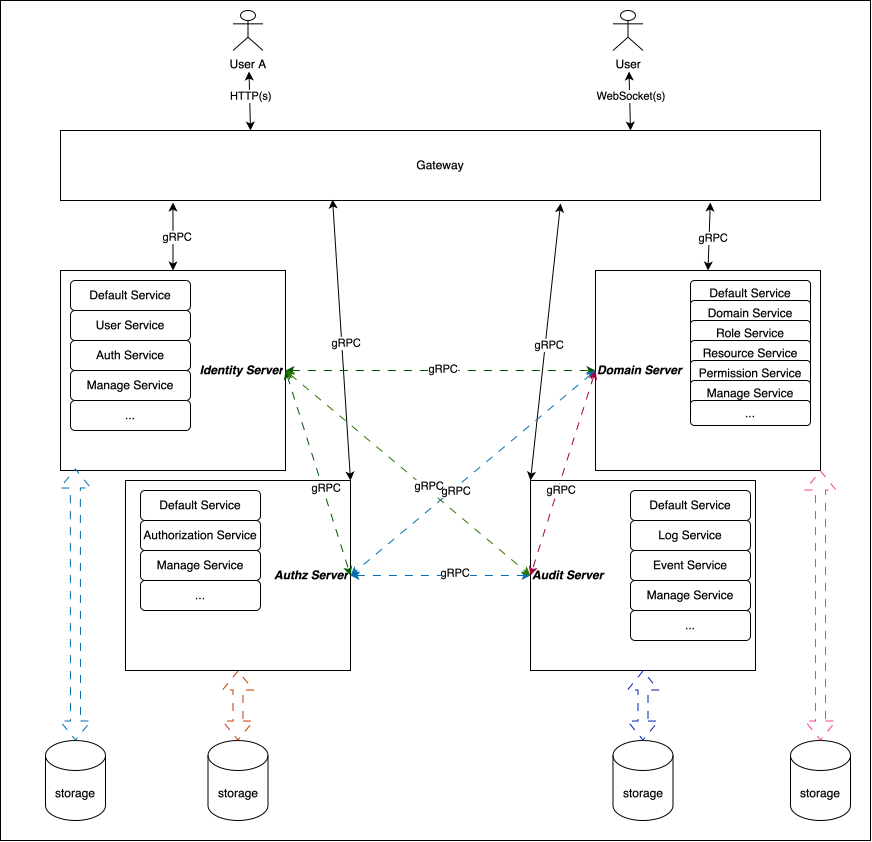

# Overview

## Gateway

A custom-built API gateway that provides the following core capabilities:

- **HTTP(S) and WebSocket(S) Proxying:** Supports proxying HTTP/HTTPS and WebSocket/WSS requests.
- **HTTP-to-gRPC Transcoding:** Supports HTTP-to-gRPC transcoding based on user-defined Protocol Buffers (.proto) service definitions.

## Micro Services

### Identity Service

Responsible for managing user identities and authentication-related operations. Its core capabilities include:

- **Identity Management:** User registration, account management, and user profile management.
- **Authentication:** User authentication, credential verification, and login management.
- **Token Management:** Issuing, validating, refreshing, and revoking access tokens.
- **Credential Management:** Password management, credential updates, and account recovery.
- **Session Management:** Managing user sessions and authentication states.

### Domain Service

Responsible for managing core business domains and implementing business-specific logic. Its core capabilities include:

- **Domain Model Management:** Managing core business entities and their relationships.
- **Business Logic:** Encapsulating and executing domain-specific business rules.
- **Data Management:** Providing CRUD operations and maintaining domain data consistency.
- **Business Workflow Management:** Handling business processes and state transitions.
- **Domain Events:** Publishing domain events to facilitate communication and integration with other microservices.
- **Role Management:** Creating and managing roles and their associated resources.
- **Resource Management:** Creating and managing resouces and their associated entities.

### Authorization Service

Responsible for managing access control policies and enforcing authorization decisions across the system. Its core capabilities include:

- **Permission Management:** Defining and maintaining fine-grained access permissions.
- **Access Control:** Evaluating access requests and determining whether operations are authorized.
- **Policy Management:** Defining and managing authorization policies based on roles, resources, and contextual attributes.
- **Authorization Evaluation:** Providing centralized authorization services through APIs.

### Audit Service

Responsible for recording, managing, and auditing security-related events and business operations across the system. Its core capabilities include:

- **Audit Logging:** Recording user activities, system events, and critical business operations.
- **Operation Tracking:** Tracking who performed an operation, when it occurred, and what changes were made.
- **Security Auditing:** Monitoring authentication, authorization, and other security-related events.
- **Audit Log Management:** Storing, querying, filtering, and retrieving audit records.
- **Audit Traceability:** Providing historical records and traceability for security investigations and compliance requirements.

---

← <a href="index.md">Index</a> &nbsp; | &nbsp; <a href="gateway.md">Gateway</a> →

