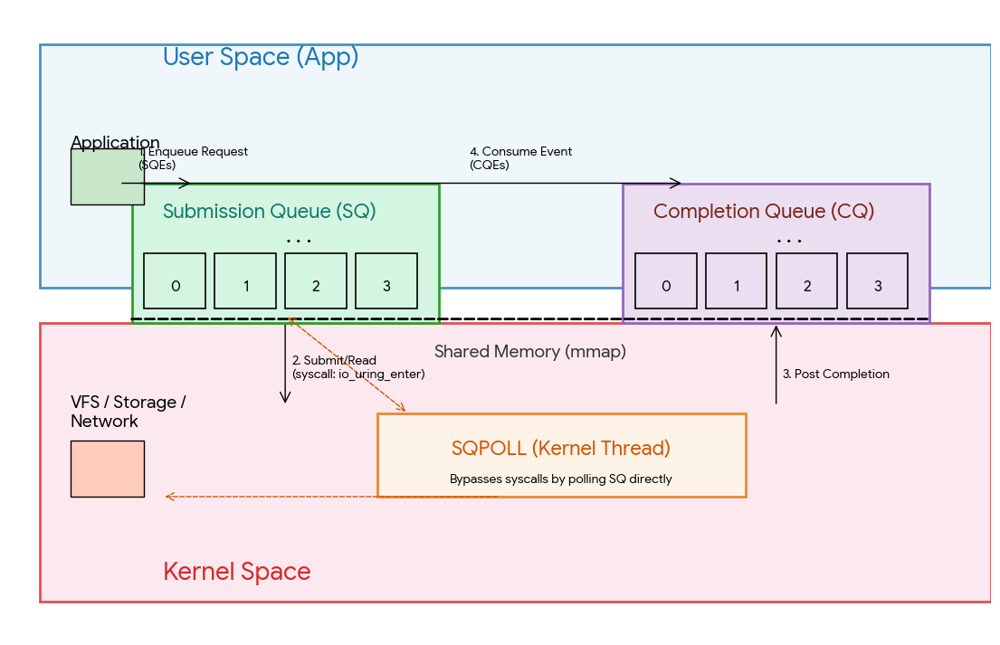

# IO

## linux的io_uring是什么新技术，解决或优化了什么？

`io_uring` 是 Linux 内核在 **5.1** 版本（2019 年）引入的一项革命性**高性能异步 I/O 框架 [1, 2]**。虽然它已经发展了几年，但由于其极其恐怖的性能表现，它至今依然是系统级编程、高性能网络和数据库（如 Rust 的 Tokio 运行时、Apache Iggy、ScyllaDB 等）中最火热的核心技术。

简单来说，`io_uring` 彻底颠覆了 Linux 传统的 I/O 模型，解决了过去几十年里**系统调用开销大、非阻塞网络与文件 I/O 无法统一**的行业痛点。

### 1. 它解决了什么痛点？（旧技术的局限）

在 `io_uring` 出现之前，Linux 主要依赖两种 I/O 方式，但它们都存在严重的致命缺陷：

- **痛点一：系统调用（Syscall）开销巨大。**

  传统的 `read/write` 或 `epoll`，每次操作都需要进行**用户态与内核态的切换（Context Switch） [2]**。随着现代 NVMe 固态硬盘（每秒百万级 IOPS）和百G网卡的普及，硬件速度已经快到把 CPU 榨干，而 CPU 的大量时间都浪费在了这种“状态切换”和内存拷贝上。

- **痛点二：非阻塞 I/O 无法统一。**

  网络 I/O 可以使用 `epoll` 实现高效的非阻塞异步响应，但 **Linux 的文件 I/O（磁盘读写）天然不支持 epoll [1, 2]**。虽然有一个名为 AIO 的传统内核异步接口，但它限制极多（必须开启 O_DIRECT、不能用缓冲、随时可能退化为阻塞），导致开发者不得不自己维护一个线程池来假装“异步”读写文件，极度消耗资源。

### 2. io_uring 是如何优化的？（核心工作原理）

`io_uring` 的核心设计思想是：**通过无锁共享内存，把“系统调用”变成“异步队列操作”**。

它在用户态和内核态之间，直接开辟了两个基于环形缓冲区（Ring Buffer）的**共享内存区域：**

1. **SQ (Submission Queue - 提交队列)：** 用户态程序（如你的应用）把要做的 I/O 任务（比如“读这个文件”或“发送这个 UDP 包”）丢进这个队列。

2. **CQ (Completion Queue - 完成队列)：** 内核处理完 I/O 任务后，把结果（比如“成功读了 100 字节”或“报错码”）丢进这个队列，供应用读取。

**🌟 带来的破坏性优化：**

- **真正的万物皆可异步：** 它不仅完美支持网络 Socket（TCP、UDP、QUIC），还**原生支持普通文件 I/O**。你终于可以用同一套代码，以纯异步、非阻塞的方式同时处理网络流量和磁盘读写了。
- **零系统调用（SQPOLL 模式）：** 这是最恐怖的优化。当开启 `IORING_SETUP_SQPOLL` 特性时，内核会启动一个内核线程专门去轮询 SQ 队列。这意味着：你的应用只需要往内存里无脑塞任务、从内存里拿结果，**整个 I/O 过程中不需要发生任何一次系统调用（Syscall 计数为 0）**。这彻底解放了内核切换带来的延迟。
- **批量提交与减少拷贝：** 你可以一次性在 SQ 中塞入几十个读写任务，然后通过一次系统调用告诉内核去处理（甚至不用系统调用），极大地提高了批量吞吐量。

### 3. 性能提升有多大？

- 根据 Linux 内核官方以及各类大厂的基准测试：在纯磁盘 IOPS 测试中，`io_uring` 的性能通常能达到传统 `AIO` 的 **2 倍以上**，更是远超多线程阻塞读写。
- 在高性能网络服务中，相比于传统的 `epoll` 架构，`io_uring` 能降低 **10%~30%** 的延迟，并大幅**降低 CPU 的使用率**。

[Apache Iggy](https://github.com/apache/iggy)之所以敢自称“超流线型、性能恐怖”，就是因为它的底层存储和网络引擎重度依赖了 Rust 的 io-uring 绑定。

如果计划用Rust编写网络应用，可以通过 Rust 的异步运行时 **Tokio**（已内置 `io_uring` 支持，或通过 `tokio-uring` 库）来白嫖这项新技术带来的红利。

## 网络 IO 模型

- 同步阻塞 IO
- 同步非阻塞 IO
- 多路复用 IO
- 异步 IO
- Reactor 网络模型
