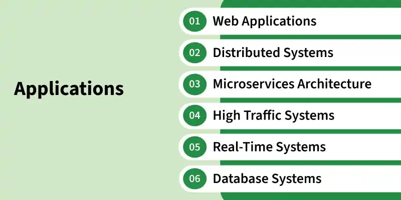
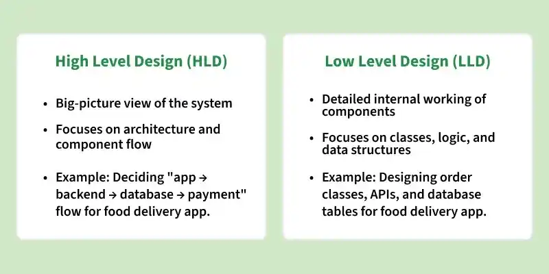
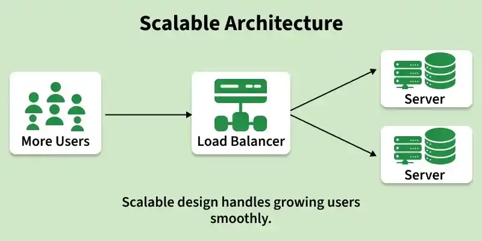
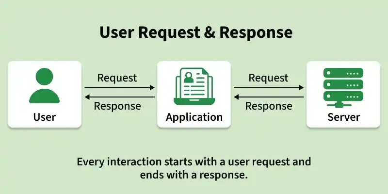
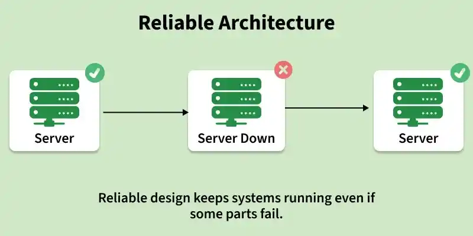
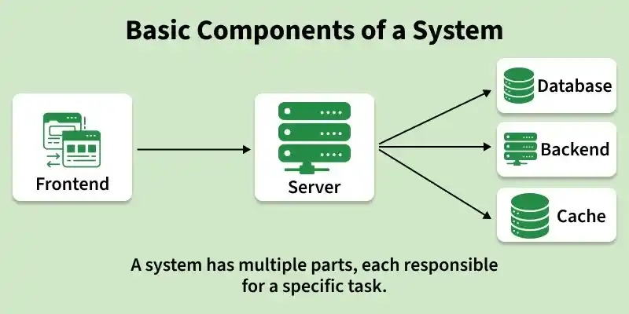
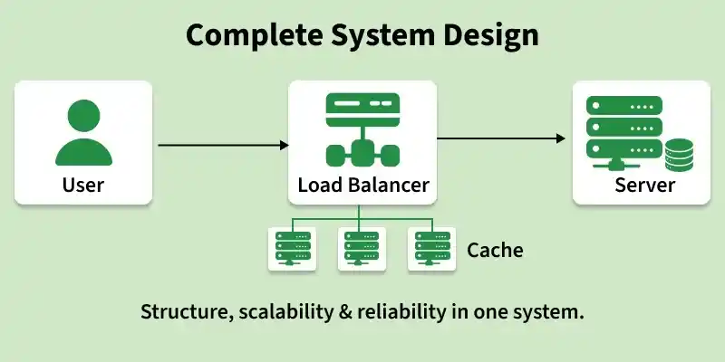

# [System Design Tutorial](https://www.geeksforgeeks.org/system-design/system-design-tutorial/)

系统设计是指设计系统的架构、组件和接口，使其满足最终用户需求的过程。本系统设计教程将帮助您以最高效的方式学习和掌握系统设计概念，从基础到高级。

## 为什么要学习系统设计？

对于任何想要构建健壮、可扩展且高效的软件应用程序的人来说，系统设计都至关重要。无论您构建的是小型应用程序还是大型应用程序，理解系统设计都能帮助您构建能够应对现实世界复杂性的解决方案。

- **_可扩展性和可靠性_**：系统设计确保系统能够扩展并应对不断增长的需求而不会发生故障。
- **_高效的资源管理_**：它有助于优化资源分配，确保应用程序快速响应。
- **_适应性_**：系统设计能够创建可随不断变化的业务需求而演进的系统，从而降低长期成本。
- **_架构理解_**：学习不同的系统架构（例如，微服务架构、单体架构）有助于构建适合各种需求的应用程序。
- **_面试准备_**：掌握系统设计是成功通过系统设计面试的关键，而系统设计面试是科技公司招聘过程中经常会问到的问题。
