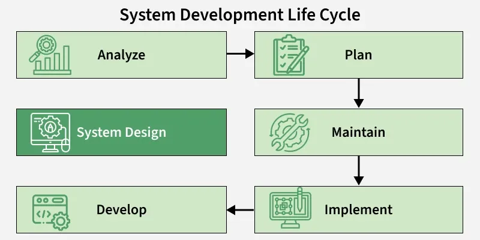
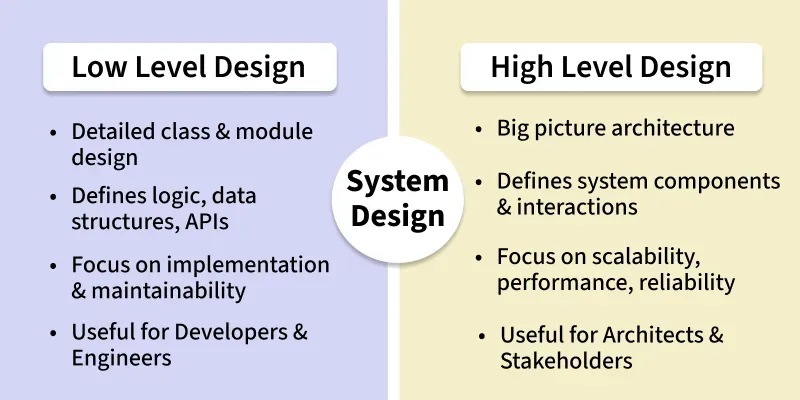
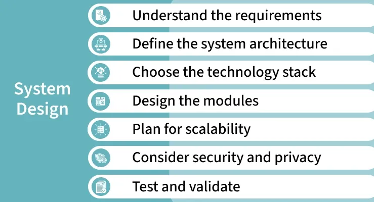
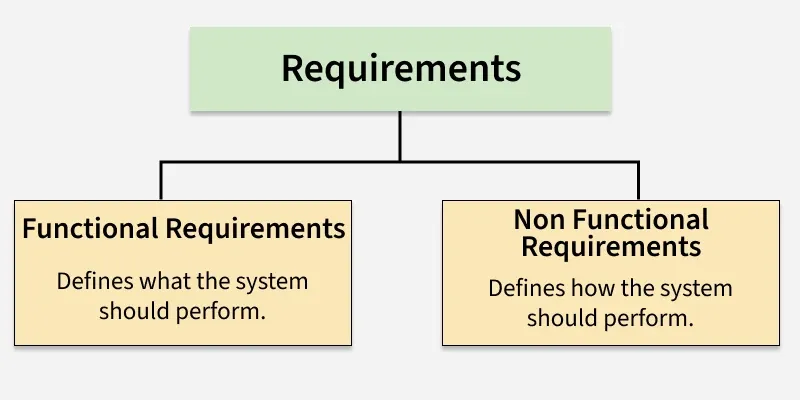

## [系统设计简介 - 低级设计 (LLD) 和高级设计 (HLD)](https://www.geeksforgeeks.org/system-design/getting-started-with-system-design/)

系统设计是规划、构建和定义软件系统架构的过程。

- 它涉及将用户需求转化为详细的蓝图，以指导后续的实现阶段。
- 其目标是创建一个组织良好、高效的结构，在满足预期用途的同时，兼顾可扩展性、可维护性和性能等因素。

### 系统设计在软件开发生命周期 (SDLC) 中的作用

- 在系统设计生命周期中，如果没有设计阶段，就无法直接进入实现或测试阶段。
- 系统设计是至关重要的一步，它为处理特殊情况提供了基础，因为它代表了软件的业务逻辑。



**系统设计可以分为两个互补的部分。**



### 高层设计 (HLD)

它概述了系统的整体架构——主要组件如何交互、将存在哪些服务或模块，以及数据如何在它们之间流动。

- 它提供了全局概览：系统如何组合在一起、其核心结构以及主要决策。
- 由架构师、利益相关者和管理人员完成。

#### HLD 的必备技术知识

- 基本编码技能（数据结构和算法）
- 与低层设计相比，高层设计通常由具有软件项目实践经验的资深人员完成。
- 了解数据库（SQL 和 NoSQL）、缓存（Redis、Memcached、CDN）和 API 等组件的作用。
- 底层设计（面向对象编程和设计模式）
- 深入理解功能需求（系统必须做什么，例如用户注册、流式传输）和非功能需求（系统应该如何运行——可扩展性、延迟、可用性、安全性等）。
- 网络和安全基础知识，例如 DNS、协议（TCP/UDP、HTTP、WebSocket）、OAuth、JWT、TLS/SSL、速率限制、API 安全和基本 DDoS 防护。
- 消息队列和流式传输工具，例如 Kafka 或 RabbitMQ。
- 了解微服务与单体架构（何时拆分服务以及如何管理依赖关系）、容错、回退策略、冗余、负载均衡器类型和算法。
- 可观测性工具，例如 Prometheus、Grafana、ELK Stack（Elasticsearch、Logstash、Kibana）和告警系统（例如 PagerDuty）。

#### HLD 涵盖的主题：

- 系统架构概述：定义主要组件、模块及其交互方式（例如服务、队列、数据库）。
- 数据流和组件交互：阐述数据如何在模块之间流动，以及关键的集成和接口。
- 技术栈和基础设施：关于框架、平台、硬件、数据库和托管设置的高级决策。
- 模块职责：描述每个模块的功能以及它们之间的关系。
- 性能与权衡：包括设计权衡、性能考量、可扩展性、安全性、成本和其他非功能性因素。
- 工件：通常包括架构图、组件图和部署图、数据流图，以及可能的实体关系图/数据库示意图。

#### 高级设计决策的真实案例

- Netflix 将其整个后端从单体架构迁移到微服务架构（从编码和 UI 服务开始），并在 2011 年完成迁移，以便在节假日等高负载时期快速扩展。
- Uber 采用事件驱动架构，乘车请求、位置更新和车费变更都会触发事件，从而触发司机匹配、计费和动态定价等实时系统。
- Twitter 部署了负载均衡架构，并缓存热门话题和推文，以便快速服务数百万用户并高效处理实时数据流。

### 低级设计 (LLD)

- 它涵盖了每个部分的工作方式和内部实现方式。
- 它为开发人员提供了一个清晰、可操作的蓝图来构建每个组件。
- 一旦利益相关者构建了高级设计，高级开发人员和设计师就需要创建低级设计。

#### 先决条件/您应该首先了解的内容：

- 基础编程技能（数据结构和算法）
- 扎实的面向对象编程概念基础（封装、继承、多态和抽象）

#### 涵盖主题：

- **_组件/模块分解_**：每个模块的详细内部逻辑——包括类的职责、方法、属性和交互
- **_数据库模式和结构_**：设计表、键、索引和关系，并进行 SQL/NoSQL 优化
- **_API 和接口定义_**：精确的请求/响应格式、错误代码、方法、端点和内部接口
- **_错误处理和验证逻辑_**：定义每个模块如何处理无效输入、故障、边界情况和日志记录
- **_设计模式和 SOLID 原则_**：实现设计模式和 SOLID 原则，以确保代码简洁、可扩展和易于维护
- **_UML 和伪代码_**：类图、序列图、伪代码或流程图，以清晰地展示逻辑路径和方法调用

### 系统设计入门步骤

以下是系统设计入门的一些步骤：



- **理解需求**

  通过咨询利益相关者、用户和查阅文档，收集并分析业务需求。

- **定义架构**

  识别关键系统组件及其交互方式（例如，服务、API、数据库）。

- **选择技术栈**

  根据需求选择合适的语言、数据库、框架和工具。

- **设计模块**

  将系统拆分为模块，并定义其职责和数据流。

- **规划可扩展性**

  设计时要考虑增长——预测负载、优化瓶颈并采用可扩展模式。

- **确保安全与隐私**

  识别风险并实施身份验证、加密和数据保护等措施。

- **测试与验证**

  编写测试用例并模拟实际使用情况，以确保系统满足需求。

总而言之，系统设计是一个复杂的过程，需要周密的计划和对细节的关注。遵循以下步骤，您可以创建一个满足用户和业务需求的系统设计。

#### 解决系统设计问题的技巧和窍门

- 遇到系统设计问题时，应该有条不紊地进行解决。
- 一开始，问题可能看起来很复杂，很容易让人不知从何下手。
- 而且，系统设计并没有固定的解决方案。
- 解决问题的方法不止一种。

那么，让我们来探讨一下，面试中遇到系统设计问题时，应该如何着手解决。

### 如何解决设计问题

#### 1. 分解问题

当你遇到一个设计问题时，首先要将其分解成若干个小组件。这些组件可以是需要在系统中实现的各项服务或功能。

- 最初，一个需要设计的系统可能包含大量功能，面试时你无需设计所有功能。
- 询问面试官你计划在系统中添加哪些功能。是否还有其他需要添加的功能？例如，任何服务？……尽管问！

#### 2. 清晰地表达你的想法

与面试官有效沟通：

- 在系统设计过程中，要让面试官随时了解你的进展。
- 大声地讨论你的设计过程。
- 尝试在白板上用流程图和图表清晰地展示你的设计。
- 向面试官描述你的想法，例如你计划如何解决可扩展性问题，如何设计数据库等等。

#### 3. 合理的假设

在系统设计过程中，做出一些合理的假设。

```text
假设您需要假设系统每天处理的请求数、每月数据库调用次数或缓存系统的效率。这些都是您在设计时需要假设的数值。尽量使这些数值合理。用可靠的事实和数据来支撑您的假设。
```

### 设计软件系统时需要考虑的重要因素：

1. **_可扩展性_**：系统应设计为能够处理不断增长的负载，并可根据需要进行横向或纵向扩展。
2. **_性能_**：系统应设计为高效运行，并尽可能减少延迟和响应时间。
3. **_可靠性_**：系统应可靠且可用，尽可能减少停机时间和系统故障。
4. **_安全性_**：系统设计应充分考虑安全性，包括防止未经授权访问和保护敏感数据的措施。
5. **_可维护性_**：系统应设计为易于维护和更新，并具备清晰的文档和结构良好的代码。
6. **_互操作性_**：系统应设计为能够与其他系统和组件无缝协作，并具有清晰明确的接口。
7. **_易用性_**：系统设计应简洁易用、直观明了，用户界面清晰一致。
8. **_成本效益_**：系统设计应注重成本效益，在满足所有需求的前提下，尽可能降低开发和运营成本。

## [功能性需求和非功能性需求](https://www.geeksforgeeks.org/software-engineering/functional-vs-non-functional-requirements/)

需求分析是软件开发中必不可少的过程。它有助于确定系统或项目是否能够实现目标并取得成功。
为了使分析有效，需求通常分为两类：



### 什么是功能需求？

功能需求定义了系统为满足业务和用户需求必须执行的具体特性和操作。它们描述了系统应该做什么，以及如何与用户或其他系统交互。

- 侧重于系统行为和功能。
- 代表最终产品中可以直接观察和测试的特性。
- 常见示例包括用户身份验证、数据处理、搜索、支付处理和报表生成。

#### 示例问题

- 系统应该包含哪些特性？
- 设计中必须考虑哪些边界情况？

### 什么是非功能性需求？

非功能性需求 (NFR) 定义了**系统的运行方式**，侧重于性能、可靠性和用户体验，而非具体功能。它们确保系统**高效**、**安全**且**易于维护**。

- **_性能_** – 速度和响应能力
- **_安全性_** – 防止未经授权的访问
- **_易用性_** – 操作便捷
- **_可靠性_** – 系统稳定性和可用性
- **_可扩展性_** – 应对增长的能力
- **_可维护性_** – 更新和修复的便捷性
- **_可移植性_** – 在不同环境下运行的能力

示例问题

- 系统对用户操作的响应速度应该有多快？
- 系统对未经授权的访问的安全性应该如何？
- 系统的可用性和可靠性应该如何？
- 扩展需求。

### 功能性需求和非功能性需求示例

让我们通过以下两个示例来说明这两种需求：

#### 1. 在线银行系统

##### 功能性需求：

- 用户应能够使用用户名和密码登录。
- 用户应能够查看账户余额。
- 用户在完成交易后应收到通知。

##### 非功能性需求：

- 系统应在 2 秒内响应用户操作。
- 所有交易必须加密并符合行业安全标准。
- 系统应能够处理 1 亿用户，并将停机时间降至最低。

#### 2. 外卖应用

##### 功能性需求：

- 用户可以浏览菜单并下单。
- 用户可以支付订单并实时追踪订单状态。

##### 非功能性需求：

- 应用应在 1 秒内加载餐厅菜单。
- 系统应支持高峰时段最多 5 万个并发订单。
- 应用应易于使用，界面直观，方便新用户上手。

#### 功能需求与非功能需求的区别：

##### 定义

- 功能需求定义系统应该做什么，即具体的功能、任务或操作。
- 非功能需求定义系统应该如何运行，即速度、安全性或易用性等质量或属性。

##### 目的

- 功能需求侧重于系统的行为和功能。
- 非功能需求侧重于系统的性能、易用性和整体质量。

##### 范围

- 功能需求定义系统必须支持的操作。
- 非功能需求定义这些操作发生的约束或条件。

##### 衡量

- 功能需求可以通过验证输出或结果轻松衡量。
- 非功能需求更难衡量，通常需要根据基准、指标或服务级别协议 (SLA) 进行验证。

##### 对开发的影响

- 功能需求驱动系统的核心设计和功能。
- 非功能需求影响系统架构和性能优化。

##### 用户视角

- 功能需求对用户直接可见，并与业务需求紧密相关。
- 非功能性需求通过确保效率、可靠性和流畅运行来塑造用户体验。

##### 文档

- 功能性需求以用例、用户故事或功能规格说明书的形式记录。
- 非功能性需求以性能标准、技术规格或设计约束的形式记录。

##### 评估

- 功能性需求通过功能测试（单元测试、集成测试或验收测试）进行验证。
- 非功能性需求通过性能测试、安全性测试和可用性测试进行验证。

##### 依赖关系

- 功能性需求定义了为满足用户需求必须构建的内容。
- 非功能性需求定义了系统构建完成后必须如何运行。

##### 示例

- 功能性需求：登录认证、数据输入/输出、事务处理。
- 非功能性需求：系统可扩展性、安全性、响应时间、可靠性、可维护性。

#### 平衡功能性需求和非功能性需求的重要性

平衡功能性需求和非功能性需求可确保系统既实用又可靠。主要优势包括：

- **_提升用户体验_**：功能性功能本身可能有效，但使用起来可能缓慢或困难。性能、易用性和可用性等非功能性因素会影响用户与系统的交互方式。
- **_增强系统性能_**：可扩展性、可靠性和安全性确保系统在实际应用环境中高效运行。
- **_预防瓶颈和故障_**：充分关注非功能性需求可减少系统故障、安全漏洞和停机时间。
- **_降低长期成本_**：及早解决非功能性需求可避免日后进行昂贵的重新设计、返工或性能优化。
- **_支持系统演进_**：可维护性和可扩展性使系统能够随着业务和用户需求的增长而平滑扩展和调整。

#### 定义这些需求时常见的挑战

定义功能性和非功能性需求可能很复杂，原因有以下几点：

- **_需求模糊不清_**：模糊或不完整的需求难以定义系统必须做什么（功能性需求）以及它应该如何运行（非功能性需求）。
- **_需求变化_**：不断变化的业务目标、市场趋势或用户期望都可能导致需求变化，从而难以维护稳定的设计。
- **_优先级排序困难_**：功能性需求通常优先考虑，而安全性或可扩展性等关键的非功能性方面则可能被忽视。
- **_衡量非功能性需求_**：功能性需求更容易测试；而可用性、可扩展性或可靠性等非功能性属性则难以量化和验证。
- **_需求重叠或冲突_**：某些需求可能相互冲突，例如，更强的安全性可能会影响系统性能，因此需要仔细权衡。

#### 如何收集功能性和非功能性需求

收集需求涉及多种方法，需要开发团队、利益相关者和最终用户之间的协作：

##### 1. 功能性需求：

- **_访谈_**：与利益相关者或用户交谈，了解他们的需求。
- **_调查_**：分发问卷，收集更多用户的反馈。
- **_研讨会_**：举办研讨会，集思广益，讨论功能并收集反馈。

##### 2. 非功能性需求：

- **_性能基准_**：与 IT 团队协商，设定性能和负载预期。
- **_安全标准_**：与安全专家协商，确定数据保护的最佳实践。
- **_可用性测试_**：测试系统，找出用户可能遇到的问题，并改进界面。
