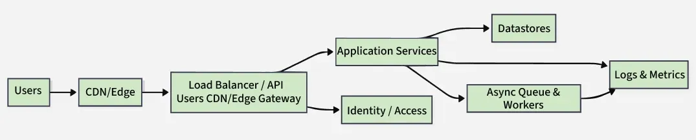
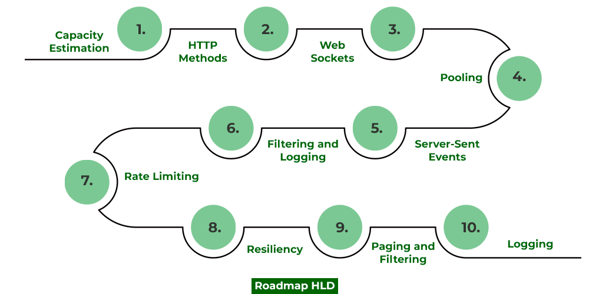
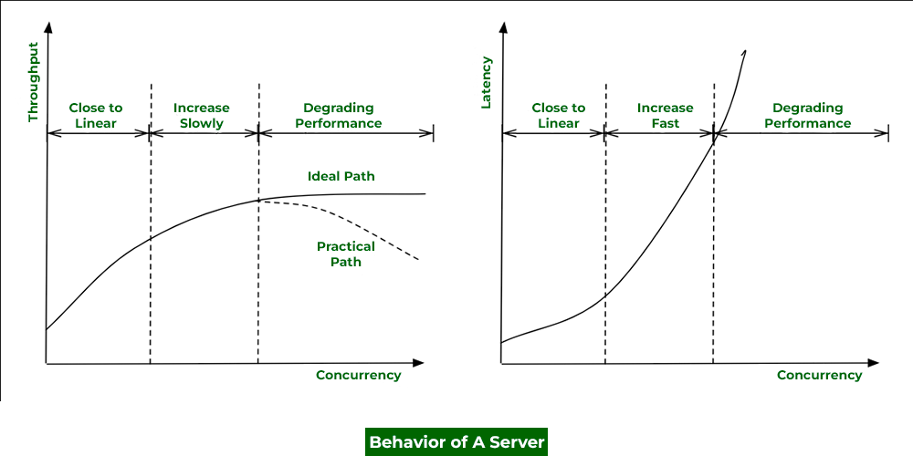
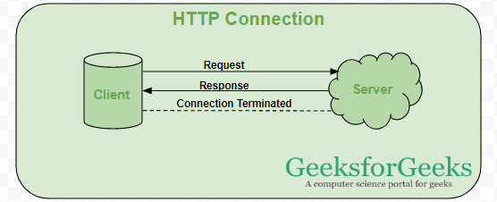
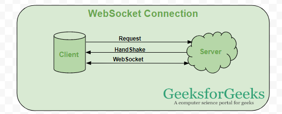
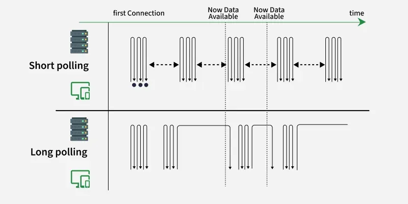
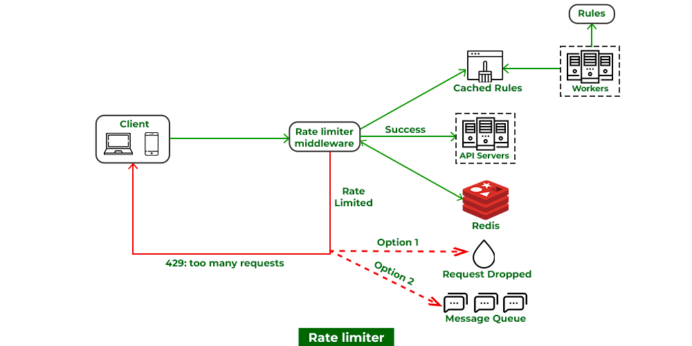
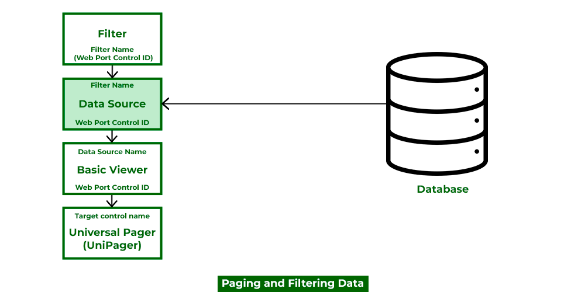
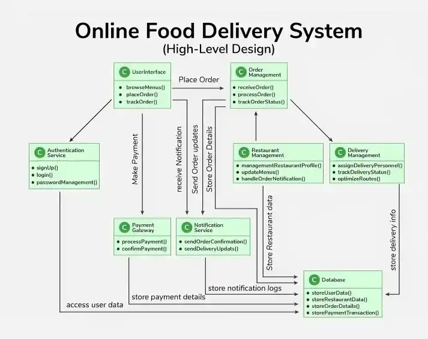

# 高层设计

## [什么是高层设计？ - 学习系统设计](https://www.geeksforgeeks.org/system-design/what-is-high-level-design-learn-system-design/)

高层设计（HLD）是应用程序开发的初始步骤，用于规划系统的整体结构。

- 它主要关注系统各个组件如何协同工作，而无需了解内部编码和实现细节。
- 它有助于项目中的所有参与者理解目标，并确保开发过程中的良好沟通。
- 对于开发人员、架构师和产品经理来说至关重要，因为它能确保所有利益相关者与项目目标保持一致。因此，它也被称为宏观设计。

大多数应用程序都遵循从用户到数据再返回的常见请求流程。

- **用户 → 边缘/网关**：CDN/边缘处理缓存、TLS 和基本 DDoS 防护；负载均衡/API 网关路由。
- **网关 → 服务**：应用层运行身份验证/逻辑，并分发到各个依赖项。
- **服务 → 数据**：读写 SQL/NoSQL/对象/存储/搜索；缓存热点读取；持久化写入。
- **服务 → 异步**：将电子邮件/Webhook/重新索引/繁重任务卸载到队列；工作进程稍后更新。
- **身份验证与可观测性**：在网关/服务端进行身份验证；发出日志、指标和跟踪信息以进行监控/告警。
- **响应 → 用户**：回复通过网关/边缘返回；更新缓存以加快下次访问速度。

### 高级设计组成部分

理解高级设计的组成部分对于创建满足用户需求和技术要求的有效系统至关重要。以下是高级设计的主要组成部分：

1. **系统架构**：系统架构是对整个系统的概览，它展现了系统的结构以及各个组件之间的关系。它有助于以可视化的方式呈现不同部分如何交互和运作。
2. **模块和组件**：高级设计将系统分解为模块或组件，每个模块或组件都具有特定的角色和职责，并拥有独特的功能，共同构成整个系统，从而有助于开发高效的系统。
3. **数据流图 (DFD)**：数据流图展示了系统内部的数据流动。它们有助于理解信息是如何被处理以及如何从一端传递到另一端的。
4. **接口设计**：接口设计包括用于系统集成的应用程序编程接口 (API) 和用于用户交互的用户界面 (UI) 的设计，以确保组件之间无缝衔接的功能和通信。
5. **技术栈**：技术栈是指系统开发过程中将使用的各种技术和工具。这包括编程语言、框架和数据库。
6. **部署架构**：它包括系统的托管和访问方式，涵盖服务器配置、云基础设施和网络方面的考虑因素。

### 什么是高级设计文档？

高级设计文档 (HLD) 由数据流、流程图和数据结构组成，旨在帮助开发人员理解和实现当前系统的设计目标。该文档负责解释系统组件和操作之间的联系，从而展现系统逻辑。它根据功能需求，为系统的每个模块设计所需的架构（以实现系统功能和流程）。

### 高级设计的目的和特点

高级设计 (HLD) 的目的是添加必要的详细描述，以构建合适的模型。它旨在帮助理解操作需求，并有助于理解模块之间的交互方式。简而言之，HLD 是对功能需求和组件间信息流的技术性描述。高级设计的特点包括：

- HLD 中包含表示每个设计方面的图表（基于业务需求和预期结果）。
- 硬件、软件接口以及用户界面的描述。
- 详细描述用户典型流程的工作流程以及性能规范。

### HLD 与 LLD 的区别

高层设计 (HLD) 是一种通用系统设计，它需要在不同的框架、组件和数据库之间进行权衡，并根据业务需求和系统功能及非功能方面的实际情况选择最佳方案。

而 LLD（低层设计）则将 HLD 细化为更小、更具体的部分，包括类图、方法、数据结构和算法，重点关注每个部分的实现方式。

延伸阅读：[高层设计 (HLD) 和低层设计 (LLD) 的区别](https://www.geeksforgeeks.org/system-design/difference-between-high-level-design-and-low-level-design/)

在充分理解 HLD 及其与 LLD 的区别之后，现在让我们来讨论一下 HLD 路线图，如下图所示：

### 如何设计可扩展的高级设计 (HLD) 系统

为了设计任何高级系统，我们需要按顺序了解一些术语，以便将各个知识点串联起来，便于理解。路线图对于从业人员来说非常重要，因为它们可以帮助我们全面、深入地理解实时服务如何在高级层面上进行扩展。

#### 1. 容量估算

系统设计中的容量估算是指预测满足预期工作负载所需的资源（例如处理能力、内存和带宽）。它确保系统能够高效地处理当前和未来的需求，有助于合理分配资源并防止性能瓶颈。

**例如：**

Twitter 近来频频出现在新闻推送中。在高层设计阶段，我们需要确保热门博主的推文能够触达数百万用户，那么我们应该如何扩展系统才能保证服务不受影响呢？

我们还在下方展示了服务器的典型行为，该行为是通过系统吞吐量和延迟来衡量的。

#### 2. HTTP 和 HTTPS 及其方法

HTTP（超文本传输 ​​ 协议）用于在网络上传输数据，它实现了客户端和服务器之间的通信，使用户能够请求 HTML 页面、消息、视频或图像等资源。HTTPS（安全超文本传输 ​​ 协议）是 HTTP 的扩展，它通过 SSL/TLS 加密增加了一层额外的安全保障。HTTP 的方法包括 GET、PUT 和 POST。

**提示：** 从面试的角度来看，这些也很重要，因为在 API 面试中，何时使用哪种方法至关重要。

**提示：** 服务器向客户端发送数据有两种方式：

- 使用 WebSocket
- 使用轮询

#### 3. WebSocket

服务器向客户端发送数据有两种方式：WebSocket 和轮询。在[客户端-服务器架构](https://www.geeksforgeeks.org/system-design/client-server-architecture-system-design/)中，我们向服务器发送请求，服务器将请求返回，从而实现通信。但在系统设计中，我们面临的最大问题是：究竟应该采用客户端-服务器模型还是[点对点模型](https://www.geeksforgeeks.org/system-design/peer-to-peer-p2p-architecture/)？

- WebSocket 在此发挥着至关重要的作用，帮助我们解决这些问题，并实现实时通信。
- WebSocket 是一种全双工协议，允许应用程序同时发送和接收数据。
- 几乎所有系统设计都会用到 WebSocket，因为我们不能让系统等待响应。
- WebSocket 在实时 Web 应用、游戏应用和聊天应用中非常有用。

#### 4. 轮询

轮询是另一种与服务器收发数据的方式，就像我们之前提到的 WebSocket 一样。轮询主要分为两种类型：

- 短轮询：客户端向服务器发送请求后，服务器会立即按固定的时间间隔发送数据，无论数据是否更新。
- 长轮询：服务器会等待客户端的请求响应，并且只有在有新数据可用或数据正在更新时才会响应。

**_提示_**：长轮询优于短轮询，因为长轮询在系统中发送的请求数量更少。

#### 5. 服务器发送事件 (SSE)

SSE 专为特定设计系统中的服务器到客户端的单向通信而设计。它是一种通过 HTTP 连接将实时更新从服务器推送至客户端的技术。SSE 使服务器能够在数据可用时自动发送数据。实时流传输就是 SSE 的应用示例。

.png>)

#### 6. 速率限制

速率限制器通过限制发送方在给定时间段内可以发送的请求数量，来限制在特定时间段内可以执行的事件数量。一旦达到阈值限制，速率限制器就会进一步阻止传入的请求，如下方媒体所示：

#### 7. 弹性

无论我们设计的系统多么出色，总存在出现故障和失效的可能性，这可能是由于硬件问题或软件问题（例如内存不足）造成的，也可能是人为错误。在这种情况下，我们需要通过复制、冗余和可用性来提供弹性。

注意：系统设计面试通常从对特定系统的开放式设计开始，随后会受到多层次的约束。为了清晰地处理这些约束，通俗地说，这被称为通过在系统中实现常见的权衡来实现弹性。因此，提供弹性对于设计复杂的系统以及通过面试都至关重要。

#### 8. 分页

在高层设计 (HLD) 中，分页是指将大型数据集或内容分割成更小、更易于管理的页面。这种方法允许用户增量加载数据，从而减少初始加载时间并提高性能，进而改善用户体验。

#### 9. 日志记录

日志文件记录软件应用程序中发生的事件的详细信息。这些信息可能包括微服务、事务、服务操作，或任何有助于调试系统中事件流程的内容。日志记录对于监控应用程序的运行流程至关重要。它还有助于跟踪分布式系统的健康状况和性能，以及调试可能出现的问题。实现分布式日志记录的方法有多种，包括：

- 使用[集中式日志服务](https://www.geeksforgeeks.org/system-design/centralized-logging-systems-system-design/)
- 使用[分布式日志系统](https://www.geeksforgeeks.org/system-design/logging-in-distributed-systems/)
- 使用[基于云的日志服务](https://www.geeksforgeeks.org/cloud-computing/google-cloud-monitoring-google-cloud-logging/)

### 学习高级设计 (HLD) 的路线图

#### 1. HLD 基础

- [HLD 与 LLD 的区别](https://www.geeksforgeeks.org/system-design/difference-between-high-level-design-and-low-level-design/)
- [高级设计 (HLD) 的目标是什么？](https://www.geeksforgeeks.org/system-design/what-is-the-goal-of-high-level-designhld/)

#### 2. 高层设计 (HLD) 的核心组件

- [负载均衡器](https://www.geeksforgeeks.org/system-design/what-is-load-balancer-system-design/)
- [内容分发网络 (CDN)](https://www.geeksforgeeks.org/websites-apps/what-is-cdn/)
- [系统设计中的缓存](https://www.geeksforgeeks.org/system-design/caching-system-design-concept-for-beginners/)
- [什么是 API 网关](https://www.geeksforgeeks.org/system-design/what-is-api-gateway-system-design/)
- [消息队列](https://www.geeksforgeeks.org/system-design/message-queues-system-design/)
- [一致性哈希](https://www.geeksforgeeks.org/system-design/consistent-hashing/)
- [通信协议](https://www.geeksforgeeks.org/system-design/communication-protocols-in-system-design/)
- [网络协议和代理](https://www.geeksforgeeks.org/system-design/network-protocols-and-proxies-in-system-design/)

#### 3. 高层设计 (HLD) 的设计原则

- [可扩展性及其实现方式](https://www.geeksforgeeks.org/system-design/what-is-scalability/)
- [系统设计中的可用性](https://www.geeksforgeeks.org/system-design/availability-in-system-design/)
- [系统设计中的一致性](https://www.geeksforgeeks.org/system-design/consistency-in-system-design/)
- [系统设计中的可靠性](https://www.geeksforgeeks.org/system-design/reliability-in-system-design/)
- [系统设计中的容错性](https://www.geeksforgeeks.org/system-design/fault-tolerance-in-system-design/)
- [CAP 定理](https://www.geeksforgeeks.org/system-design/cap-theorem-in-system-design/)
- [系统设计中的性能优化技术](https://www.geeksforgeeks.org/system-design/optimization-techniques-for-system-design/)
- [如何绘制高层设计图？](https://www.geeksforgeeks.org/system-design/how-to-draw-high-level-design-diagram/)

#### 4. 高层设计图的类型

- [基于组件的图](https://www.geeksforgeeks.org/software-engineering/component-based-diagram/)
- [序列图](https://www.geeksforgeeks.org/system-design/unified-modeling-language-uml-sequence-diagrams/)
- [什么是数据流图 (DFD)？](https://www.geeksforgeeks.org/software-engineering/what-is-dfddata-flow-diagram/)
- [部署图](https://www.geeksforgeeks.org/system-design/deployment-diagram-unified-modeling-languageuml/)

#### 5. 架构与模式

- [单体架构](https://www.geeksforgeeks.org/system-design/monolithic-architecture-system-design/)
- [微服务架构](https://www.geeksforgeeks.org/system-design/microservices/)
- [事件驱动架构](https://www.geeksforgeeks.org/system-design/event-driven-architecture-system-design/)
- [客户端-服务器架构](https://www.geeksforgeeks.org/system-design/client-server-architecture-system-design/)
- [点对点 (P2P) 架构](https://www.geeksforgeeks.org/system-design/peer-to-peer-p2p-architecture/)
- [无服务器架构](https://www.geeksforgeeks.org/system-design/serverless-architectures/)
- [熔断器模式](https://www.geeksforgeeks.org/system-design/what-is-circuit-breaker-pattern-in-microservices/)
- [事件溯源模式](https://www.geeksforgeeks.org/system-design/event-sourcing-pattern/)
- [CQRS 设计模式](https://www.geeksforgeeks.org/system-design/cqrs-command-query-responsibility-segregation/)

#### 6. 高层设计 (HLD) 面试准备

- [如何攻克系统设计面试？](https://www.geeksforgeeks.org/interview-experiences/how-to-crack-system-design-round-in-interviews/)
- [2024 年顶级高层设计 (HLD) 面试题](https://www.geeksforgeeks.org/system-design/top-high-level-designhld-interview-questions-2024/)

高层设计 (HLD) 对于开发可扩展应用程序至关重要，它作为架构蓝图，指导系统的整体结构和组件交互。它侧重于宏观层面，确保利益相关者之间的一致性，并促进有效沟通。各种关键组件包括系统架构、模块、数据流图、接口设计、技术栈和部署架构。HLD 确保可扩展性、可维护性和性能，提供全面的视图，有助于详细的实现阶段，最终构建健壮高效的系统。

## [绘制高层设计图](https://www.geeksforgeeks.org/system-design/how-to-draw-high-level-design-diagram/)

高层设计图 (HLD) 是系统整体架构以及主要组件间数据流的可视化表示。它提供了一个宏观层面的视图，展示了不同模块、服务和系统如何交互，而无需深入到实现细节。

- 它通过突出显示主要系统组件及其交互来关注全局。
- 它展示了系统如何融入其环境并与外部系统集成。

### 高层设计图的重要性

高层设计 (HLD) 图非常重要，因为它们有助于系统的整体布局。它们通过展示各个子部分如何组合以及它们如何工作，提供了一个整体视角。其重要性体现在以下几个方面：

- **沟通：** 有助于向利益相关者、开发人员和其他团队成员展示设计。
- **规划：** 有助于项目的规划和进度安排以及资源分配。
- **理解：** 因为它可以帮助理解正在开发的系统的复杂架构。
- **文档：** 在项目的不同阶段都非常有用。
- **问题解决：** 帮助设计人员在设计阶段发现潜在问题。

### HLD 的组成部分

高层设计的主要组成部分包括：

- **模块/子系统：** 本质上，这些是拟议系统的关键方面，它们将提供系统的元素或模块。
- **接口：** 可用模块之间存在的交互。
- **数据流：** 指模型中流程执行过程中，数据产品从一个模块流向另一个模块的过程。
- **用户界面：** 从用户交互的高层视角出发，实现用户界面的最小可行功能。
- **外部系统：** 与非实现系统或第三方进行通信。

### 绘制高层设计图前的准备工作

首先，在绘制高层设计图之前，需要进行一些准备工作，以避免错误和遗漏，并生成真正有用且信息丰富的图表。

#### 1. 需求分析

为了了解项目的总体需求和范围。

- **收集需求：** 记录所有利益相关者的需求，包括业务目标、功能需求、非功能需求和限制条件。
- **分析需求：** 需要进一步分解和分类收集到的需求，以确定系统必须交付的内容以及如何交付。
- **确定需求优先级：** 确定哪些需求应该优先，哪些是强制性的，哪些不是。
- **文档需求：** 所有需求都必须系统地记录下来，不一定需要使用需求规格说明书或用户故事，但也可以参考这些资料。

#### 2. 利益相关者意见

收集所有利益相关者的信息，以确保完全满足他们的愿景和需求。

- **识别利益相关者：** 讨论所有利益相关者，包括项目发起人、用户、开发人员、测试人员以及任何其他相关方。
- **召开会议：** 与利益相关者安排会议、研讨会或访谈，以便收集他们的意见和反馈。
- **明确期望：** 确保记录其他利益相关者的期望。这意味着需要记录他们的愿景、需求以及其他事项，或者他们可能存在的任何顾虑。
- **保持沟通：** 与所有利益相关者保持密切联系，确保他们持续向项目提供反馈，以确保所有需求都得到满足。

#### 3. 系统上下文

为了确定流程参数：上下文图：绘制上下文图，突出显示系统与外部实体（例如用户、外部应用程序、第三方）之间的关系。

- **定义边界：** 明确定义系统包含哪些内容以及不包含哪些内容。这有助于定义范围，因为这样更容易避免范围过大。
- **外部交互：** 列出与至少一个外部系统发生的所有数据接口，无论是数据交换点、API 集成点还是外部用户界面点。
- **假设和依赖关系：** 记录在开发不同阶段时所做的任何假设，以及对其他系统或组件的依赖关系。

#### 4. 技术栈

确定项目的技术架构，这需要在选择可用技术时进行。

- **技术调研：** 搜索本地和在线商店中使用的各种技术，了解哪些技术足以满足项目需求。这包括使用的编程语言、框架、数据库、云服务提供商等。
- **方案评估：** 对每项技术的特性进行评估，例如通用性、性能、安全性、易用性和用户普及度。
- **技术选择：** 选择适合本项目并能实现预期目标的技术。
- **决策文档：** 建议结合调研数据，详细解释选择特定技术栈的原因。这份文档在未来以及培训新团队成员时都将非常有用。

#### 5. 标准与规范

为了完善模型并尽可能精确地完成创建阶段，必须遵循一定的符号和规范。

- **UML 标准：** 使用统一建模语言 (UML) 编写图表。UML 是一种图形化表示法，它为各种类型的图表（例如类图、序列图）定义了符号和标记。
- **命名约定：** 由于模块、组件和接口是设计的基本单元，因此需要为它们制定命名标准。
- **设计模式：** 如果需要，请采用目前已知的常用设计模式。设计模式是预先定义并经过测试的最佳实践。
- **文档标准：** 确保所有文档保持一致，以便所有团队成员都能理解每个已开发的文档。

### 创建高级设计图的工具

如果要绘制易于理解的高级设计 (HLD) 图，选择合适的工具和策略至关重要。以下是一些常用的工具和技术，以及详细的说明。

#### 1. Microsoft Visio

Microsoft Visio 是一款专业的图表绘制工具，广泛用于创建技术图和系统设计图。

- 它是一款高效的图表绘制软件，拥有丰富的模板和形状，可用于创建复杂的图表。
- 它支持 UML 图、网络图、流程图等，并且可以轻松与其他 Microsoft Office 工具（如 Excel 和 Word）集成。
- 它被认为是专业和企业级工作的理想选择，尤其适用于企业环境。

#### 2. Lucidchart

Lucidchart 是一个基于云的图表绘制平台，允许团队在线创建和协作处理图表。

- 它允许多个用户通过互联网实时编辑图表。
- 它支持 UML 图、流程图、ER 图，并可与 Google Drive、Slack 和 Confluence 等平台集成。
- 非常适合需要协作和轻松共享图表的团队。

#### 3. Draw.io (Diagrams.net)

Draw.io 是一款免费且广泛使用的在线工具，用于创建图表和系统设计可视化效果图。

- 它是一款完全免费、简单易用且高度灵活的工具。
- 提供多种形状和模板，并可与云存储服务集成。
- 对于寻求功能强大且免费的图表绘制解决方案的个人用户和小团队而言，Draw.io 是理想之选。

### 创建高级设计图的技巧

以下是一些创建高级设计图的技巧：

#### 1. 统一建模语言 (UML)

一种标准化的建模语言，用于指定、可视化和记录软件系统的模型。

- **组件：** 包括各种图表，例如类图、序列图、用例图和组件图。
- **用例图：** 对于创建软件开发社区广泛理解的全面且标准化的图表至关重要。

#### 2. 框图

使用块表示系统组件，并使用线条表示它们之间关系的图表。

- **组件：** 通常包括块（模块）和连接器（交互或数据流）。
- **用例图：** 适用于侧重于主要组件及其交互的高级表示。

#### 3. 实体关系图 (ERD)

用于说明数据库中实体之间关系的图表。

- **组件：** 包括实体（表）、属性（列）和关系（连接）。
- **用例：** 非常适合设计和可视化数据库模式及其关系。

#### 4. 流程图

使用符号表示流程或系统流动的图表。

- **组成部分：** 包括起点/终点、流程、决策以及指示流动方向的箭头。
- **用例：** 适用于可视化流程和决策路径。

#### 5. 数据流图 (DFD)

描述系统内数据流动的图表。

- **组成部分：** 包括流程、数据存储、数据流和外部实体。
- **用例：** 有助于理解和记录数据在系统中的流动方式。

### 绘制高级设计图的分步指南

以下是绘制高级设计图的分步指南：

**1. 确定主要组成部分：** 确定系统的主要模块或子系统。例如，在在线食品配送系统中，这些组件可能包括用户界面、订单管理、支付处理等。
**2. 定义关系和接口：** 确定这些组件如何交互并定义它们的接口。例如，用户界面模块与订单管理模块交互以处理订单。
**3. 创建初步布局：** 在纸上或白板上绘制组件及其交互的粗略布局，以可视化整体结构。
**4. 使用工具（例如 Lucidchart）：** 打开 Lucidchart 并使用合适的模板创建一个新图表。添加形状来表示组件。使用矩形表示模块，箭头表示交互，标签表示接口。
**5. 添加细节：** 添加更多细节，例如数据流、用户交互和外部系统。使用不同的颜色或形状来区分不同的元素。
**6. 审核和修改：** 与利益相关者和团队成员分享图表以获取反馈。进行必要的修改以确保准确性和清晰度。
**7. 完成：** 审核完成后，通过添加注释、图例和标题等收尾工作来完成图表。

### 在线外卖系统高级设计图示例

下图展示了一个在线外卖系统的高级设计图。主要组件包括：

- **用户界面（Web/移动应用）：** 前端用于浏览菜单、下单和追踪配送；与后端服务交互以处理请求。
- **身份验证服务：** 处理用户注册、登录、身份验证和授权，以确保系统访问安全。
- **餐厅管理：** 管理餐厅资料、菜单，并处理订单提醒和沟通。
- **订单管理：** 核心模块，负责处理、验证和追踪订单，并与餐厅协调。
- **配送管理：** 管理配送人员，追踪配送状态，并确保订单及时送达。
- **支付网关：** 外部服务，用于处理支付、支持多种支付方式并确认交易。
- **通知服务：** 通过推送通知、电子邮件和短信发送订单状态和配送更新。
- **数据库：** 存储用户、餐厅、订单和支付数据；支持验证和数据检索。

### 绘制高层设计图的最佳实践

以下是一些绘制高层设计图的最佳实践：

#### 1. 保持简洁

高层设计图应清晰地概述系统架构，避免不必要的复杂性。

- 重点关注主要组件及其交互，而非实现细节。
- 避免添加过多元素，以免图表难以理解。

#### 2. 使用标准符号

使用标准图表符号可确保一致性，并使图表更易于理解。

- 使用通用标准，例如 UML 符号和架构图标。
- 在整个图表中保持符号和标签的一致性。

#### 3. 迭代

随着系统设计的日益清晰，高层设计图通常会不断演进。

- 随着新需求或新见解的出现，持续审查和完善图表。
- 更新设计以更好地表示系统架构。

#### 4. 协作

高层设计图的创建应参考项目中不同利益相关者的意见。

- 与团队成员、架构师和利益相关者分享设计，以获取反馈。
- 协作有助于及早发现问题并改进整体设计。

#### 5. 文档

完善的文档能够确保设计决策和架构得到清晰记录。

- 维护文档，解释系统架构和设计选择。
- 在整个项目生命周期中保持图表更新，以便将来参考。

### 绘制高层设计图时应避免的常见错误

以下是绘制高层设计图时的一些常见错误：

#### 1. 细节过多

在高层设计图中添加过多信息会使其变得复杂且难以理解。

- 应关注主要组件及其关系，而不是实现细节。
- 保持图表简洁，并将详细逻辑留给其他设计文档。

#### 2. 忽略利益相关者

在设计阶段不让利益相关者参与会导致误解和糟糕的设计决策。

- 在审查设计时，应邀请架构师、开发人员和利益相关者参与。
- 他们的反馈有助于确保系统满足业务和技术需求。

#### 3. 缺乏一致性

使用不一致的符号或标记会使阅读图表的人感到困惑。

- 请遵循标准的图表标记，例如 UML 符号。
- 在整个图表中保持标签、形状和结构的一致性。

#### 4. 忽略更新

系统架构可能会随着项目的演进而发生变化。

- 定期更新 HLD 图，以反映最新的系统设计。
- 保持图表更新可确保团队获得准确的文档。
