# 系统架构风格

## 单体架构 - 系统设计

单体架构是一种软件设计方法，它将应用程序的所有组件组合成一个单一的、不可分割的单元。在这种架构下，用户界面、业务逻辑和数据访问层都作为一个统一的单元进行创建、部署和维护。

- 这是一种传统的[系统设计](https://www.geeksforgeeks.org/system-design/what-is-system-design-learn-system-design/)方法，它将所有应用程序组件包含在单个代码库中。
- 它因其简单性和易于初始部署而备受青睐。
- 相比之下，微服务等替代架构方法将应用程序拆分为更小的、可独立部署的服务。
- 由于其刚性，单体架构难以扩展和维护，因此难以适应不断变化的需求。

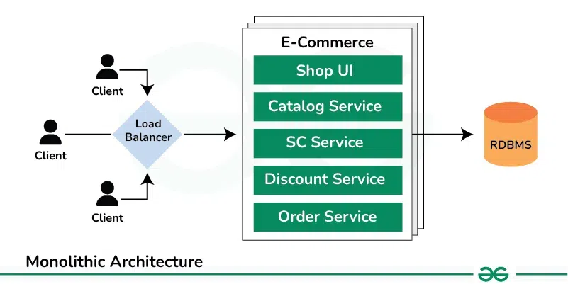

### 单体系统的重要性

尽管面临来自微服务等更现代架构风格的日益激烈的竞争，单体系统在各种场景下仍然具有重要意义：

- **简洁性：** 单体架构提供直接的开发和部署流程。当所有组件都集成在一起时，开发人员通常更容易理解整个系统并进行修改。
- **成本效益：** 单体架构对于初创公司或中小型项目来说可能更经济。与分布式系统相比，它们需要更简单的部署设置和更少的架构开销。
- **性能：** 由于所有组件都在同一个进程中运行，单体系统有时可以提供更高的性能，因为组件之间的通信开销更少。
- **安全性：** 由于服务间通信点较少，单体系统的攻击面可能更小，因此它们可能更安全，尤其是在实施适当的安全措施的情况下。
- **遗留系统支持：** 许多现有系统仍然依赖于单体架构。维护和演进这些系统需要专业知识，而理解单体架构对于它们的持续运行至关重要。

### 单体架构的特点

单体架构具有以下几个显著特点：

- **单一代码库：** 由于所有组件都在单个代码库中创建和维护，因此程序更易于管理和实现。
- **紧耦合：** 架构中的组件紧密链接、相互依赖，并经常直接交换资源和数据。
- **共享内存：** 单体应用程序通常共享同一内存空间，使组件能够高效通信，而无需网络开销。
- **集中式数据库：** 数据存储在应用程序内部集中化，通常使用单个数据库实例来满足所有数据存储需求。
- **分层结构：** 单体系统的结构通常采用分层设计，数据访问层、业务逻辑层和表示层分别用于不同的功能。虽然这种分层结构能够隔离问题，但也可能导致跨层依赖。
- **[可扩展性](https://www.geeksforgeeks.org/system-design/what-is-scalability/)有限：** 由于必须一次性扩展整个应用程序，因此扩展单体应用程序可能很困难，并且经常导致效率低下和资源消耗过高。

### 单体架构的关键组件

单体架构的关键组件包括：

- **用户界面 (UI)：** 该组件负责通过按钮、表单和其他交互元素向用户提供信息并收集反馈。
- **应用逻辑：** 这部分有时被称为业务逻辑层，包含应用程序的主要功能。它处理数据、用户界面请求，并执行所需的任何计算或操作。
- **数据访问层：** 该组件管理与数据库或其他数据存储系统的交互。它通过提供查询、插入、更新和删除数据的功能，确保程序可以根据需要检索和修改数据。
- **数据库：** 数据库以结构化格式存储应用程序的数据。根据应用程序的需求，它可以是关系型数据库、NoSQL 数据库或其他类型的数据库。
- **外部依赖项：** 此外，单体应用程序还可以与第三方 API、身份验证提供程序或消息队列等外部系统或服务进行通信。这些依赖项使得额外的功能或系统集成成为可能。
- **中间件：** 在某些情况下，单体系统中可以包含用于管理日志记录、安全或性能监控等横切问题，或帮助各种应用程序组件之间进行通信的中间件组件。

### 单体系统设计原则

单体系统设计侧重于在单一代码库内保持可管理性、一致性和简洁性。一些关键的设计原则包括：

- **模块化：** 尽管单体系统仅包含一个代码库，但以模块化的方式组织代码至关重要。
- **关注点分离：** 根据关注点分离原则，应用程序的各个组件应负责不同的任务。例如，将用户界面逻辑与业务逻辑和数据访问逻辑分离，可以简化调试过程，并使代码结构更加清晰。
- **[可扩展性](https://www.geeksforgeeks.org/system-design/what-is-scalability/)：** 在必要时支持横向扩展的系统架构称为“可扩展性设计”。这可能包括为资源密集型操作引入异步处理、采用缓存方法或优化性能关键型组件。
- **封装：** 封装是指仅公开交互所需的接口，同时隐藏组件的核心操作。通过将功能封装在清晰定义的接口中，开发人员可以减少依赖关系，并简化代码维护和演进。
- **一致性：** 在整个代码库中保持编码风格、架构模式和设计原则的一致性，可以确保开发人员获得清晰性和可预测性。

### 单体架构部署的挑战

单体架构的部署面临诸多挑战，例如：

- **部署周期长：**
  - 部署单体应用时，通常会将整个代码库作为一个整体进行部署。
  - 由于程序的每个组件都必须同时进行打包、测试和部署，这会导致部署时间延长。
- **停机风险：**
  - 部署单体应用可能需要暂时将整个系统离线，尤其是在部署涉及重大变更或更新的情况下。
  - 停机可能会影响用户体验和业务运营。
- **可扩展性有限：**
  - 由于扩展通常涉及复制整个应用堆栈，因此单体应用的扩展可能较为困难。
  - 这会导致效率低下和基础设施成本增加，尤其是在需求高峰期。
- **资源消耗：**
  - 与微服务等更轻量级的架构相比，单体程序可能会占用更多内存和 CPU 资源。
  - 这可能导致整体效率降低和基础设施成本增加。
- **灵活性有限：**
  - 与采用分离组件的架构相比，对单体应用程序进行修改可能更加困难。
  - 修改可能需要更改代码库的多个部分，这会增加引入错误或不一致的可能性。

### 单体系统的扩展

由于单体系统固有的设计特性，扩展它们可能充满挑战，但以下几种策略可以帮助缓解这些挑战：

- **[垂直扩展](https://www.geeksforgeeks.org/system-design/system-design-horizontal-and-vertical-scaling/)：** 也称为向上扩展，是指在运行单体应用程序时增加现有服务器或虚拟机资源（例如 CPU、内存或存储）。虽然这种方法可以立即缓解压力，但它也存在局限性，超出这些局限性后，成本将非常高昂，甚至可能不切实际。
- **性能优化：** 识别并优化单功能操作中的瓶颈。这可能包括分析应用程序以发现效率低下的区域、优化数据库查询、降低算法复杂度或减少不必要的资源使用。
- **[缓存](https://www.geeksforgeeks.org/system-design/caching-system-design-concept-for-beginners/)：** 增强缓存选项以减轻外部服务的负载。通过保存频繁访问的数据或统计结果，可以减轻应用程序的压力并提高响应速度。但是，必须仔细配置存储方法，以确保信息的准确性和时效性。
- **[负载均衡](https://www.geeksforgeeks.org/system-design/what-is-load-balancer-system-design/)：** 使用负载均衡将传入流量分配到单体应用程序的多个实例上。这有助于更均匀地分配工作，并提高可扩展性。
- **[数据库分片](https://www.geeksforgeeks.org/system-design/database-sharding-a-system-design-concept/)：** 如果数据库成为瓶颈，可以考虑对数据库进行分片，以便在多个数据库实例之间共享数据。每个分片存储一小部分数据，从而实现数据库的水平扩展。但是，数据库分片会增加应用程序的复杂性，需要仔细规划和维护。

### 从单体架构迁移到微服务架构的策略

从单体架构迁移到微服务架构是一个复杂的过程，需要精心规划和实施。以下是一些典型的迁移策略：

#### 1. [绞杀者模式](https://www.geeksforgeeks.org/system-design/strangler-pattern-in-micro-services-system-design/)

这种方法涉及逐步用微服务替换单体应用程序的部分功能。在逐步重构和迁移旧功能的同时，新的特性和功能以微服务的形式实现。这种方法可以实现渐进式迁移，而不会干扰应用程序的当前运行。

#### 2. 基于业务能力的分解

确定单体应用程序，并根据领域或业务能力将其分解为微服务。每个微服务负责特定的特性或业务功能，例如支付处理、产品目录管理或用户管理。这种方法使团队能够专注于特定的业务领域，并且符合领域驱动设计 (DDD) 的理念。

#### 3. 数据库解耦

在许多单体应用程序中，数据库模式和应用程序代码紧密相关。通过使用每个服务一个数据库（DBPS）或服务专属数据库来解耦数据库，可以简化向微服务架构的迁移。这消除了依赖关系，并允许每个微服务拥有自己的数据库模式，从而实现独立开发和部署。

#### 4. [事件驱动架构](https://www.geeksforgeeks.org/system-design/event-driven-architecture-system-design/)

采用事件驱动架构可以实现异步通信并解耦微服务。事件可用于触发操作并在微服务之间传播变更，从而减少依赖关系并提高可扩展性和弹性。

## 什么是微服务？

微服务是一种软件开发架构方法，它将软件应用程序构建成一系列小型、独立的服务，这些服务通过网络相互通信。

- 与将所有功能紧密集成到单一代码库中的单体应用程序不同，微服务将应用程序拆分成更小、更松耦合的服务。
- 微服务可以使用多种编程语言和框架编写，每个服务都可以独立运行，如同一个小型应用程序。
- 每个微服务都是一个小型、松耦合的服务，旨在执行特定的业务功能，并且可以独立开发、部署和扩展。

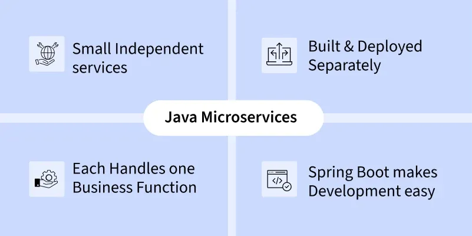
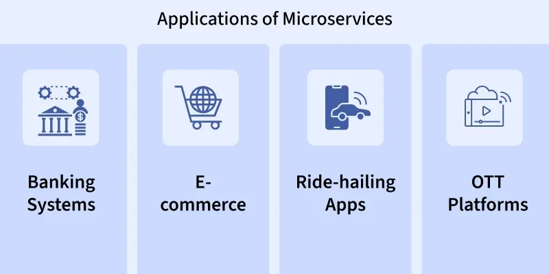

### 微服务是如何运作的？

- 每个微服务负责处理特定的业务功能，例如用户身份验证或产品管理，从而实现专业化开发。
- 服务之间通过 API 进行交互，促进标准化的信息交换和集成。
- 每个服务可以使用不同的技术，使团队能够选择最适合自身需求的工具。
- 微服务可以独立更新，从而降低变更风险并增强系统弹性。

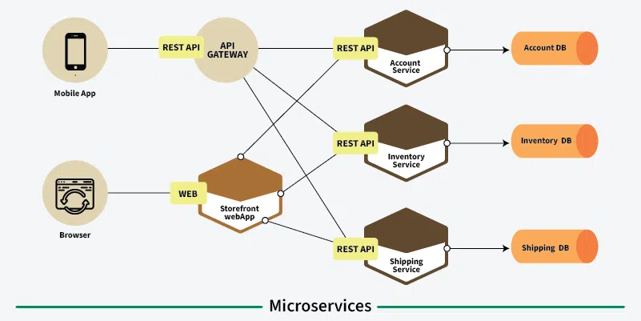

### 微服务架构的主要组成部分

微服务架构的主要组成部分包括：

- **微服务：** 小型、松耦合的服务，各自处理特定的业务功能，专注于不同的能力。
- **[API 网关](https://www.geeksforgeeks.org/system-design/what-is-api-gateway-system-design/)：** 作为外部客户端的中心入口点，负责管理请求、身份验证，并将请求路由到相应的微服务。
- **[服务注册与发现](https://www.geeksforgeeks.org/java/service-discovery-and-service-registry-in-microservices/)：** 跟踪所有微服务的位置和地址，使它们能够动态地相互定位和通信。
- **[负载均衡器](https://www.geeksforgeeks.org/system-design/load-balancer-system-design-interview-question/)：** 将传入流量分配到多个服务实例，防止任何微服务过载。
- **[容器化](https://www.geeksforgeeks.org/system-design/containerization-architecture-in-system-design/)：** Docker 封装微服务及其依赖项，Kubernetes 等编排工具管理它们的部署和扩展。
- **事件总线/[消息代理](https://www.geeksforgeeks.org/system-design/what-are-message-brokers-in-system-design/)：** 促进微服务之间的通信，允许组件/微服务之间异步发布/订阅事件。
- **[每个微服务一个数据库](https://www.geeksforgeeks.org/system-design/database-per-service-pattern-for-microservices/)：** 每个微服务通常都有自己的数据库，从而实现数据自治，并允许独立管理和扩展。
- **[缓存](https://www.geeksforgeeks.org/system-design/caching-system-design-concept-for-beginners/)：** 缓存将频繁访问的数据存储在靠近微服务的位置，通过减少重复查询来提升性能。
- **[容错](https://www.geeksforgeeks.org/system-design/fault-tolerance-in-system-design/)和[弹性](https://www.geeksforgeeks.org/system-design/resilient-system-system-design/)组件：** 诸如断路器和重试机制之类的组件确保系统能够优雅地处理故障，从而维持整体功能。

### 微服务架构设计模式

以下是微服务的主要设计模式：

#### 1. API 网关模式

[API 网关模式](https://www.geeksforgeeks.org/system-design/api-gateway-patterns-in-microservices/)通过将多个服务的复杂性隐藏在一个接口之后，简化了客户端体验。它还可以处理身份验证、日志记录和速率限制等任务，使其成为微服务架构的关键组成部分。

#### 2. 服务注册中心模式

[服务注册中心模式](https://www.geeksforgeeks.org/system-design/what-is-service-registry-in-microservices/)就像微服务的电话簿。它维护着所有活动服务及其位置（网络地址）的列表。当一个服务启动时，它会向注册中心注册自身。

其他服务随后可以查找注册中心以找到并与之通信。这种动态发现机制提高了灵活性，并帮助服务在无需硬编码其位置的情况下进行交互。

#### 3. 熔断器模式

在[熔断器模式](https://www.geeksforgeeks.org/system-design/what-is-service-registry-in-microservices/)中，如果一个服务反复出现故障，熔断器会触发，阻止对该服务的进一步请求。经过一段时间的超时后，它会允许有限的请求来测试服务是否恢复在线。这可以减轻故障服务的负载并增强系统的弹性。

#### 4. Saga 模式

[Saga 模式](https://www.geeksforgeeks.org/system-design/saga-design-pattern/)适用于管理跨多个服务的复杂业务流程。它并非将流程视为单一事务，而是将其分解为更小的步骤，每个步骤由不同的服务处理。

如果某个步骤失败，则会采取补偿措施来撤销之前的步骤。这样，即使发生故障，也能确保系统数据一致性。

#### 5. 事件溯源模式

在[事件溯源模式](https://www.geeksforgeeks.org/system-design/event-sourcing-pattern/)中，每个事件都描述了发生的变更，服务可以通过重放事件历史来重建当前状态。这提供了清晰的审计跟踪，并简化了错误发生时的数据恢复。

#### 6. 绞杀者模式

[绞杀者模式](https://www.geeksforgeeks.org/system-design/strangler-pattern-in-micro-services-system-design/)允许从单体应用逐步过渡到微服务架构。新功能以微服务的形式开发，而旧系统则继续使用。

随着时间的推移，随着越来越多的功能迁移到微服务，旧系统逐渐被“绞杀”，直至完全退役。这种方法可以最大限度地降低风险，并实现更平滑的迁移。

#### 7. 隔板模式

类似于船上的舱室，[隔板模式](https://www.geeksforgeeks.org/system-design/bulkhead-pattern/)将不同的服务隔离开来，以防止故障影响整个系统。

如果一个服务遇到问题，不会影响其他服务。通过创建边界，这种模式增强了系统的弹性，确保一个区域的故障不会导致整个系统崩溃。

#### 8. API 组合模式

当您需要从多个微服务收集数据时，[API 组合模式](https://www.geeksforgeeks.org/system-design/api-composition-pattern-in-microservices/)可以帮助您高效地完成这项工作。

一个独立的服务（组合服务）收集来自各个服务的响应，并将它们组合成一个单独的响应发送给客户端。这减少了客户端发出多个请求的需要，并简化了他们与系统的交互。

#### 9. CQRS 设计模式

[CQRS 设计模式](https://www.geeksforgeeks.org/system-design/cqrs-command-query-responsibility-segregation/)将数据处理方式分为两部分：命令和查询。命令用于更改数据，例如创建或更新记录，而查询仅用于获取数据。这种分离方式使您可以根据每个部分的具体用途进行定制。

### 微服务的实际应用案例

让我们通过亚马逊电子商务应用程序的实际案例来理解微服务：

亚马逊的在线商店运行在众多小型、专业化的微服务之上，每个微服务负责一项特定的任务。它们协同工作，共同打造流畅的购物体验。

.webp>)

以下是亚马逊电子商务应用中涉及的微服务：

- **用户服务：** 处理用户账户和偏好设置，确保每位用户都能获得个性化的体验。
- **搜索服务：** 通过整理和索引产品信息，帮助用户快速找到所需产品。
- **目录服务：** 管理产品列表，确保所有信息准确且易于访问。
- **购物车服务：** 允许用户在结账前添加、移除或更改购物车中的商品。
- **愿望清单服务：** 允许用户保存商品以便稍后购买，帮助他们追踪心仪的产品。
- **订单接收服务：** 处理客户订单，检查库存并验证订单详情。
- **订单处理服务：** 负责整个订单履行流程，与库存和物流部门协作，确保订单顺利送达。
- **支付服务：** 管理安全交易并记录支付详情。
- **物流服务：** 协调所有与配送相关的事宜，包括运费和物流追踪。
- **仓库服务：** 监控库存水平，并在需要时协助补货。
- **通知服务：** 向用户发送订单更新和任何特价优惠信息。
- **推荐服务：** 根据用户的浏览和购买记录向其推荐产品

### 如何从单体架构迁移到微服务架构？

以下是从[单体架构](https://www.geeksforgeeks.org/system-design/monolithic-architecture-system-design/)迁移到微服务架构的主要关键步骤：

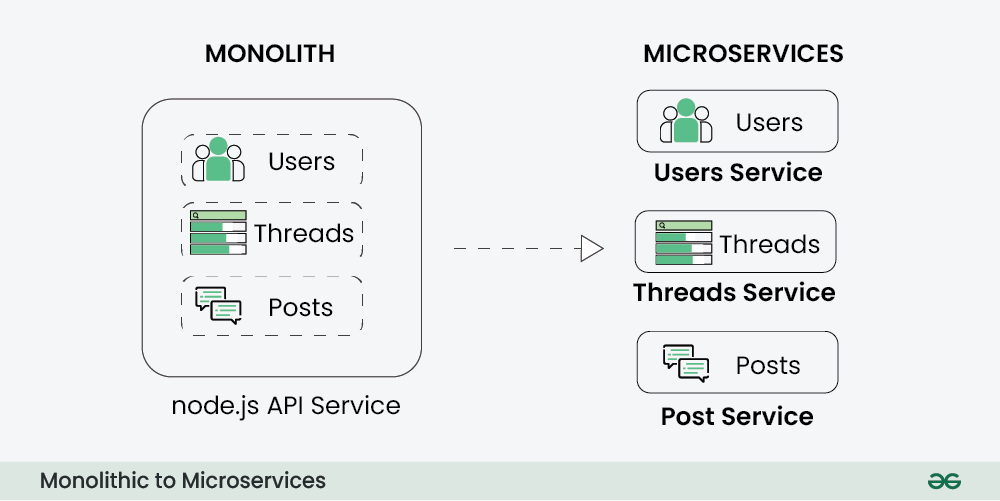

- **步骤 1：** 首先评估您当前的单体应用。识别其组件，并确定哪些部分可以迁移到微服务架构。
- **步骤 2：** 将单体应用拆分为具体的业务功能。每个微服务都应代表一项独特的功能，并与您的业务需求相符。
- **步骤 3：** 实施“绞杀者模式”（Strangler Pattern），逐步将单体应用的部分功能替换为微服务。这种方法可以实现平滑迁移，而无需一次性完成所有转换。
- **步骤 4：** 为您的微服务建立清晰的 API 和契约。这确保它们能够高效通信并无缝交互。
- **步骤 5：** 创建持续集成和持续部署 (CI/CD) 流水线。这可以自动化测试和部署，从而实现更快、更可靠的发布。
- **步骤 6：** 引入服务发现机制，使微服务能够动态地相互定位和通信，从而增强灵活性。
- **步骤 7：** 设置集中式日志记录和监控工具。这可以帮助您深入了解微服务的性能，从而快速识别和解决问题。
- **步骤 8：** 确保所有微服务对安全性和身份验证等横切关注点进行一致的管理，以维护系统完整性。
- **步骤 9：** 采用迭代方法构建微服务架构。根据反馈和不断变化的需求，持续改进和扩展服务。

### 微服务的应用

- **电子商务平台：** 库存、支付、订单和用户管理等独立服务。
- **银行和金融科技：** 账户、交易、欺诈检测和客户支持等独立服务。
- **流媒体服务（例如 Netflix、Spotify）：** 用户个人资料、推荐、内容分发和计费等服务。
- **旅行和预订系统：** 航班、酒店、支付和通知等服务。
- **医疗保健系统：** 患者记录、预约安排、计费和报告等独立服务。
- **社交媒体平台：** 动态、聊天、通知和用户个人资料等微服务。

### 使用微服务架构的优势和挑战

#### 使用微服务架构的优势

- 团队可以同时开发不同的微服务。
- 一项服务出现问题不会影响其他服务，从而提高了可靠性。
- 每项服务都可以根据其特定需求进行扩展。
- 系统可以快速适应不断变化的工作负载。
- 团队可以为每个微服务选择最佳技术栈。
- 小型跨职能团队可以独立工作。

#### 使用微服务架构的挑战

- 管理服务通信、网络延迟和数据一致性可能很困难。
- 将应用程序分解为微服务会增加开发、测试和部署的复杂性。
- 网络通信可能导致更高的延迟，并使错误处理更加复杂。
- 跨服务维护一致的数据具有挑战性，分布式事务也可能很复杂。

### 微服务架构与单体架构

下表从各个方面比较了微服务架构和单体架构：

|     方面     |                 微服务架构                 |                  单体架构                  |
| :----------: | :----------------------------------------: | :----------------------------------------: |
|   架构风格   |          分解成小型、独立的服务。          |          单一、紧密集成的代码库。          |
| 开发团队结构 |     每个微服务都由小型跨职能团队负责。     |        规模更大、集中式的开发团队。        |
|   可扩展性   |           各个服务可以独立扩展。           |         扩展需要复制整个应用程序。         |
|     部署     |             服务可以独立部署。             |     整个应用程序作为一个整体进行部署。     |
|  资源利用率  | 由于服务可以独立扩展，因此资源利用率更高。 |    资源根据应用程序的整体需求进行分配。    |
|   开发速度   |           更快的开发和部署周期。           |    由于整个代码库，开发和部署速度较慢。    |
|    灵活性    |        更容易为特定服务采用新技术。        |        由于通用技术栈，灵活性有限。        |
|     维护     |   更易于维护规模较小、功能集中的代码库。   | 对于大型单体代码库来说，维护可能非常复杂。 |

## 单体架构与微服务架构

软件架构的两种常见方式是单体架构和微服务架构。让我们来看看这两种方法的区别，以及何时应该选择其中一种。

### 什么是单体架构？

传统的软件设计采用[单体架构](https://www.geeksforgeeks.org/system-design/monolithic-architecture-system-design/)，在这种架构中，整个程序被构建为一个单一的、不可分割的单元。

- 这意味着对应用程序的任何更改或更新都需要修改并重新部署整个单体应用。
- 单体架构的特点是简单易用，尤其适用于中小型应用程序。
- 然而，随着应用程序规模和复杂性的增长，单体架构会变得复杂且难以维护。


### 什么是微服务架构？

[微服务架构](https://www.geeksforgeeks.org/system-design/microservices/)将应用程序设计成一组小型、独立的服务。每个服务本身代表一项业务功能。这些服务之间松耦合，并通过网络进行通信，通常使用轻量级协议，例如 HTTP 或消息队列。

- 每个服务负责应用程序的单一功能或特性，并且可以独立开发、部署和扩展。
- 微服务架构对应用程序和数据库之间的关系有着显著的影响。

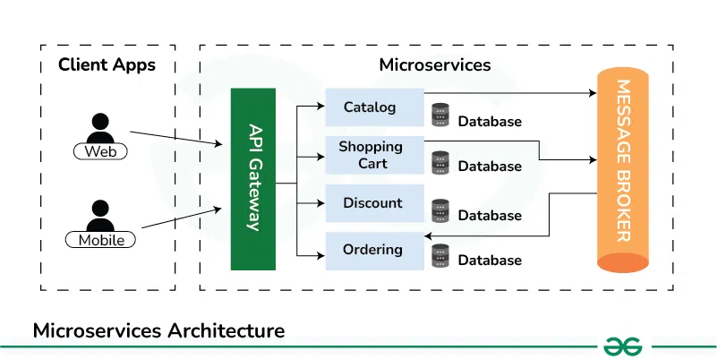

### 单体架构与微服务架构的区别

以下是单体架构与微服务架构的区别：

|   方面   |                 单体架构                 |                  微服务架构                  |
| :------: | :--------------------------------------: | :------------------------------------------: |
|   架构   |                 单层架构                 |                   多层架构                   |
|   规模   |          大型，所有组件紧密耦合          |               小型，组件松耦合               |
|   部署   |             作为一个整体部署             |             各个服务可以独立部署             |
| 可扩展性 |          横向扩展可能具有挑战性          |                更容易横向扩展                |
|   开发   |              开发初期更简单              |          由于管理多个服务而变得复杂          |
|   技术   |               技术选择有限               |       可以自由地为每个服务选择最佳技术       |
|  容错性  | 一个部分发生故障，整个应用程序都可能崩溃 |       单个服务发生故障不会影响其他服务       |
|   维护   |         由于其简单性，维护更容易         |           管理多个服务需要更多精力           |
|  灵活性  |     由于所有组件紧密耦合，灵活性较差     | 组件可以独立开发、部署和扩展，因此灵活性更高 |
|   通信   |          组件之间的通信速度更快          |        由于网络调用，通信速度可能较慢        |

### 单体架构和微服务架构的最佳应用场景

以下是单体架构或微服务架构的最佳应用场景：

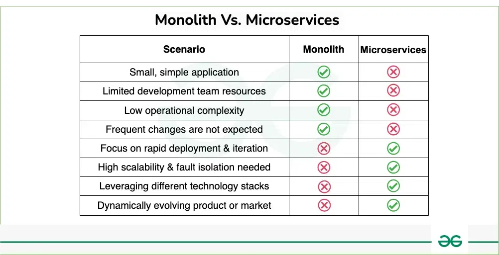

## [事件驱动架构 - 系统设计](https://www.geeksforgeeks.org/system-design/event-driven-architecture-system-design/)

事件驱动架构 (EDA) 是一种软件设计范式，其中系统组件通过产生和响应事件进行通信。这些事件可以是重要的事件，例如用户操作或系统状态的变化。

- 这种方法能够实现实时响应、可扩展性和模块化。
- 组件是独立的，这意味着它们可以独立运行，无需彼此紧密连接。当事件发生时，会发出一条消息，提示相关组件做出相应的响应。
- 这种结构增强了系统的灵活性、[可扩展性](https://www.geeksforgeeks.org/system-design/what-is-scalability/)和实时响应能力。

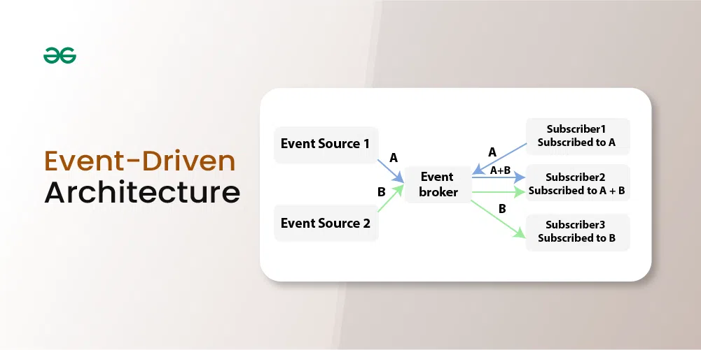

**例如，** 在一个大型派对上，每个人都各忙各的。他们不会互相询问，而是用铃声来提示重要事项，比如“蛋糕准备好了”或“舞会开始”。在事件驱动架构中，这个铃声就像一个“事件”。在科技领域，计算机系统的不同部分通过在重要事件发生时发送消息进行通信。每个部分都可以专注于自己的工作，当需要关注时，它就会发出铃声（发送事件）。

### 事件驱动架构 (EDA) 在系统设计中的重要性

事件驱动架构 (EDA) 在系统设计中具有重要意义，原因如下：

- **灵活性和响应性：** 借助 EDA，系统可以快速适应不断变化的情况。系统可以通过基于事件启动操作来动态适应新信息，从而保证其敏捷性和响应性。
- **[可扩展性](https://www.geeksforgeeks.org/system-design/what-is-scalability/)：** 由于 EDA 具有可扩展性，因此可以添加或删除组件而不会影响当前配置。这种灵活性使得系统更容易根据不断变化的需求进行修改。
- **实时处理：** 事件驱动架构 (EDA) 非常适合需要实时处理的场景。事件发生时即被处理，使系统能够高效地管理对时间要求严格的任务。
- **去中心化通信：** 组件通过事件而非直接连接进行通信，从而减少了点对点交互的需求。这种去中心化方法提高了可靠性并简化了系统维护。

### 事件驱动架构示例

下图展示了一个电子商务网站的事件驱动架构。在访问高峰期，该架构使网站能够响应来自多个来源的变化，而不会导致应用程序崩溃。

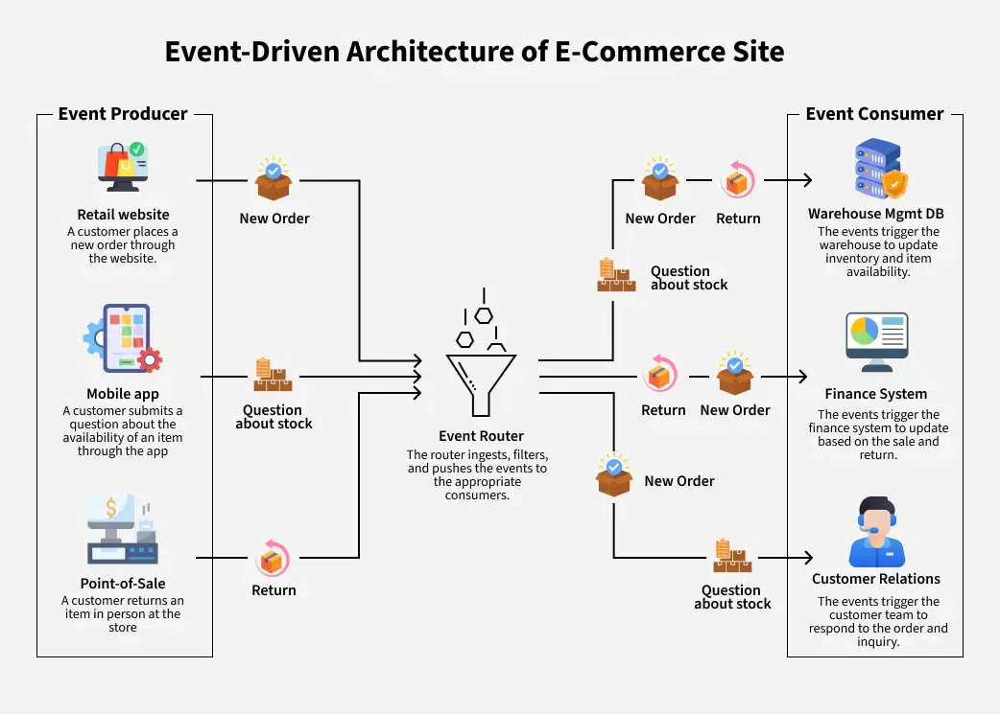

### 事件驱动架构 (EDA) 中的事件

事件是事件驱动架构 (EDA) 的关键组成部分，用于表示重大事件或系统变更。它们通过促进组件间的通信来实现实时响应。以下是关于 EDA 中事件的关键要点：

- **表示：** 事件以消息或信号的形式表达，用于传递特定信息。
- **触发：** 各种来源，例如用户操作或数据更改，都可以触发事件。
- **异步性：** EDA 通常使用异步通信，允许组件独立并行地工作。
- **发布/订阅模型：** 事件管理采用发布/订阅模型，事件的创建者发布事件，感兴趣的各方订阅事件。
- **事件类型：** 事件按用途分组，例如“用户登录”或“订单已下”。
- **有效载荷：** 事件通常包含提供上下文的额外信息，即有效载荷（例如，“已收到付款”事件可能详细说明付款金额）。
- **事件处理：** 组件拥有特定的事件处理程序，用于决定其对事件的响应。
- **实时处理：** 事件允许对变化做出即时反应，这使得事件驱动架构 (EDA) 非常适合需要快速响应的场景。

### 事件驱动架构 (EDA) 的组成部分

### 事件驱动架构 (EDA) 包含几个关键要素，有助于促进通信并响应事件。以下是事件驱动架构的主要组成部分

#### 1. 事件源

- 事件源是指任何生成事件的系统或组件。例如，用户界面、传感器、数据库和外部系统。
- 事件源至关重要，因为它们启动了驱动整个架构的信息流。

#### 2. 事件

- 事件是 EDA 中通信的核心单元，代表重要的事件或状态变化。
- 事件由事件源发出，可以封装各种类型的信息，是不同组件之间通信的主要方式。

#### 3. 事件代理/事件总线

- 事件代理或事件总线充当中央枢纽，通过处理事件的分发、过滤和路由来促进各个组件之间的通信。它确保事件能够传递给正确的订阅者，从而促进系统内的高效交互。

#### 4. 发布者

- 此组件生成事件并将其发送到事件总线。
- 发布者负责在特定条件或操作发生时发出事件，有效地将系统中的变化转化为可执行的消息，从而触发响应。

#### 5. 订阅者

- 订阅者组件对特定事件类型感兴趣并订阅这些事件。订阅者监听事件总线上的相关事件，并采取相应的操作。
- 这使得组件能够动态地响应变化，从而实现响应式架构。

#### 6. 事件处理程序

- 这是一段与订阅者关联的代码或逻辑，用于定义如何处理接收到的事件。
- 事件处理程序对于系统的响应能力至关重要，因为它们决定了响应事件时应采取的具体步骤。

#### 7. 分发器

- 在某些事件驱动架构 (EDA) 实现中，分发器用于将事件路由到相应的事件处理程序。
- 此部分控制事件在系统中的流转方式，确保事件被路由到合适的处理位置。

#### 8. 聚合器

- 聚合器将多个相关事件合并为一个更重要的单一事件。
- 这简化了众多独立事件的管理，从而降低了复杂性，使订阅者更容易处理相关信息。

#### 9. 监听器

- 监听器组件会主动监控事件总线上的事件并做出响应。
- 监听器通常针对特定事件类型进行定制，以确保它们能够及时响应与其功能相关的变化。

### 何时使用事件驱动架构

事件驱动架构 (EDA) 在多种场景下都是不错的选择。以下是一些您可能需要考虑使用 EDA 的情况：

- 实时应用程序：如果您的应用程序需要对用户操作或数据变化做出即时响应，EDA 可以提供所需的响应速度。
- 可扩展性需求：当您预期系统会不断增长并处理越来越多的事件时，EDA 可以提供更好的可扩展性。可以在不中断整个系统的情况下添加或修改组件。
- 解耦组件：如果您希望推广模块化设计，EDA 可以通过允许组件通过事件而非直接调用进行通信来提供帮助。这使得更新或替换系统部件变得更加容易。
- 复杂事件处理：对于需要处理多个事件并从中获取洞察的应用程序，EDA 可以简化这些复杂场景的处理。
- 集成多样化系统：如果您正在使用需要通信的各种系统或服务，EDA 可以帮助更有效地集成它们，从而实现不同技术之间的灵活通信。

### 事件驱动架构 (EDA) 的优势

以下是事件驱动架构的优势：

- 灵活性和敏捷性：通过解耦组件，EDA 使系统能够轻松适应不断变化的需求。添加或更改新功能不会影响整个系统。
- 可扩展性：EDA 通过允许组件独立运行来支持可扩展性。系统可以通过添加更多组件或资源来处理不断增加的负载或不断增长的数据集。
- 实时响应：通过启用实时处理，EDA 确保事件发生时即可得到及时处理。这对于需要快速响应的应用（例如金融交易或物联网应用）至关重要。
- 松耦合：事件驱动系统的组件之间连接松散，这意味着它们彼此依赖性不高。这增强了组件的独立性，并简化了各个部分的维护。
- 增强的模块化：EDA 鼓励模块化设计，将复杂的系统分解为易于管理的组件。这种模块化结构简化了开发、测试和维护。

### 事件驱动架构 (EDA) 的挑战

事件驱动架构 (EDA) 虽然有很多优势，但也存在一些值得考虑的挑战。以下是一些关键挑战：

- **复杂性增加：** 随着事件和组件的增加，EDA 系统会变得复杂。管理事件流并保持所有事件协调一致可能非常困难。
- **事件顺序和[一致性](https://www.geeksforgeeks.org/system-design/consistency-in-system-design/)：** 保持事件的正确顺序并确保系统保持一致性可能很棘手。处理乱序事件或确保操作作为一个整体完成可能需要额外的工作。
- **调试和追踪：** 在分布式和异步设置中查找和修复问题可能比在传统系统中更困难。追踪问题可能需要更多时间。
- **事件延迟：** 由于事件是单独处理的，因此事件发生和响应之间可能存在延迟。在需要快速反应的情况下，这种延迟可能会成为一个问题。

### 事件驱动架构 (EDA) 的应用案例

以下是事件驱动架构的应用案例：

- **金融服务：** EDA 在金融系统中具有优势，可用于实时处理交易、欺诈检测和市场数据更新。交易执行、支付授权和市场波动等事件可以触发即时响应。
- **电子商务：** EDA 可以处理电子商务平台中的订单处理、库存变更和支付处理等任务。它能够实现实时订单监控、库存控制以及与外部服务的顺畅连接。
- **物联网 (IoT)：** 对于设备会产生大量事件的物联网应用，EDA 非常适用。它能够实时处理传感器数据、进行远程监控并快速响应不断变化的环境状况。
- **电信：** EDA 可促进电信行业中网络组件之间的事件驱动通信、网络监控和实时呼叫处理。它有助于管理动态网络环境和负载自适应。
- **在线游戏：** 在在线游戏中，事件驱动架构 (EDA) 支持玩家之间的实时交互、处理游戏内事件并更新游戏状态。它能够动态适应玩家的操作和游戏事件。

### 事件驱动架构 (EDA) 的实现

事件驱动架构 (EDA) 的实现涉及多个组件，包括事件源、事件总线和订阅者。本文将使用 Python 和基本的事件处理机制实现一个简化的示例。

假设我们有一个在线订购系统，需要在用户下单后通知他们。我们将实现一个简单的 EDA 系统，其中包含发布者、事件总线和订阅者。

以下是上述示例的实现：

```python

# Event Bus
class EventBus:
    subscribers = {}

    @classmethod
    def subscribe(cls, event_type, subscriber):
        if event_type not in cls.subscribers:
            cls.subscribers[event_type] = []
        cls.subscribers[event_type].append(subscriber)

    @classmethod
    def publish(cls, event_type, data=None):
        if event_type in cls.subscribers:
            for subscriber in cls.subscribers[event_type]:
                subscriber.handle_event(event_type, data)


# Event Subscriber
class OrderNotificationSubscriber:
    def handle_event(self, event_type, data=None):
        if event_type == 'OrderPlaced':
            print(&quot;Notification: Your order with ID {} has been placed!&quot;.format(data['order_id']))


# Event Publisher
class OrderService:
    def place_order(self, order_id):
        # Order placement logic here
        # ...

        # Notify subscribers about the order placement
        EventBus.publish('OrderPlaced', {'order_id': order_id})


# Example Usage
if __name__ == &quot;__main__&quot;:
    # Creating instances
    order_notification_subscriber = OrderNotificationSubscriber()
    order_service = OrderService()

    # Subscribing the subscriber to the 'OrderPlaced' event
    EventBus.subscribe('OrderPlaced', order_notification_subscriber)

    # Placing an order
    order_service.place_order(order_id=123)

```

**输出**

```text
通知：您的订单（ID 123）已成功下单！
```

以下是上述代码的解释：

- **事件总线：**
  - EventBus 类作为处理事件的中心枢纽。它允许组件订阅特定类型的事件，并发布事件以通知订阅者。

- **事件订阅者：**
  - OrderNotificationSubscriber 类是一个示例订阅者，用于处理“OrderPlaced”事件。在实际场景中，此订阅者可以触发通知、电子邮件或其他操作。

- **事件发布者：**
  - OrderService 类代表负责下单的服务。下单后，它会使用 EventBus 发布“OrderPlaced”事件，通知订阅者。

- **示例用法：**
  - 在示例用法部分，我们创建了订阅者和发布者的实例。订阅者使用 EventBus.subscribe 函数来注册“OrderPlaced”事件。当使用 `order_service.place_order` 下单时，会调用订阅者的 `handle_event` 方法并发布事件。

### 事件驱动架构与消息驱动架构

以下是事件驱动架构和消息驱动架构之间的区别。

|   方面   |            事件驱动架构 (EDA)            |                   消息驱动架构 (MDA)                   |
| :------: | :--------------------------------------: | :----------------------------------------------------: |
|   定义   |    关注代表重大事件或状态变化的事件。    |       以组件间消息交换为核心，通常使用消息代理。       |
|   通信   |          组件通过事件进行通信。          |       通信涉及消息的交换，其范围可能比事件更广。       |
|  数据流  |          强调触发操作的事件流。          |              数据流基于组件间消息的交换。              |
|   解耦   |           促进组件间的松耦合。           |           旨在通过依赖消息中间件来实现解耦。           |
| 触发机制 |  事件通常由系统中的特定事件或变化触发。  |          消息的发送和接收基于通信组件的需求。          |
|   示例   |     订单提交、传感器数据更新触发操作     |        消息队列、发布/订阅系统、请求/响应模式。        |
| 事件处理 | 组件具有事件处理程序，用于响应特定事件。 | 组件可能具有消息处理程序或监听器，用于处理传入的消息。 |

### 事件驱动架构学习路线图

#### 1. 事件驱动架构简介

- [什么是事件驱动架构？](https://www.geeksforgeeks.org/system-design/event-driven-architecture-system-design/)
- [事件溯源模式](https://www.geeksforgeeks.org/system-design/event-sourcing-pattern/)
- [事件溯源与事件流的比较](https://www.geeksforgeeks.org/system-design/event-sourcing-vs-event-streaming-in-system-design/)
- [微服务架构中的事件驱动 API](https://www.geeksforgeeks.org/system-design/event-driven-apis-in-microservice-architectures/)

#### 2. 事件驱动架构进阶主题

- [事件驱动架构中的错误处理](https://www.geeksforgeeks.org/system-design/error-handling-in-event-driven-architecture/)
- [如何在基于事件、消息驱动的微服务架构中，在故障场景下恢复状态？](https://www.geeksforgeeks.org/system-design/how-to-restore-state-in-an-event-based-message-driven-microservice-architecture-on-failure-scenario/)
- [云原生应用中的事件驱动架构模式](https://www.geeksforgeeks.org/system-design/event-driven-architecture-patterns-in-cloud-native-applications/)
- [请求驱动型微服务与事件驱动型微服务](https://www.geeksforgeeks.org/system-design/request-driven-vs-event-driven-microservices/)

#### 3. 与其他架构的比较

- [事件驱动架构与微服务架构的比较](https://www.geeksforgeeks.org/system-design/event-driven-architecture-vs-microservices-architecture/)
- [事件驱动架构与数据驱动架构的比较](https://www.geeksforgeeks.org/system-design/event-driven-architecture-vs-microservices-architecture/)
- [消息驱动架构与事件驱动架构的比较](https://www.geeksforgeeks.org/system-design/message-driven-architecture-vs-event-driven-architecture/)

## [无服务器架构](https://www.geeksforgeeks.org/system-design/serverless-architectures/)

无服务器架构是一种云计算执行模型，它允许云服务提供商动态控制服务器的配置和分配。由于云服务提供商负责底层基础设施（包括扩展、维护和配置），开发人员可以完全专注于代码编写。

- 云服务提供商会在事件触发的无状态计算容器中自动执行代码，这些容器由提供商完全管理。
- 开发人员无需了解运行这些服务器的复杂性，包括容量规划、扩展和服务器维护。

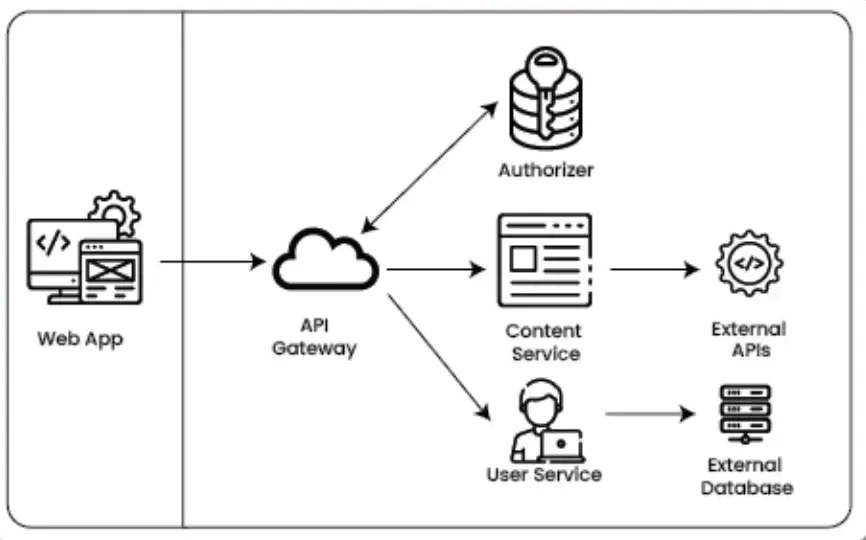

### 无服务器计算提供商和平台

凭借能够满足各种开发需求的独特平台和功能，无服务器计算已成为众多云服务提供商关注的重点领域。以下是一些顶级的无服务器计算平台和提供商：

- **AWS Lambda：** 无需预置或管理服务器，开发人员即可使用 AWS Lambda（可能是最知名的无服务器计算工具）来执行代码，以响应来自 200 多个 AWS 服务和 SaaS 应用的事件。
- **Azure Functions：** 借助 Microsoft 的无服务器计算解决方案 Azure Functions，您可以执行事件触发的代码，而无需显式预置或管理基础架构。Azure Functions 可以轻松与其他 Azure 服务连接，并支持多种编程语言。
- **Google Cloud Functions：** 这是 Google 用于创建和连接云服务的无服务器执行环境。使用 Google Cloud Functions，您只需编写代码；Google 会负责管理、扩展和底层基础架构。
- **Oracle 云函数：** 开发者可以利用由来自 Oracle 云服务的 HTTP 请求或事件触发的函数，创建基于 Oracle 无服务器架构的应用程序。它旨在通过与 Oracle 现有云产品轻松集成，提供一体化的云体验。

### 开发无服务器应用程序的步骤

由于无服务器架构与传统软件开发不同，创建无服务器应用程序需要采用不同的方法。以下是构建无服务器应用程序时需要考虑的主要步骤和因素：

- **步骤 1：了解无服务器模型：**
  - 流量不可预测且采用微服务架构（将应用程序拆分为更小的独立组件）的应用程序尤其适合采用无服务器架构。

- **步骤 2：选择合适的提供商：**
  - 选择最符合您需求的无服务器提供商，包括支持的语言、集成能力、成本、性能（包括冷启动时间）以及提供的具体功能。主要提供商包括 AWS Lambda、Azure Functions、Google Cloud Functions 以及前面讨论过的其他提供商。

- **步骤 3：设计应用程序：**
  - 无服务器应用程序的设计应最大限度地发挥无服务器执行模型的优势：
  - [事件驱动](https://www.geeksforgeeks.org/system-design/event-driven-architecture-system-design/)：设计组件以响应事件（例如，HTTP 请求、文件上传、数据库事件）。
  - [无状态](https://www.geeksforgeeks.org/system-design/stateless-and-stateful-systems-in-system-design/)：确保函数是无状态且独立的。使用外部服务来维护状态，例如数据库或云存储。
  - 微服务架构：将应用程序功能分解为可以独立部署、扩展和更新的小型独立单元。

- **步骤 4：设置开发环境：**
  - 设置开发环境。
  - 使用 Serverless Framework、AWS SAM（无服务器应用程序模型）或 Azure Functions Core Tools 等框架和工具来简化无服务器应用程序的部署和管理。
  - 配置本地测试和仿真工具以模拟云环境，并减少开发期间的部署周期。

- **步骤 5：实现函数：**
  - 开发函数。编写基于特定触发器执行的小型、单一用途的函数。
  - 与托管数据库、身份验证和存储服务集成，以减轻无服务器平台能够更好地处理的职责。

- **步骤 6：管理依赖项：**
  - 仅包含必要的库和依赖项，以保持部署包体积小，从而提高冷启动性能。

- **步骤 7：部署和持续集成：**
  - 使用与无服务器平台集成的 CI/CD 流水线实现自动化部署。GitHub Actions、Jenkins 或 CircleCI 等工具可以配置为直接部署到无服务器环境。

### 无服务器应用设计模式

无服务器架构引入了多种设计模式，有助于高效地解决无服务器环境中的特定问题。以下是一些最常见的无服务器应用设计模式：

- **函数即网关 (FaG)：**
  - 在这种模型中，传入的请求通过充当网关或代理的无服务器函数路由到其他服务或函数。
  - 该函数处理传入的 HTTP 请求，完成初始处理，然后将其路由到相应的后端服务。它常用于构建 API 网关。

- **事件流处理：**
  - 响应日志、金融交易或社交媒体动态等数据流非常适合使用无服务器函数。
  - 在这种架构中，事件流触发函数，这些函数分别处理每个事件。
  - 这在日志记录、实时数据分析以及处理来自物联网的数据等场景中非常有用。

- **聚合器：**
  - 无服务器函数充当聚合器，收集来自多个系统或函数的结果，将它们聚合起来，并返回统一的响应。
  - 这在微服务架构中尤其有用，因为不同的服务会处理事务或查询的不同部分。

- **绞杀者模式：**
  - 这种模式有助于将遗留系统逐步迁移到无服务器架构。引入无服务器函数来处理新功能或拦截对现有服务的调用，从而逐步用新的基于无服务器的实现替换旧系统的组件。

- **[熔断器](https://www.geeksforgeeks.org/system-design/what-is-circuit-breaker-pattern-in-microservices/)：**
  - 在无服务器架构中实现熔断器模式的一部分是设置一个方法，当达到预设的故障阈值时“中断”函数调用链。
  - 当系统的某个组件发生故障时，这有助于防止系统同时崩溃，并使其能够继续运行，尽管性能会降低。

### 无服务器架构的扩展性和性能考量

扩展性和性能是无服务器架构中的关键考量因素，应用程序必须能够在无需人工干预的情况下高效地处理各种负载。以下是关于无服务器计算中扩展性和性能需要考虑的关键点：

#### 1. 无服务器计算中的扩展

- **自动扩展：** 无服务器平台会根据传入的请求或事件速率自动扩展执行单元（函数）。
- **冷启动：** 无服务器环境中一个重要的问题是冷启动带来的延迟，即初始化函数新实例时产生的延迟。与基于 JVM 的语言相比，Python 和 Node.js 等语言通常具有更快的冷启动速度。
- **限流：** 云提供商通常会限制函数的调用速率。如果传入的请求超过这些限制，则可能会发生限流，除非通过重试机制或提高并发限制等策略进行妥善管理，否则会导致处理延迟。

#### 2. 性能优化策略

- **优化函数代码：** 保持函数代码的精简和高效至关重要。这包括尽量减少依赖项，并在适当情况下使用异步编程模型。
- **管理依赖项：** 通过精简不必要的库和文件来减小部署包的大小可以缩短初始化时间，这对于运行时环境较大的语言尤为重要。
- **持久连接：** 在与数据库或其他服务集成时，使用持久连接（例如在多次调用之间保持数据库连接打开）可以减少连接开销。

### 无服务器架构安全最佳实践

以下是一些增强无服务器环境安全性的最佳实践：

#### 1. 最小权限原则

- 严格遵循最小权限原则 (PoLP)。
- 每个无服务器函数应仅被授予执行其功能所需的权限。这样，一旦发生安全漏洞，就能最大限度地减少潜在损失。

#### 2. 保护应用程序密钥

- 切勿将私有数据硬编码到环境变量或无服务器代码中，包括密钥令牌、数据库凭据或 API 密钥。
- 请使用托管服务，例如 Google Cloud Secret Manager、Azure Key Vault 或 AWS Secrets Manager。

#### 3. 输入验证

- 为防止 SQL 注入、命令注入和跨站脚本攻击 (XSS) 等常见漏洞，请务必检查无服务器方法的输入。
- 因为无服务器函数经常直接与数据库和其他服务通信。

#### 4. 保护 API 网关

- 如果您使用 API 网关，请启用速率限制、身份验证和 CORS 策略等安全功能。
- 使用 IAM 权限、API 密钥或 OAuth 来管理对 API 端点的访问。

#### 5. 加密

- 启用传输中和静态数据的加密。
- 加密数据库连接，对无服务器 API 使用 HTTPS，并确保数据存储提供商已配置为在数据存储期间对其进行加密。
- 通过这些措施，可以降低数据泄露给未经授权方的可能性。

### 无服务器架构用例

无服务器架构的一些用例包括：

- **聊天机器人和虚拟助手：** 无服务器架构通过语音界面或消息系统控制用户交互，从而可以快速构建和部署聊天机器人和虚拟助手。
- **实时数据处理：** 无服务器功能无需基础设施管理，即可分析来自多个来源的流数据，提供实时分析、监控和警报。
- **Web 和移动后端：** 无服务器后端为 Web 和移动应用程序提供经济高效且可扩展的解决方案，可处理身份验证、数据库交互和 API 请求。
- **计划任务和定时任务：** 无服务器函数可以按计划触发，从而自动执行数据备份、报告生成和定期维护等任务。

### 无服务器架构的挑战

无服务器架构的挑战包括：

- **冷启动延迟：** 无服务器函数在首次调用或闲置一段时间后可能会出现延迟，称为“冷启动”，这会影响偶尔访问的函数的响应时间。
- **执行环境受限：** 无服务器平台对可用资源（例如内存、执行时间和语言支持）存在限制，这可能会限制可在无服务器环境中有效运行的应用程序或工作负载类型。
- **调试和监控的复杂性：** 传统的调试和监控工具可能无法直接应用于无服务器架构，因此需要新的方法和工具来有效地监控和调试分布在动态事件驱动环境中的函数。
- **状态管理：** 无服务器函数通常是无状态的，这会使状态管理和持久化变得复杂，需要外部服务或变通方法来维护跨调用的应用程序状态。
- **安全和合规性挑战：** 无服务器架构引入了新的安全挑战，例如保护功能端点、管理访问控制以及确保符合监管要求，这些挑战可能需要额外的努力和专业知识才能有效解决。

## [有状态架构与无状态架构](https://www.geeksforgeeks.org/system-design/stateful-vs-stateless-architecture/)

[有状态架构](https://www.geeksforgeeks.org/system-design/stateless-and-stateful-systems-in-system-design/)将客户端会话数据维护在服务器上，而[无状态架构](https://www.geeksforgeeks.org/system-design/stateless-and-stateful-systems-in-system-design/)则独立处理每个请求。

### 什么是有状态架构？

服务器维护每个客户端的状态或会话信息。这意味着服务器会在多次交互或请求中跟踪客户端的数据和上下文。

- 通常涉及将会话数据存储在服务器内存、数据库或其他存储机制中。
- 例如，传统的 Web 应用程序使用服务器端会话来存储用户数据或购物车内容。

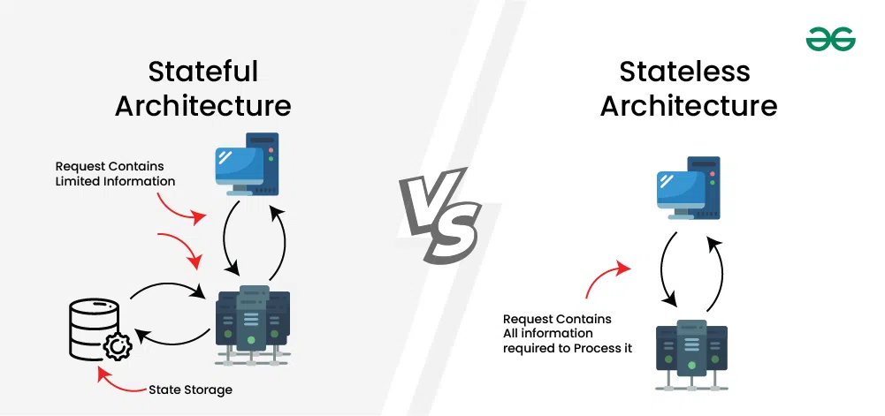

### 什么是无状态架构？

服务器不会在请求之间存储任何客户端会话信息。来自客户端的每个请求都被视为一个独立的事务。

- 为了维护用户会话，无状态架构通常使用 JSON Web Tokens (JWT) 或客户端 cookie 等技术来存储会话数据。
- 例如，RESTful API 中的每个请求都包含服务器独立处理该请求所需的所有信息。
- 由于无需服务器资源来维护客户端状态，无状态架构的设计更具可扩展性和容错性。

### 有状态架构与无状态架构

以下是有状态架构和无状态架构之间的区别：

|    参数    |                   有状态架构                   |                     无状态架构                     |
| :--------: | :--------------------------------------------: | :------------------------------------------------: |
|  可扩展性  |              扩展需要同步会话数据              |                  水平扩展较为简单                  |
|   容错性   | 一台服务器的故障会影响存储在其他服务器上的会话 |            故障是隔离的，仅影响单个请求            |
|    性能    |          由于会话管理，延迟可能会增加          |         由于没有会话开销，响应速度通常更快         |
|  资源使用  |          需要更多资源进行会话状态管理          |          由于没有会话状态，资源利用率更高          |
|  缓存策略  |       由于会话数据，缓存策略可能比较复杂       |            没有会话状态，缓存策略更简单            |
| 部署复杂性 |          由于会话同步，部署可能更复杂          |           由于无状态性，部署和维护更简单           |
| 事务完整性 |       通过维护会话上下文来确保事务完整性       |         事务是隔离的，确保请求级别的完整性         |
|  负载均衡  |         负载均衡可能需要考虑会话亲和性         |            无需考虑会话的负载均衡更简单            |
|  开发重点  |          开发人员需要处理会话相关问题          | 开发人员可以更专注于业务逻辑，而无需操心会话问题。 |

### 有状态架构的优势

- **会话持久性：** 维护用户会话，实现跨步骤或设备间的平滑切换。
- **高效的资源利用：** 将会话数据存储在服务器上，减少重复传输和处理。
- **个性化：** 利用过往交互记录提供定制化体验，例如推荐服务。
- **增强的安全性：** 集中式会话管理支持强大的身份验证和加密功能。

### 无状态架构的优势

- **高可扩展性：** 无需会话管理即可轻松处理大量请求。
- **容错性：** 每个请求都是独立的，因此一个环节的故障不会影响其他环节。
- **简化的负载均衡：** 请求可以均匀分配，无需会话粘性。
- **更佳的性能：** 没有会话开销，从而实现更快的响应速度和更低的延迟。

## [什么是发布/订阅架构？](https://www.geeksforgeeks.org/system-design/what-is-pub-sub/)

考虑一个同步消息传递的场景。你的系统中有两个组件：发送方和接收方，它们相互通信。

- 接收方向发送方请求服务，发送方响应请求并等待接收方的确认。
- 此时，另一个接收方也向同一个发送方请求服务。如果发送方尚未收到第一个接收方的确认，则可能会被阻塞。因此，发送方无法为第二个接收方提供服务。为了解决这个问题，引入了发布/订阅（Pub/Sub）模型。
- 发布/订阅（Publisher/Sub）模型是一种软件架构中使用的消息传递模式，它使用消息代理。消息代理根据订阅关系将消息从发布者路由到订阅者，从而确保消息的正确传递、持久性和可扩展性。

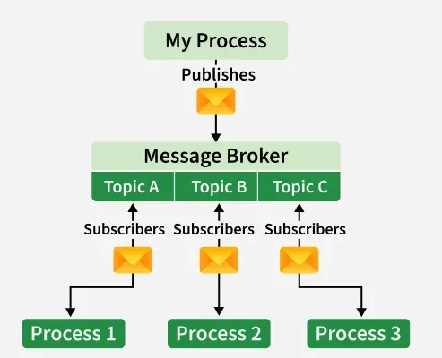

### 发布/订阅架构的组成部分？

在发布/订阅（Publish/Sub）模型中，有几个关键组件协同工作，以实现发布者和订阅者之间的通信。这些组件包括：

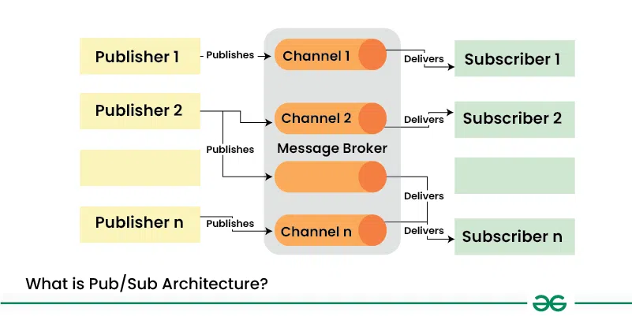

- **发布者：** 创建消息并将其发送到主题，无需了解订阅者。
- **订阅者：** 接收来自已订阅主题的消息，无需了解发布者。
- **主题：** 用于对消息进行分类的命名通道。发布者向主题发送消息，订阅者订阅这些主题。
- **消息代理：** 根据订阅情况将消息从发布者路由到订阅者，确保消息的送达、持久性和可扩展性。
- **消息：** 交换的数据单元，可以是文本、JSON 或二进制数据。
- **订阅：** 将订阅者与主题关联起来，定义接收哪些消息以及送达保证（例如，最多一次、至少一次）。

### 发布/订阅架构如何运作？

以下是发布/订阅架构的工作原理：

- **步骤 1：** 发布者创建消息并将其发送到发布/订阅系统。发布者会根据消息内容将其分类到不同的主题或频道中。
- **步骤 2：** 订阅者告知系统他们感兴趣的主题。他们只会收到来自这些主题的消息。
- **步骤 3：** 主题本质上是消息的频道。发布者将消息发送到特定的主题，订阅者可以选择关注一个或多个主题。
- **步骤 4：** 消息代理充当中间人，管理消息从发布者到订阅者的传递。消息代理接收来自发布者的消息，并将其发送给感兴趣的订阅者。
- **步骤 5：** 当发布者向某个主题发送消息时，消息代理会获取该消息并将其发送给所有已订阅该主题的订阅者。
- **步骤 6：** 发布/订阅系统支持异步通信。这意味着发布者无需等待订阅者准备好即可发送消息，订阅者也可以随时接收消息，而无需发布者在场。

### 发布/订阅架构的实际应用案例

```text
Twitter 等社交媒体平台的运行就是一个发布/订阅架构的实际应用案例。
```

- **发布者：** 用户发布推文，这些推文会被发布到 Twitter 平台。
- **订阅者：** 用户的关注者订阅其推文以接收更新。
- **主题：** 每个用户的推文都可以被视为一个主题，订阅者会收到他们感兴趣的主题的更新。
- **消息代理：** Twitter 的后端基础设施充当消息代理，将推文从发布者路由到订阅者。
- **消息：** 每条推文都是一条消息，由用户发布并被其关注者接收。

在这个例子中，发布/订阅架构实现了推文向关注者的可扩展且高效的分发。发布者（用户）可以发布推文而无需知道谁会收到，而订阅者（关注者）可以实时接收更新，而无需与发布者直接沟通。

#### 发布/订阅架构的应用场景

发布/订阅（Publisher/Sub）架构广泛应用于各种需要组件间异步且可扩展通信的场景。一些常见的发布/订阅架构应用场景包括：

- **实时数据流：** 它常用于处理实时数据的应用，例如物联网设备和传感器网络，允许多个订阅者立即获取数据流。
- **[事件驱动架构](https://www.geeksforgeeks.org/system-design/event-driven-architecture-system-design/)：** 这种架构非常适合对事件做出响应而非持续检查更新的系统，从而提高应用的响应速度。
- **[消息队列](https://www.geeksforgeeks.org/system-design/message-queues-system-design/)：** 发布/订阅架构可以充当消息队列，临时存储消息，直到订阅者处理它们，这有助于管理消息的传递方式。
- **通知和警报：** 它用于发送通知和警报，允许发布者发送重要更新，订阅者可以立即接收。
- **可扩展的 Web 应用：** 在 Web 应用中，发布/订阅架构支持实时更新和聊天等功能，因此许多用户可以同时接收信息而不会使服务器过载。
- **微服务通信：** 最后，它帮助微服务相互通信，使它们能够在不紧密连接的情况下进行通信，从而提高可扩展性和可靠性。

### 发布/订阅服务类型

以下是两种发布/订阅服务类型：

#### 1. 发布/订阅服务

这是大多数用户和应用程序选择的主要消息服务。它提供：

- **高[可靠性](https://www.geeksforgeeks.org/system-design/reliability-in-system-design/)：** 确保消息的一致性传递。
- **集成：** 支持与其他服务的广泛集成。
- **自动容量管理：** 根据需求自动扩展容量。
- **[数据复制](https://www.geeksforgeeks.org/system-design/data-replication-strategies-in-system-design/)：** 将所有数据同步复制到至少两个可用区，并尽力复制到第三个可用区以提高可靠性。

#### 2. 精简版发布/订阅服务

这是一种独立的消息服务，旨在提高成本效益，但也存在一些不足：

- **可靠性较低：** 与标准发布/订阅服务相比，可靠性较低。
- **区域或分区存储：** 区域精简版主题存储在一个可用区中，而区域精简版主题会将数据异步复制到第二个可用区。
- **需要预先配置：** 您需要自行管理和配置存储和吞吐量容量。
- **经济高效：** 如果控制成本至关重要，并且您可以接受较低的可靠性和一些额外的管理任务，则可以考虑此选项。

### 发布/订阅与其他消息传递技术的比较

以下是发布/订阅与其他消息传递技术的比较：

- **发布/订阅与消息队列：**

消息队列一次只能向一个消费者传递消息（点对点），以确保消息的顺序和送达。发布/订阅可以同时向多个订阅者广播消息，非常适合事件驱动型系统。

- **发布/订阅与流式平台：**

流式平台（例如 Kafka）处理具有长期保留和复杂处理的连续数据流。发布/订阅则专注于更简单、实时的消息传递。

- **发布/订阅与 WebSocket：**

WebSocket 支持实时双向客户端-服务器通信（例如聊天）。发布/订阅将发布者和订阅者解耦，无需直接连接即可支持多个订阅者。

- **发布/订阅模式与 HTTP API：**

HTTP API 使用同步请求-响应通信。发布/订阅模式支持异步消息传递，允许发布者无需等待订阅者响应即可发送消息。

### 发布/订阅架构的适用场景

#### 1. 发布/订阅架构的适用场景

以下情况适合使用发布/订阅架构：

- 订阅者之间无需相互了解，这使得系统更加灵活且易于扩展。
- 发布/订阅架构有助于构建易于扩展的系统。您可以添加更多发布者或订阅者，而不会中断现有设置。
- 如果您希望系统的各个部分无需相互等待即可通信，发布/订阅架构是一个绝佳的选择。发布者可以发送消息而无需等待订阅者。
- 这种方法非常适合事件驱动型系统。发布者可以发送事件，而订阅者可以响应这些事件，彼此之间无需紧密关联。
- 借助发布/订阅架构，订阅者可以在运行时更改其关注点。他们可以订阅不同的主题或消息类型，从而为系统增加更大的灵活性。

#### 2. 何时不应使用发布/订阅架构

以下情况不应使用发布/订阅架构：

- 如果您的系统各部分之间需要非常快速的通信，发布/订阅可能并非最佳选择。消息路由和管理订阅的过程可能会降低速度。
- 使用发布/订阅会使您的系统更加复杂，尤其是在消息路由和订阅处理方面。
- 发布/订阅无法保证消息按发送顺序送达。如果您的应用程序需要消息按特定顺序到达，则发布/订阅可能不适合您。
- 对于组件直接通信的小型应用程序，使用发布/订阅可能会增加不必要的复杂性。

### 发布/订阅架构的可扩展性和安全性如何？

发布/订阅模型的可扩展性和安全性取决于具体的实现方式和系统的具体需求。但是，一般来说，如果实现正确，发布/订阅模型可以兼具可扩展性和安全性。

- **可扩展性：**

水平扩展允许添加更多发布者、订阅者或消息代理来处理不断增长的负载。负载均衡将消息均匀地分配到各个消息代理，从而实现高效的资源利用。

- **安全性：**

访问控制限制消息访问权限，只有授权用户才能访问。加密使用 TLS 或类似方法保护传输中的数据。身份验证和授权验证发布者和订阅者的身份和权限。

- **挑战：**

在分布式环境中，消息顺序难以严格保证。消息传递保证通常是至少一次或至多一次，这可能并不适用于所有用例。

### 发布/订阅架构的优势和挑战

#### 1. 发布/订阅架构的优势

以下是发布/订阅架构的优势：

- **可扩展性：** 通过解耦的组件和消息代理，可以轻松扩展以容纳大量的发布者、订阅者和消息。
- **解耦：** 发布者和订阅者独立运行，简化了系统设计和维护。
- **异步通信：** 支持非阻塞消息交换，提高了响应速度和效率。
- **可靠性：** 通过确认、重试和故障处理机制确保消息传递。

#### 2. 发布/订阅架构的挑战

以下是发布/订阅架构的挑战：

- **消息顺序：** 消息可能乱序到达，导致对严格顺序要求的应用出现问题。
- **精确一次传递：** 确保即使发生故障也不会重复传递消息，这非常困难且复杂。
- **延迟：** 消息路由可能会引入延迟，使得低延迟难以与可扩展性和可靠性相平衡。
- **复杂性：** 在大规模部署中管理订阅、路由和一致性需要精心规划。

### 发布/订阅与点对点消息传递

以下是发布/订阅和点对点消息传递之间的区别：

|     方面     |                  发布/订阅消息传递                   |                      点对点消息传递                      |
| :----------: | :--------------------------------------------------: | :------------------------------------------------------: |
| 消息传递方式 |              发布者向多个订阅者广播消息              |            点对点消息传递向单个接收者传递消息            |
|  订阅者信息  |                 发布者无需了解订阅者                 |                   发送者需要了解接收者                   |
|   可扩展性   | 发布者可扩展，因为可以添加新的订阅者而不会影响发布者 | 发送者可扩展性较差，因为每条消息都直接发送给特定的接收者 |
|    耦合性    |            发布者和订阅者解耦，因此松耦合            |            发送者和接收者直接连接，因此紧耦合            |
|   应用场景   |              适用于向多个接收者广播消息              |                     适用于一对一通信                     |
|   示例技术   |     Google Cloud Pub/Sub、Amazon SNS/SQS、Kafka      |                   JMS、AMQP、RabbitMQ                    |
