# 测试

## [单元测试](https://www.geeksforgeeks.org/software-testing/unit-testing-software-testing/)

单元测试是一种软件测试方法，它将软件应用程序的各个单元或组件（例如函数、方法或类）隔离进行测试，以验证它们是否按预期正常工作。

- 它有助于在开发周期的早期发现并修复缺陷，从而降低后期调试的成本和工作量。
- 它通过确保应用程序的每个小部分都能独立正常运行，促进编写模块化、简洁且易于维护的代码。

**例如：** 在银行应用程序中，单元测试用于验证利息计算、贷款资格规则和交易验证逻辑。

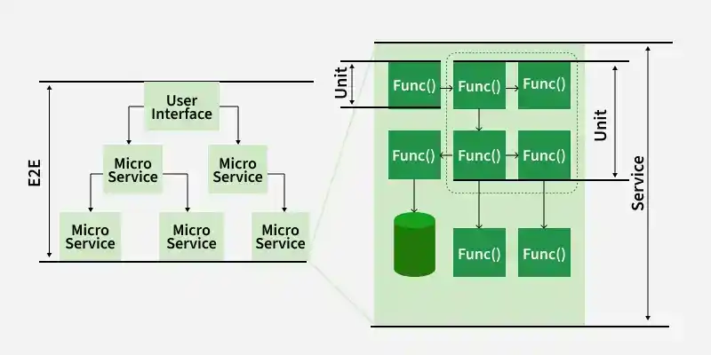
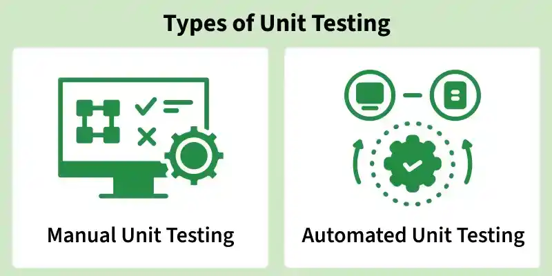

### 单元测试流程

单元测试工作流程包括以下步骤：

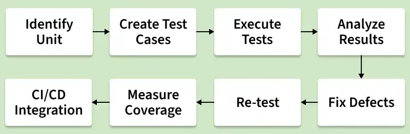

- **确定待测单元：** 确定需要测试的函数、方法、类或模块，并了解其预期行为。
- **创建单元测试用例：** 编写单元测试用例，涵盖所选单元的正面、负面、边界和异常场景。
- **执行单元测试：** 使用测试框架运行单元测试，验证代码是否按预期运行。
- **分析测试结果：** 审查测试结果，识别失败的测试用例，并确定缺陷原因。
- **修复缺陷：** 修复测试过程中发现的问题，并更新代码以解决已识别的缺陷。
- **重新执行单元测试：** 修复缺陷后再次运行单元测试，确保缺陷已成功解决。
- **衡量测试覆盖率：** 评估代码覆盖率，验证关键路径、条件和分支是否已得到充分测试。
- **与 CI/CD 流水线集成：** 在构建过程中自动化执行单元测试，以确保持续的代码质量和及早发现缺陷。

### 单元测试类型

单元测试可以手动执行，也可以自动执行：

#### 手动单元测试

[手动](https://www.geeksforgeeks.org/software-testing/software-testing-manual-testing/)单元测试是指在不依赖自动化测试框架的情况下验证单个代码单元。它主要用于调试或初始代码验证阶段。

- 开发人员手动验证小型函数、方法或模块的行为。
- 它适用于开发或故障排除期间的快速验证。
- 它不适用于重复测试，并且随着应用程序的增长会变得非常耗时。

#### 自动化单元测试

[自动](https://www.geeksforgeeks.org/software-testing/automation-testing-software-testing/)化单元测试使用测试框架和工具自动验证单个代码单元。它有助于提高代码质量并减少重复测试所需的工作量。

- 测试自动执行，并专注于隔离的代码单元。
- 通常使用模拟对象或桩对象来消除对外部系统的依赖。
- 自动化单元测试通常集成到 CI/CD 管道中，以支持持续测试和更快的反馈。

### 单元测试架构

单元测试架构定义了用于隔离测试各个软件组件的结构和方法。它有助于确保每个单元都能正常运行，并支持可维护、可靠且高质量的代码。

单元测试是测试金字塔（单元测试 → 集成测试 → 端到端测试）的基础，因为它们执行速度快，能够提供快速反馈，并有助于在开发早期发现缺陷。

#### 单元测试架构的组成部分

**1. 测试隔离与依赖关系：** 每个单元都独立于外部系统（例如数据库、API 和文件系统）进行测试。使用模拟对象、桩对象和伪对象来模拟依赖关系，确保仅验证单元的内部逻辑。

**2. AAA 模式（准备-执行-断言）：** AAA 模式提供了一种结构化的方法，用于编写清晰且易于维护的单元测试。

- **准备：** 准备测试数据、对象和所需的模拟对象。
- **执行：** 执行被测函数或方法。
- **断言：** 验证实际结果是否与预期结果一致。

这种方法促进了模块化测试，提高了测试的可读性，并使开发人员能够快速识别问题。由于单元测试通常在几毫秒内执行完毕，因此它们可以在开发和 CI/CD 执行期间提供快速反馈。

常见的单元测试框架包括 JUnit（Java）、pytest（Python）、xUnit（.NET）和 Jest（JavaScript）。

### 单元测试策略

为了创建有效的单元测试，通常使用以下技术：

- **逻辑检查：** 验证计算是否正确，以及代码中的所有逻辑路径是否按预期执行。
- **边界检查：** 测试正常输入、边界输入和无效输入，以确保系统能够正确处理各种限制。
- **错误处理：** 确保系统能够正确响应错误，而不是崩溃。
- **面向对象检查：** 确认方法执行后对象状态是否已正确更新。

### 单元测试技术

单元测试技术分为以下三种：

- [黑盒测试](https://www.geeksforgeeks.org/software-testing/software-engineering-black-box-testing/)：这是一种基于输入和预期输出对系统进行测试的技术，无需了解内部代码或逻辑。它侧重于从用户的角度验证功能，并确保系统对于给定的输入能够正确运行。
- [白盒测试](https://www.geeksforgeeks.org/software-testing/software-engineering-white-box-testing/)：这是一种测试应用程序内部结构、逻辑和代码的技术。它确保所有代码路径、条件和语句都能按预期正常工作。
- [灰盒测试](https://www.geeksforgeeks.org/software-testing/gray-box-testing-software-testing/)：这是一种结合了黑盒测试和白盒测试方法的技术，测试人员对系统内部结构有一定的了解。它有助于测试应用程序的功能和一些内部行为。

### 单元测试的特点

优秀的单元测试通过有效验证各个代码单元，确保软件的可靠性和可维护性。单元测试的关键特点包括：

- **快速：** 执行速度快，因此可以在开发过程中频繁运行测试。
- **独立：** 独立运行，不依赖其他测试或外部系统。
- **可重复：** 每次运行都能产生相同的结果，不受环境影响。
- **自验证：** 无需人工检查即可清晰地指示通过或失败。
- **专注：** 一次只测试一个功能或行为。
- **可读且易于维护：** 易于理解、更新和维护。

### 单元测试的优势

单元测试通过独立验证应用程序的各个组件，有助于确保软件的可靠性。

- 在开发周期的早期阶段发现缺陷，从而降低调试成本。
- 通过确保每个单元都能正常工作，提高代码质量。
- 增强代码修改或添加新功能时的信心。
- 通过快速验证代码变更，加快开发速度。
- 支持安全重构，不会破坏现有功能。
- 可作为理解代码行为的文档。

### 实现示例

以下示例演示了包含相应单元测试用例的 Java 代码。

**步骤 1.** 创建 Calculator 类。

```java
public class Calculator {

    // Method to add two numbers
    public int add(int a, int b) {
        return a + b;
    }

    // Method to subtract two numbers
    public int subtract(int a, int b) {
        return a - b;
    }
}
```

**步骤 2.** 创建 TestNG 测试类。

```java
package com.example.tests;

import org.testng.Assert;
import org.testng.annotations.BeforeMethod;
import org.testng.annotations.Test;

public class CalculatorTest {

    private Calculator calculator;

    // This method runs before each test method
    @BeforeMethod
    public void setUp() {
        calculator = new Calculator();
    }

    // Test for the 'add' method
    @Test
    public void testAdd() {
        int result = calculator.add(5, 3);
        // Assert that the result of 5 + 3 is 8
        Assert.assertEquals(result, 8, "Addition result is incorrect");
    }

    // Test for the 'subtract' method
    @Test
    public void testSubtract() {
        int result = calculator.subtract(5, 3);
        // Assert that the result of 5 - 3 is 2
        Assert.assertEquals(result, 2, "Subtraction result is incorrect");
    }
}
```

**输出：**

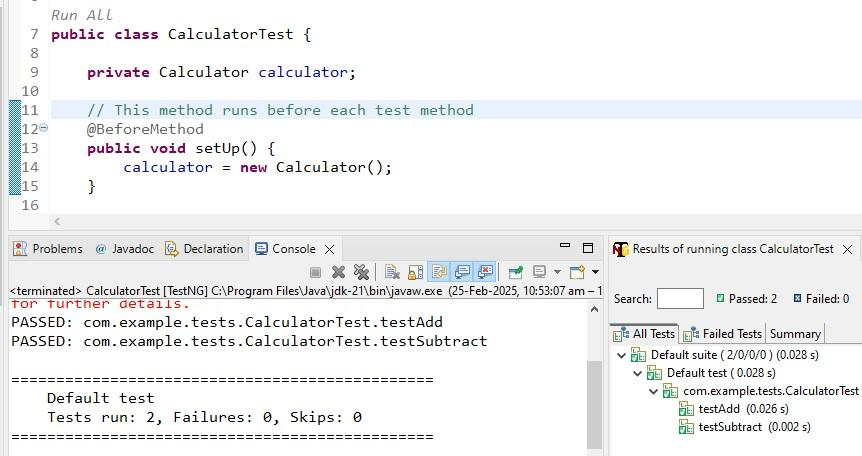

### 单元测试最佳实践

遵循最佳实践可确保单元测试高效、可靠且易于长期维护。

- 创建简洁、清晰且独立的测试用例。
- 使用能够描述预期行为的有意义的测试名称。
- 遵循 Arrange-Act-Assert (AAA) 模式。
- 使用模拟对象或桩对象避免外部依赖。
- 包含边界测试和边缘测试。
- 定期运行和维护测试，最好通过 CI/CD 流水线进行。

### 单元测试工具

以下是一些单元测试工具：

- **TestMu AI：** 一个基于云的 AI 驱动型测试平台，支持跨浏览器测试和自动化测试。
- **JUnit：** 一个广泛使用的 Java 测试框架，用于创建和运行单元测试。
- **NUnit：** 一个用于对 C# 应用程序进行单元测试的 .NET 框架。
- **TestNG：** 一个具有并行测试等功能的高级 Java 测试框架。
- **PHPUnit：** 一个用于单元测试和集成测试的 PHP 测试框架。
- **Mockito：** 一个用于模拟依赖关系的 Java 模拟框架。

### 单元测试的局限性

单元测试是软件测试的重要组成部分，但它存在一些局限性，影响其范围和有效性。

- 仅关注单个组件，而不测试整体系统行为。
- 无法检测不同模块或服务之间的集成问题。
- 大型项目需要额外的工作来编写和维护测试用例。
- 可能无法识别需要最终用户交互的可用性或 UI 相关问题。
- 有效性取决于开发人员编写的测试用例的质量。

## [集成测试](https://www.geeksforgeeks.org/software-testing/software-engineering-integration-testing/)

集成测试是一种[软件测试技术](https://www.geeksforgeeks.org/software-testing/software-testing-techniques/)，它专注于验证[软件应用程序](https://www.geeksforgeeks.org/computer-science-fundamentals/what-is-application-software/)中不同组件或模块之间的交互和数据交换。[集成测试](https://www.geeksforgeeks.org/software-testing/software-engineering-integration-testing/)的目标是识别不同组件组合并相互交互时出现的任何问题或缺陷。

- 它侧重于确定接口的正确性。所有模块完成单元测试后，即可执行集成测试。
- 集成测试可以逐模块增量式执行。这有助于确保模块按正确的顺序集成。
- 集成测试主要关注识别集成单元之间交互过程中出现的缺陷。

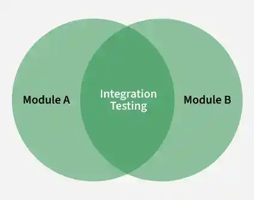
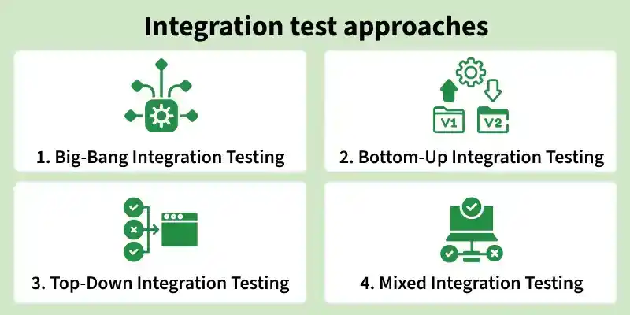

### 实际案例

**电子商务网站：** 集成测试确保在线购物平台的不同模块（例如产品目录、购物车、支付网关和用户账户）能够协同工作。

- 添加产品后，购物车会准确更新。
- 购物车总额会正确发送到支付模块。
- 支付成功后，会触发正确的订单确认并更新数据库。
- 库存和用户订单历史记录会正确更新。

### 架构

集成测试架构是指在单元测试之后，用于组合和测试多个软件模块的结构和设置。它验证组件之间的交互、接口和数据流，以确保系统作为一个整体能够正常工作。

它通常是测试金字塔（单元测试 → 集成测试 → 系统/端到端测试）中的中间层。

#### 集成测试架构的组成部分：

- **集成策略：** 用于系统地组合模块的不同方法，例如自顶向下（使用桩模块）、自底向上（使用驱动程序）、大爆炸式（一次性集成所有模块）以及混合/三明治式（结合了两种方法）。
- **测试框架及辅助工具：** 包括测试驱动程序、桩代码、模拟对象以及受控测试环境。它还会设置数据库、API 和消息队列等依赖项，以模拟真实系统行为。
- **接口及数据流测试：** 专注于验证 API、函数调用和数据库交互等通信点。它确保模块间数据传输正确、错误处理到位以及协议合规性良好。

### 集成测试工作流程

集成测试工作流程定义了验证集成软件模块间通信和数据流的步骤。

#### 1. 创建测试用例

编写测试用例以验证集成模块或组件之间的交互和接口。

- 识别模块间的集成点、数据流和 API。
- 编写涵盖跨模块边界的正面、负面和异常场景的测试用例。
- 准备集成测试数据、桩代码/驱动程序和环境设置。

#### 2. 审查测试用例

由同行或高级开发人员审查集成测试用例的完整性和正确性。

- 检查所有接口场景、数据映射和错误处理的覆盖范围
- 验证测试框架设置、断言以及是否符合集成标准
- 根据评审意见更新测试用例

#### 3. 最终确定测试用例

在执行前正式评审并批准集成测试用例。

- 审查测试用例的完整性、准确性和集成覆盖范围
- 评审和验证通过后批准测试用例
- 将最终确定的测试用例存储在版本控制系统中，以便进行追溯
- 将其标记为已批准并准备执行

#### 4. 执行测试用例

运行基准测试用例以验证模块交互并生成结果。

- 在集成环境或 CI/CD 流水线中执行测试
- 分析通过/失败结果、接口问题，并准备执行报告
- 记录缺陷并在修复集成问题后重新执行测试

### 设计和执行集成测试

设计集成测试可以确保不同的软件组件能够正确协同工作。请遵循以下步骤：

- **识别待测组件：** 确定哪些模块相互交互或依赖。
- **设定测试目标：** 定义要验证的内容——数据流、模块交互或整体行为。
- **准备测试数据：** 使用真实数据模拟实际场景。
- **设计测试用例：** 为每个测试制定清晰的步骤和预期结果。
- **编写测试脚本：** 尽可能实现测试自动化，或者清晰地记录手动步骤。
- **搭建测试环境：** 确保测试环境与生产环境一致。
- **执行测试：** 运行测试并观察模块交互。
- **评估结果：** 审查测试结果以识别错误或意外行为，并确保组件按预期工作。

### 集成测试的类型

集成测试可以使用不同的策略：

#### 1. 大爆炸式集成测试

在[大爆炸式集成测试](https://www.geeksforgeeks.org/software-testing/big-bang-integration-testing/)中，所有模块一次性集成，并作为一个完整的系统进行测试。

- 仅适用于模块数量有限的小型应用程序。
- 缺陷发生时，很难确定确切的根本原因。
- 没有增量测试，因此调试变得复杂且耗时。

#### 2. 自底向上集成测试

[自底向上集成测试](https://www.geeksforgeeks.org/software-engineering/steps-in-bottom-up-integration-testing/)首先测试底层模块，然后逐步集成高层模块。

- 使用测试驱动程序来模拟尚未可用的高层模块。
- 首先侧重于验证内部模块逻辑和数据流。
- 核心组件中的缺陷更容易及早发现和修复。

#### 3. 自顶向下集成测试

[自顶向下集成测试](https://www.geeksforgeeks.org/software-engineering/steps-in-top-down-integration-testing/)首先测试高层模块，然后逐步集成底层模块。

- 在早期测试阶段使用桩模块来模拟底层模块。
- 有助于在开发早期验证系统架构和主要工作流程。
- 确保在全面系统集成之前测试关键业务逻辑。

#### 4. 混合集成测试

结合自顶向下和自底向上两种方法并行执行。

- 使用桩和驱动程序同时测试不同层。
- 通过并行执行模块来缩短整体测试时间。
- 提供对高层和底层系统组件的均衡覆盖。

### 集成测试的挑战

集成测试有助于确保模块协同工作，但它也存在一些挑战，这些挑战会影响测试效率和准确性。

- 由于多个模块交互可能导致故障，因此调试复杂，难以确定根本原因。
- 当某些模块、API 或服务在测试期间尚未完全开发或稳定时，会出现依赖性问题。
- 需要搭建与生产环境高度匹配的测试环境，这可能非常耗时。
- 当多个系统共享和交换数据时，测试数据管理会变得困难。
- 需要花费更多精力来创建桩、驱动程序和模拟对象，以模拟缺失的组件。

### 工具

集成测试中使用各种工具和框架来自动化测试执行、模拟依赖关系并确保组件之间的顺畅交互。

- **Postman：** 用于测试 REST API 和验证服务之间请求-响应的常用工具。
- **RestAssured：** 基于 Java 的库，用于编写功能强大的自动化 API 集成测试。
- **Testcontainers：** 允许在 Docker 容器中运行真实的数据库、消息队列和服务，以进行逼真的集成测试。
- **JUnit / TestNG：** 用于编写和执行集成测试用例的框架（通常与 Spring Boot Test 结合使用）。
- **WireMock：** 用于在集成测试期间模拟外部 API 和第三方服务的工具。
- **Pytest：** 广泛用于编写集成测试用例的 Python 框架，支持 fixtures 和插件。
- **Jenkins / GitHub Actions：** CI/CD 工具，可在代码更改时自动运行集成测试。

### 最佳实践

遵循最佳实践可确保集成测试的可靠性、可维护性，并有效验证系统组件之间的交互。

- 仅在单元测试模块准备就绪后才开始测试，并首先关注关键接口和高风险集成。
- 使用真实且结构良好的测试数据，同时保持测试环境的清洁和稳定。
- 自动化重复的集成测试，并确保正确记录缺陷，以便于调试。
- 每次修复或更新后，都要执行增量测试和回归测试。
- 模拟外部服务以隔离系统组件并避免依赖项故障。
- 确保持续集成，以便在代码更改时自动运行测试。

## [负载测试 - 软件测试](https://www.geeksforgeeks.org/software-testing/software-testing-load-testing/)

负载测试是一种性能测试，用于评估系统在预期用户负载下的性能。它有助于确保应用程序在多个用户同时访问时保持稳定、响应迅速且高效。

- 检查正常负载和峰值负载下的响应时间、速度和系统稳定性
- 识别瓶颈、崩溃和性能问题
- 确保系统能够处理预期数量的并发用户

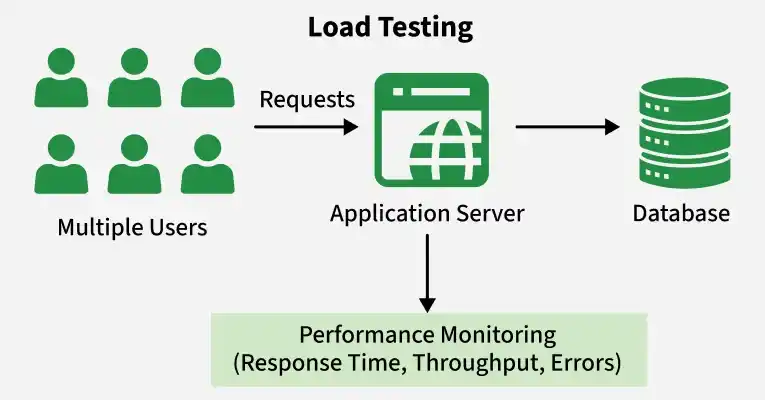

**例如：** 在促销活动期间，对一个电商网站进行 10,000 名用户的测试，以检验其能否在高流量下保持稳定运行。

### 负载测试类型

负载测试可以根据评估系统在不同负载条件下的性能进行分类。

- **[基准测试](https://www.geeksforgeeks.org/software-testing/baseline-testing/)：** 在正常预期用户负载下测量系统性能，以建立参考点。
- **增量负载测试：** 逐步增加用户数量，观察性能如何随负载增长而变化。
- **峰值负载测试：** 在最大预期用户流量下测试系统，以确保其在高峰时段也能良好运行。
- **断点测试：** 将系统推至极限，以确定其崩溃或故障的临界点。

### 负载测试技术

负载测试中使用不同的技术来评估系统在各种负载条件下的行为。

- **压力测试：** 检查系统在超出正常使用范围的负载下的性能。
- **峰值测试：** 评估系统对突发流量峰值的响应。
- **负载测试：** 评估系统在长时间持续负载下的性能。

### 负载测试准备

充分的准备工作能够确保测试结果的准确性，并有效评估系统性能。

- **选择工具：** 使用 JMeter、LoadRunner、Locust、Gatling 或 Apache Benchmark 等工具来模拟用户并测量性能。
- **定义目标：** 设定明确的目标，包括预期响应时间、事务量和用户行为。
- **确定关键场景：** 重点关注登录、搜索、表单提交和其他频繁交互等关键用户操作。

### 负载测试的目标

负载测试旨在确保系统能够高效地处理预期和未来的工作负载。

- **评估可扩展性：** 衡量系统如何处理不断增长的用户和事务，并确定性能瓶颈。
- **规划容量：** 确保系统能够满足未来用户、数据和事务的增长需求。
- **识别瓶颈：** 检测应用程序或基础架构中可能降低性能的薄弱环节。
- **分析响应时间：** 跟踪关键事务，确保系统在不同负载下都能迅速响应。
- **检测内存泄漏：** 识别并修复可能随时间推移降低性能的资源泄漏。

### 执行负载测试的场景

负载测试应在软件开发生命周期的关键阶段执行，以确保系统稳定性和性能。

- **产品发布前：** 验证系统能否处理生产环境中的预期用户流量。
- **重大更新后：** 引入新功能、模块或架构变更时。
- **高流量事件前：** 例如销售、产品发布或营销活动。
- **基础设施变更后：** 服务器、数据库或网络配置发生变更时。

### 负载测试流程

负载测试流程包括一系列步骤，用于评估系统性能并识别不同负载条件下的潜在问题。

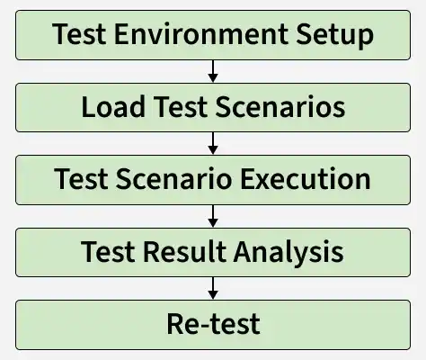

- **测试环境搭建：** 创建一个类似于生产环境的专用环境（服务器、网络、数据库）。这可以确保在不影响真实用户的情况下获得准确且真实的测试结果。
- **创建测试场景：** 定义用户活动，例如登录、搜索、交易等。准备测试数据，并确定用户数量、负载级别和执行条件。
- **执行测试：** 使用支持多虚拟用户的工具运行负载测试。在执行过程中监控系统行为、响应时间、服务器负载和错误率。
- **分析结果：** 检查收集的数据，找出瓶颈、响应缓慢或故障。确定根本原因并提出性能改进建议。
- **必要时重新测试：** 修复问题后，再次执行测试以验证改进效果，并确保系统满足性能要求。

### 负载测试指标

使用响应时间、吞吐量、错误率和资源利用率等指标，在不同的负载条件下衡量系统性能。

- **平均响应时间：** 系统响应用户请求的平均时间。它表明应用程序在负载下的运行速度，并直接影响用户体验。
- **错误率：** 测试期间失败或不成功的请求百分比。较高的错误率可能表明服务器过载、配置问题或应用程序缺陷。
- **吞吐量：** 测试期间每秒处理或传输的数据量。它显示了系统能够高效处理的工作负载。
- **每秒请求数 (RPS)：** 系统每秒处理的请求数。它有助于衡量应用程序管理传入流量的能力。
- **并发用户数：** 同时活跃使用系统的用户数。这有助于确定系统是否能够应对高峰使用时段。
- **峰值响应时间：** 系统响应请求所需的最长时间，通常在最大负载情况下观察到。它有助于识别性能瓶颈和高流量下系统运行缓慢的问题。

### 用例和示例

#### 示例：

一个电子商务网站通常处理 5,000 个并发用户。在一次大型节日促销活动之前，团队使用 JMeter 进行了负载测试。

#### 解决方案：

他们逐步将负载从 5,000 个用户增加到 50,000 个用户。测试结果显示，在3万用户的情况下，结账页面响应时间从1秒跃升至8秒，并且由于数据库过载，错误率也急剧上升。

在优化数据库查询并添加缓存后，他们重新进行了测试，成功处理了5万用户，平均响应时间低于2秒。这有效避免了实际销售过程中网站出现卡顿。

### 负载测试工具

负载测试中使用了多种工具来模拟用户流量、测量性能指标并有效识别系统瓶颈。

- **Apache JMeter：** 开源工具，广泛用于 API 和 Web 负载测试，对脚本编写和分布式测试提供强大的支持。
- **WebLoad：** 在不同的用户负载下测试 Web 应用程序，以识别瓶颈并确保其能够处理预期流量。
- **NeoLoad：** 模拟虚拟用户来测试可扩展性和压力性能，有助于检测瓶颈和可靠性问题。
- **LoadNinja：** 基于云的实时负​​载测试工具，可提供应用程序性能和可扩展性的深入分析。
- **Micro Focus LoadRunner（原 HP Performance Tester）：** 企业级工具，专为大规模性能测试而设计，具有高级分析和协议支持。
- **LoadUI Pro：** 用于测试 Web 应用程序和 API 的商业工具；模拟各种负载条件并监控系统行为。
- **LoadView：** 基于云的平台，模拟真实用户交互以评估网站在高流量下的性能。

### 负载测试期间的监控

监控工具可在负载测试运行时跟踪服务器和应用程序的性能，从而识别系统瓶颈和资源使用问题。

- **CPU 监控：** 检查高流量情况下的处理器利用率。
- **内存监控：** 检测高内存消耗和内存泄漏。
- **服务器监控：** 跟踪服务器的健康状况、正常运行时间和资源利用率。
- **网络监控：** 测量带宽使用情况、延迟和网络稳定性。
- **数据库监控：** 观察负载下的查询执行时间和数据库性能。

### 负载测试的优势

负载测试具有多项优势，使其成为软件测试的重要组成部分：

- **识别瓶颈：** 检测性能问题，例如数据库查询缓慢、内存不足或网络拥塞，使开发人员能够优化系统。
- **提高可扩展性：** 确定系统的最大容量，并确保应用程序能够随着时间的推移处理不断增长的用户和事务。
- **增强可靠性：** 揭示高负载下的错误率或响应缓慢等问题，确保生产环境中的性能稳定。
- **降低部署风险：** 在发布前识别潜在故障，最大程度降低实际使用中出现崩溃或性能不佳的概率。
- **经济高效：** 在测试期间修复性能问题远比部署后解决成本低得多。
- **提升用户体验：** 确保流畅响应的性能，从而提高用户满意度和信任度。

## [压力测试](https://www.geeksforgeeks.org/software-testing/stress-testing-software-testing/)

压力测试是一种[软件测试技术](https://www.geeksforgeeks.org/software-testing/software-testing-techniques/)，用于确定系统在承受超出其预期容量的工作负载时的行为。它有助于评估应用程序的稳健性和处理极端运行条件的能力。

- 确定系统在过载下的崩溃点。
- 揭示性能限制和资源利用问题。
- 验证系统在故障后是否能够正确恢复。

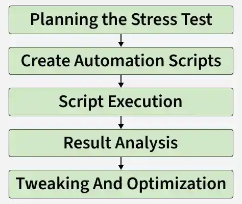
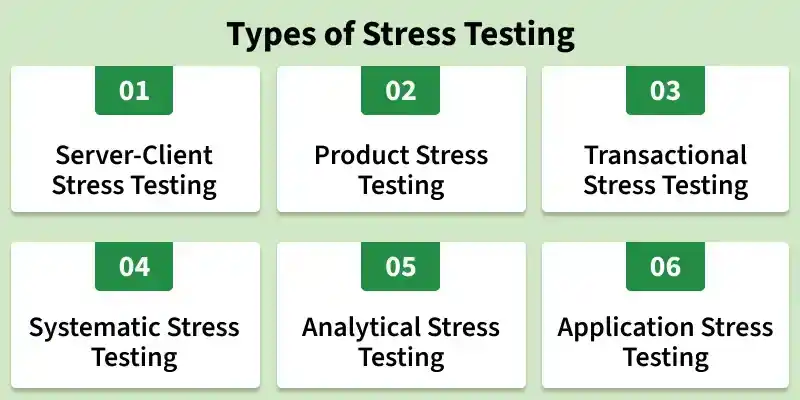

### 特性

这些特性定义了压力测试如何评估系统在极端和不可预测条件下的行为。

- **风险识别：** 有助于检测系统在极端条件下的弱点和潜在故障点。
- **定量和定性分析：** 评估压力测试期间的性能指标（数值）和整体系统行为。
- **可变测试条件：** 通过改变负载、流量和外部条件等因素来测试系统。
- **团队协作：** 涉及多个团队（开发、测试、运维），以便进行更深入的分析。
- **清晰的沟通：** 需要对目标、方法和结果进行适当的报告，以进行有效的改进。

### 压力测试的必要性

压力测试对于确保系统在意外或高压情况下的可靠性和性能至关重要。

- **应对流量高峰：** 确保系统能够应对用户数量的突然增加，例如在销售高峰期或高峰时段，而不会崩溃。
- **适当的错误处理：** 检查应用程序在高负载下是否显示清晰且适当的错误消息。
- **异常情况下的运行：** 验证系统即使在极端或意外情况下也能持续运行。
- **故障应对准备：** 有助于验证灾难恢复策略、故障转移系统、备份机制和恢复计划，以确保在意外系统故障期间业务连续性。

### 压力测试流程

压力测试流程包括规划、执行、分析和优化测试，以评估系统在极高负载和故障情况下的行为。

- **规划：** 收集系统详细信息（服务器、数据库、流量模式），分析当前性能，并设定明确的目标（例如，每分钟处理 10,000 个用户，并保持可接受的响应时间）。
- **创建测试脚本：** 使用压力测试工具开发自动化脚本，并准备真实的测试数据来模拟用户活动。
- **执行测试：** 在受控环境中运行压力测试，并逐步增加负载以观察系统行为。
- **分析结果：** 审查日志和性能指标，以识别瓶颈、故障或速度下降（例如，CPU 限制、数据库问题）。
- **优化和重新测试：** 修复已发现的问题，优化系统性能，并重新测试以确保系统达到预期基准。

### 压力测试类型

压力测试可以根据在极端条件下评估的系统方面采用不同的方法。

**1. 服务器-客户端（分布式）压力测试：** 测试服务器同时处理多个客户端请求的能力，以确保其在高负载下的稳定性。

**示例：** 模拟数千用户同时登录以检查服务器性能。

**2. 产品压力测试：** 侧重于识别特定应用程序中的问题，例如性能瓶颈、数据冲突或网络故障。

**示例：** 同时运行多个数据库事务以检测速度减慢或锁定问题。

**3. 事务压力测试：** 评估系统间事务在高负载条件下的性能，以确保流畅处理。

**示例：** 模拟电子商务平台每分钟处理数千笔支付交易。

**4. 系统性压力测试：** 在同一服务器上测试多个应用程序，以识别资源共享问题和性能影响。

**例如：** 检查高负载数据库是否会影响运行在同一服务器上的其他应用程序。

**5. 分析性（探索性）压力测试：** 使用非常规或极端场景测试系统，以评估在罕见但可能发生的情况下系统的行为。

**例如：** 模拟高峰流量期间的数据库崩溃，以分析系统响应和恢复情况。

### 压力测试工具

压力测试工具用于模拟高负载，并在极端条件下评估应用程序的性能、稳定性和可靠性。

- **Apache JMeter：** 一款基于 Java 的开源工具，用于对网站和各种服务进行压力和负载测试。
- **LoadNinja：** SmartBear 旗下的一款工具，允许使用真实浏览器进行无代码负载测试，从而获得准确的性能结果。
- **WebLOAD：** 一款用于测试 Web 和移动应用程序的性能、稳定性和可靠性的工具。
- **NeoLoad：** 一款性能测试工具，可模拟大量用户，并支持 Web、移动和 API 测试，同时集成 CI/CD。
- **SmartMeter：** 一款用户友好的测试工具，具有图形界面，允许无需编写代码即可创建测试并生成详细报告。

### 压力测试指标

压力测试指标用于衡量系统在高负载下的性能。常用指标包括：

- **每秒页面数 (Pages per Second)：** 每秒处理的页面请求数。
- **页面加载时间 (Page Load Time)：** 页面完全加载所需的平均时间。
- **首字节到达时间 (TTFB)：** 从服务器接收到第一个字节数据所需的时间。
- **事务响应时间：** 完成事务所需的平均时间。
- **每秒事务数 (TPS)：** 每秒处理的成功事务数。
- **错误/故障率：** 连接失败或系统尝试失败的次数。
- **测试轮数：** 成功和失败的测试周期数。

### 优势

压力测试能够深入了解系统稳定性，并有助于确保系统在极端条件下的可靠性能。

- **了解系统行为：** 展示系统在故障期间的响应方式，并确保其能够快速恢复。
- **提升安全性：** 确保系统崩溃或高负载不会造成安全漏洞。
- **确保可靠性：** 帮助系统在正常和极端条件下都能正常运行。
- **支持更佳决策：** 提供有助于提升性能和风险管理的有用信息。
- **增强利益相关者的信心：** 证明组织已做好应对高负载情况和潜在风险的准备。

## [CI/CD 流水线 - 系统设计](https://www.geeksforgeeks.org/system-design/cicd-pipeline-system-design/)

CI/CD 代表持续集成和持续交付/部署。它自动化构建、测试和部署代码，使软件交付更快、更可靠、更不容易出错。

- **持续集成：** 开发人员定期合并代码更改，并运行自动化测试以尽早发现问题。
- **持续交付：** 代码更改在测试成功后自动准备发布，但需要人工批准才能部署。
- **持续部署：** 代码更改自动部署到生产环境，无需人工批准。

**示例：** 在 Web 应用程序中，当开发人员将代码推送到代码库时，系统会自动构建和测试代码。如果一切顺利，应用程序将自动部署到生产环境，无需人工干预。

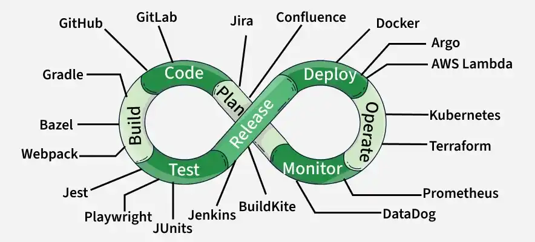

### 持续集成 (CI)

持续集成 (CI) 是 CI/CD 流水线的核心实践。这意味着开发人员频繁地将小的代码更改合并到共享代码库中，以便尽早发现问题。它专注于自动化构建和测试，以维护代码质量并避免后续进行大型、复杂的集成。

**例如：** 在项目中，每当开发人员向 GitHub 提交代码时，Jenkins 或 GitHub Actions 等持续集成 (CI) 工具都会自动构建应用程序并运行测试。如果任何测试失败，开发人员会立即收到通知，并可以快速修复问题。

#### 工作原理

这解释了持续集成流程如何在代码更改后自动运行。

- 开发人员定期将小的代码更改推送到共享代码库（每天多次推送，而不是不频繁的大型更新）。这可以保持代码库的更新，并减少集成问题。
- 每次代码推送都会自动触发 CI 流水线，该流水线首先构建应用程序。此步骤编译代码并准备进行测试，以确保没有构建错误。
- 构建成功后，将执行自动化测试。这些测试包括单元测试（用于验证各个组件）和集成测试（用于确保系统的不同部分能够正确协同工作）。
- 如果任何步骤（构建或测试）失败，流水线将停止并立即通知开发人员，以便快速修复。如果所有步骤都通过，则代码被认为是稳定的，可以进入下一阶段。

#### CI 测试类型

CI 测试有两种类型。

- **单元测试：** 验证小型、独立的组件。
- **集成测试：** 确保应用程序的不同部分能够正确协同工作。

#### 目标

尽早发现集成问题，以便在问题最容易、成本最低的时候进行修复。避免“集成地狱”，即大型代码变更在后期合并时导致的：

- 大规模冲突。
- 隐藏的 bug。
- 漫长的调试周期。

### 持续交付 (CD)

持续交付 (CD) 扩展了持续集成 (CI) 的功能，它自动化了代码生产发布所需的一切准备工作。CI 在构建和测试后停止，而 CD 则启动并将已验证的工件部署到预生产环境中。

**例如：** 开发人员提交新功能后，代码通过 CI 测试，并自动部署到与生产环境镜像的预发布环境。在此环境中，在功能正式发布给用户之前，会运行端到端测试、性能测试和安全测试。

#### 工作原理

以下解释了代码成功通过 CI 阶段后发生的情况。

- 一旦代码通过 CI 中的所有构建和测试，CD 流水线就会接管并自动将应用程序推进到下一个阶段。第一步是将构建部署到测试环境，在那里执行额外的测试，例如端到端测试和集成测试，以检查系统的完整行为。
- 应用程序通过测试后，会被部署到预发布环境。该环境与生产环境几乎完全相同（相同的设置、配置和数据模式），因此有助于团队验证应用程序在实际环境中是否能够正常运行。
- 这些环境充当检查点，用于在正式上线前发现任何遗留问题。当代码到达持续交付流程的最后阶段时，它已经过全面测试，稳定可靠，可以放心发布。

#### 持续交付 (CD) 流水线中的测试类型

CD 会运行更深入、更长时间的测试，例如：

- 端到端 (E2E) 测试
- 性能测试
- 安全扫描
- 用户验收测试 (UAT)

#### 目标

目标是确保应用程序始终处于可发布状态，并具有高度的可靠性。

- 确保始终有一个已通过所有自动化检查的生产就绪版本。
- 随时可以自信且稳定地发布版本。

### 持续部署 (CD)

持续部署 (CD) 是 CI/CD 流水线中最高级别的自动化。它会自动将代码更改发布到生产环境，无需任何人工审批。一旦代码通过所有测试，它就会直接上线。这有助于更快地交付更新，并确保用户始终获得最新版本。

**示例：** 如果开发人员修复了登录功能中的一个错误，则该更改将通过流水线自动进行测试。一旦通过所有检查，它将立即部署到生产应用程序，因此用户无需等待下一个发布周期即可体验修复。

#### 工作原理

这解释了代码如何在所有检查完成后自动部署到生产环境。

- 开发人员提交代码后，代码首先会经过持续集成 (CI) 流程，该流程会构建应用程序并使用单元测试和集成测试进行测试。如果所有测试都通过，则会进入持续交付 (CD) 阶段，执行更高级的测试，例如端到端测试、性能测试和安全测试。
- 如果代码成功通过所有这些检查，则会自动部署到生产环境，无需任何人工审批。这确保了快速、可靠的发布，并使应用程序始终保持最新状态。

### 传统方法与 CI/CD 方法

让我们逐步比较传统方法和 CI/CD 方法。

#### 1. 代码集成

这指的是开发人员如何以及何时将他们的代码合并到主项目中。

##### 传统方法（瀑布式开发）

- 开发人员各自独立工作数周/数月。在项目结束时合并所有代码。
- 结果：大量的“合并冲突”、功能缺陷、大量的调试工作。

##### CI/CD 方法

- 开发人员每天甚至每小时集成小的代码更改。
- 自动化构建和测试立即运行。
- 结果：冲突发现得早，修复起来更容易。

#### 2. 测试

这部分涵盖了开发过程中代码的测试方式。

##### 传统方法

- 测试在系统完全构建完成后进行。手动测试需要数天甚至数周的时间。
- 后期发现的缺陷修复成本更高。

##### 持续集成/持续交付 (CI/CD) 方法

- 每次代码推送都会运行自动化测试（单元测试、集成测试、UI 测试）。
- 代码编写后几分钟内即可发现缺陷。

#### 3. 部署

这指的是将应用程序发布到生产环境。

##### 传统方法

- 每隔几个月发布一次。
- 需要`大爆炸式`部署，导致整夜停机，如果出现问题则需要回滚。
- 例如：午夜部署，停机 5 小时，客户不满。

##### 持续集成/持续交付 (CI/CD) 方法

- 小规模、频繁的部署（如有需要，每天多次）。
- 例如：下午 3 点部署愿望清单功能，监控部署情况，如有需要立即回滚。

### CI/CD 流水线的组成部分

CI/CD 流水线由多个阶段组成，可高效可靠地自动化构建、测试和部署代码的过程。

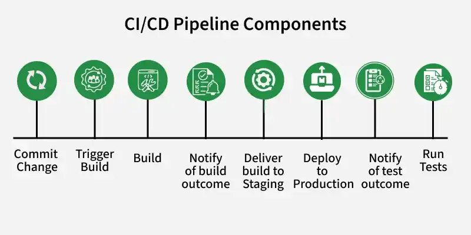

#### 阶段 1：源代码

源代码阶段是整个 CI/CD 流水线的入口点和触发点。它与版本控制系统紧密相连，版本控制系统是代码库的唯一真实来源。

- **触发：** 流水线运行由版本控制系统中的事件启动。最常见的触发是向特定分支（例如 main 或 develop）推送代码，但也可能是创建或更新拉取请求、创建 Git 标签，甚至是计划事件。
- **预检：** 在执行资源密集型的构建和测试流程之前，流水线会直接对源代码执行一系列快速的自动化检查。这体现了“快速失败”原则：立即发现简单的问题，以节省时间和计算资源。这些检查通常包括：
- **静态代码分析：** SonarQube 等工具会在不执行代码的情况下扫描源代码，以识别潜在的错误、逻辑错误、代码异味以及可能导致未来问题的过于复杂的结构。
- **代码检查：** 代码检查工具会强制代码库采用一致的编码风格和格式。这有助于提高代码的可读性和可维护性，这对协作项目至关重要。
- **安全扫描 (SAST)：** 静态应用程序安全测试 (SAST) 工具会在代码编译之前分析源代码中是否存在已知的安全漏洞，例如 SQL 注入或跨站脚本攻击 (XSS) 漏洞。

#### 阶段 2：构建

源代码通过初始检查后，构建阶段会将其从人类可读的代码转换为可运行的打包应用程序。

- **编译：** 源代码会被编译或转译成可执行格式（例如，Java 字节码、.NET 程序集或浏览器打包的 JavaScript）。
- **依赖管理：** 所有必需的库和框架都会在构建过程中自动获取并包含。
- **工件创建：** 应用程序及其代码、依赖项和配置被打包成可部署的单元，例如 Docker 镜像、JAR/WAR 文件、NuGet 包或 ZIP 文件。
- **不可变性：** 创建的工件带有版本号，且永不更改。所有环境均使用相同的工件，以确保一致性并避免“在我机器上运行正常”的问题。

#### 阶段 3：测试

在测试阶段，构建的工件将接受严格的多层验证流程，以确保其质量、正确性和稳定性。此阶段通常是整个流程中最耗时的部分，由多个自动化测试子阶段组成。

- **单元测试：** 单独测试代码的最小组成部分（函数/类）。单元测试速度快，由开发人员编写，有助于快速识别特定故障。
- **集成测试：** 检查不同的模块或服务是否能够正确协同工作，例如数据库交互或服务之间的 API 通信。
- **端到端 (E2E) 测试：** 从用户角度验证完整的应用程序流程，模拟真实用户操作，例如登录、结账等。
- **合规性和安全性测试：** 确保系统遵循必要的策略和安全标准，包括使用 DAST 等工具进行运行时漏洞检查。

#### 阶段 4：部署

构建产物成功通过所有自动化测试后，部署阶段负责将其发布到各种环境，最终交付给最终用户。

- **环境升级：** 经过验证的产物会依次经过多个环境——开发环境、预发布环境（接近生产环境的副本）和用户验收测试环境 (UAT)——最终发布到生产环境供最终用户使用。
- **部署策略：** 生产环境部署采用滚动部署、蓝绿部署或金丝雀部署等策略，以确保平稳发布，并将停机时间降至最低甚至为零。
- **基础设施即代码 (IaC)：** 现代流水线还使用代码（例如 Terraform、AWS CloudFormation、Azure ARM）管理基础设施，从而实现自动化配置和版本控制的基础设施以及应用程序部署。

### 流水线编排

系统设计中的流水线编排是指管理和自动化 CI/CD 流水线的各个阶段，以确保软件交付的流畅性和高效性。编排确保从代码提交到生产部署的流水线每个阶段都按照预定义的规则按正确的顺序执行。

以下深入探讨系统设计中的流水线编排：

#### 1. 流水线定义

这定义了 CI/CD 流水线的结构和代码编写方式。

- **声明式流水线：** 使用领域特定语言 (DSL) 以代码形式定义流水线的各个阶段和步骤。这使得流水线易于版本控制和修改。
- **脚本式流水线：** 使用通用脚本语言定义复杂的工作流和自定义逻辑。

#### 2. 阶段管理

这控制流水线中不同步骤的执行方式。

- **顺序阶段：** 定义按顺序执行的阶段，确保从开发到部署的线性流程。
- **并行阶段：** 同时执行多个阶段，以优化资源利用并缩短整体流水线执行时间。

#### 3. 条件和分支

这允许基于条件和代码分支灵活执行。

- **条件执行：** 根据特定条件（例如分支名称、环境变量或先前步骤的结果）执行阶段或步骤。
- **分支：** 为不同的分支（例如，特性分支、主分支）定义不同的工作流，以管理开发和发布的不同阶段。

#### 4. 流水线触发器

这决定了流水线的启动时间。

- **基于事件的触发器：** 根据事件（例如代码提交、拉取请求或手动触发）启动流水线。
- **计划触发器：** 按计划的时间间隔执行流水线，以执行诸如夜间构建或定期测试之类的任务。

#### 5. 工件管理

这处理构建过程中生成的输出。

- **构建工件：** 管理构建过程的输出（例如，编译后的二进制文件、Docker 镜像），并确保它们在各个阶段之间正确传递。
- **工件存储：** 使用工件仓库（例如，JFrog Artifactory、Nexus）来存储和管理构建工件。

#### 6. 环境管理

这确保了不同阶段的正确配置。

- **环境变量：** 定义和管理流水线不同阶段所需的环境变量。
- **基础设施即代码 (IaC)：** 使用 Terraform 或 Ansible 等工具来配置和管理流水线中的基础设施。

### 常用 CI/CD 工具

这些工具有助于自动化整个软件交付流程，从代码集成到部署，从而加快开发速度并提高可靠性。

1. **Jenkins：** 开源自动化服务器；可通过插件高度扩展；非常适合复杂的流水线。
2. **GitLab CI/CD：** 内置于 GitLab 中；易于设置；支持流水线即代码和 Kubernetes 集成。
3. **CircleCI：** 基于云；利用并行和缓存实现快速构建；与 Docker 兼容性良好。
4. **Travis CI：** 基于云端；设置简单；适用于开源项目和多种语言。
5. **GitHub Actions：** 集成于 GitHub；事件驱动型工作流；使用预构建的操作轻松实现自动化。

**提示：** 根据项目规模、版本控制系统和团队熟悉程度选择工具。

### CI/CD 流水线的安全性

确保 CI/CD 流水线的安全性对于保护软件开发生命周期免受漏洞和威胁至关重要。在 CI/CD 流水线的每个阶段实施安全最佳实践有助于保护代码、构建工件和部署环境。

以下是保护 CI/CD 流水线的关键注意事项和最佳实践：

#### 1. 代码安全

这侧重于在代码进入流水线之前对其进行保护。

- **代码审查：** 强制所有代码变更进行同行评审。GitHub 和 GitLab 等工具提供在合并代码之前强制进行代码审查的功能。
- **静态代码分析：** 在构建阶段使用 SonarQube、Checkmarx 或 Snyk 等工具分析代码中的漏洞和编码规范。
- **密钥管理：** 将 API 密钥、密码和令牌等敏感信息存储在 HashiCorp Vault、AWS Secrets Manager 或 Azure Key Vault 等安全密钥库中。避免将密钥硬编码到代码库中。

#### 2. 构建安全

这确保构建过程安全无漏洞。

- **构建隔离：** 在隔离的环境（例如容器或虚拟机）中运行构建，以防止交叉污染和未经授权的访问。
- **依赖项管理：** 使用 OWASP Dependency-Check、Snyk 或 WhiteSource 等工具扫描依赖项中的已知漏洞。定期将依赖项更新到最新的安全版本。
- **已签名工件：** 对构建工件进行加密签名，以确保其完整性和真实性。在将工件部署到生产环境之前，请验证签名。

#### 3. 环境安全

这部分侧重于保护不同的部署环境。

- **基础设施即代码 (IaC)：** 使用 Terraform、Ansible 或 CloudFormation 等 IaC 工具安全地定义和管理基础设施。将 IaC 配置存储在版本控制的存储库中。
- **环境分段：** 隔离环境（开发、预发布、生产），以最大限度地降低未经授权的访问和数据泄露的风险。使用网络分段和防火墙规则来控制环境之间的访问。
- **访问控制：** 实施基于角色的访问控制 (RBAC) 来限制对 CI/CD 工具和环境的访问。遵循最小权限原则，向用户和服务帐户授予必要的最小权限。

#### 4. 流水线安全

这部分确保 CI/CD 流水线本身免受威胁。

- **安全的 CI/CD 工具：** 确保 CI/CD 工具（例如 Jenkins、GitLab CI/CD、CircleCI）已安装最新的安全补丁。定期审核配置和权限。
- **流水线加固：** 对流水线配置和脚本实施严格的访问控制。使用加密通信通道（例如 HTTPS、SSH）进行数据传输。
- **第三方集成：** 评估并限制第三方插件和集成的使用。确保它们来自可信来源并定期更新。

#### 5. 运行时安全

这侧重于在执行期间监控和保护流水线。

- **容器安全：** 使用 Aqua、Twistlock（Palo Alto Prisma）或 Clair 等容器安全工具扫描容器镜像中的漏洞。遵循容器安全的最佳实践，例如使用非 root 用户运行容器并最大限度地减少攻击面。
- **持续监控：** 对 CI/CD 流水线活动实施监控和日志记录。使用 ELK Stack（Elasticsearch、Logstash、Kibana）、Splunk 或 Prometheus 等工具监控管道日志并检测异常。
- **事件响应：** 制定并维护 CI/CD 管道安全漏洞事件响应计划。定期进行演练，并根据经验教训更新计划。

#### 6. 合规性和治理

这确保遵守安全策略和法规。

- **策略执行：** 使用 Open Policy Agent (OPA) 或 Sentinel 等策略即代码工具，在整个 CI/CD 管道中强制执行安全和合规性策略。
- **审计跟踪：** 维护管道活动的详细审计日志，包括代码提交、构建过程和部署操作。确保日志防篡改并安全存储。
- **合规性检查：** 将合规性检查集成到 CI/CD 管道中，以确保遵守行业标准和法规（例如 GDPR、HIPAA、PCI-DSS）。

### 扩展 CI/CD 流水线

扩展 CI/CD 流水线对于支持更大规模的团队、应对不断增长的负载以及确保高可用性至关重要。

以下是有效扩展 CI/CD 流水线的关键注意事项和最佳实践：

#### 1. 基础设施可扩展性

这侧重于扩展资源以高效应对不断增长的工作负载。

- **横向扩展：** 添加更多 CI/CD 服务器或代理来处理额外的负载。Jenkins、GitLab CI 和 CircleCI 等工具支持添加多个代理来分配工作负载。
- **容器化：** 使用容器在隔离、可复现的环境中运行 CI/CD 作业。Docker 和 Kubernetes 等工具可以帮助管理和扩展容器化工作负载。
- **云服务：** 利用基于云的 CI/CD 服务（例如 AWS CodePipeline、Azure DevOps、GitHub Actions）根据需求自动扩展基础设施。

#### 2. 并行执行

这有助于通过同时运行任务来缩短管道执行时间。

- **并行作业：** 配置管道以并行运行多个作业。这可以显著减少完成管道所需的时间，尤其是在构建和测试阶段。
- **矩阵构建：** 使用矩阵构建可以在不同的环境或配置（例如，多个操作系统版本、不同的编程语言版本）上运行同一组测试或构建。

#### 3. 流水线优化

这可以提高效率并减少不必要的处理。

- **缓存：** 实施缓存机制以在构建之间重用依赖项和工件。这可以减少下载和安装依赖项所花费的时间。
- **增量构建：** 配置流水线，使其仅构建和测试已更改的组件，而不是整个项目。这可以通过 Bazel 或 Gradle 的增量构建功能等工具来实现。
- **流水线即代码：** 将 CI/CD 流水线定义为代码，以便进行版本控制，并轻松地在不同的项目和环境中复制流水线配置。

#### 4. 负载均衡

这可以确保工作负载在资源之间均匀分布。

- **负载均衡器：** 使用负载均衡器将传入的 CI/CD 作业请求均匀地分配到多个服务器或代理上。这可以确保不会有单个服务器过载。
- **分布式构建：** 使用分布式构建系统，将大型构建拆分成更小的任务，并在多个节点上运行。

#### 5. 监控和日志记录

这有助于跟踪性能并快速识别问题。

- **集中式日志记录：** 实施集中式日志记录解决方案（例如 ELK Stack、Splunk）来聚合来自所有 CI/CD 组件的日志。这有助于监控流水线运行状况并排查问题。
- **性能监控：** 使用监控工具（例如 Prometheus、Grafana）来跟踪 CI/CD 流水线的性能。监控作业持续时间、资源利用率和故障率等指标。

#### 6. 高可用性和容错性

这确保流水线即使在发生故障时也能保持运行。

- **冗余：** 设置冗余的 CI/CD 服务器或代理以确保高可用性。使用诸如双活或双备配置之类的技术。
- **自动故障转移：** 实施自动故障转移机制，以便在发生故障时切换到备份服务器。Kubernetes 等工具可以帮助管理容器化工作负载的故障转移。

### CI/CD 的挑战及其解决方案

持续集成/持续部署 (CI/CD) 流水线是自动化软件交付流程的强大工具，但它们也面临着一系列挑战。以下列举了一些 CI/CD 流水线常见的挑战以及如何避免或缓解这些挑战：

#### 1. 流水线配置的复杂性

当流水线由于涉及多个阶段和环境而难以管理时，就会出现这种情况。

- **挑战：** CI/CD 流水线可能会变得非常复杂，尤其是在涉及多个阶段和环境的大型项目中。
- **解决方案：** 使用基础设施即代码 (IaC) 工具（例如 Terraform 或 CloudFormation）来管理流水线配置。将流水线拆分为更小、可重用的组件。使用版本控制来跟踪流水线配置的变更并促进协作。

#### 2. 集成问题

当流水线中的不同工具无法顺畅协作时，就会出现这种情况。

- **挑战：** 确保各种工具和系统（例如版本控制、测试框架、部署目标）在流水线中无缝集成。
- **解决方案：** 定期更新和测试工具之间的集成。使用 CI/CD 平台提供的标准化 API 和插件。将集成测试自动化集成到流水线中。

#### 3. 构建/测试执行缓慢

当构建和测试耗时过长，导致开发速度减慢时，就会出现这种情况。

- **挑战：** 过长的构建和测试时间会延迟反馈和部署。
- **解决方案：** 通过并行化任务和利用缓存机制来优化构建流程。使用容器化技术（例如 Docker）为构建和测试创建一致的环境。实施增量构建，仅构建/测试已更改的内容。

#### 4. 维护流水线可靠性

这指的是保持流水线的稳定性和持续运行。

- **挑战：** 确保 CI/CD 流水线在交付构建时可靠且一致。
- **解决方案：** 监控流水线的性能和可靠性指标。实施构建失败的自动重试和通知机制。定期审查和更新流水线配置和依赖项。

#### 5. 安全问题

这涉及与数据、凭证和系统漏洞相关的风险。

- **挑战：** 流水线组件中的漏洞或凭证处理不当可能导致安全漏洞。
- **解决方案：** 使用密钥管理工具（例如 HashiCorp Vault、AWS Secrets Manager）安全地存储和访问凭证。对流水线组件实施最小权限访问控制。定期进行安全审计和漏洞评估。

#### 6. 扩展性挑战

当流水线难以应对不断增加的工作负载或团队规模时，就会出现这种情况。

- **挑战：** 扩展 CI/CD 流水线以应对不断增加的工作负载和更大的团队。
- **解决方案：** 使用支持分布式构建和并行执行的可扩展 CI/CD 平台。监控资源利用率并相应地调整流水线配置。实施流水线即代码实践，以便轻松复制和扩展流水线。

#### 7. 测试覆盖率不足

当测试不足导致生产环境中出现缺陷时，就会出现这种情况。

- **挑战：** 测试不足会导致缺陷进入生产环境。
- **解决方案：** 实施全面的测试策略（单元测试、集成测试、回归测试、性能测试）。在流水线的每个阶段实现自动化测试。将测试框架与 CI/CD 工具集成，以实现无缝执行和报告。
