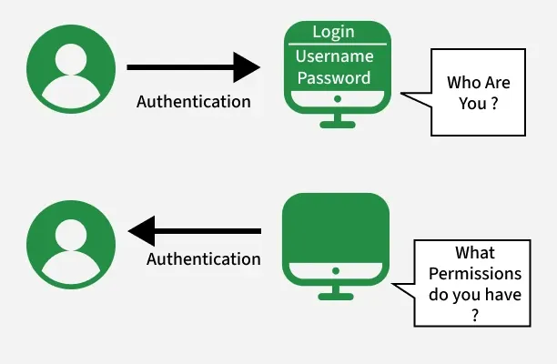
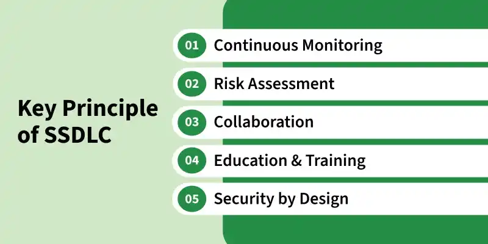
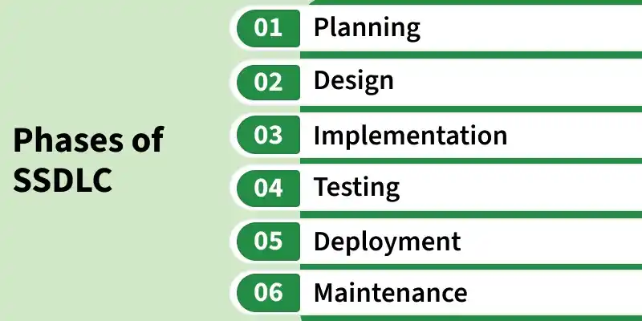
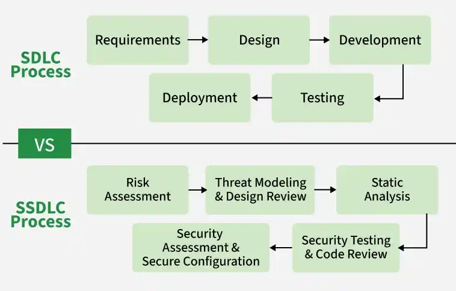
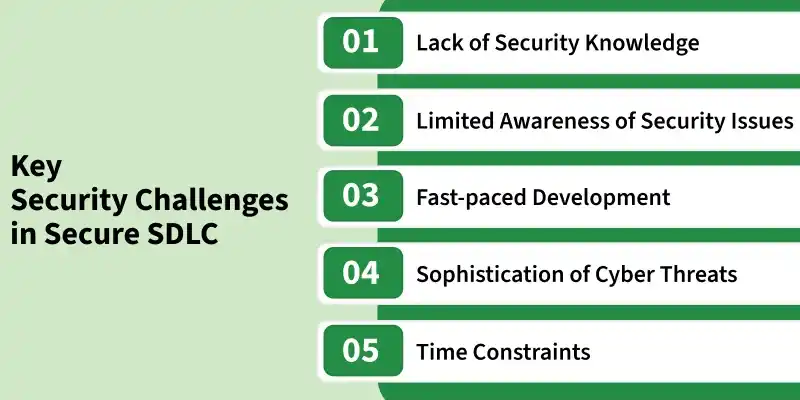
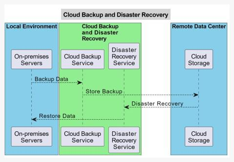

# 安全措施

## [系统设计中的安全措施](https://www.geeksforgeeks.org/system-design/essential-security-measures-in-system-design/)

随着网络攻击和数字风险的日益增长，企业需要强大的系统安全措施来保护重要数据、遵守规则，并确保业务免受经济损失或声誉损害。

- 系统安全措施能够抵御网络攻击、数据泄露和未经授权的访问，同时确保符合 GDPR、HIPAA 和 CCPA 等法规。
- 系统安全措施通过防止安全威胁和攻击导致的系统停机，来维持系统的可用性。

**例如：** 一家金融服务公司实施了多因素身份验证和客户数据加密。这可以防止黑客访问敏感的账户信息，从而保护公司及其用户的安全。

### 确保系统安全的步骤和方法

保护系统安全需要多层防护，以保护数据、用户和资源免受未经授权的访问和网络威胁。

#### 1. 身份验证与授权

身份验证是核实访问系统的用户身份的关键步骤。常见的[身份验证](https://www.geeksforgeeks.org/computer-networks/difference-between-authentication-and-authzrization/)方式包括：

- 多因素身份验证 (MFA)
- 生物识别技术
- 强制执行强密码策略
- 单点登录 (SSO)

授权是指检查试图访问系统的特定用户所拥有的权限的过程。常见的[授权](https://www.geeksforgeeks.org/computer-networks/difference-between-authentication-and-authzrization/)方式包括：

- 基于属性的访问控制 (ABAC)
- 最小权限原则
- 访问权限审查
- 基于资源的授权

**示例：** 当您登录 Netflix 账户时，身份验证会检查您的用户名和密码以确认身份；而授权则决定了您可以访问哪些用户资料（Profile）以及允许观看哪些内容。

#### 2. 数据加密

数据加密同样是确保系统安全的关键环节。实现[数据加密](https://www.geeksforgeeks.org/computer-networks/what-is-data-encryption/)的几个关键方面包括：

- 选择强加密算法（如 AES）
- 在数据从源端传输到目的端的过程中，使用 HTTPS、TLS 或 SSL 等安全协议
- 对存储的数据进行加密（例如采用全盘加密等方式）
- 建立安全的密钥管理系统，以便在必要时生成、存储和更新加密密钥
- 对用户生成的内容及其他敏感通信采用端到端加密

**示例：** 某即时通讯应用利用 AES 和 TLS 技术对消息进行端到端加密，这意味着即使消息在传输途中被拦截，也只有发送者和接收者能够读取其内容。

### 安全编码实践

安全编码实践对于保护系统免受各类网络威胁至关重要。以下列举了一些安全编码实践：

- **输入验证：** 必须始终验证用户输入，以防范 SQL 注入和 XSS（跨站脚本攻击）等威胁。
- **访问控制：** 实施适当的访问控制机制，确保用户只能访问其获授权使用的数据。
- **安全身份验证：** 采用 MFA（多因素身份验证）、人脸识别等安全身份验证方法。
- **错误处理：** 使用具有明确含义的错误消息和日志记录，避免敏感或机密数据意外泄露给公众，从而防止黑客利用这些信息。
- **定期更新与补丁管理：** 必须定期更新安全组件、库和补丁，以保护系统免受网络攻击。

### 网络安全

严格的网络安全策略能建立安全的数据或信息传输通道，确保数据的完整性与安全性。

- **部署防火墙与 IDS：** 防火墙充当过滤器，筛选来自不可信公共网络并试图进入可信私有网络或设备的数据包。IDS（入侵检测系统）也有助于识别网络中是否存在可疑活动。
- **使用加密技术：** 利用 SSL 或 TLS 等加密协议保护数据传输，防止第三方窃听或拦截数据，从而确保传输数据的完整性。
- **访问控制：** 实施 RBAC（基于角色的访问控制），确保用户无法获得其权限范围之外的服务访问权。此外，还需定期审查并根据需要调整这些访问权限。
- **网络监控与日志记录：** 持续监控网络，确保未发生未经授权的访问或异常情况。详细的网络活动日志也可用于检测异常或安全漏洞。

**示例：** 某公司使用防火墙拦截不可信流量，利用 TLS 加密所有 API 通信，并通过监控网络日志来检测任何未经授权的访问尝试。

### 事件响应与灾难恢复 (IR/DR)

#### 事件响应 (IR)

顾名思义，事件响应是指针对系统中发生的网络安全事件（范围涵盖网络攻击、数据泄露及恶意软件感染等）所采取的应对措施。一个通用的 IR 计划通常包含以下阶段：

- **准备：** 制定针对特定事件的响应计划，识别关键资产，并组建事件响应团队。
- **问题识别：** 通过分析系统日志，检测并对问题进行分类。
- **遏制：** 采取即时行动，阻止恶意软件扩散并防止其波及整个系统。
- **根除：** 查明问题的根本原因，并将其从受影响的系统区域中彻底清除。
- **恢复：** 在根除问题后，将系统恢复至未受影响的原始状态，并改进安全措施以防范未来攻击。

**示例：** 某公司检测到异常登录活动，预示可能存在安全漏洞。IR 团队随即隔离受影响的服务器，清除恶意软件，恢复干净的备份，并实施更严格的身份验证措施。

#### 灾难恢复 (DR)

灾难恢复主要针对物理故障，例如硬盘、主板、内存 (RAM) 或系统其他物理组件的问题。它侧重于解决硬件层面的故障，并力求确保系统在解决问题后能继续正常运行。这包括：

- **数据备份：** 定期将数据备份到云端或其他位置，这是确保数据可用性的关键步骤，即便系统遭遇硬件故障，数据依然安全。
- **冗余：** 利用冗余硬件、数据中心等手段创建同一文件的多个副本，确保即使某个系统发生故障，文件仍可访问。
- **业务连续性规划：** 制定策略，确保在灾难发生后仍能维持关键业务流程的运作。
- **测试与演练：** 通过测试和模拟演练定期检验灾难恢复计划，确保系统已做好应对此类情况的准备。

**示例：** 某服务器因硬盘崩溃而发生故障。由于该公司拥有冗余服务器和云端备份，因此在更换故障硬件的同时，业务运营仍能无缝进行。

### 物理安全

物理安全是系统设计中至关重要的一环。以下是其重要性的主要原因：

- **硬件保护：** 物理安全措施对于保护系统的硬件组件至关重要。数据中心、服务器和网络设备都需要受到保护，以防被盗、遭蓄意破坏或受到其他形式的损害。
- **数据保护：** 接触物理硬件往往意味着能够访问其中存储的数据；因此，为了保护存储在物理组件中的数据，物理安全必不可少。
- **业务连续性：** 无论是人为灾害还是自然灾害，任何形式的灾难都可能中断业务运营。为了确保系统在发生火灾或电源故障等灾难后仍能继续运行，实施物理安全措施至关重要。
- **防止未经授权的访问：** 物理安全措施也可用于防止未经授权的人员访问敏感数据。
- **物理资产保护：** 物理安全还有助于保护硬件设备等物理资产，防止其被盗、遭破坏、受损或被滥用。

**示例：** 某公司在数据中心安装了生物识别门禁系统和闭路电视监控（CCTV）。即使有人试图闯入，也只有获得授权的人员才能接触服务器，从而保护了敏感数据和硬件设备。

### 安全通信协议

强烈建议在传输敏感数据时使用 SSL/TLS 和 HTTPS 等安全协议；这也是大多数行业通用的做法。通过保障通信安全，系统能够降低数据泄露风险，维护自身信誉，并让用户确信其信息在存储或传输过程中是安全的。

以下是一些常用的通信协议：

- [安全套接层](https://www.geeksforgeeks.org/computer-networks/secure-socket-layer-ssl/)/传输层安全协议 (SSL/TLS)
- [超文本传输​​安全协议](https://www.geeksforgeeks.org/html/explain-working-of-https/) (HTTPS)
- [安全外壳协议](https://www.geeksforgeeks.org/computer-networks/secure-shell-and-tls/) (SSH)
- [互联网协议安全](https://www.geeksforgeeks.org/computer-networks/ip-security-ipsec/) (IPSec)
- [S/MIME](https://www.geeksforgeeks.org/computer-networks/multipurpose-internet-mail-extension-mime-protocol/)（安全/多用途互联网邮件扩展协议）
- [PGP](https://www.geeksforgeeks.org/computer-networks/pgp-authentication-and-confidentiality/)（优良隐私加密，Pretty Good Privacy）

**示例：** 某电子商务网站在处理所有客户交易时均使用 HTTPS 协议。即使黑客拦截了网络流量，由于数据已加密，他们也无法读取其中的内容。

### 第三方风险管理

现代系统往往依赖 API 和云服务等各种第三方应用，因此很容易受到这些应用的影响。

系统管理员需要评估这些第三方服务相关的安全措施。第三方服务出现故障或发生安全违规，可能导致数据泄露、系统中断以及（最重要的是）声誉受损等严重后果。

**示例：** 某金融科技公司使用第三方支付网关，但会定期审核其安全认证。这确保了即使第三方服务面临威胁，客户的支付数据依然安全。

## [身份验证与授权](https://www.geeksforgeeks.org/computer-networks/difference-between-authentication-and-authzrization/)

身份验证（Authentication）和授权（authzrization）是关键的安全步骤，旨在确保只有合法的用户才能访问系统并执行被允许的操作。身份验证用于确认您的身份，而授权则决定了您可以执行哪些操作。

- 身份验证：确认用户的身份。
- 授权：确定已通过验证的用户被允许访问哪些资源或执行哪些操作。

### 身份验证与授权的工作原理

以下内容阐述了用户如何先进行身份验证，随后获得相应的访问权限：

### 身份验证

身份验证是核实用户或系统身份的过程。它通过验证密码、一次性密码（OTP）或生物识别信息等凭证，来确认用户的合法性。

### 工作原理

身份验证过程在授予系统访问权限之前，先核实用户的身份。

- 用户输入凭证（密码、OTP、生物识别信息）
- 系统验证凭证
- 若凭证有效，则用户通过身份验证

### 授权

授权用于确定已通过身份验证的用户的访问权限和许可。它决定了用户可以访问哪些资源以及被允许执行哪些操作。

### 工作原理

系统利用身份验证和授权流程来控制访问并确保安全。

- 系统检查用户的角色或权限
- 授予或拒绝资源访问权限
- 确保用户仅能执行被允许的操作

### 身份验证与授权的区别

以下是身份验证（Authentication）与授权（authzrization）之间的一些主要区别：

| 身份验证                                      | 授权                                            |
| --------------------------------------------- | ----------------------------------------------- |
| 验证用户的身份                                | 确定用户可以访问哪些资源                        |
| 在授权之前进行                                | 在身份验证之后进行                              |
| 需要登录凭证（用户名、密码、生物识别信息）    | 需要用户角色、权限或访问级别                    |
| 确定用户是否合法                              | 确定合法用户拥有哪些权限                        |
| 使用 ID 令牌（ID Tokens）                     | 使用访问令牌（Access Tokens）                   |
| 由 OpenID Connect (OIDC) 规范                 | 由 OAuth 2.0 规范                               |
| 凭证可由用户更改                              | 权限仅可由系统所有者更改                        |
| 用户可见（需输入凭证）                        | 用户不可见（在后台处理）                        |
| 示例：密码、OTP（一次性密码）、指纹、人脸识别 | 示例：管理员权限、读/写访问权限、基于角色的权限 |

## [安全套接字层 (SSL) 与 传输层安全 (TLS)](https://www.geeksforgeeks.org/computer-networks/difference-between-secure-socket-layer-ssl-and-transport-layer-security-tls/)

SSL（安全套接字层）和 TLS（传输层安全）是用于保护 Web 浏览器与服务器之间通信安全的协议。TLS 是 SSL 的更新且更安全的版本，提供了增强的加密和完整性校验功能。

- SSL 利用消息摘要生成主密钥，并提供身份验证与机密性保护。
- TLS 利用伪随机函数生成主密钥，具备更强的安全特性。
- 两者均能确保通过互联网传输的数据保持私密且不被篡改。

**示例：** 当您访问使用 https:// 协议的网站时，浏览器会利用 TLS 加密连接，从而保护您的登录凭证和支付信息安全。

### 安全套接层 (SSL)

[安全套接层](https://www.geeksforgeeks.org/computer-networks/secure-socket-layer-ssl/) (SSL) 是一种旨在实现计算机网络安全通信的加密协议。它由 Netscape 公司于 20 世纪 90 年代开发，用于在 Web 服务器和 Web 浏览器之间建立加密连接。SSL 通过加密技术保护数据传输，确保信用卡信息和个人数据等敏感信息保持机密。

#### 特性

SSL 为客户端与服务器之间的通信提供安全通道，保护敏感数据免受拦截和篡改。

- 加密：利用加密算法保护传输中的数据。
- 身份验证：验证服务器身份，确保数据发送至正确的目标。
- 数据完整性：确保数据在传输过程中未被篡改。
- Fortezza 算法：Fortezza 算法是一种加密系统，曾用于 SSL 早期版本（如 SSL 3.0），旨在为安全通信提供强加密支持。

### 传输层安全 (TLS)

[传输层安全](https://www.geeksforgeeks.org/computer-networks/transport-layer-security-tls/) (TLS) 是 SSL 的继任者，旨在提供更高的安全性和效率。TLS 是在 SSL 基础上改进而成的，旨在解决各种漏洞并引入现代加密技术。其首个版本 TLS 1.0 基于 SSL 3.0，但进行了重大改进。TLS 持续演进，新版本提供了更强的安全特性。

#### 特性

TLS 在 SSL 的基础上构建，在数据传输过程中提供更强的安全性、更优的性能以及针对现代网络威胁的防护能力。

- 增强加密：相比 SSL，使用更强大的加密算法。
- 前向保密：支持前向保密（Forward Secrecy），确保即使服务器私钥泄露，会话密钥也不会受到威胁。
- 性能提升：通过优化的算法和协议，提供更佳的性能与效率。

### 安全套接层 (SSL) 与 传输层安全 (TLS)

安全套接层 (SSL) 和传输层安全 (TLS) 都是旨在保护互联网数据传输安全的协议，但 TLS 是更现代、更安全的版本。

| SSL                                                                     | TLS                                                               |
| ----------------------------------------------------------------------- | ----------------------------------------------------------------- |
| SSL 代表安全套接层 (Secure Socket Layer)。                              | TLS 代表传输层安全 (Transport Layer Security)。                   |
| 支持 Fortezza 算法。                                                    | 不支持 Fortezza 算法。                                            |
| 对应 3.0 版本。                                                         | 对应 1.0 版本。                                                   |
| 在 SSL 中，使用消息摘要 (Message Digest) 来生成主密钥 (Master Secret)。 | 在 TLS 中，使用伪随机函数 (Pseudo-random function) 来生成主密钥。 |
| 使用消息认证码 (MAC) 协议。                                             | 使用基于哈希的消息认证码 (HMAC) 协议。                            |
| 比 TLS 更复杂。                                                         | 比 SSL 更简单。                                                   |
| 安全性低于 TLS。                                                        | 提供高安全性。                                                    |
| 可靠性较低且速度较慢。                                                  | 可靠性高且经过升级，延迟更低。                                    |
| 已被弃用。                                                              | 仍被广泛使用。                                                    |
| 使用端口建立显式连接。                                                  | 使用协议建立隐式连接。                                            |

## [什么是安全软件开发生命周期 (SSDLC)？](https://www.geeksforgeeks.org/ethical-hacking/what-is-secure-software-development-life-cycle-ssdlc/)

安全软件开发生命周期 (SSDLC) 是一种结构化的软件开发方法，旨在将安全实践融入开发过程的每一个阶段。

- 它涵盖了软件的规划、设计、编码、测试、部署和维护，并在每个环节持续关注安全问题。
- 尽早识别并修复安全漏洞至关重要，这有助于降低网络威胁风险。通过在整个开发过程中整合安全措施，
- 其目标是构建更安全、更值得信赖的软件应用程序。在不断变化的网络安全环境中，这是一项至关重要的实践。

### SSDLC 的关键原则

安全软件开发生命周期（SSDLC）的关键原则定义了指导安全应用程序开发的核心实践。这些原则有助于团队在开发过程的各个阶段有效地融入安全措施。

- **设计即安全 (Security by Design)：** 该原则强调在软件开发的最初阶段就必须考虑安全性。这意味着在开发的初期规划和设计阶段就将安全需求纳入考量。
- **持续监控 (Continuous Monitoring)：** 持续监控确保在整个生命周期内能够识别并应对潜在的威胁与漏洞。
- **风险评估 (Risk Assessment)：** 风险评估涉及尽早识别和评估潜在的安全威胁。它有助于确定漏洞的优先级，并采取及时行动以将风险降至最低。
- **教育与培训 (Education and Training)：** 开发人员和团队成员必须接受良好的安全实践培训。适当的教育能确保他们具备有效应对安全挑战所需的知识与技能。
- **协作 (Collaboration)：** 有效的安全保障需要团队合作。开发、运维与安全团队之间的协作能确保更顺畅的沟通、共同承担责任以及更强大的整体防护能力。

### SSDLC 阶段

安全软件开发生命周期 (SSDLC) 的阶段是指构建安全软件过程中所涉及的各个不同环节。这些阶段指导着从软件的初始规划到持续维护的整个分步实施过程。

- **规划：** 在规划阶段，主要重点是确定软件的安全需求。这包括识别潜在风险，并制定从一开始就确保软件安全的计划。
- **设计：** 在设计阶段，安全计划付诸实施。这涉及决定如何将安全功能构建到软件中。目标是确保设计能够应对潜在的安全问题。
- **实现：** 在实现阶段，开发人员开始采用安全编码实践来构建软件。这意味着编写代码时要降低出现安全问题的几率。同时会进行代码审查，以发现并修复任何安全问题。
- **测试：** 测试的重点是检验软件的安全性。会进行各种测试，例如尝试入侵软件以查找漏洞、扫描代码以发现潜在问题，以及确保软件能够应对各种安全威胁。
- **部署：** 部署是指软件发布的过程。在此阶段，重点是确保发布过程安全，并采取预防措施以避免出现任何安全问题。
- **维护：** 维护是一个持续的过程，涉及对软件的日常管理。这包括监控安全状况并定期更新软件以应对新威胁，从而确保软件长期保持安全。

### 安全 SDLC 示例

#### NIST 安全软件开发框架 (SSDF)

- 美国国家标准与技术研究院 (NIST)（该机构同时也维护着国家漏洞数据库 NVD）制定了安全[软件开发](https://www.geeksforgeeks.org/software-engineering/software-development/)框架 (SSDF)，旨在帮助组织构建更安全的软件。
- SSDF 提供了支持实施安全 SDLC 的指导方针、最佳实践和标准化流程。它侧重于在整个开发生命周期中减少漏洞并提高软件的整体安全性。

#### 微软安全开发生命周期 (MS SDL)

微软推出了 MS SDL（安全开发生命周期），旨在将安全性融入软件开发的每个阶段。

- 确保采用安全编码实践并满足合规性要求。
- 减少漏洞，并最大限度地降低后期修复成本及延误风险。

#### SDLC 流程与 SSDLC 流程的对比

| 维度     | 软件开发生命周期 (SDLC)                                  | 安全软件开发生命周期 (SSDLC)                             |
| -------- | -------------------------------------------------------- | -------------------------------------------------------- |
| 侧重点   | 主要关注交付具备所需功能的软件。                         | 强调在整个过程中考量安全性。                             |
| 目标     | 满足业务需求与功能要求。                                 | 整合安全措施以防范漏洞。                                 |
| 阶段     | 通常包括规划、分析、设计、实现、测试、部署和维护等阶段。 | 纳入了与安全相关的阶段，如威胁建模、安全编码和持续监控。 |
| 安全考量 | 主要在测试阶段关注安全性。                               | 从设计到部署的每个阶段都考量安全性。                     |
| 测试     | 安全测试通常作为一个独立阶段进行。                       | 安全测试被整合到开发的每个阶段中。                       |
| 文档     | 文档侧重于功能与特性。                                   | 包含关于安全措施、威胁模型和风险评估的详尽文档。         |
| 开发速度 | 强调软件功能的按时交付。                                 | 由于增加了安全考量，开发周期可能会略有延长。             |
| 适应性   | 通常更能适应业务需求的变化。                             | 由于严格关注安全性，纳入变更可能需要投入更多精力。       |

### 安全软件开发生命周期的优势

- **早期发现漏洞：** 尽早识别并修复安全问题，降低部署后的风险。
- **成本效益：** 在开发阶段解决问题的成本低于处理发布后的安全漏洞或违规事件。
- **增强安全与数据保护：** 保护敏感数据免受未经授权的访问和网络威胁。
- **合规性：** 有助于满足行业安全标准和法律法规要求。
- **提升可靠性与信任度：** 构建安全可靠的软件，增强用户信心。
- **减少停机时间：** 预防安全事件，确保更高的系统可用性。​​
- **长期可持续性：** 适应不断变化的威胁，延长软件生命周期。
- **竞争优势：** 提升声誉，吸引重视安全的用户。

### 安全软件开发生命周期中的关键安全挑战

尽管实施安全软件开发生命周期具有诸多优势，但也面临着若干挑战；若处理不当，这些挑战可能会影响软件的安全性。

- **缺乏安全专业知识：** 对安全编码和最佳实践了解不足可能导致安全漏洞。
- **快节奏开发：** 紧迫的交付期限往往导致对安全实施的关注度降低。
- **不断演变的网络威胁：** 日益复杂的攻击手段使得预测和防范风险变得更加困难。
- **安全意识薄弱：** 团队可能因意识不足而忽视关键的安全问题。
- **时间限制：** 快速发布的压力可能导致跳过安全检查和测试环节。

### SSDLC 中的 DevOps 与安全集成

将 DevOps 与安全相结合，可确保安全措施贯穿于安全软件开发生命周期（SSDLC）的始终。这种融合汇集了开发、运维和安全实践，旨在交付既快速又安全的软件。

- **早期安全集成：** 在开发初期识别并修复漏洞。
- **自动化安全测试：** 在开发过程中持续进行安全问题测试。
- **持续监控：** 实时跟踪并应对威胁。
- **协作：** 协调开发、运维和安全团队的工作。

### 安全软件开发生命周期中的自动化

安全软件开发生命周期（SSDLC）中的自动化是指利用工具和流程，在所有开发阶段简化并加强安全工作。它确保了安全措施的一致性和主动性，减少了对人工操作的过度依赖。

- **自动化安全测试：** 执行持续的漏洞扫描和代码分析。
- **一致的安全实施：** 在所有阶段统一应用安全控制措施。
- **持续监控：** 实时检测并应对威胁。

## [数据备份与灾难恢复](https://www.geeksforgeeks.org/cloud-computing/what-is-data-backup-and-disaster-recovery/)

数据备份是指创建关键数据的安全副本，而灾难恢复则确保在发生故障后能够快速恢复数据并维持业务连续性。现代基于云的 BDR（备份与灾难恢复）解决方案利用可扩展的软件驱动系统，实现了这些流程的自动化。它们通常遵循`3-2-1`策略，以确保强大的数据保护和可用性。

- 基于云的 BDR 系统会自动跨多个地点备份数据，从而降低数据丢失风险并确保高可用性。
- 这些系统采用加密和复制等安全手段来保护数据，并支持在系统故障期间实现快速恢复。

**示例：** 某电子商务应用程序将用户和订单数据存储在云端。一旦服务器发生故障，系统能迅速从备份中恢复数据并继续运行，避免出现长时间的业务中断。

### 实际应用案例

这些案例展示了数据备份与恢复解决方案如何在不同行业中保护关键数据并确保业务连续性。

- **小型企业数据保护：** 一家会计师事务所将客户财务记录存储在本地服务器上。通过结合持续复制功能的云备份，他们能够实时保护关键数据。一旦遭遇勒索软件攻击，该事务所可利用云备份进行恢复，以极短的停机时间恢复服务，从而维护客户关系。
- **电子商务网站的韧性：** 一家在线零售商维护着客户信息、产品目录和交易记录。利用具备异地冗余数据中心能力的云灾难恢复方案，他们在多个地点创建了冗余数据库副本。即使某个数据中心发生故障，业务运营也能无缝继续。
- **教育机构数据保护：** 大学积累了海量的学生档案、研究资料和行政文档。云备份服务可防范数据泄露和意外删除风险。管理员能在几分钟内恢复关键信息，确保教学与科研活动的连续性。

### 定义成功标准：RTO 与 RPO

在建立任何备份或恢复系统之前，组织必须利用两个关键指标来明确其对数据丢失和停机时间的容忍度。

#### 恢复点目标 (RPO)

定义了系统可容忍的最大数据丢失量。

- 决定了备份的频率，以最大限度减少数据丢失
- **示例：** RPO 为 4 小时，意味着备份必须至少每 4 小时进行一次

#### 恢复时间目标 (RTO)

定义了故障发生后可接受的最长停机时间。

- 决定了系统和数据必须恢复的速度
- **示例：** RTO 为 1 小时，意味着系统应在故障发生后 60 分钟内完全恢复运行

### 实施路线图

该路线图概述了构建安全、可扩展且具有韧性的备份与灾难恢复 (BDR) 策略的关键阶段。

#### 第一阶段：策略制定与识别

重点在于规划并确定需要保护的数据及其备份方式。

**数据分类：** 根据数据对业务运营的重要性进行分类。

- 分为一级（任务关键型）、二级（重要型）和三级（非关键型），以便进行优先保护
- 有助于有效分配资源并确定恢复的优先级

**选择备份类型：** 根据速度、存储和恢复需求，选择合适的备份方式。

- **全量备份：** 完整的数据副本；执行速度较慢，但​​恢复速度最快
- **增量与差异备份：** 节省存储空间；增量备份仅保存自上次备份以来的变更，差异备份则保存自上次全量备份以来的变更

#### 第二阶段：执行与安全

确保备份实施的安全性，并防范网络威胁。

**`黄金副本`原则：** 确保数据在存储和传输过程中均经过加密保护。

- 对静态数据使用 AES-256 加密，对传输中数据使用 TLS/SSL 加密
- 防止敏感数据遭受未经授权的访问和泄露

**不可变备份：** 防止数据在存储后被修改或删除。

- 利用对象锁定（Object Lock）技术确保备份防篡改
- 提供针对勒索软件攻击的强力防护

#### 第三阶段：测试与维护

确保备份可靠、即时且随时可用于恢复。

**恢复演练：** 验证在需要时能否成功恢复备份。

- 在隔离环境中进行沙箱恢复测试，以发现潜在问题
- 确保数据完整性及恢复就绪状态

**漂移管理：** 确保备份系统与基础设施的变更保持同步。

- 自动向新服务器和应用程序部署备份代理
- 确保系统演进过程中的持续保护

### 高级流程

该流程阐述了现代云备份系统如何超越简单的复制，高效地存储、验证和恢复数据。

#### 1. 重复数据删除

在传输前剔除重复数据，以优化存储和带宽利用率。

- 识别重复的数据块，仅将唯一数据发送至云端
- 降低存储成本并加快备份速度

#### 2. 压缩

最小化数据大小，以节省存储空间并提高传输效率。

- 在上传前压缩数据，减少带宽占用
- 在保持数据完整性的同时降低存储成本

#### 3. 验证（校验和）

确保数据在传输和存储过程中的准确性与完整性。

- 利用校验和技术比对原始数据与云端副本
- 检测传输过程中可能出现的数据丢失或损坏

#### 4. 故障转移与故障恢复

定义系统如何​​处理故障及恢复操作。

- **故障转移（Failover）：** 故障期间将业务切换至备份系统或云端站点，以维持业务连续性
- **故障恢复（Failback）：** 在原系统修复并稳定运行后，将业务切回原系统

### 数据备份与恢复的应用

数据备份与恢复可在发生故障或灾难时，确保数据安全、系统可靠及业务连续性。

#### 1. 数据保护与冗余

确保数据安全存储，并防范各类故障与威胁。

- 跨数据中心存储多个副本，防止因硬件故障或灾难导致的数据丢失
- 抵御网络攻击，确保极高的数据持久性

#### 2. 可扩展性

支持根据需求灵活调整存储容量。

- 无需投资新硬件即可轻松扩展或缩减存储空间
- 高效适应不断变化的数据需求

#### 3. 成本效益

降低整体基础设施与运营成本。

- 无需昂贵的硬件设备或维护投入
- 仅为实际使用的存储空间付费

#### 4. 可访问性与灵活性

支持随时随地轻松访问数据。

- 可通过任何联网设备及地点访问文件
- 提升协作效率与远程办公效能

#### 5. 自动化备份与恢复

以极低的人力成本确保数据保护的一致性与可靠性。

实现备份计划自动化，减少人工干预
保持备份准确性，防止数据丢失

#### 6. 灾难恢复能力

助力系统在意外故障后快速恢复。

- 实现快速数据恢复，确保业务连续性
- 最大限度减少停机时间与运营中断
