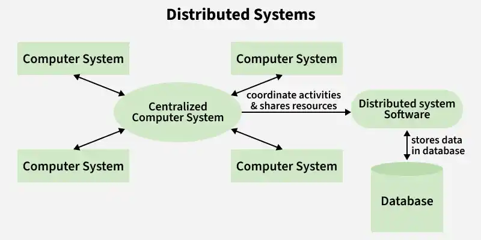
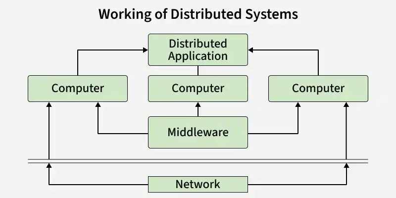
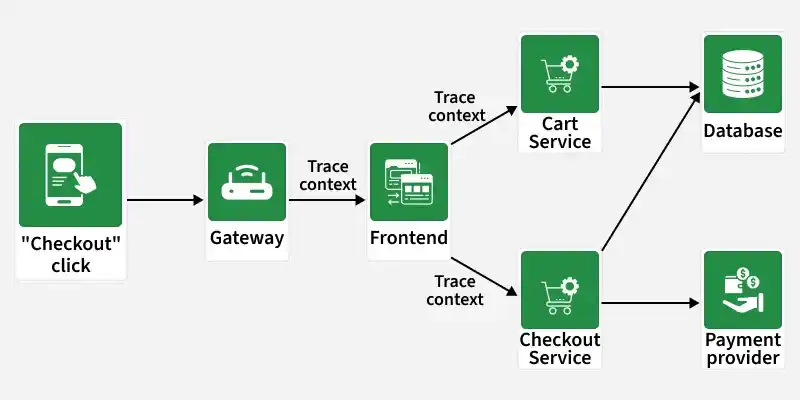
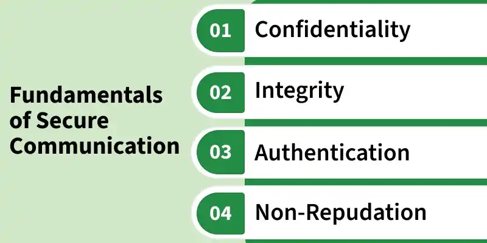
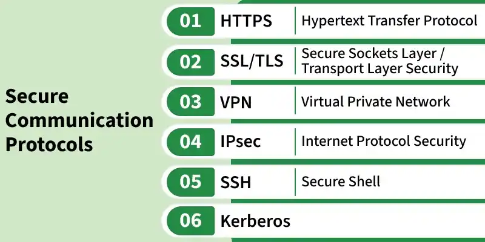
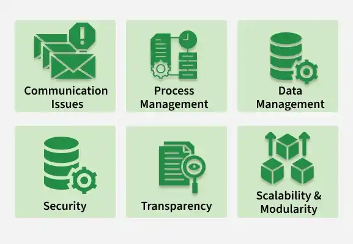

# 分布式系统设计

<<<<<<< Updated upstream

## [分布式系统简介](https://www.geeksforgeeks.org/computer-networks/what-is-a-distributed-system/)

分布式系统是由一组独立的计算机（称为节点）组成，这些节点协同工作，构成一个单一的系统。这些节点通过网络通信，共享数据、资源和任务，以实现共同目标。它确保多个系统之间的协调，同时对用户呈现统一的体验。

- 分布式系统由多个在网络中协同工作的独立计算机（节点）组成。
- 节点之间高效地通信并共享数据、资源和任务。
- 对用户而言，分布式系统表现为一个单一的系统，一个节点的故障不会导致整个系统停止运行。

**例如：** 像亚马逊这样的在线购物平台使用分布式系统，其中多个服务器处理不同的任务，例如产品搜索、支付和订单处理。即使一个服务器发生故障，平台也能继续运行，不会影响用户体验。

### 实际应用案例

这些案例展示了分布式系统如何在实际应用中处理大规模数据、提升性能并确保可靠性。

- **网上银行系统：** 银行使用分布式系统，分支机构和ATM机在独立运行的同时与中央服务器共享数据，从而确保交易的连续性。
- **电子商务平台：** 像亚马逊或Flipkart这样的平台通过多个服务器处理订单、支付和库存，以应对高流量并确保流畅的用户体验。
- **社交媒体平台：** 像Facebook、Twitter和Instagram这样的应用使用多个数据中心来高效地存储和处理海量用户数据。
- **在线游戏系统：** 像PUBG这样的多人游戏将游戏状态分布在多个服务器上，以降低延迟并提供实时游戏体验。

### 分布式系统的类型

分布式系统可以根据节点的组织方式、通信方式以及任务在系统中的分布方式进行分类。

#### 1. 客户端-服务器系统

客户端-服务器系统是一种分布式系统，其中中央服务器提供服务，多个客户端通过网络请求这些服务。

- 服务器管理数据和处理
- 客户端发送请求并接收响应

**例如：** Gmail 或网上银行系统。

#### 2. 点对点 (P2P) 系统

点对点系统是一种分布式系统，其中所有节点地位平等，无需中央机构即可充当客户端和服务器。

- 不存在中央服务器
- 节点之间直接共享资源

**例如：** BitTorrent、区块链网络。

#### 3. 集群系统

集群系统是由一组紧密连接的计算机组成，它们作为一个整体协同工作，以提高性能和可靠性。

- 节点在一个紧密连接的网络中工作
- 任务共享以实现高性能

**例如：** 谷歌搜索集群、超级计算机。

#### 4. 基于云的分布式系统

基于云的分布式系统使用云基础设施，其中计算资源分布在多个数据中心，并通过互联网访问。

- 资源可按需扩展
- 服务通过互联网访问

**例如：** AWS、Microsoft Azure、Google Cloud。

### 工作原理

分布式系统通过将任务分配给多个节点来工作，这些节点通过网络进行通信和协调，以实现共同目标。

- 每个节点运行自己的应用程序并维护本地数据。
- 节点使用协议或中间件服务通过网络进行通信。
- 数据和任务分布在各个节点上进行并行处理。
- 节点在本地处理数据，并在需要时与其他节点共享结果。
- 数据可以存储在分布式数据库中，而不是单个集中式系统中。
- 该系统确保所有节点之间的协调性、一致性和容错性。

### 优势

分布式系统具有多项优势，可提升应用程序的性能、可扩展性和可靠性。

- 资源共享允许节点共享数据、文件和硬件，从而提高效率并降低系统总成本。
- 可扩展性使系统能够通过添加更多节点轻松应对不断增长的工作负载，而无需进行重大更改。
- 可靠性和容错性确保单个节点的故障不会导致整个系统崩溃，从而维持持续运行。
- 由于工作负载分布在多个节点上，性能得到提升，处理速度和响应时间也随之加快。

### 劣势

尽管分布式系统具有诸多优势，但也带来了与复杂性、安全性和数据管理相关的挑战。

- 复杂性使得分布式系统的设计、管理和维护比集中式系统更加困难。
- 由于存在多个节点，安全挑战随之而来，增加了未经授权访问和网络攻击的风险。
- 网络依赖性意味着系统性能严重依赖于网络速度、延迟和可靠性。
- 在多个节点之间保持数据同步时，尤其是在实时系统中，会出现数据一致性问题。

### 分布式系统与微服务的区别

分布式系统和微服务是相关的概念，但它们并不相同。它们在软件架构中的用途和范围有所不同。

#### 分布式系统

分布式系统是由多个独立计算机（节点）组成的集合，这些节点协同工作，并表现为一个单一的系统。

- 侧重于多台机器之间的协调和通信
- 用于提高可扩展性、性能和可靠性

#### 微服务

微服务是一种架构风格，它将应用程序拆分为通过网络通信的小型独立服务。

- 侧重于将应用程序设计为松耦合的服务
- 每个服务处理特定的功能，并且可以独立开发和部署

#### 区别

- 所有基于微服务的应用程序都是分布式系统
- 并非所有分布式系统都遵循微服务架构

### 另请参阅

- [Centralized system Vs Distributed system](https://www.geeksforgeeks.org/computer-networks/centralized-vs-distributed-system/)
- [Architectures of Distributed systems](https://www.geeksforgeeks.org/computer-networks/architecture-styles-in-distributed-systems/)

## [分布式系统中的共识算法](https://www.geeksforgeeks.org/operating-systems/consensus-algorithms-in-distributed-system/)

[分布式系统](https://www.geeksforgeeks.org/computer-networks/what-is-a-distributed-system/)中的共识算法解释了分布式网络中的多台计算机如何就单个数据值或决策达成一致。

- 关键示例包括 Paxos 和 Raft 算法，它们通过一系列提议和接受来确保所有非故障节点对同一值达成一致；以及实用拜占庭容错算法 (PBFT)，它通过要求诚实节点达成多数共识来处理恶意节点。
- 这些算法对于区块链、分布式数据库以及其他需要跨多个节点协调行动和达成一致的系统至关重要，才能正确且安全地运行。
- 共识算法在分布式系统中至关重要，原因有很多，例如[数据一致性](https://www.geeksforgeeks.org/system-design/consistency-in-system-design/)、[容错性](https://www.geeksforgeeks.org/system-design/fault-tolerance-in-system-design/)、协调与同步以及[可扩展性](https://www.geeksforgeeks.org/system-design/what-is-scalability/)。

### 共识算法的类型

分布式系统中的共识算法有多种形式，每种算法都旨在应对不同的挑战和需求。以下是一些主要的共识算法类型：

#### 1. 崩溃容错 (CFT) 算法：

- **Paxos：** 一系列协议，即使网络延迟、节点故障和消息丢失也能达成共识。Paxos 以其鲁棒性著称，但通常被认为难以理解和实现。
- **Raft：** Raft 的设计目标是比 Paxos 更易于理解和实现。它通过选举一个领导者来管理日志条目到其他节点的复制，从而达成共识。

#### 2. 拜占庭容错 (BFT) 算法：

- **实用拜占庭容错 (PBFT)：** 处理拜占庭故障，即节点可以任意或恶意地执行操作。PBFT 需要绝大多数诚实节点才能达成共识，适用于需要高安全性的系统。
- **Tendermint：** 一种专为区块链网络设计的 BFT 共识算法，兼具快速最终性和高吞吐量。它采用多轮投票机制，并针对性能和安全性进行了优化。

#### 3. 基于证明的算法：

- **工作量证明 (PoW)：** 比特币和其他加密货币采用 PoW 机制，PoW 要求节点（矿工）解决复杂的密码学难题来验证交易并将新区块添加到区块链中。它能耗较高，但安全性强。
- **权益证明 (PoS)：** 验证者根据其持有的代币数量以及是否愿意`质押`代币作为抵押品来选择。PoS 比 PoW 更节能，以太坊 2.0 等加密货币采用 PoS 机制。
- **委托权益证明 (DPoS)：** 代币持有者投票选出少量委托人来验证交易并创建区块。DPoS 旨在更快地达成共识，EOS 和 TRON 等平台采用 DPoS 机制。

#### 4. [基于领导者的算法](https://www.geeksforgeeks.org/system-design/leader-election-in-system-design/)：

- **视图标记复制 (VR)：** 类似于 Paxos 和 Raft，VR 包含一个主节点（领导者），负责协调日志复制到备份节点。如果领导者发生故障，则会选举一个新的领导者来继续运行。
- **多 Paxos：** Paxos 的扩展，其中单个领导者处理多轮共识，从而降低领导者选举的开销，并提高长时间运行应用程序的效率。

#### 5. 基于投票的算法：

- **基于法定人数的算法：** 这些算法依赖于多数节点（法定人数）来达成共识。每个操作都需要法定人数节点的批准，以确保决策的一致性。例如 Quorum 和 Zab（用于 Apache ZooKeeper）。
- **联邦拜占庭协议 (FBA)：** FBA 用于 Stellar 等系统，它允许每个节点选择自己的法定人数切片，从而实现去中心化的共识形成。节点通过重叠的法定人数达成一致，从而确保安全性和可扩展性。

### 常用共识算法

以下是一些分布式系统中常用的共识算法，每种算法都有其独特的特性和应用：

#### 1. Paxos

Paxos 是由 Leslie Lamport 开发的一系列协议，旨在分布式系统中克服网络延迟、节点故障和消息丢失等问题，实现共识。Paxos 确保即使部分节点发生故障，所有节点也能就同一值达成一致。

- 该协议包含提议者、接受者和学习者。提议者提出值，接受者同意该值，学习者学习该共识值。
- Paxos 的运行分为两个主要阶段：准备阶段，提议者寻求大多数接受者的同意；以及接受阶段，接受者最终确定共识。尽管 Paxos 具有很强的鲁棒性，但通常被认为难以理解和实现。
- 它被应用于 Google 的 Chubby、Microsoft 的 Azure Storage 和 Yahoo 的 ZooKeeper 等系统中。

#### 2. Raft

Raft 是一种共识算法，其设计目标是比 Paxos 更易于理解和实现。它的工作原理是在节点间选举一个领导者来管理日志复制并确保数据一致性。Raft 将共识问题分解为三个主要子问题：领导者选举、日志复制和数据安全。

- 领导者接收来自客户端的日志条目，并将其复制到跟随节点，从而确保所有节点拥有相同的日志条目。
- 如果领导者发生故障，则会选举一个新的领导者。Raft 的设计注重简洁性，已被 etcd、Consul 和 CockroachDB 等系统广泛采用。

#### 3. 实用拜占庭容错机制 (PBFT)

PBFT 旨在处理拜占庭故障，即节点可能发生故障或恶意行为。只要故障节点少于三分之一，它就能确保共识。PBFT 的运行分为三个阶段：预准备阶段、准备阶段和提交阶段。在预准备阶段，领导者提出一个值。

- 在准备阶段，节点交换消息以就该提议达成一致。在提交阶段，一旦达成绝对多数共识，节点就会提交该提议。
- 由于 PBFT 能够处理任意故障，因此被应用于 Hyperledger Fabric 和 Zilliqa 等高安全性应用中。

#### 4. 工作量证明 (PoW)

PoW 是一种主要用于比特币等加密货币的共识机制。

- 它要求矿工解决复杂的密码学难题来验证交易并创建新区块。这些难题的难度会进行调整，以确保区块以稳定的速率添加。
- 工作量证明（PoW）的安全性依赖于所需的计算量，这使得攻击者难以篡改区块链。
- 然而，PoW 因其高能耗而备受诟病。尽管如此，由于其强大的安全性，PoW 仍然是许多加密货币的基石。

#### 5. 权益证明（PoS）

PoS 是一种更节能的共识算法，验证者根据其持有的代币数量以及愿意质押的代币数量来选择。验证者创建并提议新的区块，其质押的代币激励他们诚实行事。

- 如果他们验证了恶意交易，则可能失去其质押的代币。
- 由于 PoS 在保持安全性的同时，能耗低于 PoW，因此被应用于包括以太坊 2.0 和 Cardano 在内的多种加密货币中。

### 不同共识算法的比较

以下表格比较了分布式系统中最流行的几种共识算法：

| 算法             | 描述                                   | 容错性           | 应用案例                    | 优势                      | 挑战                             |
| ---------------- | -------------------------------------- | ---------------- | --------------------------- | ------------------------- | -------------------------------- |
| Paxos            | 即使网络延迟和节点故障也能达成共识。   | 崩溃容错 (CFT)   | 谷歌的 Chubby、微软的 Azure | 稳健可靠，容错性高        | 理解和实现较为复杂               |
| Raft             | 基于领导者的日志复制达成共识。         | 崩溃容错 (CFT)   | etcd、Consul、CockroachDB   | 比 Paxos 更容易理解和实现 | 领导者选举可能导致延迟           |
| PBFT             | 通过超级多数同意处理拜占庭故障。       | 拜占庭容错 (BFT) | Hyperledger Fabric、Zilliqa | 安全性高，可处理任意故障  | 需要较高的消息开销；可扩展性有限 |
| 工作量证明 (PoW) | 矿工通过解决密码学难题来验证交易。     | 拜占庭容错 (BFT) | 比特币、莱特币              | 高度安全；去中心化        | 高能耗；交易速度慢               |
| 权益证明 (PoS)   | 验证者根据其权益被选中来提议新的区块。 | 拜占庭容错 (BFT) | 以太坊 2.0、卡尔达诺        | 节能；可扩展              | 财富集中；潜在的中心化风险       |

### 共识算法的实现挑战

在分布式系统中实现共识算法是一项复杂的任务，因为必须解决一些固有的挑战才能确保可靠性、性能和安全性。以下是对这些常见挑战的详细解释：

#### 1. 容错性

容错性是指系统即使某些组件发生故障也能继续正常运行的能力。在分布式系统中，故障可能包括节点崩溃、网络分区，甚至恶意行为。共识算法必须能够优雅地处理这些故障。

- **崩溃容错 (CFT)：** 诸如 Paxos 和 Raft 之类的算法旨在处理节点崩溃并在不丢失数据的情况下恢复。
- **拜占庭容错 (BFT)：** 诸如 PBFT 和 Tendermint 之类的算法旨在处理任意故障，包括恶意行为，这类故障更为复杂且资源消耗更大。

#### 2. 可扩展性

可扩展性是指系统处理不断增加的工作量或易于扩展的能力。在共识算法的背景下，可扩展性意味着在不降低性能的前提下管理更多节点和更高的事务吞吐量。

- **消息开销：** 许多共识算法需要在节点之间进行大量通信。随着节点数量的增加，消息复杂度会显著增加，从而导致网络拥塞和延迟。
- **性能瓶颈：** 集中式故障点（例如 Raft 中的领导者）可能会成为大型系统中的性能瓶颈。

#### 3. 安全性

安全性对于保护分布式系统中数据的完整性和机密性至关重要。共识算法必须能够抵御各种攻击，包括女巫攻击、双重支付和拒绝服务 (DoS) 攻击。

- **女巫攻击：** 攻击者创建多个虚假身份来控制网络。工作量证明 (PoW) 和权益证明 (PoS) 分别通过要求计算工作量或质押来应对此类攻击，从而增加了发起此类攻击的成本。
- **双重支付：** 确保数字货币不能被重复使用对于区块链系统至关重要，这需要相应的机制来检测和防止双重支付。
- **拒绝服务 (DoS) 攻击：** 共识算法必须包含防御措施，以抵御旨在破坏网络运行的 DoS 攻击。

#### 4. 同步

同步确保分布式系统中的所有节点对系统状态拥有一致的认知，并对相同的数据达成共识。

- **网络延迟：** 网络延迟的变化会导致消息传递延迟，进而导致节点对系统状态的理解出现差异。
- **时钟同步：** 在许多算法中，节点依赖同步时钟来正确排序事件。异步时钟会导致节点间出现不一致和分歧。

#### 5. 配置管理

配置管理是指在不中断共识过程的前提下，管理网络配置的变更，例如添加或移除节点。

- **动态成员：** 在保持共识的同时动态处理参与节点集合的变化是一项挑战。算法需要相应的机制来适应节点的加入或离开，而不会导致系统不一致。
- **参数调优：** 正确调优超时时间、消息间隔和法定人数大小等参数对于获得最佳性能至关重要，但要做到这一点可能很困难。

### 选择合适的共识算法

为分布式系统选择合适的共识算法取决于系统需求、环境和约束等各种因素。以下详细指南可帮助您做出明智的决策：

#### 1. 了解用例和需求

- **交易吞吐量：** 确定系统需要处理的每秒交易数 (TPS)。高吞吐量需求可能更适合 Raft、Tendermint 或 DPoS 等算法。
- **[延迟](https://www.geeksforgeeks.org/system-design/latency-in-system-design/)：** 考虑可接受的交易确认延迟。低延迟需求的系统可能更适合 Tendermint 或 PBFT。
- **[容错性](https://www.geeksforgeeks.org/system-design/fault-tolerance-in-system-design/)：** 评估系统必须处理的故障类型（例如，崩溃故障、拜占庭故障）。PBFT 和 Tendermint 可以处理拜占庭故障，而 Paxos 和 Raft 可以处理崩溃故障。
- **[可扩展性](https://www.geeksforgeeks.org/system-design/what-is-scalability/)：** 确定系统需要支持的节点数量。PoS 和 DPoS 等算法比 PoW 和 PBFT 更具可扩展性。

#### 2. 评估安全需求

- **攻击抵抗能力：** 识别潜在的安全威胁（例如，女巫攻击、双花攻击、拒绝服务攻击）。 PoW 能够有效抵御女巫攻击，而 PoS 和 PBFT 则提供不同的安全保障。
- **敌手模型：** 选择与敌手模型相匹配的算法。拜占庭容错对于节点可能恶意运行的环境至关重要。

#### 3. 考虑资源限制

- **计算资源：** 评估可用计算能力。PoW 需要大量的计算资源，而 PoS 和 Raft 的要求则较低。
- **能源效率：** 考虑环境影响和运行成本。与 PoW 相比，PoS 和 DPoS 的能源效率更高。

#### 4. 评估网络状况

- **网络延迟和带宽：** 高延迟网络可能受益于消息开销较低的算法，例如 Raft。由于通信需求量大，PBFT 等算法在高延迟环境中可能难以运行。
- **网络[可靠性](https://www.geeksforgeeks.org/system-design/reliability-in-system-design/)：** 在不可靠的网络中，能够优雅地处理网络分区的算法（例如 Raft 和 Paxos）可能更合适。

#### 5. 评估实现复杂度和可维护性

- **易于实现：** 有些算法，例如 Raft，相比 Paxos 更容易理解和实现。
- **维护成本：** 考虑维护和更新共识算法所需的持续工作量。复杂的算法可能需要更专业的知识和资源。

### 选择合适的共识算法的步骤

以下是选择合适的共识算法的步骤：

- **步骤 1：定义系统需求：** 列出关于吞吐量、延迟、容错性和安全性的具体需求。
- **步骤 2：将算法特性与需求匹配：** 将各种算法的特性与系统需求进行比较。
- **步骤 3：原型设计和测试：** 使用入围的算法实现原型，在受控环境中测试性能、可扩展性和容错性。
- **步骤 4：权衡利弊：** 考虑不同算法之间的权衡，平衡性能、安全性和复杂度。
- **步骤 5：做出明智的决定：** 根据测试结果和全面评估，选择最符合您要求的算法。

## [分布式追踪 - 系统设计](https://www.geeksforgeeks.org/system-design/distributed-tracing-system-design/)

分布式追踪是一种强大的监控技术，能够清晰展现请求在复杂分布式系统（例如微服务架构）中的流转过程。通过捕获并可视化每个请求在多个服务间的路径，它可以帮助开发人员和运维人员有效地识别性能瓶颈、延迟问题和系统错误。

- 它能够追踪跨多个服务的请求，从而识别分布式系统中的延迟、错误和性能问题。
- 它通过提供对瓶颈和故障的深入洞察，帮助调试和优化系统性能。

**例如：** 在电子商务应用中，当用户下单时，分布式追踪会跟踪订单请求从前端到支付、库存和通知服务的整个流程。如果出现延迟，它可以帮助快速定位问题出在支付处理还是库存处理环节。

### 实际案例

分布式追踪的实际案例包括：

- **Uber：** Uber 使用开源追踪工具 Jaeger 来监控其微服务的协同工作情况。它有助于查找运行缓慢的服务、跟踪依赖关系并快速修复问题，从而保持系统的快速性和可靠性。
- **Netflix：** Netflix 使用分布式追踪来监控请求在其众多微服务中的流转情况。这有助于发现瓶颈或错误，从而确保用户能够流畅地观看视频，而不会出现中断。
- **Airbnb：** Airbnb 使用追踪来了解不同服务之间的交互方式以及延迟发生的位置。这有助于他们提高系统稳定性，并为用户提供流畅的体验。

### 特性

分布式追踪的特性通常包括以下关键方面：

- **端到端可见性：** 分布式追踪能够全面展现请求在分布式系统中流经各个服务的整个路径。这种可见性包括跨服务边界的追踪，从而可以全面了解请求流及其依赖关系。
- **跟踪上下文传播：** 跟踪上下文（例如跟踪 ID 和跨度 ID）会在服务之间传播，确保处理请求的所有相关组件都对同一跟踪做出贡献。这使得跨分布式服务的事件和操作能够关联起来。
- **细粒度时间信息：** 跟踪中的每个跨度都包含详细的时间信息，捕获服务中特定操作或动作的持续时间。这种细粒度有助于精确定位性能瓶颈并识别延迟问题。
- **元数据和标签：** 跨度可以包含额外的元数据和标签，提供有关被跟踪操作的上下文信息。这些信息可能包括 HTTP 标头、用户 ID、错误代码或任何其他有助于理解系统行为的相关数据。
- **采样：** 分布式跟踪系统通常采用采样技术来管理生成的跟踪数据量，尤其是在高吞吐量环境中。采样决策根据预定义的标准（例如，概率采样、自适应采样）决定收集和存储哪些跟踪和跨度。

### 类型

分布式追踪通过跟踪请求在系统中的流动和执行情况，帮助团队监控和分析应用程序。主要类型包括：

- **代码追踪：** 跟踪特定函数执行期间的源代码流程，以识别逻辑问题或错误。
  示例：验证服务请求是否正确查询数据库并监控响应时间。
- **程序追踪：** 在执行期间检查指令地址和内存变量，以检测深层性能问题。
  示例：诊断应用程序中的内存溢出、资源使用率过高或操作阻塞等问题。
- **端到端追踪：** 跟踪数据在多个服务之间的流动，以了解转换和依赖关系。
  示例：跟踪用户请求在电子商务系统中如何通过身份验证、库存和支付服务。

### 组件

分布式追踪的关键组件包括：

- **插桩：** 将追踪代码引入应用程序和服务以收集追踪数据。例如，这可以通过手动方式完成，也可以通过包含追踪库提供的自动插桩属性来完成。
- **跟踪上下文传播：** 用于跨服务边界扩展跟踪上下文的一些技术包括但不限于 HTTP 标头或其他协议。
- **跨度收集：** 它从已检测的服务中收集跨度，并将它们聚合到一个跟踪中。
- **跟踪存储：** 将收集到的跟踪数据归档到公共数据库中，以便进行分析和可视化。
- **跟踪分析和可视化：** 用于输入和操作跟踪数据并将其显示出来，以揭示执行系统特征的系统。

### 工作原理

分布式追踪的工作原理是通过对应用程序进行插桩，在分布式系统中请求流经不同服务时生成追踪数据。以下是其典型工作方式：

- **插桩：** 开发人员在其应用程序中添加代码（通常使用库或 SDK），为每个请求创建唯一标识符（通常称为追踪 ID 和跨度 ID）。这些 ID 使追踪系统能够关联跨服务的事件。
- **传播：** 当请求进入某个服务时，追踪上下文（包含追踪 ID 和跨度 ID）会被传播。这确保后续处理该请求的服务能够继续追踪其路径。
- **跨度创建：** 每个服务都会创建跨度，这些跨度代表请求生命周期中执行的特定操作或动作。跨度包含元数据，例如时间信息、标签和日志。
- **数据收集：** 收集到的跨度数据（包括 ID、时间信息和元数据）会被发送到集中式或分布式追踪后端。追踪后端的示例包括 Jaeger、Zipkin 和 AWS X-Ray。
- **可视化与分析：** 追踪后端聚合并存储收集到的数据，使用户能够可视化请求跨服务的整个路径。这种可视化有助于识别性能瓶颈、延迟问题以及服务之间的依赖关系。
- **根本原因分析：** 通过检查追踪数据，开发人员和运维人员可以将性能问题、错误和其他异常追溯到分布式系统中的特定服务或操作。

### 重要性

分布式追踪在现代软件架构中扮演着至关重要的角色，它能够提供可见性、提升性能并帮助快速解决复杂系统中的问题。

- **端到端可见性：** 提供请求跨服务的完整路径视图，帮助识别关联关系、定位问题并评估系统状态。
- **性能监控：** 量化请求路径中每个服务的延迟，帮助团队精确定位瓶颈并优化系统性能。
- **错误诊断：** 精确定位系统中的故障位置，从而加快根本原因分析并减少停机时间。
- **优化：** 提供洞察，将优化工作集中在导致高延迟的服务上，确保资源能够提高整体系统效率。

### 实现策略

这些方法有助于实现有效的分布式追踪并提高系统可观测性。

- **手动插桩：** 应用程序需要开发人员通过添加追踪代码来创建和传播跨度。
- **自动插桩：** 一些库和框架可以帮助自动生成用于建立追踪的代码。
- **采样：** 对某些请求进行采样，而不是跟踪所有追踪，从而在提供良好可见性的同时，避免过多的开销。
- **分布式上下文传播：** W3C 制定了各种标准，包括追踪上下文（Trace Context），可以遵循这些标准来以标准化的方式将上下文从一个服务传递到另一个服务。
- **集中式追踪收集：** 将追踪数据存储在一个位置，以便于查询和分析。

### 挑战

以下因素会影响追踪系统的有效性和性能。

- **开销：** 添加追踪功能会增加系统开销，从而影响系统性能。
- **数据量：** 大量的跟踪数据可能会带来问题，因为存储和分析这些数据都可能很困难。
- **上下文传播：** 存在诸多挑战，包括但不限于以下几点：如何在不同的服务和技术之间保持跟踪上下文的稳定传播。
- **采样策略：** 第三章还探讨了如何在保证足够可观测性的同时，将收集跟踪数据的性能成本控制在合理范围内。
- **隐私和安全：** 防止与当前流程步骤完全无关的信息干扰跟踪数据。

### 分布式跟踪工具

这些工具通过跟踪跨服务的请求并提高性能可见性，帮助开发人员监控复杂的分布式系统。

- **Jaeger：** 一款开源的端到端分布式跟踪工具，最初由 Uber 创建。它提供用于跟踪数据收集、存储和分析/可视化的工具。
- **Zipkin：** 一个开源的分布式跟踪系统，其主要功能是为收集所需的计时数据提供支持……
- **OpenTelemetry：** 一套工具、API 和 SDK，用于附加跟踪、生成指标数据、收集日志数据并导出以供分析。
- **AWS X-Ray：** 亚马逊网络服务 (AWS) 提供的一款工具，负责程序性能和依赖关系的分布式跟踪和诊断。
- **Datadog APM：** 一款具有分布式跟踪功能的应用程序性能监控工具，可提供有关应用程序运行情况的全面信息。

## [分布式系统中的安全通信](https://www.geeksforgeeks.org/operating-systems/secure-communication-in-distributed-system/)

安全通信是指在数据传输过程中保护数据，以确保通信系统之间数据的机密性、完整性、身份验证和不可否认性。

- 防止未经授权访问敏感数据
- 降低数据泄露、欺诈和身份盗窃的风险
- 确保数据在传输过程中不被篡改

### 核心原则

#### 1. 保密性

确保数据仅供授权用户访问。

- 通过加密技术实现
- 保护密码和财务数据等敏感信息

#### 2. 完整性

确保数据在传输过程中保持不变。

- 检测未经授权的修改
- 使用哈希和验证机制维护

#### 3. 身份验证

验证通信实体的身份。

- 防止未经授权的访问
- 确保通信发生在合法用户之间

#### 4. 不可否认性

确保发送方和接收方均不能否认其参与。

- 提供通信证明
- 支持问责和审计流程

### 密码学基础

这些基础包括用于保护通信安全的核心技术和机制，其作用在于防止数据未经授权的访问、确保数据完整性以及验证数据真实性。

#### 1. 对称加密

使用单个密钥进行加密和解密。

- 快速高效地加密大量数据
- 需要各方之间安全地共享密钥
- 示例算法：AES、DES、3DES

#### 2. 非对称加密

使用一对密钥（公钥和私钥）。

- 公钥用于加密，私钥用于解密
- 无需事先共享密钥
- 常用于密钥交换和身份验证
- 示例算法：RSA、ECC

#### 3. 哈希函数

将输入数据转换为固定长度的哈希值。

- 用于确保数据完整性
- 输​​入数据的微小变化会产生完全不同的哈希值
- 本质上是不可逆的（无法恢复原始数据）
- 示例算法：SHA-256、MD5

#### 4. 数字签名

提供一种验证数据真实性和完整性的方法。

- 使用发件人的私钥创建
- 使用发件人的公钥验证
- 确保消息来源可靠并防止篡改
- 用于电子邮件、软件分发和文档

#### 5. 公钥基础设施 (PKI)

用于管理数字密钥和证书的框架。

- 证书颁发机构 (CA)：颁发和验证证书
- 注册机构 (RA)：验证用户身份
- 通过数字证书将公钥与身份绑定
- 支持 HTTPS 和 VPN 等系统中的安全通信

### 协议

这些是标准化的规则和方法，通过提供加密、身份验证和数据完整性来确保网络上的安全数据传输。

#### 1. HTTPS

HTTPS（超文本传输​​安全协议）是 HTTP 的安全版本，它使用加密技术来保护 Web 浏览器和服务器之间交换的数据。

- 使用 SSL/TLS 加密 Web 流量
- 保护登录凭证和支付信息等敏感数据
- 确保安全可信的 Web 通信

#### 2. SSL/TLS

SSL（安全套接字层）和 TLS（传输层安全协议）是提供网络安全通信的加密协议，其中 TLS 是更现代、更安全的版本。

- 在传输过程中加密数据
- 使用数字证书进行身份验证
- 确保数据完整性和机密性

#### 3. VPN

虚拟专用网络 (VPN) 在公共网络上创建安全加密的连接，从而实现安全的数据传输和远程访问。

- 在互联网上建立私有隧道
- 保护数据免受公共 Wi-Fi 拦截
- 维护用户隐私和匿名性

#### 4. IPsec

IPsec（互联网协议安全）是一套协议，它通过加密和验证 IP 数据包来保护网络层的通信安全。

- 加密和验证每个数据包
- 提供安全的端到端通信
- 常用于 VPN

#### 5. SSH

SSH（安全外壳协议）是一种用于通过网络安全访问和管理远程系统的协议。

- 支持安全的远程登录
- 支持加密命令执行
- 允许安全的文件传输

#### 6. Kerberos

Kerberos 是一种网络身份验证协议，它使用密钥加密技术在用户和服务之间提供安全的身份验证。

- 提供强大的用户身份验证
- 支持双向身份验证
- 支持单点登录 (SSO) 系统

### 身份验证和授权机制

身份验证和授权是用于通过验证用户身份和定义权限来控制系统访问的安全机制。

#### 1. 身份验证

身份验证是指在授予访问权限之前验证用户或系统身份的过程。

- 它使用密码、生物识别、令牌和多因素身份验证 (MFA) 等方法。
- 确保只有合法用户才能访问系统。
- 有助于防止基于身份的攻击。

#### 2. 授权

授权是指在身份验证后确定用户被允许执行哪些操作的过程。

- 它基于角色、策略或访问控制规则。
- 限制对特定资源和操作的访问。
- 确保系统资源的受控和安全使用。

### 密钥管理

[密钥管理](https://www.geeksforgeeks.org/computer-networks/easy-key-management-in-cryptography/)是指在加密密钥的整个生命周期中对其进行管理，以确保安全通信和数据保护。

- 它涉及密钥的生成、分发、存储和使用。
- 它包括密钥轮换和撤销，以最大限度地降低风险。
- 防止未经授权访问敏感密钥。
- 确保加密系统的长期安全性和可靠性。

### 实施挑战

在分布式系统中实现安全通信会带来一些挑战，这些挑战会影响可扩展性、性能和整体系统安全性。

- **可扩展性：** 随着系统规模的扩大，安全连接和密钥的管理将变得复杂。
- **密钥管理：** 密钥生命周期管理不当可能导致安全漏洞。
- **性能开销：** 加密和安全检查会增加延迟和计算成本。
- **互操作性：** 不同的系统和标准可能会造成兼容性问题。
- **节点入侵：** 单个节点被入侵可能会威胁整个系统的安全。

### 安全通信最佳实践

- 使用 AES 和 RSA 等强加密算法保护数据。
- 实施双向身份验证以验证客户端和服务器的身份。
- 定期轮换密钥以最大程度地降低密钥泄露的风险。
- 使用可信系统安全地存储加密密钥。
- 监控和审计通信，以便及早发现并应对威胁。

## [分布式系统的设计问题](https://www.geeksforgeeks.org/system-design/design-issues-of-distributed-system/)

分布式系统由多台独立的计算机组成，这些计算机通过网络协同工作，共同完成任务或提供服务。这些计算机位于不同的地方，但通过基于软件的通信进行协调。

- 计算机通过网络连接并相互通信，同时每台计算机仍然独立运行。
- 它们在系统中共享资源和数据，以高效地共同实现目标。

**例如：** Web应用程序、在线游戏和[云计算](https://www.geeksforgeeks.org/cloud-computing/cloud-computing/)。

以下是分布式系统的一些主要设计问题。

### 1. 通信问题

该问题源于网络延迟和分布式组件之间连接的不可靠性。

- **消息传递：** 这是一种通信方法，进程通过网络发送消息来交换信息。
- **通信延迟和带宽：** 延迟和带宽都会影响系统的性能和效率。
- **通信协议：** 这些协议定义了节点间数据交换的规则，确保可靠且安全的传输。

### 2. 进程管理

这涉及跨多台机器创建、调度、协调和终止进程。

- **进程协调：** 它管理跨节点进程的交互和同步。
- **进程迁移：** 这涉及将正在运行的进程从一个节点移动到另一个节点，以平衡负载。
- **线程管理：** 它控制进程中线程的执行、调度和终止。

### 3. 数据管理

这侧重于存储、访问和维护分布在不同节点上的数据的一致性。

- **数据存储：** 它管理跨多个节点的数据，确保高效访问、可扩展性和冗余性。
- **数据访问：** 高效的访问机制确保即使在拥有大型数据集和多用户的系统中也能快速检索数据。
- **一致性和复制：** 一致性确保所有节点上的数据副本完全相同。复制提高了访问速度和容错能力。
- **数据完整性：** 这确保数据在其整个生命周期内保持准确性和一致性，防止数据损坏或丢失。

### 4. 容错性和可靠性

这确保即使某些组件发生故障，系统也能继续正常运行。

- **故障检测：** 它识别节点或链路何时发生故障，使系统能够采取纠正措施。
- **冗余和恢复：** 冗余在节点间复制关键组件，而恢复机制则在故障后恢复正常运行。
- **共识：** 共识确保分布式节点即使在发生故障的情况下也能就决策达成一致。

### 5. 安全性

安全性旨在保护分布式系统免受未经授权的访问、数据泄露和恶意攻击。

- **身份验证和授权：** [身份验证](https://www.geeksforgeeks.org/computer-networks/difference-between-authentication-and-authzrization/)用于验证用户或系统的身份，而授权则控制对资源的访问。
- **密码学：** 它使用加密、解密和加密密钥来保护通信和数据。
- **数据隐私：** 保护个人和敏感信息免受未经授权的访问和泄露。

### 6. 可扩展性和模块化

使系统能够在不显著降低性能的情况下扩展和演进。

- **可扩展架构：** 允许系统通过添加服务器或存储等资源来处理工作负载，并在需求增加时保持性能。
- **模块化设计：** 将系统分解为更小的、独立的组件，这些组件可以单独开发、部署和扩展。
- **弹性：** 使系统能够根据需求动态地分配和释放资源。

### 7. 同步和协调

管理分布式进程之间操作的正确顺序和时间。

- **时钟同步：** 确保分布式系统中的所有节点共享一致的时间，这对于协调任务和时间敏感型操作至关重要。
- **领导者选举：** 它选择一个节点来协调行动和管理资源，确保去中心化系统的一致性并防止冲突。
- **互斥：** 防止多个进程同时访问同一资源。

### 8. 透明性

对用户和应用程序隐藏分布式系统的复杂性。

- **访问透明性：** 隐藏数据表示和存储方式的差异，使用户能够跨系统以统一的方式与资源交互。
- **位置透明性：** 使资源的物理位置不可见，使用户无需了解其存储位置即可访问资源。
- **复制透明性：** 隐藏跨多个节点的数据复制过程，使用户能够像访问单个副本一样访问数据。

### 9. 性能

性能侧重于优化响应时间、吞吐量和资源利用率。

- **负载均衡：** 将工作负载分配到多个节点，以优化资源使用、防止过载并提高系统性能。
- **缓存和缓存管理：** 缓存存储频繁访问的数据以加快检索速度，而缓存管理确保数据保持最新。
- **延迟和吞吐量：** 延迟是指数据传输的延迟时间，而吞吐量衡量单位时间内处理的数据量。

### 10. 调试与监控

这包括检测、诊断和解决分布式组件中的问题。

- **分布式系统调试：** 这包括识别和修复多个节点上的错误。
- **事件监控：** 它跟踪并记录跨节点的系统事件，有助于及早发现问题，并确保系统稳定性，从而进行调试和优化。
- **分布式追踪：** 分布式追踪跟踪跨系统组件的请求，提供可视化的时间线以识别性能问题。

### 11. 实时系统

这需要严格的时间保证，以确保响应在规定的时间范围内完成。

- **实时调度：** 它在严格的时间约束下分配任务，确保关键任务系统能够及时执行。
- # **服务质量 (QoS)：** QoS 保证带宽、延迟和可靠性等性能特征，优先处理关键任务，并确保实时应用程序的最佳性能。

## 

> > > > > > > Stashed changes
