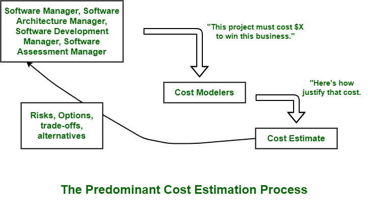
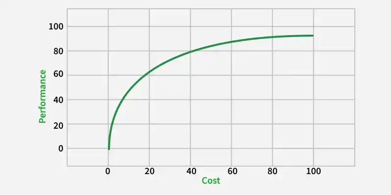

# 成本与性能优化

## [软件成本估算](https://www.geeksforgeeks.org/software-engineering/software-cost-estimation/)

软件成本估算是一个系统化的过程，用于预测开发、部署和维护软件产品所需的工作量（人时或人月）、工期（日历时间）和财务成本。它是软件项目管理生命周期中的基础步骤，确保利益相关者能够做出明智的决策，并确保项目按时、按预算并达到预期质量。

该过程涉及分析各种因素，例如项目范围、复杂性、团队专业知识、工具、技术和风险，以生成切合实际且数据驱动的估算，从而有助于有效的项目规划、预算编制、进度安排和资源分配。

### 软件成本估算的关键目标

- **优化资源分配：** 确定项目所需的人员、工具和基础设施的数量和类型。
- **评估项目可行性：** 估算软件项目是否能够在可用时间、预算和资源范围内完成。
- **支持预算规划：** 提供财务预测，帮助利益相关者分配适当的资金并避免意外支出。
- **降低风险：** 在项目早期识别潜在的成本相关风险，并制定相应的缓解策略。
- **提升决策水平：** 为项目经理和利益相关者提供数据驱动的洞察，以支持更明智的规划和执行。
- **辅助项目进度安排：** 通过估算每个开发阶段所需的时间，帮助制定切实可行的项目时间表。

### 软件成本估算的关键组成部分

- **项目规模：** 项目规模以代码行数 (LOC) 或功能点数 (FP) 来衡量，其总体规模直接影响开发所需的工作量和时间。
- **项目复杂性：** 项目复杂性越高，需要的时间、专业知识和周密的计划，这些都会显著影响成本。
- **技术和工具：** 软件工具、平台许可和任何特殊硬件的成本都会增加项目的总支出。
- **风险和不确定性：** 需求不明确、使用不熟悉的技术或团队经验不足等因素都可能引入风险，从而导致成本增加。
- **开发周期：** 设计、开发、测试和部署软件所需的总时间是总体成本估算的重要组成部分。
- **团队规模和技能水平：** 开发人员的数量及其经验水平会影响人工成本。高技能专业人员通常需要更高的薪酬。

### 主要成本估算流程的步骤

- **项目负责人初步评估：** 项目经理和技术负责人评估项目目标、限制条件和业务需求。
- **风险和权衡分析：** 关键利益相关者识别潜在风险，探索替代方案，并评估权衡取舍，以确定可行的前进方向。
- **启动成本建模：** 成本建模人员会收到与业务目标相符的目标预算或成本限额（例如，“我们必须以 X 美元的价格交付此项目”）。
- **制定成本估算：** 建模人员利用风险因素、资源需求和项目复杂性等输入信息，生成切合实际的成本估算。
- **论证和文档：** 最终估算结果将附有清晰的论证，解释成本的计算方法及其合理性。

### 软件项目成本估算的目的

- **项目规划与进度安排：** 有助于确定所需的开发人员数量，并制定切实可行的项目完成时间表。
- **进度跟踪：** 使项目经理能够监控工作是否朝着正确的方向发展，并在出现偏差时采取相应措施。
- **优化资源利用：** 确保劳动力、工具和材料等资源得到高效利用，从而减少浪费并提高生产力。
- **支持合同谈判：** 为各方就项目成本、时间表和责任进行讨论和达成一致提供坚实的基础。
- **促进团队沟通：** 建立对项目财务方面的共同理解，鼓励利益相关者之间进行清晰坦诚的沟通。
- **时间和精力管理：** 有助于估算不同任务所需的时间以及如何分配资源，这直接影响整体项目进度。

### 常用成本估算方法

| 方法                                                                                                 | 描述                                                  |
| ---------------------------------------------------------------------------------------------------- | ----------------------------------------------------- |
| 专家判断                                                                                             | 基于专家的经验和直觉。                                |
| 类比估算                                                                                             | 基于以往类似项目的成本。                              |
| 自顶向下估算                                                                                         | 先估算总成本，然后将其分摊到各个组成部分。            |
| 自底向上估算                                                                                         | 先估算每个模块的成本，然后求和。                      |
| [COCOMO 模型](https://www.geeksforgeeks.org/software-engineering/software-engineering-cocomo-model/) | 一种使用代码行数 (LOC) 和复杂度等输入参数的数学模型。 |
| 功能点分析                                                                                           | 根据软件向用户提供的功能来衡量软件。                  |

## [系统设计性能优化技术](https://www.geeksforgeeks.org/system-design/optimization-techniques-for-system-design/)

在现代应用中，设计高效、可扩展且高性能的系统至关重要。随着系统处理的用户和数据量不断增加，优化对于保持速度、可靠性和流畅的用户体验变得尤为重要。

- 通过高效分配工作负载，提高系统性能并缩短响应时间。
- 在处理不断增长的用户和数据的同时，确保可扩展性和更高的资源利用率。

**例如：** 在电子商务网站中，优化数据库查询和使用缓存有助于更快地加载产品页面，即使在促销等高流量期间也是如此。

### 1. 数据结构与算法

选择合适的数据结构有助于提高性能、内存使用率和可扩展性。

- 明智地选择数据结构（哈希表、树、数组）以兼顾效率、内存使用率和可扩展性。
- 谷歌搜索会将关键词映射到文档列表，这是一种针对搜索查询优化的哈希表。

### 2. 缓存

缓存用于存储常用数据，以减少响应时间和后端负载。

- 使用缓存（内存缓存、CDN、多级缓存）来降低延迟和后端负载。我们可以将内容按类别划分，例如静态、中等和动态，并为静态内容（如图片、CSS 和 JS 文件）设置较长的缓存过期时间，为项目列表等项目设置中等缓存，而为消息等内容设置较低的缓存过期时间。
- 缓存需要在各个层级进行，例如浏览器缓存、数据库缓存、CDN 缓存和内存缓存。

### 3. 数据库优化

优化数据库操作有助于加快数据检索速度并提高系统性能。

- 对数据库常用项目使用索引。
- 使用[查询优化](https://www.geeksforgeeks.org/sql/best-practices-for-sql-query-optimizations/)来减少响应时间。
- Netflix 使用 CDN 在本地缓存视频和个性化推荐内容。Twitter 使用 Redis 缓存时间线和会话，从而实现实时更新并处理每秒数百万次的查询。 Facebook 利用 Memcached 缓存频繁访问的社交图谱数据（例如好友关系），从而减轻数据库压力。

### 4. 可扩展性和负载均衡

扩展系统并分配流量可确保在高负载下保持高可用性和高性能。

- 使用[水平扩展](https://www.geeksforgeeks.org/dbms/horizontal-and-vertical-scaling-in-databases/)（增加节点）实现经济高效的增长；垂直扩展（升级资源）存在局限性。
- 实施负载均衡策略（例如轮询、最小连接数或 IP 哈希）以均匀分配流量。
- 例如，Netflix 会根据实时 CPU、网络和队列情况动态调整服务集群。他们会进行预测性扩展——在流量高峰期几分钟内启动数千台虚拟机——并在需求下降时将其停用。

### 5. 微服务与架构模式

将系统拆分成更小的服务可以提高灵活性、可扩展性和故障隔离能力。

- 将系统拆分成独立的组件可以提高可扩展性、故障隔离能力和开发人员的敏捷性。
- Netflix 运行着 700 多个微服务，能够以强大的可扩展性支持每天数千次的部署。Uber 从单体架构过渡到微服务架构，以动态地应对全球规模的扩展。

### 6. 网络优化

优化网络使用可以降低延迟并改善用户体验。

- 通过打包资源、使用 CSS 精灵图和利用浏览器缓存来减少 HTTP 请求的数量。
- 压缩图像并使用合适的文件格式来减小图像大小并缩短页面加载时间。
- 使用 CDN 将静态资源按地理位置分发，从而降低延迟并提高内容分发速度。

### 7. 其他技术

其他技术有助于提高性能并减少不必要的资源使用。

- 延迟加载：仅在需要时加载资源，从而缩短初始页面加载时间。
- 将代码拆分成更小的块，并按需加载

### 监控与可观测性

监控和可观测性能够提供系统性能的可见性，并有助于及早发现问题。监控跟踪响应时间、CPU、内存和请求速率等关键指标，而可观测性则利用日志、指标和追踪信息来解释问题发生的原因。

- **日志：** 记录系统事件、错误和重要活动，以便进行调试。
- **指标：** 跟踪延迟、吞吐量和资源使用情况等性能指标。
- **分布式追踪：** 有助于跨多个服务跟踪请求，从而识别延迟和故障。

通过结合这些技术，团队可以主动监控系统运行状况，快速检测异常，并采取纠正措施来维护性能和可靠性。

**示例：** 在基于微服务的应用程序中，监控工具可以检测到响应时间的突然增加。利用分布式追踪，开发人员可以确定是某个特定服务（例如数据库服务）导致了延迟，并对其进行优化以恢复性能。

### 速率限制与流量控制

速率限制和流量控制用于控制系统处理的请求数量，以防止系统过载并确保资源的公平使用。速率限制会在给定时间内设定一个允许的请求数量上限，而流量控制则会在请求超出限制时减慢或阻止请求。这些技术有助于在高流量或遭受攻击时维持系统稳定性。

- **防止系统过载：** 保护服务器免受过量流量或突发峰值的影响。
- **确保资源的公平使用：** 防止单个用户或服务占用所有资源。
- **提高安全性：** 有助于防御 DDoS 攻击或暴力破解等攻击。

常用策略包括固定窗口、滑动窗口和令牌桶算法，以有效地管理请求限制。

**例如：** 在 API 服务中，可能允许用户每分钟仅发出 100 个请求。如果超出限制，则额外的请求将被延迟或拒绝，从而确保系统对所有用户保持稳定运行。

### 系统设计优化的未来趋势

现代系统设计正随着先进技术的进步而不断发展，这些技术能够提升系统性能、自动化程度和实时处理能力。

- **人工智能和机器学习：** 这些技术能够提高系统效率、实现决策自动化，并使系统能够持续适应和学习，从而带来更智能、更强大的解决方案。
- **自主系统和边缘计算：** 自主系统利用优化算法实现高效运行。边缘计算通过在本地处理数据来降低延迟，从而对自主系统进行补充。

## [成本与性能](https://www.geeksforgeeks.org/system-design/cost-vs-performance/)

系统设计中的成本与性能指的是系统效率与实现该效率所需资源之间的权衡。更高的性能通常会增加成本，因此目标是在预算范围内设计出性能最优的系统。

- **成本：** 构建、运行和维护系统所需的资源。
- **性能：** 系统处理任务的效率（速度、可扩展性、响应能力）。
- **权衡：** 提高性能通常会增加成本，因此平衡至关重要。

**示例：** 一家初创公司可能会选择云服务而不是自建数据中心。这既能降低成本，又能提供良好的性能和可扩展性。

### 影响系统成本和性能的因素

以下几个因素会影响系统的成本和性能：

#### 1. 规模和复杂性

系统的整体规模和复杂性决定了构建和维护它所需的工作量和资源。

- 系统的规模和复杂性会极大地影响成本和性能。
- 更复杂的系统通常需要更多资源来构建和维护，这会增加成本。然而，如果设计得当，它们也可能提供更高的性能。

#### 2. 技术与工具

技术和工具的选择对系统的效率、成本和性能起着至关重要的作用。

- 系统设计中使用的技术和工具的选择会对成本和性能产生显著影响。
- 尖端技术可能提供更好的性能，但实施成本可能更高。
- 另一方面，使用较旧或不太先进的技术可能会降低成本，但可能会影响性能。

#### 3. 需求与规范

明确定义的需求有助于做出更好的设计决策，并在成本和性能之间取得平衡。

- 清晰明确的需求和规范对于平衡成本和性能至关重要。
- 满足特定的性能标准通常需要付出相应的成本，因此理解需求并确定其优先级有助于优化成本与性能之间的平衡。

#### 4. 可扩展性和灵活性

设计可扩展和适应性强的系统能够确保长期效率和更佳性能。

- 能够根据不断变化的需求进行扩展和适应的系统通常具有更佳的长期性能，但初始成本可能更高。
- 在系统架构中构建灵活性可以简化升级和修改，从而在不增加过多成本的情况下提升性能。

#### 5. 资源分配

高效利用资源有助于在不产生不必要费用的情况下实现预期性能。

- 合理分配时间、预算和人员等资源对于在成本和性能之间取得理想的平衡至关重要。
- 高效的资源分配能够确保系统在不超支的情况下满足性能要求。

#### 6. 质量和可靠性

保持高质量和高可靠性对于确保系统长期稳定运行至关重要。

- 投资于更高质量的组件和工艺可以提高系统性能和可靠性，但也可能会增加成本。
- 在预算限制内，平衡质量和成本对于实现预期性能水平至关重要。

### 平衡成本与性能的重要性

在[系统设计](https://www.geeksforgeeks.org/system-design/getting-started-with-system-design/)中，平衡成本与性能意味着在产品性能和成本之间找到最佳平衡点。以下是其重要性所在：

- **节省成本：** 我们希望确保设计成本不会超过实际所需。如果成本过高，可能会影响利润。
- **合理利用资源：** 平衡成本与性能有助于我们合理利用资源。
- **面向未来发展：** 我们希望设计能够适应未来的发展和变化，而无需投入巨资。如果我们预期业务规模扩大或客户需求发生变化，这一点至关重要。
- **战胜竞争对手：** 如果我们能够以合理的价格提供性能卓越的产品，就能在竞争中脱颖而出。
- **降低风险：** 不考虑成本就投入过多资金可能会使项目陷入困境。平衡成本与性能有助于我们避免这种风险。

### 成本与性能的关系

在系统设计中，成本与性能之间的关系通常体现为一种权衡取舍。工作原理如下：

#### 1. 性价比权衡

平衡成本和性能是系统设计中最重要的决策之一。

- 通常，系统所需的性能水平与实现该性能所需的成本之间存在权衡。
- 如果想要更高的性能，通常需要付出更高的成本。反之，降低成本可能意味着牺牲部分性能。

#### 2. 优化

优化有助于在不增加不必要支出的情况下实现最佳性能。

- 系统设计人员的目标是找到最佳平衡点，既能达到所需的性能水平，又能将成本控制在可接受的范围内。
- 这包括优化设计，以在给定成本下最大化性能，或在满足性能要求的前提下最小化成本。

#### 3. 预算限制

预算限制直接影响设计选择和系统功能。

- 可用预算在决定成本和性能之间的权衡方面起着至关重要的作用。
- 设计人员必须在预算限制内工作，以交付满足性能预期且不超出可用资金的系统。

#### 4. 性能要求

明确定义的性能目标有助于决定对系统进行多少投资。

- 更高的性能要求会因资源消耗增加而导致成本上升。
- 较低的要求可以降低成本，但可能无法满足用户期望。

#### 5. 技术与创新

现代技术有助于在控制成本的同时提高性能。

- 现代技术在控制成本的同时提高了性能。
- 创新有助于在不显著增加支出的情况下提高效率。

### 成本与性能之间的权衡如何影响架构决策

成本与性能之间的权衡深刻影响着系统设计中的架构决策。具体如下：

#### 1. 组件选择

选择合适的组件至关重要，因为它直接影响系统的成本和性能。

- 高性能组件可以提高效率，但会增加成本。
- 经济实惠的组件可以降低成本，但可能会影响性能。
- 架构师必须平衡成本和性能，才能在预算范围内满足系统需求。

#### 2. 可扩展性和灵活性

设计能够扩展和适应的系统对于长期性能和成本效益至关重要。

- 架构决策会影响系统扩展和适应不断变化的性能需求的能力。
- 可扩展性设计可能会增加前期成本，但可以提高长期性能。
- 同样，在架构中构建灵活性可以实现经济高效的升级和修改，以满足不断变化的需求，而无需完全重新设计。

#### 3. 架构模式和设计原则

使用正确的设计模式有助于管理系统复杂性并优化性能。

- 选择合适的架构模式和设计原则有助于平衡成本和性能。
- 例如，使用微服务架构可以实现组件的独立扩展，优化资源利用率并降低成本。
- 同样，遵循关注点分离和模块化等原则可以通过隔离和优化关键组件来提高性能。

#### 4. 云和基础设施选择

选择合适的基础设施对于控制成本并确保系统性能至关重要。

- 云计算提供可扩展性和性能优势，但也带来了成本方面的考量。
- 架构师必须评估云服务模型和部署选项，以平衡性能和成本。
- 此外，选择合适的云服务组合并优化资源利用率有助于在确保足够性能的同时控制成本。

#### 5. 可靠性和弹性之间的权衡

提高系统可靠性通常需要额外的投资，从而需要在成本和稳定性之间取得平衡。

- 架构决策通常需要在性能和可靠性/弹性之间进行权衡。
- 例如，冗余组件和容错设计可以提高系统可靠性，但也可能增加成本。
- 架构师必须根据系统的关键性、用户期望和预算限制，仔细权衡这些利弊。

### 优先级场景

以下是一些场景，在考虑成本或性能优先级时，可能会产生不同的结果：

#### 1. 网站托管服务

高性能托管和低成本托管之间的选择直接影响网站速度和用户体验。

##### 优先考虑性能：

- 选择具有快速服务器、高级缓存机制和专用资源的高性能网站托管服务，可确保网站快速加载和响应迅速的用户体验。
- 然而，这些高级托管解决方案通常成本更高。

##### 优先考虑成本：

- 选择具有共享服务器和有限资源的经济型网站托管服务可能会导致网站性能下降，尤其是在流量高峰期。
- 虽然这种选择可以降低前期成本，但由于加载速度慢，可能会导致用户体验不佳，并造成潜在的收入损失。

#### 2. 汽车制造

性能与成本之间的权衡会影响车辆的质量、功能和价格。

##### 性能优先：

- 投资高性能材料、先进工程技术和尖端科技，可以生产出速度、加速和操控性能卓越的高性能车辆。
- 然而，由于研发和制造成本高昂，这些车辆的价格通常也较高。

##### 成本优先：

- 专注于成本效益高的制造工艺、标准化零部件和简化设计，可以生产出价格更实惠、前期投入更低的车辆。
- 虽然这些车辆在日常驾驶中可能表现良好，但它们可能缺乏高端车型所具备的先进功能和性能。

### 平衡成本与性能的挑战

由于多种因素，系统设计中平衡成本与性能往往充满挑战。以下是一些常见的挑战：

#### 1. 需求不明确

当系统需求定义不清晰时，很难在成本和性能之间找到合适的平衡点。

- 需求不明确或需求变更会导致难以在预算限制内确定所需的性能水平。
- 需求不明确可能导致过度设计或低估所需性能，从而造成成本超支或性能不足。

#### 2. 系统复杂性

随着系统规模和复杂性的增加，成本和性能的管理难度也随之增加。

- 随着系统复杂性的增加，平衡成本和性能的挑战也越来越大。
- 复杂的系统可能存在众多相互依赖关系和权衡取舍，需要仔细评估。
- 管理这种复杂性需要深入了解系统架构及其对成本和性能的影响。

#### 3. 资源有限

预算、时间或专业人员的限制使得同时实现高性能和低成本变得困难。

- 资源有限，例如预算、时间和熟练人员，给实现成本与性能之间的理想平衡带来了巨大挑战。
- 设计人员必须权衡各种相互冲突的需求，并有效地分配资源，以在预算限制内最大限度地提高性能。

#### 4. 技术限制

现有技术的局限性可能会限制在不增加成本的情况下提升性能。

- 技术限制或约束可能会阻碍在不超出成本目标的情况下实现最佳性能。
- 例如，传统系统可能缺乏在不进行重大升级或投资的情况下提供高性能所需的功能。

### 优化成本和性能的最佳实践

优化成本和性能需要通过明智的设计决策来平衡效率和成本。

- **设定明确的目标：** 尽早定义性能目标和成本限制。
- **确定需求优先级：** 重点关注影响性能的关键功能。
- **迭代设计：** 根据测试和反馈不断改进。
- **成本效益分析：** 选择最具成本效益的解决方案。
- **模块化和可重用性：** 使用灵活的设计来降低成本并提高可扩展性。

### 成本与性能

这一概念阐述了投入资金与系统运行效率之间的权衡。

| 成本                               | 性能                         |
| ---------------------------------- | ---------------------------- |
| 构建和维护系统所需的资金           | 系统运行效率                 |
| 侧重于预算、基础设施和资源         | 侧重于速度、效率和响应时间   |
| 较低的成本可能会降低系统质量或功能 | 较高的性能可以改善用户体验   |
| 成本的增加通常会提升系统功能       | 更好的资源和设计可以提升性能 |
| 目标是最大限度地降低成本           | 目标是最大限度地提高效率     |
