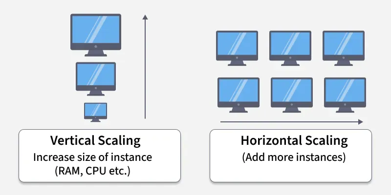
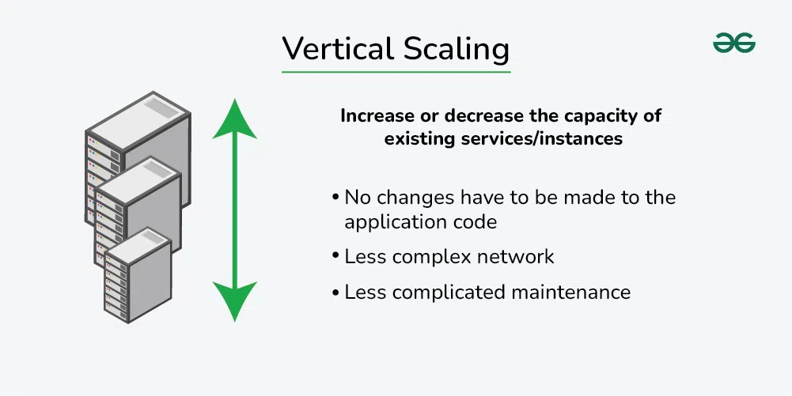
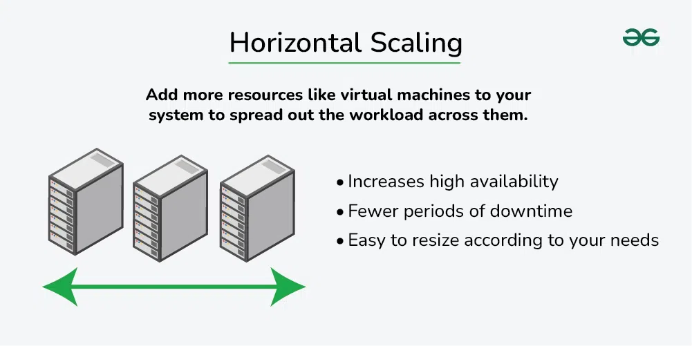
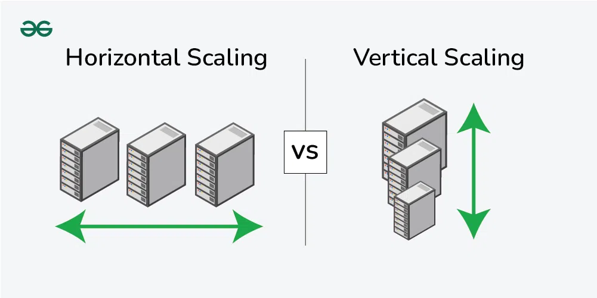
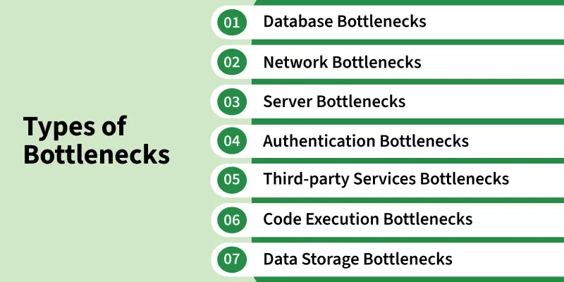

# 可扩展性

## [水平和垂直扩展 | 系统设计](https://www.geeksforgeeks.org/system-design/system-design-horizontal-and-vertical-scaling/)

在系统设计中，扩展性对于应对不断增长的负载至关重要。水平扩展和垂直扩展是两种不同的系统扩展方法，两者都可用于提升系统的性能和容量。

### 为什么我们需要扩展？

我们需要扩展来构建弹性系统并提升用户体验。

- 应对不断增长的用户负载和流量。
- 确保高可用性和可靠性。
- 维持性能和响应时间。
- 满足不断增长的数据和存储需求。

以下是两种扩展方式。

### 垂直扩展

垂直扩展，也称为向上扩展，是指增加系统中单个硬件或软件组件的容量或功能。

- 我们升级的是现有系统，而不是添加更多系统。通过添加更强大的处理器、增加内存或其他性能提升措施来增强机器的性能。
- 易于实现，适用于单体架构和小规模应用。

#### 示例

- 将 MySQL 服务器的内存从 16 GB 升级到 64 GB，以处理更多查询。
- 将托管在 2 核虚拟机上的网站迁移到 8 核、更高内存的虚拟机，以提高性能。
- 电子商务平台运行在单个大型 AWS EC2 实例上，并增加了资源（CPU、内存、磁盘）。

#### 优势

- **容量提升：**升级硬件可以提高服务器的性能和处理传入请求的能力。
- **管理更便捷：**升级单个节点通常是垂直扩展的重点，这可能比维护多个节点更简单。

#### 劣势

- **可扩展性有限：**垂直扩展受限于硬件的物理限制。水平扩展则不受此限制。
- 所有传入请求仍然由一台服务器处理，因此一旦服务器发生故障，停机的可能性就会增加。
- 向上扩展通常需要**重启或更换**机器，从而导致停机。

### 横向扩展

横向扩展，也称为横向扩展，是指通过添加更多机器或服务器来提高系统容量或性能，从而将工作负载分配到更多独立单元上的过程。

- 无需更改服务器容量或更换服务器。
- 向网络添加更多服务器时不会造成停机。

#### 示例

- 像 GeeksforGeeks 这样的网站会在负载均衡器后添加更多 Web 服务器来应对流量高峰。
- Netflix 会独立扩展不同的微服务——例如，跨区域部署多个流媒体服务实例。
- Amazon Auto Scaling 会在购物高峰时段（例如黑色星期五）启动更多 EC2 实例。
- Akamai 或 Cloudflare 使用全球分布的服务器，以便更靠近用户提供内容。

#### 优势

- 容量提升：更多节点或实例可以处理更多传入请求。
- 性能提升：通过将负载分配到多个节点或实例，可以降低单个服务器过载的可能性。
- [容错能力](https://www.geeksforgeeks.org/system-design/fault-tolerance-in-system-design/)增强：如果某个节点发生故障，传入请求可以发送到另一个节点，从而降低服务中断的可能性。

#### 缺点

- 需要复杂的架构（负载均衡器、分布式数据库等）。
- 难以在分布式节点间保持强一致性。需要在节点间进行同步、消息传递或数据复制。
- 机器越多，网络、电力和维护成本就越高。
- 需要编排工具（例如 Kubernetes、Ansible）来管理大量服务器。
- 问题可能分散在多个节点上，使得根本原因分析变得棘手。
- 节点间的通信会增加延迟和复杂性。

### 水平缩放和垂直缩放的区别

我们已经了解了应用程序扩展的两大主要类别，也讨论了它们的优缺点。接下来，让我们根据这些优缺点，对这两种方法进行快速比较。

|   方面   |                           横向扩展                           |                                             纵向扩展                                             |
| :------: | :----------------------------------------------------------: | :----------------------------------------------------------------------------------------------: |
| 资源增加 |              增加更多机器或服务器以分散工作负载              |                                        增强单个组件的资源                                        |
| 成本效益 |                 通常对大规模系统更具成本效益                 |                                  初期更简单，但长期成本可能更高                                  |
|  灵活性  |                灵活性更高，因为更容易添加单元                |                                   灵活性有限，尤其是在硬件方面                                   |
|  容错性  |                 通过分散工作负载来增强容错性                 |                                 容错性有限，因为它依赖于单个单元                                 |
|   性能   |              随着工作负载的分散，性能可能会提高              |                               性能可能会提高，但可能会达到硬件限制                               |
| 单点故障 |                       不易出现单点故障                       |                                  由于单个单元，可能存在单点故障                                  |
|  复杂性  |               可能会增加分布式系统管理的复杂性               |                            由于涉及的组件较少 ​​，因此管理起来更简单                             |
|  适用性  |                  非常适合处理大规模扩展需求                  |                                         适合中等扩展需求                                         |
| 负载均衡 |       需要负载均衡机制来将工作负载均匀地分配到多个单元       |                 负载均衡可能不太重要，因为在大多数情况下，工作负载由单个单元管理                 |
| 机器通信 | 横向扩展严重依赖网络通信来协调分布式机器之间的任务和共享数据 | 纵向扩展主要涉及单台机器内部或紧密耦合的进程之间的进程间通信，从而最大限度地减少对网络通信的需求 |

### 哪种扩展方案最适合应用程序？

任何扩展方案都各有优劣，因此开发人员可能很难决定哪种方案更适合应用程序。

- 首先，您应该明确自身需求、业务目标以及希望提升价值的领域。
- 然后，通过不断反思、开发原型和完善设计，做出重要的设计决策。
- 大多数情况下，大型组织的工程师会兼顾垂直扩展和水平扩展的优点。
- 他们采用混合方法，将垂直扩展的速度和稳定性与水平扩展的弹性和无限扩展能力相结合。

## [哪种可扩展性方案最适合我们的应用程序？ - 系统设计](https://www.geeksforgeeks.org/system-design/which-scalability-approach-is-right-for-our-application-system-design/)

我们已经介绍了[可扩展性以及实现可扩展性的不同方法](https://www.geeksforgeeks.org/system-design/what-is-scalability/)。现在让我们来讨论如何根据您的系统需求选择合适的可扩展性方案。

### 影响选择正确可扩展性方法的因素

接下来，我们来谈谈是什么因素决定了您选择哪种方案：

- 应用架构：如果您的应用就像一座大型建筑，所有功能都集成在其中，那么垂直扩展可能一开始就适用。但如果它更像一座城市，包含许多不同的部分，那么水平扩展则更有意义。
- 选择合适的数据库：数据库就像应用的内存。有些数据库擅长同时处理大量数据和用户（例如 NoSQL），而另一些数据库则更适合小型应用（例如 SQL）。
- 成本考量：成本很重要！垂直扩展可能成本高昂，因为您需要升级硬件。从长远来看，水平扩展通常更经济。
- 安全性：如果您的应用需要很高的安全性，那么垂直扩展可能更安全，因为您可以更好地控制单个服务器。这就像只有一扇锁着的门，而不是很多扇。
- 时间至关重要：如果您的应用需要极快的速度（例如视频通话或游戏），则需要横向扩展。横向扩展能让您的应用更贴近用户，从而减少延迟。
- 流量波动：如果您的应用流量波动较大（例如节假日期间的购物应用），无服务器架构可以仅在需要时才使用资源，从而节省成本。
- 技术栈：技术栈的选择会影响扩展选项。某些技术（例如传统的单体应用）可能更适合纵向扩展，而另一些技术（例如 Kubernetes 等容器编排平台）则更适合横向扩展。

### 做出正确的选择

那么，何时使用哪种方法呢？以下是一些场景：

#### 1. 小规模且稳定

如果您预计应用的用户流量和资源需求不会快速增长，请选择纵向扩展，原因如下：

- 通过添加额外的 CPU、内存或存储空间来增加单个服务器的容量以适应不断增长的负载，这称为纵向扩展。
- 与横向扩展相比，纵向扩展通常更简单，并且对应用架构的更改更少。
- 适用于无需处理大量并发用户的小型应用程序。

#### 2. 扩展规模

如果您预计用户流量将大幅增长，并且需要确保您的应用程序能够应对，请考虑水平扩展，尤其是在您的应用程序被拆分为多个部分（微服务）的情况下，原因如下：

- 水平扩展是指向您的基础架构添加更多服务器或实例，将负载分配到多台机器上。
- 它提供了更好的可扩展性，因为您可以随着用户群的增长而不断添加更多服务器。
- 对于设计为微服务的应用程序来说，水平扩展尤其有效，因为它允许您独立扩展每个服务。

#### 3. 可变负载

对于流量模式不可预测或偶尔出现活动高峰的应用来说，无服务器架构是一个绝佳的选择，原因如下：

- 无服务器计算非常适合可变工作负载，因为它能够根据需求自动控制资源扩展。
- 您只需为实际使用的资源付费，这在应用空闲期间可以有效降低成本。
- AWS Lambda 或 Azure Functions 等无服务器平台负责处理底层基础设施，从而降低运维开销。

#### 4. 速度需求

当您的应用需要提供低延迟响应和高性能时，水平扩展是一个不错的选择，原因如下：

- 水平扩展允许您将流量分配到多个服务器上，从而降低每个服务器的负载并缩短响应时间。
- 负载均衡技术可以进一步优化请求分配，从而提高速度。
- 这对于响应速度至关重要的应用非常有用，例如实时系统或游戏应用。

#### 5. 成本考量

当您预算有限但又需要保证性能和可靠性时，横向扩展通常是更经济的选择，原因如下：

- 横向扩展之所以经济高效，是因为您可以从少量服务器开始，然后随着应用程序的增长逐步添加更多服务器。
- 它允许您根据实际需求进行向上或向下扩展，从而优化资源分配并降低成本。
- 云服务提供商通常提供与横向扩展相匹配的定价模式，使其成为一种经济合理的选择。

### 如何测试应用的可扩展性？

测试就像开车兜风，确保车辆运行顺畅。以下是具体步骤：

- [负载测试](https://www.geeksforgeeks.org/software-testing/software-testing-load-testing/)：使用专用工具模拟大量用户同时使用应用的情况。观察应用的运行情况——确保应用保持快速且无错误。
- [压力测试](https://www.geeksforgeeks.org/software-testing/stress-testing-software-testing/)：将应用推向极限。在出现故障之前，应用可以处理多少用户？找出故障发生的位置和原因。
- 增加服务器：如果您使用横向扩展，请确保负载均衡器能够将工作负载均匀分配到各个服务器。
- 检查数据库：测试数据库如何处理大量数据。确保数据库能够快速读写且无错误。
- 故意制造故障：模拟服务器崩溃等意外情况。观察应用是否能够应对并优雅地恢复。
- 密切监控：应用上线后，使用监控工具实时观察其性能。修复任何出现的问题。

## [高可扩展系统设计指南](https://www.geeksforgeeks.org/system-design/guide-for-designing-highly-scalable-systems/)

可扩展系统对于高效处理不断增长的用户、数据和工作负载至关重要。设计此类系统需要合理的架构规划和对可扩展性原则的理解。这有助于确保应用程序在需求增长时保持可靠性和良好性能。

- 无需进行重大重新设计即可高效处理不断增长的用户和流量，确保系统平稳扩展。
- 即使在高负载或需求高峰期，也能保持快速响应时间，并确保系统稳定可用。

**例如：** 像 Netflix 这样的流媒体平台通过增加服务器和使用负载均衡来扩展其基础设施，以支持数百万用户同时观看视频，但整体性能还取决于数据库效率、系统设计和瓶颈等因素。

### 高可扩展系统的实际案例

以下是一些高可扩展系统的实际案例：

- **亚马逊网络服务 (AWS)：** 亚马逊网络服务是领先的云计算平台，提供可扩展的基础设施服务，例如计算能力、存储和数据库。其全球数据中心网络使企业能够在全球范围内扩展应用程序，同时保持高可用性和高性能。
- **谷歌搜索：** 谷歌搜索是迄今为止最具可扩展性的系统之一，每天处理数十亿次搜索查询。其分布式架构和先进的缓存机制有助于从庞大的网页索引中快速检索结果并进行排名。
- **Netflix：** Netflix 是一个高度可扩展的流媒体平台，可同时为全球数百万用户提供服务。其基于微服务的架构使平台能够根据用户需求动态扩展，并确保流畅的视频流。
- **Uber：** Uber 运行在一个可扩展的系统上，该系统每天能够处理数百万次乘车请求。其架构能够实时动态地将司机与乘客匹配，从而确保高效的乘车分配和系统的可扩展性。
- **Facebook：** Facebook 是一个全球社交网络平台，支持数十亿用户和海量的用户生成内容。其分布式基础设施和缓存系统能够大规模地实现实时更新和个性化内容分发。

### 系统可扩展性的重要性

[可扩展性](https://www.geeksforgeeks.org/system-design/what-is-scalability/)是现代系统处理不断增长的数据、用户流量和工作负载而不出现性能问题的关键要求。它使系统能够在保持效率和优化资源利用的同时实现增长。

- 可扩展性不仅关乎应对增长，还关乎提高效率和有效利用资源。
- 可扩展的系统可以通过增加处理能力、内存和存储等资源进行纵向扩展，也可以通过将工作负载分配到多个服务器上进行横向扩展。
- 这使得系统能够在保持响应速度和可用性的同时，处理不断增长的需求和数据。

### 影响可扩展性的因素

影响可扩展性的因素包括：

- **架构：** 系统的设计和结构对其高效扩展的能力起着至关重要的作用。
- **资源分配：** 合理分配 CPU、内存和存储等资源对于应对不断增长的工作负载至关重要。
- **负载均衡：** 将传入的请求或工作负载均匀地分配到多个服务器或资源上，可以防止任何单个组件过载。
- **数据管理：** 通过分片和复制等技术高效管理和存储数据，可以防止系统增长过程中出现数据瓶颈。
- **并行性：** 利用并行处理和并发技术，系统可以同时处理多个任务，从而提高性能和可扩展性。

### 可扩展系统的设计原则

以下是一些有助于构建可扩展系统的设计原则：

- **分解：** 将系统分解成更小的组件或服务，以便在不影响整个系统的情况下更轻松地进行扩展。
- **松耦合：** 设计依赖性最小的组件，以实现独立扩展并提高灵活性。
- **面向服务的架构 (SOA)：** 将功能组织成具有明确接口的服务，以便进行独立开发和扩展。
- **水平扩展：** 通过添加更多实例而不是升级资源来进行扩展，从而提高灵活性和资源利用率。
- **无状态性：** 减少服务器端状态，以便可以轻松地将请求分布到多个实例上。
- **缓存：** 使用缓存来减少重复计算，并通过降低后端负载来提高性能。
- **容错性：** 设计系统时，利用冗余、复制和故障转移来处理故障，以维持可用性。

### 可扩展性架构模式

架构模式为常见的架构设计问题提供可重用的解决方案。在可扩展性方面，一些架构模式尤其有效，能够确保系统应对不断增长的工作负载。

#### 微服务架构

这种架构将应用程序划分为处理特定业务功能的独立小型服务。

- 每个服务都可以独立部署，并负责特定的功能。
- 服务可以根据需求独立扩展。
- 一个服务的更新或更改不会影响其他服务。

#### 事件驱动架构

这种架构允许组件通过代表系统更改或重要操作的事件进行通信。

- 组件使用事件而不是直接调用进行交互。
- 支持服务之间的异步通信。
- 帮助系统高效地应对工作负载的突然增长。

#### 分布式系统

分布式系统将计算和数据处理分布在多台机器上。

- 多个服务器协同工作以处理任务。
- 分片、复制和分区等技术用于分发数据。
- 提高性能并防止单系统瓶颈。

#### CQRS（命令查询职责分离）

CQRS 将读取和写入操作分离，以提高系统性能和可扩展性。

- 写入操作处理数据更新。
- 读取操作专注于查询和报表。
- 读取和写入组件可以独立扩展。

#### 数据库分片

分片将大型数据库分割成分布在多个服务器上的较小部分。

- 数据使用分片键进行分割。
- 每个分片管理一部分数据。
- 有助于分散数据库负载并提高性能。

#### 负载均衡

负载均衡将传入的请求分配到多个服务器上，以确保高效的资源利用。

- 防止单个服务器过载。
- 使用轮询或最小连接数等算法。
- 通过均匀分配流量来帮助系统扩展。

### 水平扩展技术

水平扩展是指向系统中添加更多服务器或节点以应对不断增长的流量，这是实现可扩展性的关键方法。

- 负载均衡是将传入请求分配到多个实例的关键策略，确保负载得到充分分配，避免单个组件成为瓶颈。
- 应用层和基础架构层的缓存可以通过从快速缓存中提供频繁访问的数据，显著降低后端系统负载。
- 将数据和计算任务分区或分片到不同的节点或服务器，可以分散工作负载，使各个组件能够独立扩展。
- 异步任务处理（通常由消息队列或流式平台辅助）有助于将请求处理与请求管理隔离，从而提高可扩展性。
- 自动扩展（系统根据既定指标或标准添加或移除资源）是动态扩展以满足系统不断变化的需求的关键技术。

### 设计高可扩展系统的运维最佳实践

生产系统的可扩展性需要遵循强有力的运维原则。

- **自动化：** 自动化配置、部署和配置等任务，以简化运维流程。
- **监控与告警：** 使用强大的监控工具跟踪系统性能，并针对潜在问题设置告警。
- **可扩展性测试：** 定期测试系统可扩展性，以便在瓶颈演变成问题之前识别并解决它们。
- **横向扩展：** 通过增加资源和均匀分配工作负载，设计可横向扩展的系统。
- **容错与弹性：** 构建冗余和故障转移机制，以确保系统在发生故障时仍能可用。
- **容量规划：** 持续监控资源使用情况，并规划未来的容量需求，以避免性能下降。
- **安全与合规：** 实施强有力的安全措施，并确保符合相关法规和标准。
- **灾难恢复：** 灾难恢复和故障转移措施，包括冗余、故障转移集群和备份，有助于确保系统保持运行并从故障中恢复。

### 实现高可扩展性的挑战

虽然实现高可扩展性对于适应增长和高效处理不断增加的工作负载至关重要，但要有效构建可扩展系统，必须解决以下几个挑战：

- **并发性和同步性：** 确保数据完整性和管理对共享资源的并发访问可能导致竞态条件和死锁等问题。
- **数据分区和分片：** 将数据分布到多个节点需要精心规划，以平衡数据分布、最大限度地减少热点并保持性能。
- **一致性和可用性之间的权衡：** 在分布式环境中，如何在保持高可用性和分区容错性的同时实现强一致性是一项挑战。
- **可扩展性测试和优化：** 在实际条件下测试系统可扩展性并优化性能需要复杂的方法和工具。
- **成本和资源管理：** 扩展基础设施资源会产生成本，因此在高效管理云资源的同时优化资源使用至关重要。

## [系统设计中的主要可扩展性瓶颈](https://www.geeksforgeeks.org/system-design/primary-bottlenecks-that-hurt-the-scalability-of-an-application-system-design/#)

系统中的瓶颈是指数据流或处理受到限制，从而降低整体性能的点。当某个组件的速度慢于其他组件，无法高效处理传入请求时，就会出现瓶颈。这会导致吞吐量下降、可扩展性问题，以及在工作负载增加时出现延迟。

- 瓶颈会限制系统性能，并阻碍高效处理高流量，通常在高峰负载情况下最为明显。
- 瓶颈可能出现在数据库、网络、服务器或代码中，解决一个瓶颈有时可能会暴露系统中的另一个瓶颈。

**例如：** 如果一个 Web 应用程序的服务器速度很快，但数据库速度很慢，那么当大量用户访问系统时，数据库就会成为瓶颈，因为它无法快速处理查询。

### 瓶颈的类型

瓶颈的类型是指系统中不同的瓶颈点——例如数据库、网络、服务器、代码、存储、身份验证或第三方服务——这些瓶颈点的容量有限，从而限制了性能和可扩展性。

### 1. 系统设计中的数据库瓶颈

许多程序严重依赖数据库，而数据库也常常是造成可扩展性问题的主要原因。数据库系统中限制其有效处理请求和事务能力的性能瓶颈被称为数据库瓶颈。

- 应用程序或系统的整体性能、可扩展性和响应能力都可能受到这些瓶颈的严重影响。
- 当查询速度慢、索引效率低下、硬件资源不足或索引不完善等问题导致数据库成为性能瓶颈时，就会出现数据库瓶颈。

**例如:** 如果一个电子商务网站在节假日促销期间流量激增，缓慢的数据库查询会导致订单处理延迟，令用户感到沮丧，并可能导致购物车遗弃。

### 2. 系统设计中的网络瓶颈

网络瓶颈会严重阻碍分布式系统的可扩展性。当某个资源或组件限制了计算机网络的容量或性能时，就会发生网络瓶颈，从而降低系统的整体性能。

- 网络瓶颈可能出现在网络拓扑结构的各个位置，并严重影响应用程序或系统的效率和响应速度。
- 当网络带宽或延迟成为限制因素时，就会出现网络瓶颈。

**例如:** 如果视频流媒体服务缺乏足够的内容分发基础设施，则可能会遇到网络瓶颈。当过多的请求使网络不堪重负时，用户可能会遇到缓冲或视频流质量下降的问题。

### 3. 系统设计中的服务器瓶颈

当应用程序服务器无法处理更多请求或并发连接时，就会出现服务器瓶颈。服务器资源的限制，包括 CPU、内存或磁盘 I/O，都可能是造成服务器瓶颈的原因。

- 例如，在社交媒体网站上，一条意外走红的帖子导致大量用户同时尝试访问。
- 如果服务器资源不足以应对这种流量激增，可能会出现无响应的情况，从而降低用户体验。

**例如:** 您有一个允许用户上传和处理图像的 Web 应用程序。随着用户群的增长，服务器开始出现性能问题。由于应用程序使用的图像处理算法计算量巨大，服务器的 CPU 成为瓶颈，导致图像处理延迟，应用程序整体运行缓慢。

### 4. 系统设计中的身份验证瓶颈

许多程序依赖身份验证来提供对用户帐户的安全访问。当确认用户身份并允许访问资源的过程成为系统整体性能和可用性的限制因素时，这被称为系统设计中的身份验证瓶颈。许多因素都可能导致这些瓶颈，例如身份验证程序效率低下、用户身份验证请求量过大或身份验证基础设施不足。

**例如:** 网上银行应用程序在高峰使用时段可能会遇到身份验证瓶颈，如果身份验证系统无法处理大量的传入请求，则会导致登录延迟。

### 5. 系统设计中的第三方服务瓶颈

现代应用程序的许多功能（例如云存储、地理位置和支付处理）通常依赖于第三方服务，这会限制系统的整体性能、可靠性和可扩展性。

- 许多因素都可能导致这些瓶颈，例如第三方服务的可用性、响应延迟、速率限制或 API 修改。
- 识别并解决第三方服务瓶颈对于设计能够提供一致且响应迅速的用户体验的系统至关重要。

**例如:** 如果一款网约车应用依赖于外部地图服务，而该服务出现故障或响应缓慢，则会影响应用的性能和可扩展性。

### 6. 系统设计中的代码执行瓶颈

在系统设计中，代码执行瓶颈是指软件代码的设计、编写或执行过程中影响计算机系统性能和效率的情况。这些瓶颈可能由多种因素造成，包括系统资源利用率低、CPU 利用率高以及响应时间慢。

**例如:** Web 应用程序前端代码中用于渲染复杂数据的低效算法会导致页面加载缓慢，降低用户满意度。检测并优化这些代码瓶颈对于实现可扩展性至关重要。

### 7. 系统设计中的数据存储瓶颈

当系统的存储机制和基础设施开始限制其性能、容量或可靠性时，就存在数据存储瓶颈。这些瓶颈会影响系统的整体功能和效率。

- 这可能包括文件存储系统访问速度慢或磁盘空间利用率低，从而导致数据访问缓慢、数据丢失或可扩展性问题等。
- 识别并解决数据存储瓶颈对于设计能够高效处理数据的系统至关重要。

**例如:** 以基于云的文件共享平台为例；如果底层文件存储系统难以处理不断增长的文件数量，或者无法提供高效的数据检索，则会阻碍平台的平滑扩展能力。
