# 系统设计中的数据库

## [数据库设计 - 系统设计](https://www.geeksforgeeks.org/system-design/complete-reference-to-databases-in-designing-systems/)

数据库设计是指组织和构建数据，使其能够高效地存储、访问和管理的过程。它在构建快速可靠的系统中发挥着关键作用，能够提升性能、确保数据一致性并支持可扩展性。一个设计良好的数据库既能满足应用程序的需求，又能保持效率和可靠性。

- 有助于高效地组织数据，从而实现快速数据检索，并提升系统的整体性能和响应速度。
- 维护数据的一致性和可靠性，同时确保系统能够随着数据和用户需求的增长而有效扩展。

**例如：** 一个电子商务网站会为其数据库设计单独的用户表、产品表和订单表，以便高效地处理产品搜索、用户数据和订单处理。

### 数据库

数据库是组织有序的数据集合，它被存储和管理，以便在需要时能够轻松地访问、更新和检索数据。

- 数据库有助于以结构化和高效的方式存储大量数据。它被广泛应用于各种场景，从网站和移动应用到企业系统。
- 您可以将其想象成一个数字文件柜，其中的信息被系统地整理，以便于查找和使用。

#### 数据库术语

以下是一些数据库系统中常用的基本术语，用于理解数据的存储和管理方式。

- **数据：** 任何原始的、未经处理的统计数据都称为数据。
- **信息：** 经过处理的数据称为信息。这是因为信息能够帮助我们了解数据的内容以及如何进一步使用它。
- **数据库管理系统 (DBMS)：** 用于添加、编辑和管理集合中各种数据库的系统称为数据库管理系统 (DBMS)。
- **事务：** 事务是指作为单个工作单元执行的一系列数据库操作（例如 CRUD）。

### 数据库类型

数据库根据其数据模型、结构和系统设计中的用例进行分类。

#### 1. 关系型数据库 (SQL)

关系型数据库以结构化且组织良好的表格形式存储数据。

- 数据被组织成表格（行和列），每个表格都有预定义的结构。
- 表格之间可以使用键（例如，主键和外键）建立关系。
- **示例：** MySQL、PostgreSQL 和 Oracle 数据库。
- 最适合处理结构化数据，例如财务系统或库存管理。

#### 2. 非关系型数据库 (NoSQL)

非关系型数据库以灵活的格式存储数据，并专为可扩展性而设计。

- 不使用表格。相反，它们以灵活的格式存储数据，例如文档、键值对、图或列。
- 专为处理非结构化或半结构化数据而设计，例如社交媒体帖子或物联网数据。
- **示例：** MongoDB、Cassandra 和 DynamoDB。
- 非常适合需要高可扩展性和灵活性的应用程序。

### 重要性

良好的数据库设计在系统设计中至关重要，因为它能确保系统高效、可靠且可扩展地处理数据。让我们来看看它的重要性：

- **性能：** 设计良好的数据库能够快速处理数据，这意味着用户可以获得更快的响应速度，系统运行也更加流畅。
- **可扩展性：** 随着系统规模的增长，良好的数据库设计能够处理更多用户和数据，而不会出现速度下降或故障。
- **数据完整性：** 合理的数据库设计可以防止数据重复、不一致或错误，从而确保系统准确运行。
- **易于维护：** 清晰、逻辑严密的数据库结构更易于理解和更新，从而在进行更改或修复问题时节省时间和精力。
- **成本效益：** 优化的数据库设计能够高效利用资源，降低服务器成本并提高系统整体性能。

### 关系型数据库 (SQL) 与非关系型数据库 (NoSQL)

| 关系型数据库 (SQL)                                         | 非关系型数据库 (NoSQL)                                     |
| ---------------------------------------------------------- | ---------------------------------------------------------- |
| 使用包含行和列的表来存储结构化数据。                       | 以灵活的格式存储数据，例如文档、键值对、图或列。           |
| 需要固定的模式，即必须在存储数据之前定义数据结构。         | 使用无模式或灵活模式，允许轻松更改数据结构。               |
| 支持使用连接和外键在表之间建立复杂的关系。                 | 专为数据实体之间关系极少或没有关系而设计。                 |
| 通常通过增加单个服务器的 CPU、内存或存储空间进行垂直扩展。 | 通过添加多个服务器或节点进行水平扩展。                     |
| 最适合结构化数据以及需要复杂查询和事务的应用程序。         | 最适合具有高可扩展性需求的大规模、非结构化或半结构化数据。 |

### 数据库设计中的 CAP 定理

[CAP 定理](https://www.geeksforgeeks.org/system-design/cap-theorem-in-system-design/)指出，在具有数据复制的[分布式系统](https://www.geeksforgeeks.org/computer-networks/what-is-a-distributed-system/)中，不可能同时保证所有三个理想的属性 —— [一致性](https://www.geeksforgeeks.org/system-design/consistency-in-system-design/)、[可用性](https://www.geeksforgeeks.org/system-design/availability-in-system-design/)和分区容错性。

#### 1. CP 数据库

CP 数据库优先考虑 CAP 定理中的一致性和分区容错性。这意味着：

- **一致性：** 所有用户看到的数据相同，即使在更新之后也是如此。如果一个用户更新了数据库，其他所有用户都会立即看到更新后的值。
- **分区容错性：** 即使发生网络故障或系统部分无法访问，数据库也能继续运行。

然而，这种做法牺牲了可用性，这意味着为了保持数据准确性，系统在网络问题期间可能不会响应。

**例如：** 银行系统使用 CP 数据库，因为确保账户余额的准确性比始终可用更为重要。

#### 2. AP 数据库

AP 数据库是一种根据 CAP 定理优先考虑可用性和分区容错性的数据库类型。

- **可用性：** 即使系统某些部分出现故障，数据库也能确保每个请求（读取或写入）都能得到响应。
- **分区容错性：** 即使发生网络分区（系统不同部分之间的通信中断），数据库也能继续运行并提供响应。

AP 数据库可能无法保证（严格意义上的）一致性，这意味着不同节点的数据在短时间内可能略有不同。

**例如：** Cassandra。在该系统中，重点在于确保数据库始终能够响应请求，即使系统的某些部分暂时不可用或无法相互通信。

#### 3. CA 数据库

CA 数据库是一种优先考虑一致性和可用性，但不保证分区容错性的数据库类型。

- **一致性** 意味着每次从数据库读取数据时，都会返回最近写入的数据。所有用户同时看到相同的数据。
- **可用性** 意味着数据库始终可以响应查询，即使系统的某些部分发生故障。

然而，CA 数据库牺牲了分区容错性。这意味着，如果出现网络问题，数据库可能会停止运行，而不是返回不一致或不可用的数据。

**例如：** 当网络分区不是常见问题时，CA 数据库是理想的选择，例如在较小的本地系统中，快速、一致地访问数据比处理重大网络故障更重要。

### 为您的应用程序选择合适的数据库

选择合适的数据库取决于您的应用程序的需求。以下是做出此决定时需要考虑的一些关键因素：

#### 1. 数据结构

定义了数据在数据库系统中的组织、存储和管理方式。

- **关系型数据库 (SQL)：** 最适合具有清晰定义的表和关系的结构化数据。
- **非关系型数据库 (NoSQL)：** 适用于具有灵活格式的非结构化或半结构化数据。

#### 2. 可扩展性需求

决定了数据库处理不断增长的数据和用户流量的能力。

- **关系型数据库：** 通常通过增加单个服务器的资源进行垂直扩展。
- **非关系型数据库：** 通常通过添加更多服务器来分配工作负载进行水平扩展。

#### 3. 一致性与可用性

代表了在保持严格的数据准确性和确保系统持续可用性之间取得平衡。

- **关系型数据库：** 当应用程序需要强一致性和准确的事务处理时，关系型数据库是首选。
- **非关系型数据库：** 更适合需要高可用性的系统，即使存在临时数据不一致的情况。

#### 4. 事务支持

指数据库在操作过程中处理和维护数据的可靠性。

- **关系型数据库：** 支持 ACID 特性，确保事务的可靠性和一致性。
- **非关系型数据库：** 通常优先考虑速度和灵活性，而非严格的事务保证。

#### 5. 开发速度和灵活性

指数据库适应不断变化的应用程序需求的难易程度。

- **关系型数据库：** 适用于数据结构稳定且定义明确的情况。
- **非关系型数据库：** 非常适合数据结构频繁变化且快速演进的应用程序。

### 数据库模式

数据库模式是为应对数据库管理中常见的挑战而建立的解决方案或最佳实践。它们有助于提高大型或复杂系统的性能、可扩展性、可靠性和可维护性。以下是一些重要的数据库模式：

#### 1. 数据分片

[分片](https://www.geeksforgeeks.org/system-design/database-sharding-a-system-design-concept/)是一种将大型数据库分割成称为分片的较小部分的技术，这些分片存储在多个服务器上。它有助于分散数据和工作负载，从而提高数据库的可扩展性和性能。

- **提高可扩展性：** 数据分布在多个服务器上，因此系统可以处理更多用户和流量。
- **提升性能：** 每个服务器管理的数据量较小，从而降低负载并加快查询速度。

#### 2. 数据分区

[分区](https://www.geeksforgeeks.org/system-design/data-partitioning-techniques/)是一种将大型数据集分割成称为分区的较小部分的技术，这些分区通常存储在同一个数据库或服务器中。它有助于高效地组织数据，并在处理大型数据集时提高性能。

- **提高查询性能：** 查询只需访问相关的分区，而无需扫描整个数据集。
- **简化数据管理：** 大型数据集更容易维护、组织和处理。

#### 3. 主从复制

[主从复制](https://www.geeksforgeeks.org/system-design/types-of-database-replication-system-design/)是一种数据库复制技术，其中主数据库负责写入操作，而从数据库负责复制数据并处理读取操作。这有助于分散工作负载并提高数据库性能。

- **提高读取性能：** 读取查询由从数据库处理，从而减轻主数据库的负载。
- **提供冗余：** 如果主数据库发生故障，可以从数据库升级为新的主数据库。

#### 4. CQRS（命令查询职责分离）

[CQRS](https://www.geeksforgeeks.org/system-design/cqrs-command-query-responsibility-segregation/)是一种设计模式，它将写入操作（命令）和读取操作（查询）分离到不同的模型中。这使得每个部分都能针对其特定的工作负载进行优化。

- **优化性能：** 读取和写入操作由为其特定任务设计的独立模型处理。
- **提高可扩展性：** 系统可以根据工作负载需求独立扩展读取和写入。

#### 5. 数据库规范化

[规范化](https://www.geeksforgeeks.org/dbms/introduction-of-database-normalization/)是将数据组织到多个相关表中以减少冗余并维护数据完整性的过程。每个表代表一个特定的实体，以避免重复和不一致。

- **减少数据冗余：** 通过将信息存储在不同的相关表中来防止数据重复。
- **提高数据一致性：** 确保数据库中数据的准确性和可靠性。

#### 6. 数据一致性模式

[数据一致性](https://www.geeksforgeeks.org/system-design/consistency-in-system-design/)模式是用于确保分布式系统中多个数据库或服务器之间的数据一致性的技术。即使系统分布在不同位置，它们也能帮助维持可靠性和准确性。

- **维护数据可靠性：** 确保所有系统都拥有正确且一致的数据。
- **处理分布式故障：** 即使在网络或系统故障期间，也能帮助维持数据一致性。

### 数据库设计中的挑战

设计数据库并非易事。它需要平衡诸多因素，以确保数据库高效运行、良好扩展并满足应用程序的需求。以下是数据库设计中一些常见的挑战：

#### 1. 数据冗余

当相同的数据存储在多个位置时，就会出现数据冗余，这使得更新和删除操作难以管理。

- **挑战：** 跨不同表或位置维护数据的一致性变得复杂。
- **解决方案：** 使用规范化技术来减少冗余并避免重复数据存储。

#### 2. 可扩展性

指的是设计一个能够高效处理不断增长的数据、用户和流量的数据库。

- **挑战：** 随着系统规模的增长，数据库可能难以管理大量的数据和请求。
- **解决方案：** 使用分片、分区和索引来分配和优化数据存储。

#### 3. 性能

糟糕的数据库设计会导致查询速度慢，降低应用程序性能。

- **挑战：** 低效的查询和缺乏索引会减慢数据检索速度。
- **解决方案：** 优化查询、添加索引，并在必要时使用反规范化来提高速度。

#### 4. 安全性

保护敏感数据免受网络威胁和未经授权的访问是一项重大挑战。

- **挑战：** 数据库可能成为黑客攻击或数据泄露的目标。
- **解决方案：** 实施加密、访问控制机制和定期安全审计。

#### 5. 不断变化的需求

应用程序通常会随着时间的推移而发生变化，因此需要数据库设计来适应新的需求。

- **挑战：** 僵化的数据库结构难以实现新功能。
- **解决方案：** 使用灵活的设计方法，例如模式演化和版本控制。

#### 6. 处理复杂关系

在大型系统中，管理多个数据实体之间的关系可能变得非常复杂。

- **挑战：** 复杂的关系会导致查询效率低下或数据库结构混乱。
- **解决方案：** 应用适当的规范化，并使用连接表等技术来处理多对多关系。

### 数据库设计最佳实践

设计一个优秀的数据库对于应用程序的性能、可扩展性和可维护性至关重要。以下是一些最佳实践：

#### 1. 设计前先规划

在开始数据库设计之前，理解应用程序需求至关重要。

- **最佳实践：** 确定关键实体、关系以及数据的存储和访问方式。
- **益处：** 合理的规划有助于创建清晰高效的数据库结构。

#### 2. 使用规范化

规范化将数据组织成更小的相关表，以减少冗余。

- **最佳实践：** 根据实体将大型表拆分成更小的表。
- **优势：** 提高数据完整性并避免重复数据存储。

#### 3. 使用合适的索引

索引通过加快数据检索速度来提高数据库性能。

- **最佳实践：** 在频繁搜索或查询的列上创建索引。
- **优势：** 加快查询执行速度并提高数据库性能。

#### 4. 定义清晰的主键和外键

主键和外键有助于维护表之间的关系和数据完整性。

- **最佳实践：** 为每个表分配一个主键，并使用外键链接相关表。
- **优势：** 确保关系的准确性并防止无效数据引用。

#### 5. 优化性能

高效的数据库操作对于保持应用程序的快速性能至关重要。

- **最佳实践：** 编写优化的查询，减少不必要的连接，并在可能的情况下使用缓存。
- **优势：** 提升响应速度和整体系统效率。

#### 6. 考虑数据安全

保护敏感数据是数据库设计的重要组成部分。

- **最佳实践：** 使用加密、严格的访问控制和定期安全检查。
- **优势：** 防止未经授权的访问并保护机密信息。

#### 7. 规划可扩展性

数据库系统应设计为能够应对未来数据和用户数量的增长。

- **最佳实践：** 实施分片、分区和复制等技术。
- **优势：** 确保数据库能够随着系统需求的增长而高效扩展。

### 数据库设计学习路线图

本路线图将指导您掌握从基础到高级的数据库设计关键概念和步骤。它涵盖了从理解数据建模到设计可扩展且高效的数据库系统的所有内容。请参考以下资源，夯实基础，自信学习。

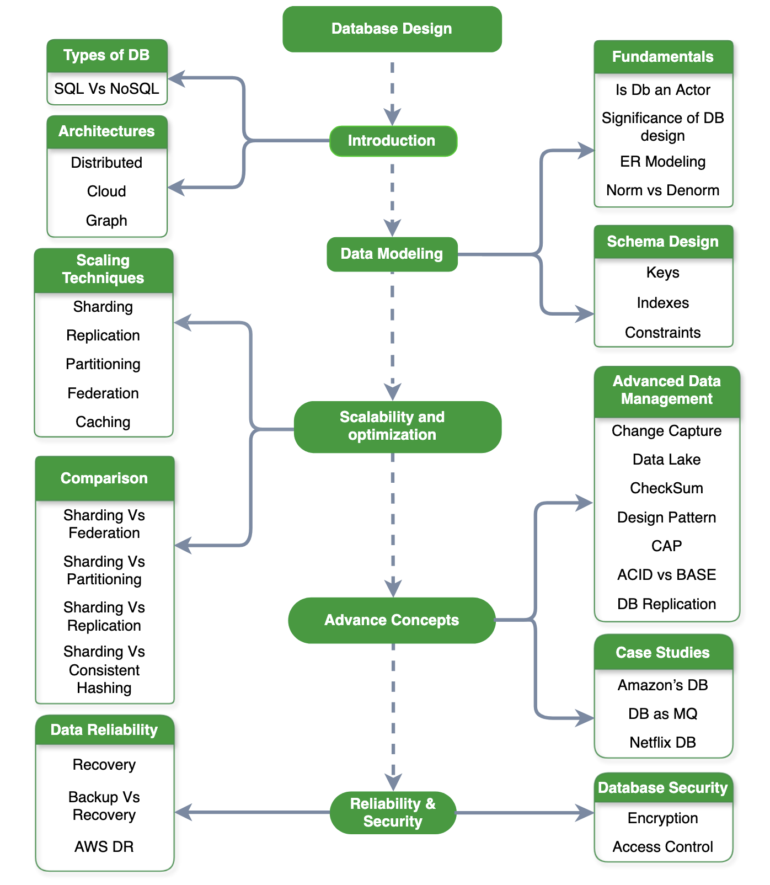

## [系统设计中的数据库类型](https://www.geeksforgeeks.org/system-design/types-of-databases-in-system-design/)

数据库是系统的重要组成部分，因为它们用于存储、组织和管理应用程序数据。所选数据库类型直接影响系统的性能、可扩展性和可靠性。

- 数据库能够高效地存储和管理大量数据，同时直接影响系统的性能、可扩展性、一致性和可用性。
- 选择合适的数据库可以提高系统速度、可靠性和整体用户体验。

**例如：** 电子商务平台可以使用关系型数据库来处理交易，并使用 NoSQL 数据库来高效地管理大量的产品或用户活动数据。

### 系统设计中的数据库类型

系统设计中最常见的数据库类型包括：

#### 1. 关系型数据库 (RDBMS)

系统设计中的关系型数据库是一种结构化存储系统，它将数据组织成表，每个表都具有预定义的列和行。它们确保数据完整性，并通过结构化查询语言 (SQL) 实现高效查询。

- 关系模型使用主键（唯一标识符）和外键（对其他表中主键的引用）来支持表之间的关系，从而实现复杂的数据检索和操作。
- 该模型广泛应用于需要结构化数据存储和 ACID（原子性、一致性、隔离性和持久性）特性的应用程序中，ACID 特性对于事务可靠性至关重要。

目前一些知名的关系型数据库包括 MySQL、PostgreSQL、Oracle 和 Microsoft SQL Server。

#### 2. NoSQL 数据库

NoSQL 数据库能够处理大量非结构化或半结构化数据，并具有高度可扩展性和灵活性。它们支持分布式系统，是现代高性能应用程序的理想选择。

- 灵活的模式：存储各种数据格式，无需严格的结构。
- 高可扩展性：专为分布式和大规模系统而设计。

**它们分为以下几种类型：**

- **文档数据库：** 将数据存储为 JSON 或 BSON 文档。例如：MongoDB、CouchDB。
- **键值存储：** 将数据记录在存储系统中，每个数据块都遵循键值对格式。例如：[Redis](https://www.geeksforgeeks.org/system-design/introduction-to-redis-server/)、DynamoDB。
- **列式存储：** 将数据按列而非行存储，更适用于宽列存储场景。例如：Cassandra、HBase。
- **图数据库：** 最适合存储关系型和网络型信息，将数据存储为节点、边和属性。例如：Neo4j、ArangoDB。

#### 3. NewSQL 数据库

NewSQL 数据库结合了传统关系型数据库（ACID 事务和强一致性）的优势以及 NoSQL 系统的可扩展性和高性能。它们的出现是为了克服传统数据库在处理现代大数据和分布式计算需求方面的局限性。

- NewSQL 数据库保留了关系型数据模型，但在分布式架构、并发控制机制和可扩展性技术方面进行了创新。
- 它们旨在通过[无共享架构](https://www.geeksforgeeks.org/system-design/shared-nothing-architecture/)、[分片](https://www.geeksforgeeks.org/system-design/database-sharding-a-system-design-concept/)（数据水平分区）和分布式事务管理来支持大规模可扩展性。
- 与 NoSQL 数据库不同，NewSQL 系统在分布式事务中保持 ACID 合规性，从而确保[数据的一致性](https://www.geeksforgeeks.org/system-design/consistency-in-system-design/)和[可靠性](https://www.geeksforgeeks.org/system-design/reliability-in-system-design/)。

一些属于 NewSQL 范畴的系统包括 Google Spanner、CockroachDB 和 NuoDB。

#### 4. 时序数据库

时序数据库是专门用于存储和查询带时间戳的数据点或测量值的数据库。它们擅长处理随时间推移生成的大量顺序数据，例如传感器数据、金融市场数据、物联网遥测数据以及来自应用程序或系统的日志数据。

- **时间戳数据：** 数据点根据时间戳进行索引和组织，从而可以按时间顺序高效地插入和检索数据。
- **优化存储：** 时间序列数据库通常采用专门的存储结构和压缩技术来高效地存储和管理顺序数据，在保持快速查询性能的同时，最大限度地减少存储空间占用。
- **基于时间的查询：** 它们支持以时间为中心的查询，例如检索特定时间范围内的数据点、按时间间隔（例如，每小时、每天）聚合数据以及执行时间序列分析（例如，计算移动平均值、检测趋势）。

示例包括：InfluxDB、TimescaleDB。

#### 5. 面向对象数据库

面向对象数据库 (OODB) 是以对象形式存储数据的数据库，类似于面向对象编程的概念。与将数据存储在表中的关系型数据库不同，面向对象数据库 (OODB) 直接将复杂的数据结构及其属性和方法存储为对象。

- 对象：数据以对象的形式表示，对象封装了数据（属性或字段）和行为（方法或过程）。对象可以拥有复杂的结构和关系，比关系型数据库更能真实地反映现实世界的实体。
- 继承和多态：OODB 支持继承，允许对象从其他对象（类）继承属性和行为。多态性使得不同类的对象可以通过接口或共享行为得到统一的处理。

示例包括：ObjectDB、db4o。

### 不同数据库对比

以下是不同数据库的对比：

| 数据库类型           | 性能                         | 可扩展性                       | 一致性                     | 可用性             |
| -------------------- | ---------------------------- | ------------------------------ | -------------------------- | ------------------ |
| 关系型数据库 (RDBMS) | 复杂查询性能优异             | 垂直扩展性强（水平扩展性有限） | 强一致性 (ACID)            | 支持集群的高可用性 |
| NoSQL 文档型数据库   | 读写操作性能优异             | 水平扩展性强                   | 最终一致性（可调）         | 高可用性           |
| NoSQL 键值型数据库   | 简单​​读写操作速度极快       | 水平扩展性强                   | 最终一致性                 | 高可用性           |
| NoSQL 列族型数据库   | 大型数据集性能优异           | 水平扩展性强                   | 一致性可调                 | 高可用性           |
| NoSQL 图数据库       | 关系查询性能优异             | 支持关系扩展                   | 强一致性                   | 高可用性           |
| NewSQL               | 具备 ACID 特性，性能优异     | 水平扩展性强                   | 强一致性(ACID)             | 高可用性（集群）   |
| 时间序列             | 针对时间序列数据查询进行优化 | 高水平可扩展性                 | 可调一致性                 | 高可用性           |
| 面向对象             | 高性能对象操作               | 中等可扩展性                   | 强一致性（取决于具体实现） | 中等可用性         |

### 基于应用需求的数据库选择

以下列出了不同的数据库及其适用场景示例：

#### 1. 关系型数据库 (RDBMS)

适用于需要结构化数据、强一致性和复杂查询的应用。

- **场景：** 需要复杂查询、业务交易和强一致性的电子商务平台。
- **示例：** 使用 PostgreSQL 管理订单、客户和库存。

#### 2. NoSQL 文档数据库

设计用于以 JSON 等文档格式存储半结构化或灵活数据。

- **场景：** 需要灵活模式要求的内容管理系统 (CMS)。
- **示例：** 使用 MongoDB 存储文章、博客帖子和用户生成的内容。

#### 3. NoSQL 键值存储

针对快速读写操作进行了优化，使用简单的键值对。

- **应用场景：** Web 应用程序中需要频繁读写操作的会话存储。
- **示例：** 使用 Redis 缓存用户会话和配置数据。

#### 4. NoSQL 列族存储

适用于处理海量分布式数据和实时分析。

- **场景：** 处理大规模数据的高速分析系统。
- **示例：** 使用 Cassandra 存储和处理用户活动会话结果。

#### 5. NoSQL 图数据库

专为管理高度关联数据和关系而设计的专用数据库。

- **场景：** 用户关系至关重要的社交网络应用。
- **示例：** 使用 Neo4j 管理用户连接和关系。

#### 6. NewSQL 数据库

在保持传统关系数据库 ACID 特性的同时，提供 NoSQL 系统的可扩展性。

- **场景：** 需要严格一致性和可扩展性的全球金融系统。
- **示例：** 使用 Google Spanner 管理跨多个地区的金融交易。

#### 7. 时序数据库

针对存储和分析持续生成的基于时间的数据进行了优化。

- **场景：** 需要长期收集大量传感器或监测数据的系统。
- **示例：** 使用 InfluxDB 存储和分析温度和湿度数据。

#### 8. 面向对象数据库

旨在直接存储复杂对象，符合面向对象编程模型。

- **场景：** 用于管理大型工程对象及其关系的 CAD 应用程序。
- **示例：** 使用 ObjectDB 存储和管理工程设计及模型。

## [SQL 与 NoSQL——系统设计中应该选择哪种数据库？](https://www.geeksforgeeks.org/system-design/which-database-to-choose-while-designing-a-system-sql-or-nosql/)

在系统设计中，**SQL 数据库与 NoSQL 数据库**之间的选择至关重要，它会对系统的整体性能、可扩展性和成功率产生重大影响。

### 什么是 SQL 数据库？

以下是 SQL 数据库的一些关键特性：

- 表格数据模型：SQL 数据库将记录组织成包含行和列的表格。
- 固定模式：SQL 数据库需要预定义的模式，这意味着您必须在向数据库添加记录之前定义记录的结构，指定记录类型和关系。这使得 SQL 数据库适用于存储稳定数据。
- ACID 兼容性：SQL 数据库通常符合 ACID 标准，这意味着它们通过原子性、一致性、隔离性和持久性来确保记录的一致性和完整性。
- 结构化查询语言 (SQL)：SQL 数据库使用标准化的查询语言来控制和检索数据。SQL 功能强大，支持复杂的查询，因此适用于需要统计分析和报表功能的应用程序。
- 强大的关系处理能力：SQL 数据库擅长处理数据表之间复杂的关系。

常见的 SQL 数据库示例包括：

- **MySQL：**一款开源关系型数据库，广泛应用于各种软件包中。
- **PostgreSQL：**一款功能强大的开源关系型数据库，以其可扩展性和对高级功能的支持而闻名。

#### SQL 的应用场景有哪些？

- **电子商务/金融系统/内容管理系统 (CMS)：**用于管理结构化数据、关系并确保事务完整性，这些场景都使用 SQL。
- **银行和库存管理：**用于确保资金转移或库存更新的准确性。

### 什么是 NoSQL 数据库？

NoSQL 数据库旨在处理非结构化或半结构化数据，并提供灵活性、可扩展性和高性能。以下是 NoSQL 数据库的一些关键特性：

- **灵活的数据模型：**NoSQL 数据库使用多种数据模型，包括键值对、文档存储、大列存储和图数据库。
- **无模式：**NoSQL 数据库是无模式的，这意味着无需预定义模式即可插入数据。
- **BASE（基本可用、软状态、最终一致性）：**NoSQL 数据库通常遵循 BASE 版本，而不是 ACID 版本。BASE 优先考虑高可用性和高性能，而非严格的一致性。
- **专有查询语言：**NoSQL 数据库通常拥有针对其特定数据模型定制的查询语言。这些查询语言通常更简洁，更易于理解数据结构。

NoSQL 数据库的常见示例包括：

- **MongoDB：**一款流行的文档存储，具有灵活性和可扩展性。
- **Cassandra：**一款宽列式数据库，以其处理海量信息和极高写入吞吐量的能力而闻名。

#### 何时使用 NoSQL？

- **社交媒体和大数据平台：**大规模处理非结构化用户生成内容。代码提交至 GeeksforGeeks Practice。
- **实时分析、物联网应用：**高写入量、模式灵活性以及快速访问的需求。

### SQL 与 NoSQL - 可扩展性和性能

- **SQL 的垂直扩展：**传统的 SQL 数据库通过向单个服务器添加更多资源来进行垂直扩展，但这存在局限性。
- **NoSQL 的水平扩展：**NoSQL 数据库在水平扩展方面表现出色，可以将数据分布在多个服务器上，从而无缝地处理不断增长的负载。
- **高流量系统的注意事项：**系统的可扩展性需求和预期流量应指导您选择垂直扩展还是水平扩展。

### SQL 与 NoSQL - 查询语言和事务

- SQL 数据库使用标准化的语言进行数据查询，这使得熟悉 SQL 语法的开发人员更容易上手。NoSQL 数据库的查询语言各不相同，有些使用传统的 SQL，而另一些则采用独特的方法。
- 在强 ACID 事务（SQL）和最终一致性（NoSQL）之间进行选择取决于应用程序对数据完整性的重视程度。

### SQL 与 NoSQL - 灵活性和模式演化

- 使 SQL 数据库适应不断变化的数据需求可能涉及复杂的模式更改和潜在的停机时间。
- NoSQL 数据库支持动态模式演化，使开发人员能够轻松适应不断变化的需求。

### 在系统设计中，何时应该选择 SQL 数据库而不是 NoSQL 数据库？

SQL 数据库适用于以下特殊情况：

- **复杂查询：**如果您的应用程序需要高级查询和复杂的报表，SQL 数据库凭借其结构化的模式和 SQL 查询语言，在这方面表现出色。
- **数据完整性：**当数据一致性和完整性至关重要时，尤其是在金融或监管应用程序中，符合 ACID 标准的 SQL 数据库是理想之选。
- **事务：**对于需要支持多步骤、符合 ACID 标准的事务的程序（例如电子商务系统），SQL 数据库是首选。

### 在系统设计中，何时应该选择 NoSQL 数据库而不是 SQL 数据库？

NoSQL 数据库在某些情况下性能更佳：

- **高[可扩展性](https://www.geeksforgeeks.org/system-design/what-is-scalability/)：**如果您的系统需要处理大量记录和访问者，NoSQL 数据库提供横向扩展能力，使其成为 Web 和移动应用程序的首选。
- **灵活的模式：**当您的信息结构是动态的，并且可能随着时间的推移而演变时，采用无模式设计的 NoSQL 数据库可以简化版本控制。
- **实时分析：**对于实时分析和流式数据处理，NoSQL 数据库因其速度和灵活性而成为首选。

### SQL 和 NoSQL 的区别

以下是 SQL 和 NoSQL 之间的主要区别：

|       方面       |                               SQL                                |                                        NoSQL                                         |
| :--------------: | :--------------------------------------------------------------: | :----------------------------------------------------------------------------------: |
|  数据模型和模式  |               强制执行结构化模式，预定义表和关系。               |                      采用灵活的模式，允许动态和演进的数据结构。                      |
|  可扩展性和性能  |         传统上通过向单个服务器添加更多资源进行垂直扩展。         |          擅长水平扩展，将数据分布到多个服务器上，以无缝处理不断增长的负载。          |
|  查询语言和事务  |               使用标准化的 SQL 语言进行数据查询。                |                查询语言多种多样，有些使用 SQL，有些则采用独特的方法。                |
| 灵活性和模式演进 |          僵化的模式可能需要复杂的更改，并可能导致停机。          |             动态模式演进允许适应不断变化的数据需求，而不会造成重大中断。             |
|    用例和应用    |       适用于复杂的事务、严格的数据完整性和定义良好的关系。       |        非常适合需要高可扩展性、处理大量非结构化数据和快速开发周期的应用程序。        |
| 数据完整性和关系 |           通过 ACID 事务维护数据完整性。关系定义良好。           |             需要反规范化才能有效地处理关系，并且一致性级别可能有所不同。             |
| 安全性和身份验证 |          完善的安全机制，包括用户角色、访问控制和加密。          |                  安全功能各不相同，需要实施访问控制来保护敏感数据。                  |
|     成本考量     |        可能涉及许可费用，垂直扩展可能会增加基础设施成本。        |       通常提供具有横向扩展能力的经济高效的解决方案，以应对不断增长的工作负载。       |
| 系统设计决策因素 | 根据具体项目需求进行选择，考虑数据结构、可扩展性需求和开发进度。 | 评估团队在 SQL 或 NoSQL 方面的专业知识，并考虑与项目增长相符的长期可扩展性和适应性。 |

## [系统设计中的文件和数据库存储系统](https://www.geeksforgeeks.org/system-design/file-and-database-storage-systems-in-system-design/)

文件和数据库存储系统对于系统设计中数据的有效管理和组织至关重要。这些系统为应用程序中的数据组织、检索和存储提供了结构，同时保证了数据的可访问性和完整性。数据库系统提供具有高级查询功能的结构化数据管理，而文件系统则管理结构化和非结构化数据。

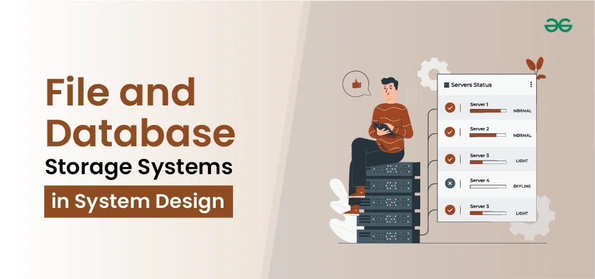

### 系统设计中的文件型存储系统

在计算机或服务器上，文件型存储系统将数据以独立文件的形式保存。在目录和子目录的组织结构下，每个文件都放置在文件夹中，并被赋予一个唯一的名称。这种简单直接的方法能够有效地存储结构化和非结构化数据，例如日志、文档和照片。但它不具备数据库的高级功能，例如索引和查询。

- **文件型存储系统的优点：**
  - **简单易用：**易于实施和管理，无需复杂的设置。
  - **兼容性强：**可与许多标准操作系统和工具配合使用。
  - **经济高效：**适合小规模存储需求，且成本不高。

- **文件型存储系统的缺点：**
  - **可扩展性有限：**不适用于大规模系统或不断增长的数据需求。
  - **缺乏查询支持：**无法像数据库那样执行高级搜索。
  - **数据完整性问题：**管理重复文件或文件之间的关系可能具有挑战性。

### 系统设计中的数据库存储系统

数据库存储系统是一种结构化的数据存储、管理和检索方式，能够高效地完成这些工作。与基于文件的系统不同，数据库将数据组织成表、行和列，从而更易于查询和维护。这些系统通常用于需要数据关系、事务处理和大规模数据处理的应用程序。

- **数据库存储系统的优点：**
  - **高效查询：**支持使用 SQL 等查询语言进行高级搜索和操作。
  - **数据完整性：**维护数据的一致性和关系。
  - **可扩展性：**通过分片或复制等选项来应对不断增长的数据需求。

- **数据库存储系统的缺点：**
  - **设置复杂：**需要进行适当的设计和配置。
  - **成本较高：**可能涉及许可费和基础设施支出。
  - **性能开销：**与基于文件的系统相比，对于非常简单的数据存储需求，数据库存储系统的速度可能较慢。

### 文件存储系统与数据库存储系统的区别

以下是文件存储系统与数据库存储系统的区别：

|   方面   |            文件存储系统            |            数据库存储系统            |
| :------: | :--------------------------------: | :----------------------------------: |
|   结构   | 数据以独立文件的形式存储在目录中。 |    数据以表格、行和列的形式组织。    |
| 数据关系 |      不支持内置的文件间关系。      |      支持使用键和约束建立关系。      |
|   查询   | 不支持高级查询；需要手动读取文件。 |  允许使用 SQL 等语言进行复杂查询。   |
| 可扩展性 |  可扩展性有限；更适合小型数据集。  | 可扩展性强，能够满足大规模数据需求。 |
|  易用性  |          易于实施和管理。          |      需要进行适当的设计和设置。      |
| 应用场景 |      适用于文档、图像或日志。      |    非常适合事务系统和关系型数据。    |

### 数据库存储系统相对于文件存储系统的优势

- **数据组织：**数据库以表格形式组织数据，与平面文件系统相比，更易于组织和维护。
- **高效查询：**数据库支持使用 SQL 等查询语言进行高级搜索，而文件系统则需要手动读取文件。
- **数据关系：**数据库支持使用键和约束来建立数据之间的关系，这是文件系统无法实现的。
- **[可扩展性](https://www.geeksforgeeks.org/system-design/what-is-scalability/)：**数据库能够处理海量数据，并可通过复制或分片有效扩展。
- **数据完整性和安全性：**提供强大的机制来保证数据的一致性、完整性和访问控制，从而确保更高的数据可靠性。

### 文件存储系统相对于数据库存储系统的优势

- **简易性：**文件存储系统易于设置和管理，无需复杂的数据库配置或查询。
- **成本更低：**文件系统的实施和维护成本通常更低，因此非常适合小型应用程序或个人使用。
- **简单操作的性能优势：**对于基本的文件检索任务，基于文件的存储速度更快，尤其是在处理图像或日志等大型非结构化数据时。
- **灵活性：**您可以将任何类型的数据（例如图像、视频、文档）以各种格式存储，而无需担心预定义的模式。
- **更低的开销：**无需数据库软件或服务器，从而降低了小型或不太复杂的系统的计算开销。

## [系统设计中的数据库复制](https://www.geeksforgeeks.org/system-design/database-replication-and-their-types-in-system-design/)

在其他服务器上创建并维护数据库的重复副本称为数据库复制。它对于提升现代系统的[可扩展性](https://www.geeksforgeeks.org/system-design/what-is-scalability/)、[可靠性](https://www.geeksforgeeks.org/system-design/reliability-in-system-design/)和数据[可用性](https://www.geeksforgeeks.org/system-design/availability-in-system-design/)至关重要。

- 通过将数据分布在多个服务器上，企业可以确保即使服务器发生故障，数据仍然可用。
- 这种冗余机制也提高了数据可靠性，因为在数据损坏或丢失的情况下，可以利用多个副本进行恢复。
- 数据库复制有助于在服务器之间分配工作负载，从而提升可扩展性和性能。

### 数据库复制的重要性

数据库复制之所以重要，原因有以下几点：

- **[高可用性](https://www.geeksforgeeks.org/system-design/what-is-high-availability-in-system-design/)：**即使一个或多个服务器发生故障，复制也能保证数据的可用性。通过在多个服务器上保留数据副本，应用程序可以持续不间断地运行。
- **灾难恢复：**发生灾难时，复制提供了一种恢复数据的方法。灾难过后，企业可以通过在多个位置保留数据副本快速恢复运营。
- **[负载均衡](https://www.geeksforgeeks.org/system-design/what-is-load-balancer-system-design/)：**它允许将读取查询分配到多个服务器上，从而降低单个服务器的负载并提高性能。
- **[容错性](https://www.geeksforgeeks.org/system-design/fault-tolerance-in-system-design/)：**它通过确保在单个服务器发生故障时，另一个服务器可以接管，最大限度地减少中断，从而提高容错性。
- **[可扩展性](https://www.geeksforgeeks.org/system-design/what-is-scalability/)：**它允许将写入操作分配到多个服务器上，从而降低单个服务器的负载，进而提高可扩展性。
- **数据本地化：**它可用于将数据更靠近用户，从而降低延迟并改善用户体验。

### 数据库复制的工作原理是什么？

以下步骤说明了数据库复制的工作原理：

- **步骤 1：**确定主数据库（源）：选择一个主数据库（或主数据库）作为主要数据源，数据变更均源自该数据库。
- **步骤 2：**设置副本数据库（目标）：配置一个或多个副本数据库（或辅助数据库）以接收来自主数据库的数据。
- **步骤 3：**捕获数据变更：主数据库中的任何更新、插入或删除操作都会被记录下来，通常通过事务日志或变更数据捕获机制来实现。
- **步骤 4：**将变更传输到副本：捕获的变更会通过网络实时或按计划的时间间隔发送到副本数据库。
- **步骤 5：**在副本上应用变更：副本应用这些更新，以保持其数据与主数据库同步。
- **步骤 6：**监控和维护同步：系统确保副本保持最新状态，并处理同步过程中出现的延迟或冲突等问题。
- **步骤 7：**读取或写入操作：应用程序可以从副本读取数据（以减少主节点的负载），并可以向主节点写入数据，具体取决于复制模型（例如，主从、主主）。

### [数据库复制类型](https://www.geeksforgeeks.org/system-design/types-of-database-replication-system-design/)

让我们了解一下不同的数据库复制类型：

#### 1. 主从复制

- 将数据从主数据库（主数据库）复制并同步到一个或多个辅助数据库（从数据库）的过程称为主从复制。
- 在这种配置中，所有写入操作，包括插入、更新和删除，都必须由主数据库接收。
- 从数据库保留一份数据副本，并将对主数据库所做的修改复制到从数据库。

#### 2. 主主复制/多主复制

- 主主复制，也称为双向复制，是一种将两个或多个数据库配置为主数据库的设置，每个主数据库都可以接收写入操作。
- 这意味着对任何主数据库所做的更改都会复制到配置中的所有其他主数据库。

#### 3. 快照复制

- 在特定时间点创建整个数据库的副本，然后将该快照复制到一个或多个目标服务器，称为快照复制。

#### 4.事务复制

- 实时同步多个数据库副本的一种方法是事务复制。
- 这意味着对一个数据库（称为发布者）中的特定表（或表组）所做的任何修改都会立即复制到其他数据库（称为订阅者）。

#### 5. 合并复制

- 合并复制是一种数据库同步方法，它允许中央服务器（发布者）及其连接的设备（订阅者）对数据进行更改，并在必要时解决冲突。

### [数据库复制策略](https://www.geeksforgeeks.org/system-design/strategies-of-database-replication-system-design/)

数据库复制策略决定了如何选择数据，以及如何在数据库之间复制和分发数据，以实现可扩展性、可用性和效率等特定目标。一些常见的数据库复制策略包括：

- **完全复制：**也称为全数据库复制，这是一种将整个数据库复制到一个或多个目标服务器的技术。数据库中的所有表、行和列都会被复制到目标服务器。因此，副本可以获得原始数据库的精确副本。
- **部分复制：**这种方法不涉及复制整个数据库，而仅复制其子集，例如特定的表、行或列。当只需要出于报告、分析或其他原因复制特定数据时，这种方法非常有用，并且可以更有效地利用资源。
- **选择性复制：**这是一种数据库复制策略，涉及根据预定义的标准或条件复制数据。与复制整个数据库的完全复制或复制数据库子集的部分复制不同，选择性复制允许对要复制的数据进行更精细的控制。
- **[分片](https://www.geeksforgeeks.org/system-design/database-sharding-a-system-design-concept/)：**这是一种数据库扩展技术，它基于键将数据分区到多个数据库实例（分片）上。这种方法可以将工作负载和数据存储分布到多个服务器上，从而提高可扩展性和性能。
- **混合复制：**这是一种数据库复制策略，它结合了多种复制技术来实现特定目标。这种方法允许根据数据库或应用程序不同部分的需求定制复制方法。

### [系统设计中的数据库复制配置](https://www.geeksforgeeks.org/system-design/configurations-of-database-replication-in-system-design/)

为了实现与数据一致性、可用性和性能相关的特定目标，可以采用多种方式设置和运行数据库复制：

#### 1. 同步复制配置

- 这是一种数据库复制技术，它将数据更改实时复制到一个或多个副本。在至少一个副本确认收到更改之前，事务不被视为已提交。
- 该技术通过保证主数据库及其副本始终保持同步，从而提供高度的数据一致性。

#### 2. 异步复制配置

- 使用此数据库复制技术，对主数据库执行的数据更改会复制到一个或多个副本，而无需等待副本确认。
- 这种方法可以加快主数据库的事务处理速度，但主数据库和副本之间的数据一致性可能会略有延迟。

#### 3. 半同步复制配置

- 半同步复制是一种结合了同步复制和异步复制元素的数据库复制技术。
- 虽然其他副本会异步更新以提高效率，但半同步复制通过同步复制到至少一个副本来确保关键数据的出色数据一致性。

### 数据库复制的挑战

数据库复制面临的一些挑战包括：

- **数据一致性：**维护副本之间的数据一致性可能很困难，尤其是在异步复制的情况下，数据复制可能会延迟。
- **复杂性：**数据库复制会增加系统复杂性，需要进行全面的设置和管理才能保证准确有效的数据复制。
- **成本：**设置和维护复制数据库环境的成本可能很高，尤其是在具有多个副本的大规模部署中。
- **冲突解决：**在多主复制环境中，当多个副本同时更改相同数据时，可能会出现冲突，需要使用冲突解决技术。
- **延迟：**同步复制需要在提交事务之前获得副本的确认，这可能会引入延迟并影响主数据库的性能。

## [数据库复制类型](https://www.geeksforgeeks.org/system-design/types-of-database-replication-system-design/)

数据库复制是指将数据复制到多个数据库服务器并进行维护，以确保即使在发生故障的情况下也能保证数据的可靠性和一致性访问。它有助于提高系统弹性，并支持分布式环境中的高效数据管理。

- 通过在高流量系统中将读取操作分布到多个副本上，可以提高系统性能和可扩展性。
- 通过在服务器之间维护同步的数据副本，可以确保灾难恢复和持续的服务可用性。

**例如：** 一个电子商务网站使用主数据库处理订单，而副本数据库则存储相同数据的副本。这样即使一个服务器发生故障，用户仍然可以查看产品并下单，从而提高可用性和可靠性。

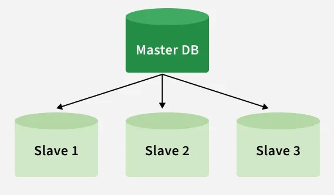

### 数据库复制类型

数据库复制类型包括单主从复制、多主复制（主主）和点对点复制。

#### 1. 主从复制

在主从复制中，所有写入操作均由主数据库处理，更新后的数据会同步到从数据库。

- 主数据库处理所有插入、更新和删除操作，而从数据库则维护主数据的副本。
- 通过使用从数据库执行查询，可以提高读取性能。
- 提供基本的容错能力，常用于读取密集型应用程序。

**示例：** 假设一个图书馆有两个分馆。

- **主分馆：** 主分馆是主要图书馆，维护着原始且最新的图书收藏。
- **从分馆：** 这是一个较小的分馆，定期从主分馆接收新书的副本。学生只能借阅实际存在于从分馆的图书。

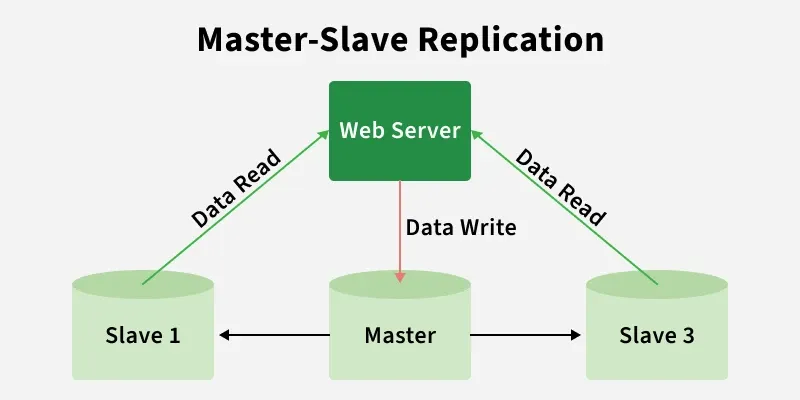

##### 工作原理

主从复制的工作原理是按顺序将数据更改从主数据库（主库）复制到一个或多个辅助数据库（从库）。

- **写入操作：** 主库将更改记录到其事务日志中。
- **日志读取：** 复制线程读取事务日志。
- **数据传输：** 更改通过网络从主库发送到从库。
- **同步更新：** 从库将接收到的更改应用到其数据。
- **确认：** 从库向主库发送确认信息。

##### 应用场景

这种架构广泛应用于需要高性能和读取可扩展性的系统中。

- **电子商务网站：** 从服务器处理读取密集型任务，例如产品列表，而主库管理写入操作，例如订单。
- **内容管理系统：** 内容读取请求由从服务器处理，所有内容更新均由主服务器处理。

##### 优势

主从复制为分布式数据库系统提供了诸多优势。

- **高可用性：** 当主数据库发生故障时，可以从数据库升级为新的主数据库，从而确保[高可用性](https://www.geeksforgeeks.org/system-design/what-is-high-availability-in-system-design/)，使系统能够持续运行并保持可访问性。
- **可扩展性：** 通过将读取操作转移到从数据库，系统可以在不影响速度的情况下管理更多用户和数据，从而提高[可扩展性](https://www.geeksforgeeks.org/system-design/what-is-scalability/)并降低主数据库的负载。
- **数据一致性：** 主从复制通过将主数据库的更改复制到从数据库来保持所有数据副本的最新状态，从而确保跨多个数据库的强数据一致性。

##### 挑战

尽管这种方法具有诸多优势，但也存在一些局限性。

- **复制延迟：** 由于在主数据库上执行更改的时间与将更改复制到从数据库的时间之间存在延迟（复制延迟），因此可能会导致数据不一致。
- **单点故障：** 主数据库充当[单点故障](https://www.geeksforgeeks.org/system-design/reliability-in-system-design/)；如果主数据库宕机，系统可能会停止运行，直到另一个数据库被提升为新的主数据库。
- **写入可扩展性有限：** 由于写入操作仅限于主数据库，因此对于写入密集型应用程序而言，这可能会成为[瓶颈](https://www.geeksforgeeks.org/system-design/bottleneck-conditions-identification-in-system-design/)。

#### 2. 主主复制

双向复制允许两个或多个主数据库接受写入操作，其中一个主数据库上的更改会自动同步到其他数据库。

- 所有主数据库都可以处理读写操作，一个主数据库上的更新会复制到其他主数据库。
- 提高了可用性和容错能力，但需要解决冲突以维护数据一致性。
- 与主从复制相比，管理起来更复杂。

**例如：** 就像两个空中交通管制员一样，他们拥有相同的权限，持续共享更新，并且可以互相接管，以确保平稳、不间断的运行。

- 两个管制员都完全控制各自的区域。
- 持续通信可以防止冲突。
- 共同承担责任可以确保可靠性。
- 如果其中一个不可用，另一个可以完全接管。

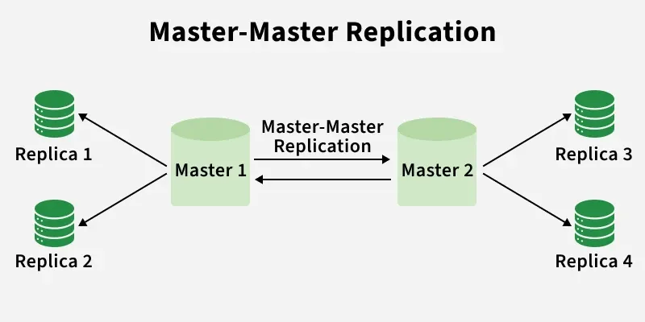

##### 工作原理

多主复制允许多个数据库同时作为主节点并接受写入操作。

- **写入操作：** 主节点将插入、更新或删除操作记录到其事务日志中。
- **复制过程：** 从日志中读取更改并准备进行复制。
- **网络传输：** 将更新发送到其他主节点（同步或异步）。
- **应用更改：** 接收更新的主节点将更新应用到自身的数据。
- **冲突解决：** 处理冲突的并发写入操作以确保数据一致性。
- **确认：** 主节点确认更改已成功应用。

##### 应用场景

这种复制方法适用于需要高可用性和分布式写入的系统。

- **多数据中心应用：** 跨数据中心的双活架构，实现低延迟数据访问。
- **协作编辑平台：** 多个用户同时编辑内容并实时同步。

##### 优势

多主复制具有强大的性能和可靠性优势。

- **提升写入可扩展性：** 写入负载分布在多个主节点上，从而提升写入密集型系统的性能。
- **高可用性：** 即使一个主节点发生故障，其他主节点也能继续处理写入操作，无需停机。

##### 挑战

尽管多主复制具有诸多优势，但也带来了额外的复杂性。

- **复杂性：** 由于冲突解决、一致性维护和网络设置等问题，配置和管理较为困难。
- **冲突解决：** 不同主节点上的同步更新可能会导致冲突，需要使用高级逻辑或进行人工干预。

#### 3. 快照复制

快照复制会在特定时间点创建数据库的完整副本，并将其复制到其他服务器，主要用于报表、备份或分发。

**示例：**

- 就像在某个时刻拍摄房间照片一样
- 快照会捕捉到当时的精确状态
- 之后可以使用快照将房间恢复到该状态。

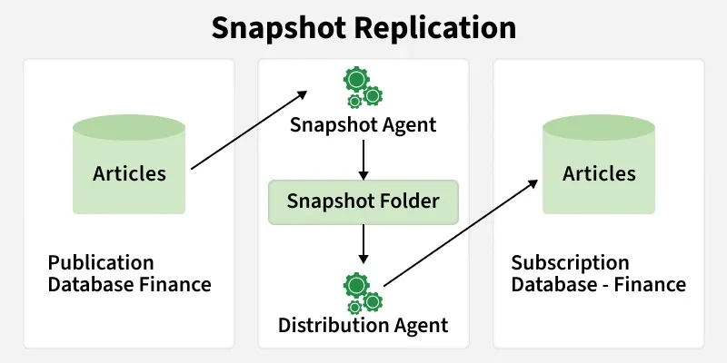

##### 工作原理

快照复制的工作原理是定期复制整个数据库并将其分发给订阅服务器。

- **初始快照：** 在发布服务器上创建完整的数据库副本（模式 + 数据）。
- **分发：** 快照存储在分发数据库中。
- **复制过程：** 发布服务器上的更改会被跟踪并保存到分发服务器上。
- **订阅服务器更新：** 订阅服务器应用接收到的更改以保持同步。

##### 应用场景

这种复制方法通常用于对实时更新要求不高的场景。

- **数据仓库：** 定期创建快照以进行分析和报告，而不会对生产环境造成负载。
- **审计与合规：** 保留历史数据状态以满足监管要求。

##### 优势

快照复制为特定用例提供了简单性和可靠性。

- **易于实施：** 比其他复制类型更容易配置和维护。
- **离线访问：** 无需连接到实时系统即可进行报告或分析。
- **数据保护：** 可用作时间点备份，用于恢复。

##### 挑战

尽管快照复制简单易用，但它也存在一些局限性。

- **数据一致性：** 保持数据库多个副本同步是一项挑战，尤其是在频繁更新的环境中，这使得跨所有副本维护数据一致性变得困难。
- **存储需求：** 存储数据库的多个副本（包括快照和更改）可能需要大量的存储空间。

#### 4. 事务复制

事务复制将发布服务器上的每次更改近乎实时地复制到订阅服务器，从而确保所有数据库保持同步并维护数据一致性。

- 更改发生后立即进行复制，发布服务器将更新发送给一个或多个订阅服务器。
- 确保跨位置的高数据一致性，同时支持实时或近实时系统。
- 常用于高可用性环境。

**示例：** 想象一下价格不断变化、实时更新的股票市场。

- 每次价格变动（交易）都会立即广播到所有连接的屏幕（副本）。
- 每个人都能实时看到相同的价格更新。

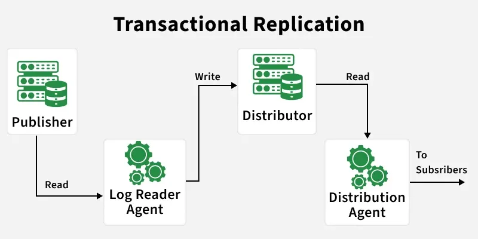

##### 工作原理

事务复制的工作原理是：跟踪发布服务器上的更改，通过分发服务器发送更改，并将更改应用到订阅服务器，从而保持数据一致性。

- **发布服务器和订阅服务器：** 发布服务器上选定的表被标记为需要复制。
- **更改跟踪：** 持续监控插入、更新和删除操作。
- **事务捕获：** 将更改分组到事务中以确保一致性。
- **分发服务器：** 收集事务并转发给订阅服务器。
- **订阅服务器更新：** 订阅服务器应用更改以保持同步。

##### 应用场景

这些应用依赖于近实时复制来维护分布式系统的准确性、一致性和流畅的用户体验。

- **金融服务：** 近实时复制交易以进行审计和合规性检查。
- **在线游戏：** 保持玩家操作和游戏状态在服务器之间的同步。

##### 优势

这些优势确保了实时数据同步、高可用性、可靠的灾难恢复以及跨分布式位置的高效数据访问。

- **实时更新：** 更改会立即反映在所有副本上，从而确保高可用性和数据一致性。
- **灾难恢复：** 复制副本在主数据库故障时充当备份。
- **数据分发：** 为地理位置分散的系统提供最新数据，且不影响性能。

##### 挑战

尽管事务复制具有诸多优势，但也引入了额外的复杂性。

- **配置：** 需要仔细设置，并具备代理、分发器和订阅者的专业知识。
- **开销：** 复制所需的额外处理可能会影响发布者数据库的性能。

#### 5. 合并复制

合并复制允许发布者和订阅者独立更新数据，并在之后同步更改，并在发生冲突时解决冲突。

- 支持双向数据同步，发布者和订阅者都可以修改数据。
- 适用于离线或偶尔连接的系统，并使用预定义规则或手动输入来解决冲突。

**示例：** 假设一个团队在 Google Docs 中处理共享文档（数据库）。

- 团队成员可以离线（本地）编辑文档，他们的更改会被临时保存。
- 当他们在线连接时，他们的更改会与主文档合并，从而解决任何冲突。

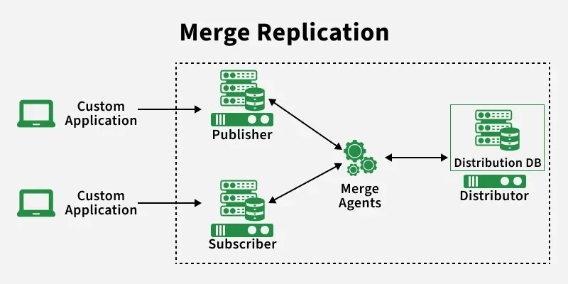

##### 工作原理

合并复制会跟踪发布者和订阅者服务器上的更改，在同步期间合并这些更改，并解决冲突以保持数据一致性。

- **发布者和订阅者：** 选定的表允许所有节点进行读/写访问。
- **更改跟踪：** 双方都会记录其数据更改。
- **冲突：** 同一数据可能会出现冲突的更新。
- **同步与解决：** 使用规则合并更改并解决冲突。
- **更新分发：** 最终更新将与所有订阅者共享。

##### 应用场景

合并复制非常适合需要离线工作并在稍后进行数据同步的系统。

- **现场服务应用：** 现场工作人员离线更新数据，并在重新连接后与中央服务器同步。
- **医疗保健系统：** 医务人员离线访问和更新患者记录，然后在联网时同步更改。

##### 优势

合并复制支持离线工作，并可在分布式系统之间灵活地进行双向数据同步。

- **离线更新：** 设备可以在断开连接的情况下修改数据，并在稍后进行同步。
- **双向同步：** 支持发布者和订阅者之间的双向数据流。
- **灵活性：** 提供多种冲突解决策略以满足不同需求。

##### 挑战

合并复制由于需要处理冲突和进行同步，因此会引入更高的复杂性和性能开销。

- **复杂性：** 冲突解决、同步和故障排除需要丰富的专业知识。
- **性能：** 合并和解决冲突会增加处理和网络开销。
- **数据一致性：** 同步或冲突解决过程中的错误会导致数据不一致，因此需要严格的数据完整性控制。

#### 主从复制与主主复制

本节重点介绍分布式数据库系统中使用的单主复制模型和多主复制模型之间的主要区别。

| 主从复制                     | 主主复制                       |
| ---------------------------- | ------------------------------ |
| 单向数据流：从主节点到从节点 | 双向数据流：主节点之间         |
| 只有主节点处理写入操作       | 所有主节点都可以处理写入操作   |
| 从节点处理读取操作           | 所有主节点都可以处理读取操作   |
| 通常是异步的；一致性延迟较小 | 可以是同步的；近乎实时的一致性 |
| 冲突很少且易于管理           | 冲突很常见且难以解决           |
| 主节点故障时可用性较低       | 一个主节点故障时可用性较高     |
| 适用于读取密集型工作负载     | 更适用于写入密集型工作负载     |
| 主节点可能成为瓶颈           | 负载分布在多个主节点上         |
| 更易于配置和管理             | 配置和管理更复杂               |
| 网络和处理开销较低           | 网络和处理开销较高             |

#### 快照复制与事务复制

本节将比较时间点数据复制和基于持续变更的复制，重点介绍它们在一致性和应用场景方面的差异。

| 快照复制                   | 事务复制                   |
| -------------------------- | -------------------------- |
| 对整个数据库进行时间点快照 | 捕获并复制单个事务         |
| 适用于不频繁的更新         | 适用于频繁的近实时更新     |
| 每次都传输整个数据集       | 仅传输自上次复制以来的更改 |
| 在特定时间点保持一致性     | 保持近实时数据一致性       |
| 数据传输开销较高           | 数据传输量较低，效率更高   |
| 配置和管理简单             | 配置较为复杂               |
| 适用于报表和备份           | 适用于实时系统             |
| 只读副本很常见             | 订阅者保持持续同步         |

## [数据库分片 - 系统设计](https://www.geeksforgeeks.org/system-design/database-sharding-a-system-design-concept/)

数据库分片是一种数据库水平扩展技术，它将数据拆分到多个数据库实例（或分片）中，以提高性能并减少大量数据对单个数据库的影响。

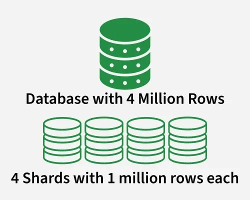

它本质上是一种**数据库架构模式**，将大型数据集分割成更小的块（逻辑分片），并将这些块存储/分布在不同的机器/数据库节点（物理分片）中。

- 每个块/分区被称为一个“**分片**”，每个分片都与原始数据库具有相同的数据库模式。
- 我们以这样的方式分布数据：每一行数据都恰好出现在一个分片中。
- 这是一种提高应用程序**可扩展性**的有效机制。

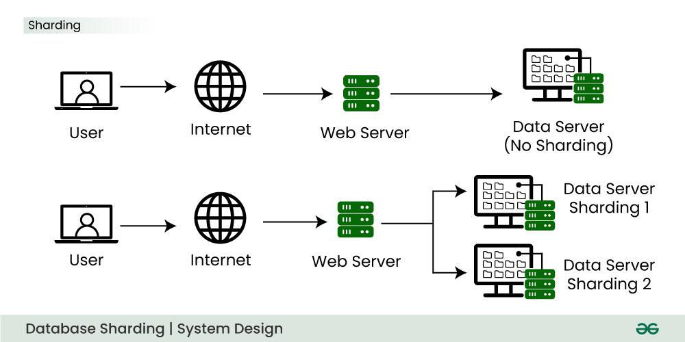

### 分片方法

#### 1. 基于键的分片

**基于键的分片**技术也称为**基于哈希**的分片。在这种方法中，我们获取实体的值，例如客户 ID、客户电子邮件、客户端 IP 地址、邮政编码等，并将该值作为**哈希函数**的输入。此过程生成一个**哈希值**，用于确定我们需要使用哪个分片来存储数据。

- 我们需要记住，输入到哈希函数中的所有值都必须来自同一列（分片键），以确保数据以正确的顺序和一致的方式存储。
- 基本上，分片键的作用类似于主键或各个行的唯一标识符。

**例如：**

假设您有 3 台数据库服务器，每个请求都有一个应用程序 ID，每次注册新应用程序时，该 ID 都会递增 1。

为了确定应该将数据放在哪个服务器上，我们对这些应用程序 ID 与数字 3 进行模运算。然后使用余数来标识存储我们数据的服务器。

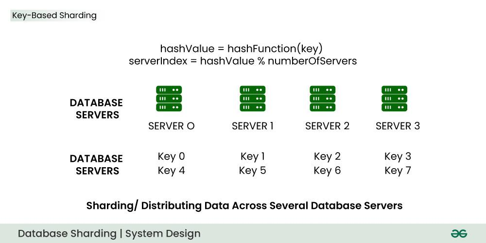

##### 基于键的分片的优势

- 基于键的分片将每个键分配到特定的分片，确保数据分布均匀一致。
- 它可以进行优化，以高效处理跨连续键范围的查询。

##### 基于键的分片的劣势

- 如果分片键分布不均，则可能出现数据分布不均的情况。
- 当某些键的访问量过大或数据存在倾斜时，可扩展性可能会受到限制。
- 选择合适的分片键对于有效的分片至关重要。

#### 2. 水平分片或范围分片

在**水平分片或范围分片**中，我们根据每条记录中特定值的范围将数据分成不同的部分。假设您有一个包含在线客户姓名和电子邮件信息的数据库。您可以将这些信息分成两个分片。

- 在一个分片中，您可以保存名字以 A 到 P 开头的客户信息。
- 在另一个分片中，保存其余客户的信息。

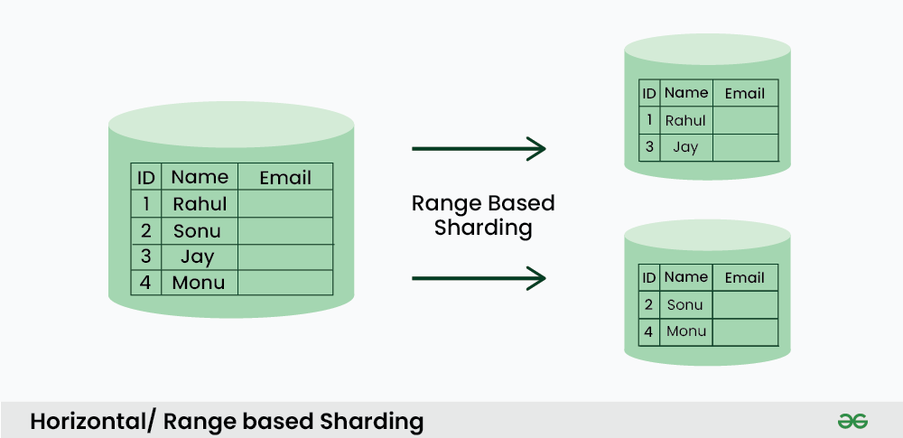

##### 基于范围的分片优势

- **可扩展性：**水平或基于范围的分片通过将数据分布在多个分片上，实现了无缝扩展，能够适应不断增长的数据集。
- **性能提升：**数据在分片间的分布通过并行化提升了查询性能，确保每个分片处理的数据子集更小，从而加快操作速度。

##### 基于范围的分片劣势

- **跨分片复杂查询：**协调涉及多个分片的查询可能具有挑战性。
- **数据分布不均：**数据分布管理不善可能导致分片间工作负载不均衡。

#### 3. 垂直分片

在**垂直分片**中，我们将表中的整列数据拆分出来，并将它们放入新的独立表中。数据在各个分区之间完全独立。此外，每个分区都包含不同的行和列。我们可以将实体的不同特征拆分到不同机器上的不同分片中。

**例如：**

在 Twitter 上，用户可能拥有个人资料、粉丝数量以及自己发布的一些推文。我们可以将用户个人资料放在一个分片中，粉丝数量放在第二个分片中，推文放在第三个分片中。

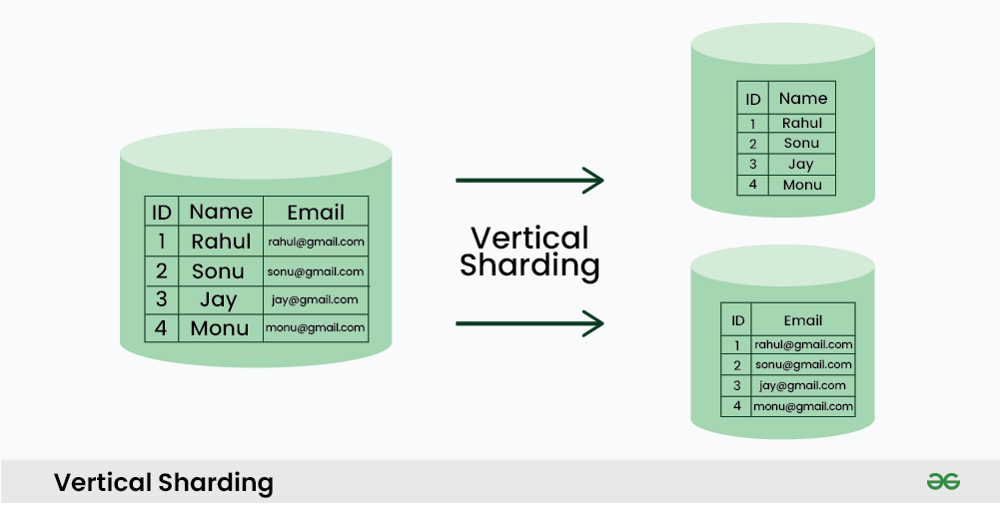

##### 垂直分片的优势

- **查询性能：**垂直分片允许每个分片专注于特定的列子集，从而提升查询性能。这种专业化提高了仅涉及部分可用列的查询效率。
- **简化查询：**需要特定列集的查询可以简化，因为它们只需与包含相关列的分片交互。

##### 垂直分片的劣势

- **热点风险：**某些分片如果包含访问量极高的列，则可能成为热点，导致工作负载分布不均。
- **模式变更的挑战：**在垂直分片系统中，对模式进行更改（例如添加或删除列）可能更具挑战性。更改可能会影响多个分片，因此需要仔细协调。

#### 4. 基于目录的分片

在基于目录的分片中，我们会为原始数据库创建并维护一个查找服务或查找表。基本上，我们使用分片键来建立查找表，并为数据库中存在的每个实体进行映射。这样，我们就能跟踪哪些数据库分片存储了哪些数据。

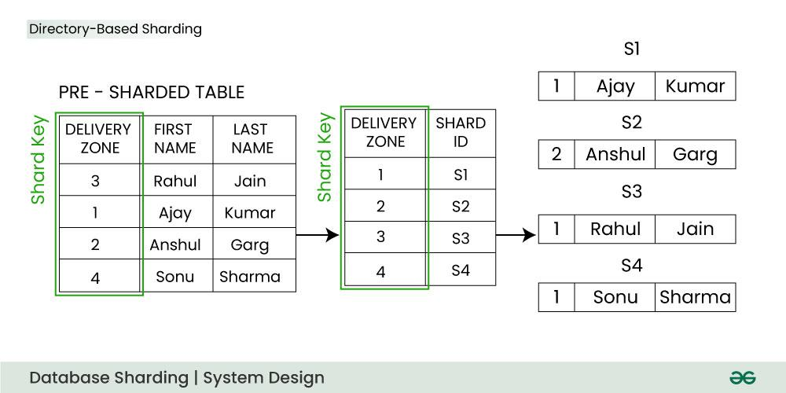

查找表保存着一组静态信息，用于指示特定数据的位置。在上图中，您可以看到我们使用了交付区域作为分片键：

- 首先，客户端应用程序查询查找服务，以确定数据所在的分片（数据库分区）。
- 当查找服务返回分片信息后，它会查询/更新该分片。

##### 基于目录的分片优势

- **灵活的数据分发：**基于目录的分片支持灵活的数据分发，中央目录可以动态管理和更新数据到分片位置的映射。
- **高效的查询路由：**利用目录中存储的信息，可以将查询高效地路由到相应的分片，从而提高查询性能。
- **动态[可扩展性](https://www.geeksforgeeks.org/system-design/what-is-scalability/)：**系统可以通过添加或删除分片来动态扩展，而无需更改应用程序逻辑。

##### 基于目录的分片的缺点

- **集中式故障点：**中心目录构成单点故障。如果该目录不可用或出现问题，可能会中断整个系统，影响数据访问和查询路由。
- **[延迟](https://www.geeksforgeeks.org/system-design/latency-in-system-design/)增加：**通过中心目录进行查询路由会引入额外的层，与其他分片策略相比，可能会导致延迟增加。

### 优化数据库分片以实现均匀数据分布的方法

以下是一些**优化数据库分片以实现均匀数据分布的简单方法**：

- **使用[一致性哈希](https://www.geeksforgeeks.org/system-design/consistent-hashing/)：**一致性哈希通过哈希函数将记录根据其键值分配到不同的分片，从而帮助数据更均匀地分布在所有分片上。
- **选择合适的分片键：**选择一个均衡的分片键至关重要。避免产生热点的分片键可以确保数据均匀分布在所有服务器上。
- **谨慎使用基于范围的分片：**如果使用基于范围的分片，请确保正确定义范围，以避免某个分片的数据量过大。
- **定期监控和重新平衡：**密切关注数据分布情况，并在必要时重新平衡分片，以避免数据增长导致负载不均。
- **自动化分片逻辑：**实现自动化工具或内置数据库功能，自动分发数据并处理分片，以维持分片间的负载均衡。

### 数据库分片的替代方案

以下是一些数据库分片的替代方案：

1. **[垂直扩展](https://www.geeksforgeeks.org/system-design/system-design-horizontal-and-vertical-scaling/)：**无需拆分数据库，即可通过增加 CPU、内存或存储空间来升级现有服务器，从而处理更多负载。但是，这种方法存在局限性，因为服务器的扩展能力是有限的。
2. **[复制](https://www.geeksforgeeks.org/system-design/database-replication-and-their-types-in-system-design/)：**可以在多个服务器上创建数据库副本。这有助于负载均衡并确保可用性，但可能会导致副本之间的同步问题。
3. **[分区](https://www.geeksforgeeks.org/system-design/data-partitioning-techniques/)：**分区不是将数据分片到多个服务器，而是将数据拆分到同一服务器内。它将数据分成更小的部分，从而提高大型数据集的查询性能。
4. **[缓存](https://www.geeksforgeeks.org/system-design/caching-system-design-concept-for-beginners/)：**通过将频繁访问的数据存储在缓存（例如 Redis 或 Memcached）中，可以减轻主数据库的负载，从而在无需分片的情况下提高性能。
5. **[CDN](https://www.geeksforgeeks.org/system-design/what-is-content-delivery-networkcdn-in-system-design/)：**对于读取密集型工作负载，使用内容分发网络 (CDN) 可以将部分数据访问从主数据库卸载，从而减少分片的需求。

### 分片的优势

分片在系统设计中具有诸多优势，例如：

1. **提升性能：**通过将负载分配到多个服务器上，每个服务器可以处理的工作量减少，从而加快响 ​​ 应速度并提升整体性能。
2. **可扩展性：**随着数据量的增长，分片使系统扩展更加容易。您可以添加更多服务器来管理不断增长的数据负载，而不会影响系统性能。
3. **提高资源利用率：**数据分散后，使用的服务器数量减少，从而降低了单个服务器过载的可能性。
4. **故障隔离：**如果一个分片（或服务器）发生故障，不会导致整个系统崩溃，这有助于更好地隔离故障。
5. **成本效益：**您可以使用更小、更便宜的服务器，而不是投资购买大型、昂贵的服务器。随着系统规模的增长，分片有助于控制成本。

### 分片的缺点

分片在系统设计方面存在一些缺点，例如：

1. **复杂性增加：**管理和维护多个分片比使用单个数据库要复杂得多。它需要精心规划和管理。
2. **重新平衡的挑战：**如果数据分布不均，重新平衡分片（在服务器之间移动数据）可能既困难又耗时。
3. **跨分片查询：**需要从多个分片获取数据的查询可能会更慢、更复杂，从而影响性能。
4. **运维开销：**使用分片后，需要更多的监控、备份和维护工作，这会增加运维开销。
5. **潜在的数据丢失：**如果某个分片发生故障且没有进行适当的备份，则存储在该分片上的数据丢失的风险更高。

## [系统设计中的数据分区技术](https://www.geeksforgeeks.org/system-design/data-partitioning-techniques/)

将数据集拆分成更易于管理的小块，以提高效率、[可扩展性](https://www.geeksforgeeks.org/system-design/what-is-scalability/)和性能的过程称为数据分区。

- 数据分区可以通过垂直分区（将数据按列划分）或水平分区（根据特定标准将数据按行划分）来实现。
- 这种方法在数据库、大数据处理框架和机器学习应用中尤其有用，因为它能够加快查询执行速度、简化海量数据集的管理并更好地利用资源。

**示例：** 在销售数据库中，可以按年份对记录进行分区，其中一个分区存储2023年的销售数据，另一个分区存储2024年的销售数据。

### 实际应用示例

以下是一些数据分区的实际应用示例：

- **电子商务平台：** 客户数据按地区（例如，北美、欧洲）进行分区，以优化运输、库存和本地化营销，从而提高性能和用户体验。
- **银行和金融：** 交易数据按账户类型或日期（例如，每日）进行分区，以加快处理速度、生成报告并更有效地检测欺诈行为。
- **社交媒体：** 用户数据按人口统计信息或兴趣进行划分，以实现定向广告和内容投放，从而提高相关性和系统效率。

### 重要性

数据分区至关重要，原因如下：

- **性能提升：** 通过将数据拆分成更小的片段，系统可以仅访问相关的分区，从而加快查询执行速度并缩短加载时间。
- **可扩展性：** 随着数据集的增长，分区可以更轻松地管理和跨多个服务器或存储系统分发数据，从而实现横向扩展。
- **高效的资源利用：** 分区有助于优化资源利用，使系统能够将处理能力集中在特定分区上，而不是整个数据集上。
- **增强可管理性：** 更小的分区更易于备份、恢复和维护，从而有助于更好地进行数据治理和维护。

### 数据分区方法

数据分区的主要方法有：

#### 1. 水平分区/分片

[水平分区](https://www.geeksforgeeks.org/system-design/database-sharding-a-system-design-concept/)按行划分数据，但所有分区可能仍然位于同一台服务器上。当这些水平分区分布在多台服务器上时，这种方法称为分片。

分片是水平分区的一种特殊情况，它通过将分区分布在多台机器上，提供真正的水平可扩展性和高可用性。

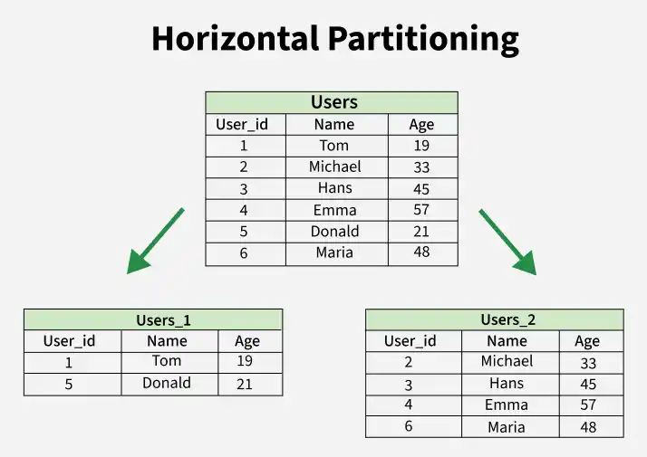

##### 优点

水平分区通过将行分布在不同的分区或服务器上，将表分割成多个部分。

- **可扩展性：** 允许跨多个节点并行处理大型数据集。
- **负载均衡：** 均匀分配工作负载，减少系统瓶颈。
- **容错性：** 每个分区独立运行，提高故障期间的可靠性。

##### 缺点

尽管水平分区具有可扩展性优势，但它也引入了一些数据库操作的复杂性。

- **复杂连接：** 跨多个分区的连接可能速度较慢且更难管理。
- **数据倾斜：** 数据分布不均可能导致某些分区比其他分区承受更多负载。

#### 2. 垂直分区

垂直分区基于列（属性）而不是行来划分数据集。每个分区仅包含所有行的列子集，具体取决于访问模式。当不同列的访问频率更高或访问方式更独立时，垂直分区非常有用。

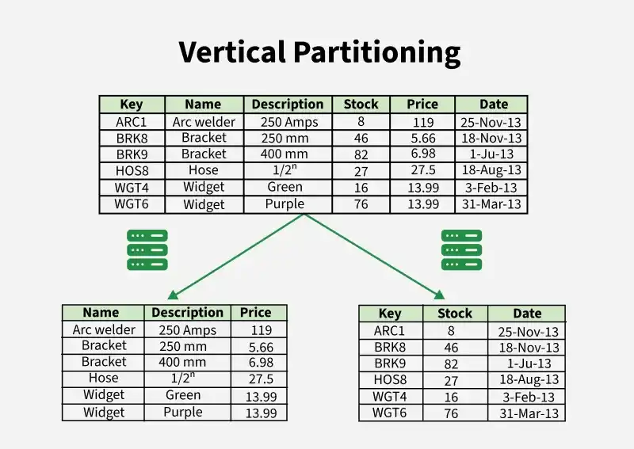

##### 优点

垂直分区根据列的使用情况或功能，将表划分到不同的分区中。

- **更佳的查询性能：** 通过隔离频繁访问的列，减少数据读取次数。
- **高效的检索：** 仅获取所需的列，从而节省 I/O 和存储空间。
- **更便捷的模式更改：** 简化了列的添加或删除。

##### 缺点

虽然垂直分区有助于列级优化，但它可能会增加查询的复杂性。

- **查询复杂性：** 查询可能需要访问多个分区。
- **连接速度较慢：** 合并来自不同分区的数据会增加开销。
- **可扩展性有限：** 不适用于列快速增长的数据集。

#### 3. 基于键的分区

基于特定键或属性划分数据，每个分区包含与该键相关的所有数据。在分布式系统中，基于键的分区方式很常见，可以实现均匀的数据分布和高效的基于键的查找。

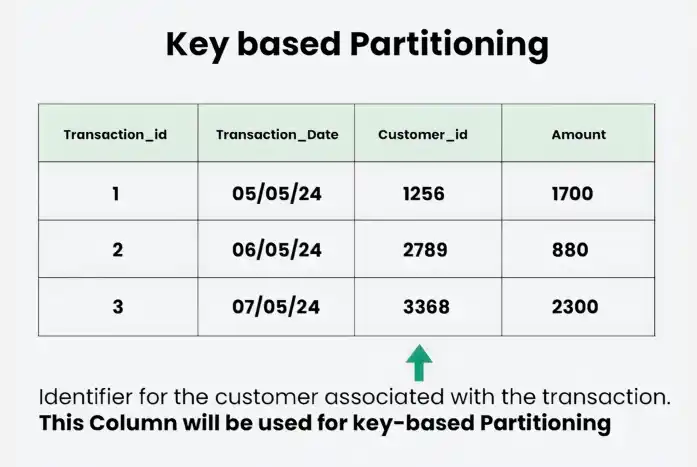

##### 优点

基于键的分区使用特定的键（通常通过哈希机制）将数据分布到各个分区。

- **均匀分布：** 将具有相同键的数据存储在一起，以实现高效的查找。
- **可扩展性：** 支持跨分区并行处理。
- **负载均衡：** 分配工作负载，避免性能瓶颈。

##### 缺点

键选择不当会导致工作负载不均衡和性能问题。

- **数据倾斜：** 键访问不均匀会导致热点。
- **灵活性有限：** 对于范围查询或多键查询效率较低。
- **分区开销：** 随着数据或键模式的演变，需要谨慎管理。

#### 4. 范围分区

范围分区基于预设的值范围对数据集进行划分。例如，如果您的数据集包含时间戳，您可以根据特定的时间范围对其进行划分。当您的数据具有自然顺序并希望根据值范围均匀分布时，范围分区非常有用。

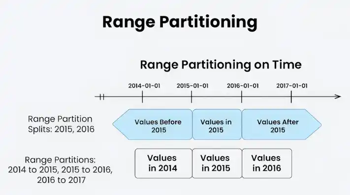

##### 优势

范围分区根据特定的值范围（例如日期、ID 或数字）将数据划分为多个分区。

- **自然排序：** 非常适合具有固有范围结构的数据。
- **高效的范围查询：** 快速定位指定值范围内的数据。
- **简化的查询规划：** 系统可以轻松识别与范围条件相关的分区。

##### 劣势

不合理的范围设计会导致数据分布不均，并带来管理上的挑战。

- **数据倾斜：** 不同范围之间的数据分布不均会影响性能。
- **增长管理：** 添加或调整范围需要持续维护。
- **复杂的连接：** 连接和非连续范围查询可能速度较慢且难以管理。

#### 5. 基于哈希的分区

哈希分区使用哈希函数将数据映射到不同的分区。哈希值决定数据所属的分区，从而实现均匀分布和更快的查找速度。它通过将数据随机分散到各个分区来帮助实现负载均衡，并通过减少热点来提高数据检索性能。

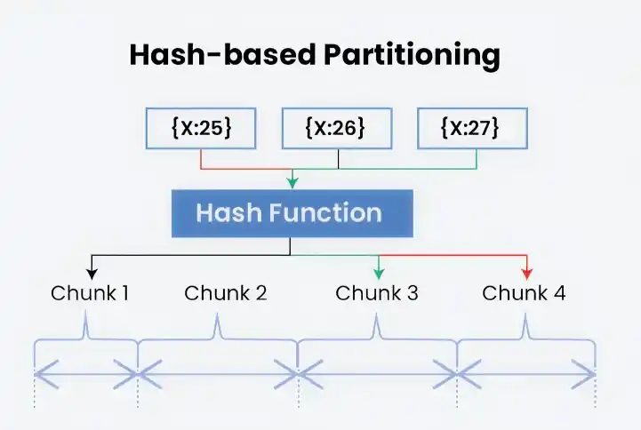

##### 优点

基于哈希的分区使用应用于特定键的哈希函数将数据分布到各个分区。

- **均匀分布：** 随机哈希将数据均匀地分布到各个分区。
- **可扩展性：** 支持跨多个节点的并行处理。
- **简单性：** 易于实现，且不依赖于数据顺序。

##### 缺点

虽然在数据分布方面效果显著，但可能会限制查询的灵活性。

- **查找效率低下：** 基于键或范围的查询性能较差。
- **可能出现负载不均衡：** 哈希可能无法始终确保完美的负载均衡。
- **维护开销：** 扩展可能需要重新分区和重新哈希数据。

#### 6. 轮询分区

在轮询分区中，数据循环且均匀地分布在各个分区之间。无论数据属性如何，每个分区都会按顺序分配下一个可访问的数据项。轮询分区的实现很简单，并且可以提供一定程度的负载均衡。

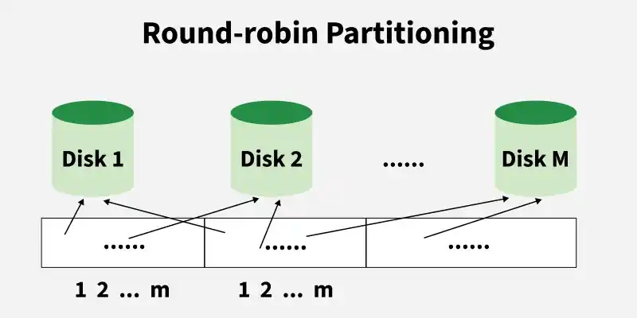

##### 优点

轮询分区无需使用任何特定键，即可将记录按顺序分布到各个分区。

- **数据分布均匀：** 确保记录在各个分区之间近乎均匀分布。
- **实现简单：** 非常容易实现；无需哈希或键逻辑。
- **负载均衡良好：** 适用于写入密集型工作负载和并行处理。

##### 缺点

由于不使用分区键，数据检索效率可能会降低。

- **查找效率低下：** 基于键或范围的查询性能较差。
- **数据局部性不足：** 相关记录可能分散在不同的分区中。
- **查询优化有限：** 不适用于依赖于分组或范围的分析查询。

## [系统设计中的块存储、对象存储和文件存储](https://www.geeksforgeeks.org/system-design/block-object-and-file-storage-in-cloud-with-difference/)

存储是系统设计的关键组成部分，了解各种存储类型有助于构建高效的系统。

块存储、对象存储和文件存储是三种常见的存储方式，每种方式都适用于特定的应用场景。

### 1. 系统设计中的块存储

块存储是一种将数据以精确大小的块（或数据块 ​​）形式存储的技术。每个数据块都有自己的地址，独立运行，并且可以存储任何类型的数据。与按层次结构组织数据的文件存储不同，块存储没有预先设定的结构。它常用于数据库和虚拟机等需要高性能和可扩展性的系统中。

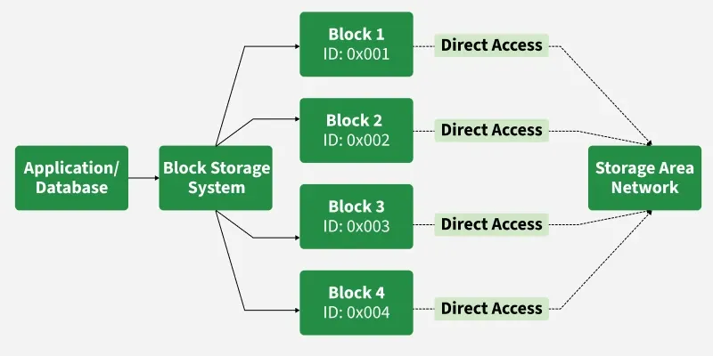

块存储本身并不“理解”它所存储的数据——它只存储原始字节。基于块存储的文件系统会将这些数据解析成文件。因此，块存储本身并不了解数据格式或数据类型。

#### 块存储的工作原理

想象一下一个仓库，其中的物品并非按类别或货架排列，而是简单地放置在编号的货箱中。每个货箱（块）可以存放任何内容，您可以直接通过货箱编号访问物品。这种直接访问模型消除了浏览文件夹层级结构的开销，从而实现了卓越的速度。

其特点包括：

- **高性能：**块存储专为快速读写操作而设计，因此非常适合高性能应用程序。
- **灵活性：**由于它不强制规定特定的结构，因此允许以任何格式存储数据。
- **[可扩展性](https://www.geeksforgeeks.org/system-design/what-is-scalability/)：**可以轻松添加或删除块，从而扩展或缩减存储容量。
- **独立性：**每个块独立运行，从而可以精确控制和管理数据。
- **在[分布式系统](https://www.geeksforgeeks.org/computer-networks/what-is-a-distributed-system/)中的应用：**块存储可以分布在多个服务器上，以实现冗余并提高性能。

#### 块存储示例

假设您需要存储大量结构化数据，而该数据是一个基于云的数据库服务。这些数据被分割成更小的块（数据块），并分布在存储区域网络中。当您访问数据库时，

- 系统会检索所需的数据块，并将它们重新组装成应用程序可以使用的数据。
- Amazon Elastic Block Store (EBS) 就是一个块存储的实际应用示例。

### 2. 系统设计中的对象存储

对象存储将数据以离散单元的形式保存，这些单元被称为“对象”。每个对象都包含唯一的标识、元数据（关于数据的信息）以及实际数据。因此，对象存储非常灵活、可扩展，并且适合存储大量非结构化数据，例如备份、视频和图片。

- 对象存储不像文件存储或块存储那样使用固定大小的数据块或分层文件系统。
- 相反，它将数据组织成扁平结构，这在分布式环境中更易于扩展和管理。

```text
注意：对象存储非常适合一次写入多次读取 (WORM) 的工作负载，不适用于频繁修改的数据。
```

#### 理解对象模型

可以将对象存储想象成一个巨大的图书馆，其中每本书都有一个唯一的 ISBN、一张详细的目录卡，并且可以直接检索，而无需知道它在哪个书架上。扁平结构消除了分层限制，使系统能够跨越无限的存储节点进行水平扩展。

#### 对象存储的关键特性

- [可扩展性](https://www.geeksforgeeks.org/system-design/what-is-scalability/)：对象存储非常适合云应用，因为它能够管理海量数据。
- 元数据丰富：每个对象都存储有元数据，有助于数据管理、索引和搜索。
- 全球访问：对象可以通过 HTTP/HTTPS 访问，因此适用于基于 Web 的应用。
- 非结构化数据的经济高效：大量非结构化数据，例如日志、媒体文件和备份，都非常适合使用对象存储。
- 弹性持久：为了提供稳定性和容错能力，对象存储系统通常会在不同位置复制数据。

#### 对象存储示例

- **媒体流：**Netflix 和 YouTube 将数十亿个视频文件存储为对象，并同时为数百万用户提供服务。
- **备份和归档：**企业利用对象存储的持久性和低廉的每 GB 成本，进行长期数据保留。
- **大数据分析：**基于对象存储构建的数据湖允许分析师以任何格式存储原始数据并进行大规模处理。
- **静态网站托管：**图像、CSS 和 JavaScript 文件等 Web 资源直接从对象存储中提供。

### 3. 系统设计中的文件存储

类似于我们在计算机上整理文件的方式，文件存储是一种传统的数据存储技术，它将数据以文件和文件夹的层级结构进行存储。每个文件都有一个名称和目录路径，便于访问和导航。需要定期更新和有序数据管理的应用程序最适合采用这种方式。

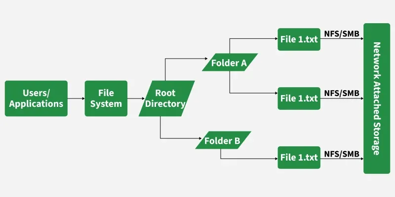

#### 层级模型

文件存储以树状结构组织数据，目录（文件夹）中包含文件和子目录。每个文件都有一个路径（例如 `/projects/2024/report.pdf`）来定义其位置，从而使导航逻辑清晰、简单明了。

#### 文件存储的主要特性

- **层级组织：**数据存储在清晰的文件夹和文件结构中，便于查找和管理。
- **简易性：**文件存储系统易于设置和使用，尤其适用于小型应用程序。
- **兼容性：**与需要传统文件访问方式的旧版应用程序和系统兼容良好。
- **共享访问：**支持具有文件权限和版本控制的多用户环境。
- **数据完整性：**通过文件更新期间的锁定机制确保一致性和完整性，但分布式文件系统（例如 NFS）在并发情况下可能会出现锁定问题和性能瓶颈。

#### 文件存储示例

Amazon EFS、Google Filestore 或 Azure Files 等云文件存储方案

- **企业文件共享：**各部门通过网络驱动器共享文档、电子表格和演示文稿，文件夹层级结构与组织架构相符。
- **内容管理：**Web 服务器将文件托管在组织有序的目录中，并通过熟悉的基于路径的 URL 提供网站服务。
- **开发环境：**开发人员使用以文件夹结构组织的代码库，并依赖文件存储进行源代码控制集成。
- **用户主目录：**服务器上的用户工作区将个人文件保存在单独的、受权限保护的目录中。

### 系统设计中的块存储、对象存储和文件存储

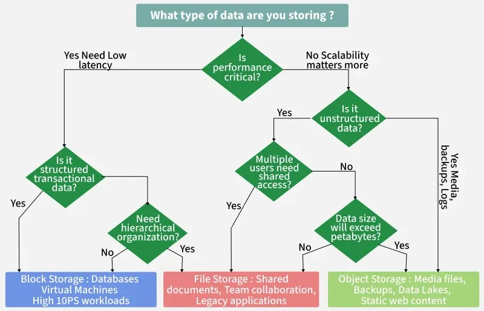

它们之间的区别如下：

|                         块存储                         |                      对象存储                      |                         文件存储                         |
| :----------------------------------------------------: | :------------------------------------------------: | :------------------------------------------------------: |
| 将数据分割成固定大小的块，每个块都有一个唯一的标识符。 |   以扁平结构存储数据，对象包含元数据和唯一 ID。    |            以文件和文件夹的层次结构组织数据。            |
|   适用于数据库、虚拟机和需要高性能的事务性工作负载。   | 最适合存储大量非结构化数据，例如多媒体文件或备份。 | 适用于结构化文件存储和共享文件访问，例如文档和电子表格。 |
|         高性能、低延迟，尤其适用于读/写操作。          |   针对可扩展性和持久性进行了优化，而非实时性能。   |           性能中等；取决于文件系统和存储设备。           |
|      可扩展性良好，但可能需要手动配置以扩展容量。      |     高度可扩展；可以跨分布式系统处理海量数据。     |      与对象存储相比，可扩展性有限；适用于小型系统。      |
|             元数据极少，通常由应用层处理。             |  每个对象都存储了大量元数据，支持高级搜索和分析。  |           基本元数据，例如文件名、类型和权限。           |
|        需要手动备份或配置快照以确保数据持久性。        |     具有高度持久性，内置跨多个位置的冗余机制。     |         数据持久性取决于底层文件系统和备份策略。         |
|    AWS EBS、Google 持久磁盘、SAN（存储区域网络）。     |  AWS S3、Azure Blob 存储、Google Cloud Storage。   |      网络附加存储 (NAS)、共享驱动器、本地文件系统。      |

## [数据库规范化简介](https://www.geeksforgeeks.org/dbms/introduction-of-database-normalization/)

规范化是数据库设计中的一个重要过程，它有助于提高数据库的效率、一致性和准确性。规范化使数据管理和维护更加便捷，并确保数据库能够适应不断变化的业务需求。

- 数据库规范化是指对数据库属性进行组织，以减少或消除数据冗余（即相同数据出现在不同位置）的过程。
- 数据冗余会不必要地增加数据库的大小，因为相同的数据会在多个位置重复出现。此外，在插入、删除和更新操作期间也会出现数据不一致的问题。
- 在关系模型中，存在一些标准方法来量化数据库的效率。这些方法被称为范式，并且存在一些算法可以将给定的数据库转换为相应的范式。
- 规范化通常涉及将一个表拆分为多个表，每次查询需要从拆分后的表中获取数据时，都必须将这些表关联起来。

### 为什么我们需要规范化？

规范化关系的主要目标是消除以下异常情况。未能减少异常会导致数据冗余，这可能会威胁数据完整性，并随着数据库规模的扩大引发更多问题。规范化包含一系列流程，可帮助您构建有效的数据库结构。

- **插入异常：**当由于缺少必需字段或数据不完整而无法将数据插入数据库时 ​​，就会发生插入异常。例如，如果数据库要求每条记录都必须有主键，但某个记录没有提供主键值，则无法将其插入数据库。
- **删除异常：**从数据库中删除记录时会发生删除异常，这可能导致意外的数据丢失。例如，如果数据库包含客户和订单信息，删除客户记录可能也会删除与该客户关联的所有订单。
- **更新异常：**修改数据库中的数据时会发生更新异常，这可能导致数据不一致或错误。例如，如果数据库包含员工及其薪资信息，只更新了某位员工在一条记录中的薪资，而没有更新所有相关记录中的薪资，就可能导致计算和报告错误。

阅读更多关于[关系模型异常](https://www.geeksforgeeks.org/dbms/anomalies-in-relational-model/)的内容。

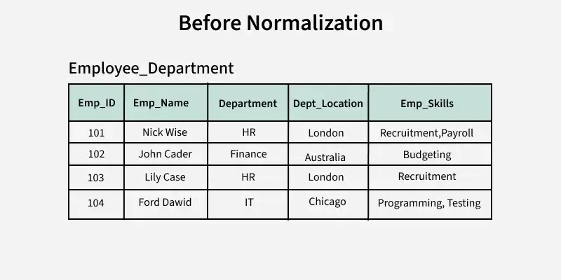
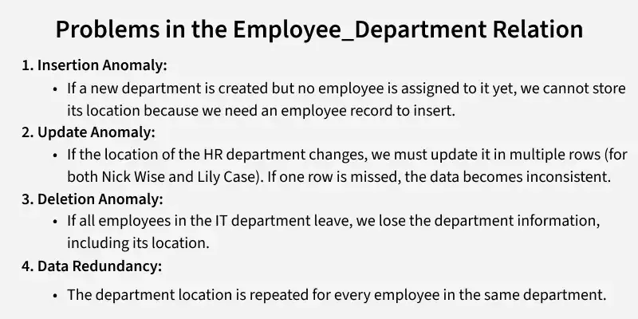
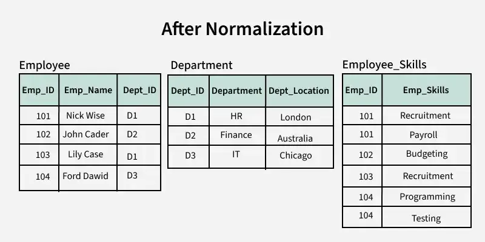

规范化前：数据库表容易出现冗余和异常（插入、更新和删除操作）。

规范化后：数据被划分为逻辑表，以确保数据一致性，避免冗余并消除异常，从而提高数据库的效率和可靠性。

### 数据库规范化的特点

- **消除数据冗余：**规范化的主要特点之一是消除数据库中可能出现的数据冗余。数据冗余是指数据库不同部分中数据的重复。规范化有助于减少或消除这种冗余，从而提高数据库的效率和一致性。

了解更多关于[数据库冗余问题](https://www.geeksforgeeks.org/dbms/the-problem-of-redundancy-in-database/)的信息。

- **确保数据一致性：**规范化有助于确保数据库中数据的一致性和准确性。通过消除冗余，规范化有助于防止由于同一数据的不同版本而导致的不一致和矛盾。

- **简化数据管理：**规范化简化了数据库中的数据管理过程。通过将复杂的数据结构分解为更简单的表，规范化使得数据的管理、更新和检索更加便捷。

- **改进数据库设计：**规范化有助于改进数据库的整体设计。通过以结构化和系统化的方式组织数据，规范化简化了数据库的设计和维护。它还使数据库更加灵活，能够更好地适应不断变化的业务需求。

- **避免更新异常：**规范化有助于避免更新异常，即更新一个表中的单个记录会影响其他表中的多个记录。规范化确保每个表只包含一种类型的数据，并且表之间的关系清晰明确，从而有助于避免此类异常。

- **标准化：**规范化有助于标准化数据库中的数据。通过将数据组织到表中并定义它们之间的关系，规范化有助于确保数据以一致且统一的方式存储。

### 数据库管理系统中的范式

|          范式          |                                                                                                                                          范式描述                                                                                                                                          |
| :--------------------: | :----------------------------------------------------------------------------------------------------------------------------------------------------------------------------------------------------------------------------------------------------------------------------------------: |
|     第一范式 (1NF)     |                                                                                 如果一个关系中的每个属性都是单值属性，则该关系处于[第一范式](https://www.geeksforgeeks.org/dbms/first-normal-form-1nf/)。                                                                                  |
|     第二范式 (2NF)     |                                                                如果一个关系处于第一范式，并且每个非主键属性都完全函数依赖于主键，则该关系处于[第二范式 (2NF)](https://www.geeksforgeeks.org/dbms/second-normal-form-2nf/)。                                                                |
|     第三范式 (3NF)     | 如果一个关系既满足第二范式，又不存在非主键属性的传递依赖，则该关系处于[第三范式](https://www.geeksforgeeks.org/dbms/third-normal-form-3nf/)。如果对于每个非平凡函数依赖 X → Y，以下至少一个条件成立，则该关系处于 3NF： 1. X 是超键。2. Y 是主属性（Y 的每个元素都是某个候选键的一部分）。 |
| 博伊斯-科德范式 (BCNF) |                                                                                   对于 BCNF，关系应满足以下条件：1. 关系应处于第三范式。2. 对于给定关系中的每个函数依赖 (FD) X 到 Y，X 都应该是其超键。                                                                                    |
|     第四范式 (4NF)     |            关系 R 满足 [4NF](https://www.geeksforgeeks.org/dbms/introduction-of-4th-and-5th-normal-form-in-dbms/) 当且仅当满足以下条件：1. 它必须满足[Boyce-Codd 范式 (BCNF)](https://www.geeksforgeeks.org/dbms/boyce-codd-normal-form-bcnf/)。 2. 该表不应包含任何多值依赖。             |
|     第五范式 (5NF)     |                                                     关系 R 满足[5NF](https://www.geeksforgeeks.org/dbms/what-is-fifth-normal-form-5nf-in-dbms/)当且仅当满足以下条件：1. R 必须已经满足 4NF。 2. 它不能进一步进行无损分解（连接依赖）。                                                     |

```text
阅读更多关于数据库管理系统 (DBMS) 中范式的内容。
```

### 规范化的优势

- 规范化消除了数据冗余，确保每条数据都只存储在一个位置，从而降低了数据不一致的风险，并更容易维护数据的准确性。
- 通过将数据分解成更小、更具体的表，规范化有助于确保每个表只存储相关数据，从而提高数据库的整体数据完整性。
- 规范化简化了数据更新过程，因为只需在一个地方更改数据，而无需在整个数据库中更改多个地方。
- 规范化使用户能够使用各种不同的条件查询数据库，因为数据被组织成更小、更具体的表，可以根据需要将这些表连接起来。
- 规范化有助于确保使用同一数据库的不同应用程序之间的数据一致性，从而更容易集成不同的应用程序，并确保所有用户都能访问准确一致的数据。

### 规范化的劣势

- 规范化可能会导致性能开销增加，因为需要额外的[连接操作](https://www.geeksforgeeks.org/dbms/joins-in-dbms/)，并且查询执行速度可能会变慢。
- 规范化可能会导致数据上下文丢失，因为数据可能分散在多个表中，需要额外的连接才能检索。
- 正确实施规范化需要具备数据库设计和规范化过程方面的专业知识。
- 规范化会增加数据库设计的复杂性，尤其是在数据模型理解不透彻或规范化过程执行不正确的情况下。

## [SQL 查询优化](https://www.geeksforgeeks.org/sql/best-practices-for-sql-query-optimizations/)

编写不佳的 SQL 查询会导致性能缓慢、资源消耗高、出现锁定和阻塞问题，并造成用户体验不佳。以下是一些可用于编写高效查询的常用方法。

### 1. 合理使用索引

[索引](https://www.geeksforgeeks.org/sql/sql-indexes/)可以让数据库快速查找行，而无需扫描整个表。

例如：

如果经常查询 `customer_id` 列（例如以下查询），则可以在该列上创建索引。

```sql
SELECT * FROM orders WHERE customer_id = 123;

CREATE INDEX idx_orders_customer_id ON orders(customer_id);
```

如果 `customer_id` 列已建立索引，则上述查询的运行速度将大大提高。

- **主索引：**自动创建在主键上；确保唯一性和高效访问。
- **二级索引：**创建在非主键列上以提高查询性能。需要显式创建。
- **聚集索引：**确定表中数据的物理顺序；每个表只能有一个聚集索引。在某些数据库中，主索引会自动创建为聚集索引。
- **非聚集索引：**包含指向数据的指针；每个表可以存在多个非聚集索引。

**最佳实践：**

- 为 `WHERE` `子句、JOIN` 条件或 `ORDER BY` 子句中频繁使用的列创建索引。
- 应避免过度创建索引，因为这会降低插入和删除操作的速度。需要额外的存储空间；由于索引维护开销，可能会减慢 `INSERT`、`UPDATE` 和 `DELETE` 等写入操作的速度。
- 定期监控和分析索引使用情况以优化性能。

### 2. 避免使用 `SELECT *`：仅选择所需的列

对于大型表或连接，使用 `SELECT *` 会影响查询性能。数据库引擎会检索所有列，即使是不需要的列，这会增加内存使用量、减慢数据传输速度，并使执行计划更加复杂。例如：

**避免使用以下语句：**

```sql
SELECT * FROM products;
```

**请使用以下语句：**

```sql
SELECT product_id, product_name, price FROM products;
```

**这样做的好处：**

- 降低 I/O 负载和内存使用量。
- 使优化器能够跳过不必要的列。
- 使查询更易读、更易维护。

### 3. 使用 `WHERE` 和 `LIMIT` 限制行数

获取超出所需行数是一个常见问题。即使您的应用程序仅使用 10 行，查询也可能检索数千行，从而降低速度。使用 `WHERE` 子句精确筛选数据，并使用 `LIMIT` 限制返回的行数。

**示例：**

```sql
SELECT name FROM customers

WHERE country = 'USA'

ORDER BY signup_date DESC

LIMIT 50;
```

**优势：**

- 降低 CPU 和网络负载。
- 避免在分析或验证期间返回过多数据。
- 非常适合预览转换和测试查询。

### 4. 编写高效的 `WHERE` 子句

`WHERE` 子句是 SQL 查询中最重要的部分之一，因为它可以根据条件筛选行。但是，它的编写方式会显著影响性能。一个常见的错误是在 `WHERE` 子句中直接对列值使用函数或运算——这会阻止数据库使用索引，从而降低查询执行速度。

**错误示例：**

```sql
SELECT * FROM employees WHERE YEAR(joining_date) = 2022;
```

问题所在：`YEAR()` 函数应用于 `joining_date` 列中的每个值。这会禁用索引，强制执行全表扫描。

**优化示例：**

```sql
SELECT * FROM employees
WHERE join_date >= '2022-01-01' AND join_date < '2023-01-01';
```

**优化技巧：**

- 不要对列使用函数（例如 `LOWER(column)`、`YEAR(column)` 等）。
- 避免使用类似 `salary + 5000 = 100000` 这样的数学运算。
- 重写条件，让数据库使用可用的索引。

### 5. 避免在索引列上使用函数

在索引列上使用 SQL 函数（例如 `UPPER()`、`LOWER()`、`DATE()`）会阻止数据库使用索引，从而导致查询速度变慢。

**错误示例（伪代码）：**

```sql
SELECT * FROM users WHERE UPPER(email) = 'JOHN@GMAIL.COM';
```

**正确示例（伪代码）：**

```sql
SELECT * FROM users WHERE email = 'john@gmail.com';
```

**重要性：**

- 保持索引的可用性
- 提高搜索效率
- 避免对大型数据集进行不必要的计算

### 6. 巧妙地使用连接

始终只连接所需的表，并尽可能在连接前筛选数据。当不需要不匹配的记录时，请使用 `INNER JOIN` 而不是 `OUTER JOIN`。

**示例：**

```sql
SELECT u.name, o.amount
FROM users u
JOIN orders o ON u.user_id = o.user_id
WHERE o.amount > 100;
```

**重要性：**

- 减少连接处理时间
- 避免笛卡尔积（当没有 `ON` 条件时）
- 帮助查询规划器优化执行路径

### 7. 避免 N+1 查询问题

***N+1 查询***是指应用程序先执行一次查询获取列表，然后循环执行多次查询来获取相关数据。始终尝试使用 `JOIN` 连接在一次查询中获取相关数据。

**错误示例（伪代码）：**

```sql
SELECT * FROM users;

-- 对于每个用户：SELECT * FROM orders WHERE user_id = ?
```

**正确示例（伪代码）：**

```sql
SELECT u.user_id, u.name, o.order_id, o.amount
FROM users u
JOIN orders o ON u.user_id = o.user_id;
```

**重要性：**

- 减少数据库调用
- 提高延迟和吞吐量
- 防止数据库过载

### 8. 使用 `EXISTS` 代替 `IN`（用于子查询）

在检查是否存在时，`EXISTS` 比 `IN` 更高效，尤其是在子查询返回大型数据集的情况下。

**错误示例（伪代码）：**

```sql
SELECT name FROM customers
WHERE customer_id IN (SELECT customer_id FROM orders);
```

**正确示例（伪代码）：**

```sql
SELECT name FROM customers
WHERE EXISTS (
  SELECT 1 FROM orders WHERE orders.customer_id = customers.customer_id
);
```

**为什么这很重要：**

- `EXISTS` 会在找到匹配项后停止搜索
- 通常能被查询规划器更好地优化
- 减少大型子查询的内存使用

### 9. 避免在 `LIKE` 语句开头使用通配符

在 `LIKE` 模式开头使用 `%` 会禁用索引，导致全表扫描。

**错误示例（伪代码）：**

```sql
SELECT * FROM users WHERE name LIKE '%john';
```

**正确示例（伪代码）：**

```sql
SELECT * FROM users WHERE name LIKE 'john%';
```

**为什么这很重要：**

- 保持搜索对索引友好
- 加快模式匹配速度
- 减少扫描开销

### 10. 考虑反规范化以提高性能

虽然规范化可以保持数据整洁，但过多的连接会降低读取密集型查询的速度。在性能比严格的数据结构更重要的场景中，反规范化（存储一些冗余数据）可以有所帮助。

**示例：**

将订单总金额存储在订单表中，而不是每次都使用 JOIN 操作进行计算。

**重要性：**

- 降低 `JOIN` 操作的复杂性
- 加快频繁读取操作的速度
- 适用于分析或仪表盘

### 11. 使用查询执行计划

每个主流数据库管理系统 (DBMS) 都提供了显示执行计划的方法（例如 MySQL/PostgreSQL 中的 `EXPLAIN`）。它展示了 SQL 引擎如何处理您的查询。

**示例：**

```sql
EXPLAIN SELECT * FROM orders WHERE user_id = 42;
```

**重要性：**

- 有助于识别全表扫描
- 揭示是否使用了索引
- 指导优化决策

### 12. 尽可能使用 `UNION ALL` 而不是 `UNION`

`UNION` 会删除重复项，这会增加排序开销。如果您不需要删除重复项，则 `UNION ALL` 速度更快。

**错误示例（伪代码）：**

```sql
SELECT col FROM table1
UNION
SELECT col FROM table2;
```

**正确示例（伪代码）：**

```sql
SELECT col FROM table1
UNION ALL
SELECT col FROM table2;
```

**为什么这很重要：**

- 避免不必要的排序
- 更快的结果合并
- 更适合处理大型数据集

### 13. 避免在循环中使用 SELECT 语句（在应用程序中）

如果可以编写一个高效的查询来检索所有需要的数据，就不要在应用程序中的循环中运行查询。

**错误示例（伪代码）：**

```python
for id in ids:
  cursor.execute("SELECT name FROM users WHERE id = ?", (id,))
```

**正确示例（伪代码）：**

```sql
SELECT id, name FROM users WHERE id IN (1, 2, 3, 4);
```

**为什么这很重要：**

- 减少数据库往返次数
- 更低的延迟
- 更佳的网络和 CPU 使用率

### 14. 对大型表进行分区

分区可以将大型表拆分成更小、更易于管理的块。分区查询速度更快，因为它们只扫描相关数据。

**示例：**

按年份或地区对销售数据进行分区

**重要性：**

- 加快对大型数据集的扫描速度
- 有助于并行处理和归档
- 提高分区内索引的效率

### 15. 优化 `ORDER BY` 和 `GROUP BY`

排序和分组操作可能非常耗时。始终限制排序或分组的行数，并尽可能使用与 `ORDER BY` 列匹配的索引。

**错误示例（伪代码）：**

```sql
SELECT * FROM orders ORDER BY created_at;
```

**正确示例（伪代码）：**

```sql
SELECT order_id, amount FROM orders WHERE created_at >= '2023-01-01' ORDER BY created_at;
```

**重要性：**

- 减少排序的内存占用
- 加快排序和分组速度
- 提升面向用户的查询性能

## [数据库中的非规范化](https://www.geeksforgeeks.org/dbms/denormalization-in-databases/)

反规范化是一种数据库优化技术，它有意地向一个或多个表中添加冗余数据，以减少复杂连接的需要并提高查询性能。它并非规范化的反义词，而是规范化之后的一种优化。

- 在规范化的数据库中，数据存储在不同的表中以最大限度地减少冗余。
- 例如，将教师信息存储在 Teachers 表中，将课程信息存储在 Courses 表中，并通过 teacherID 进行关联。
- 虽然这可以保持数据完整性，但大型表之间频繁的连接操作会降低性能。

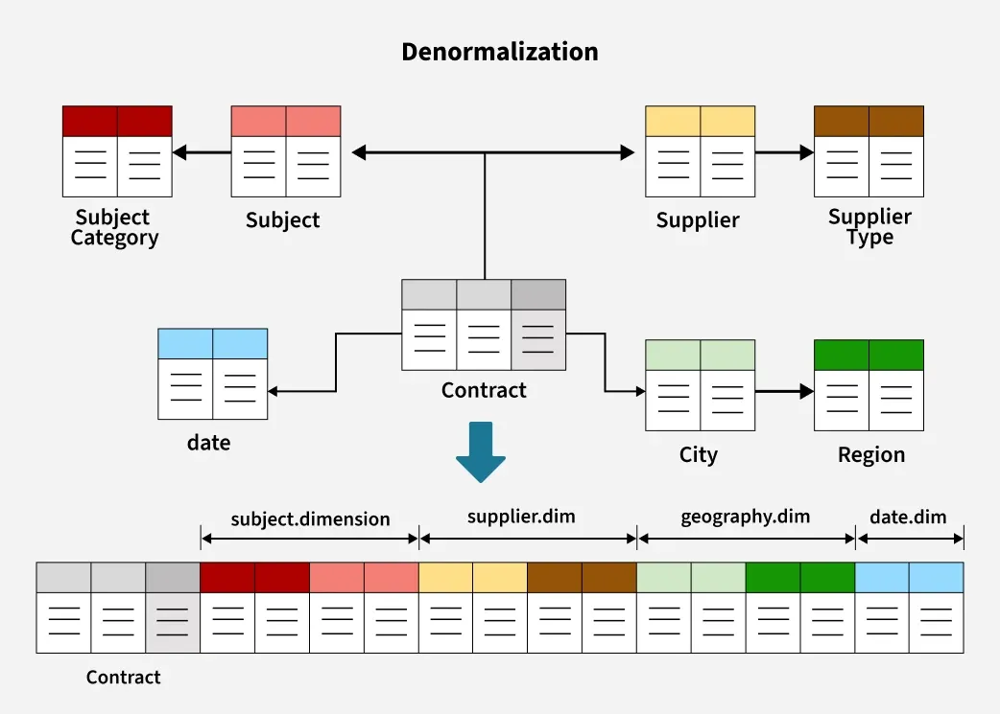

**注意：**反规范化通过允许一定程度的冗余来实现更快的数据检索和更好的性能，从而达到一种平衡，但代价是更新数据时需要付出略微更多的维护工作。

### 步骤 1：非规范化表

这是所有数据都存储在单个表中的初始状态。

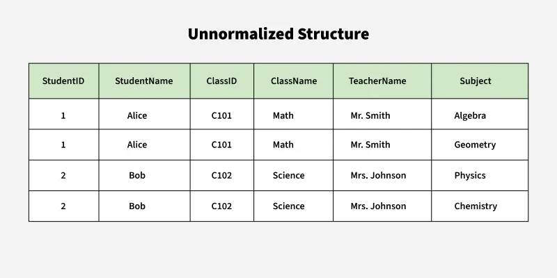

**它有什么问题？**

- **冗余：**例如，“Alice”和“Math”重复出现多次。同样，“Mr. Smith”在同一个班级中存储了两次。
- **更新异常：**如果“Mr. Smith”变为“Mr. Brown”，我们需要更新多行数据。漏掉一行可能会导致数据不一致。
- **存储效率低下：**重复的信息占用了不必要的空间。

### 步骤 2：规范化结构

为了消除冗余并避免异常，我们将数据拆分成更小的、相关的表。这个过程称为规范化。现在，每个表都专注于一个特定的方面，例如学生、班级或科目。

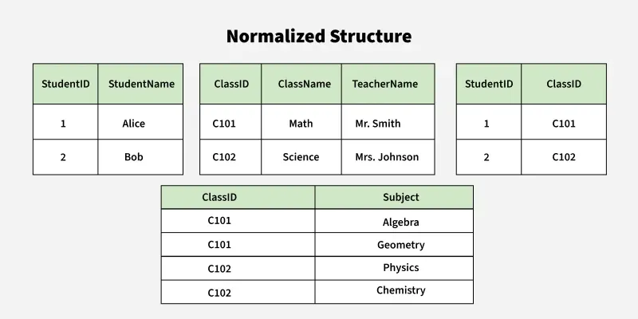

**为什么这样做更好？**

- **避免冗余：**“史密斯先生”在“课程表”中只出现一次，即使一个课程关联了多个科目。
- **更便捷的更新：**如果“史密斯先生”变为“布朗先生”，您只需更新“课程表”，所有表都会自动更新。
- **高效的存储：**消除重复数据，节省空间。

### 步骤 3：反规范化表

在某些情况下，规范化会使查询变得复杂且缓慢，因为您需要连接多个表才能获取所需信息。为了优化性能，我们可以通过将相关表合并为一个表来实现数据反规范化。

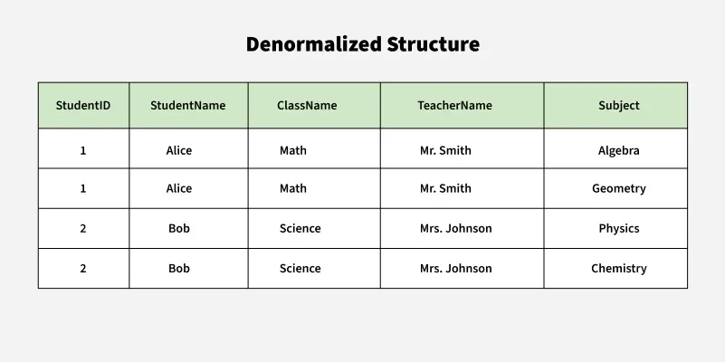

**这里发生了什么？**

- 所有相关信息（学生姓名、班级名称、教师和科目）都存储在一个表中。
- 这简化了查询，因为无需连接多个表。

### 反规范化与规范化

[规范化](https://www.geeksforgeeks.org/dbms/introduction-of-database-normalization/)和反规范化都是数据库中使用的方法，但它们的作用相反。一方面，规范化用于减少或消除冗余，这意味着同一张表中不会有重复的数据或条目，并且优化了数据完整性和存储效率。

另一方面，反规范化用于在规范化的表中添加冗余，从而增强功能并最大限度地减少数据库查询（例如连接操作）的运行时间，并优化性能和查询简洁性。在需要可扩展性的系统中，例如任何大型科技公司，我们几乎总是同时使用规范化数据库和反规范化数据库的元素。

### 反规范化的优势

- **提高查询性能：**反规范化可以通过减少检索数据所需的连接次数来提高查询性能。
- **降低复杂性：**通过将相关数据合并到更少的表中，反规范化可以简化数据库模式，使其更易于管理。
- **更易于维护和更新：**反规范化通过减少表的数量，可以简化数据库的更新和维护。
- **提高读取性能：**反规范化通过简化数据访问，可以提高读取性能。
- **更好的可扩展性：**反规范化通过减少表的数量和提高整体性能，可以提高数据库系统的可扩展性。

### 反规范化的缺点

- **降低数据完整性：**通过添加冗余数据，反规范化会降低数据完整性，并增加数据不一致的风险。
- **增加复杂性：**虽然在某些情况下，反规范化可以简化[数据库模式](https://www.geeksforgeeks.org/dbms/database-schemas/)，但它也会通过引入冗余数据来增加复杂性。
- **增加存储需求：**通过添加冗余数据，反规范化会增加存储需求，并增加[数据库](https://www.geeksforgeeks.org/dbms/what-is-database/)的维护成本。
- **增加更新和维护复杂性：**通过引入冗余数据，反规范化会增加更新和维护数据库的复杂性。
- **灵活性有限：**反规范化会引入冗余数据，使修改模式变得更加困难，从而降低数据库系统的灵活性。

## [Redis 简介](https://www.geeksforgeeks.org/system-design/introduction-to-redis-server/)

**Redis（远程字典服务器）**是一个快速数据库，用于内存缓存，通过减少磁盘和/或网络读写操作来降低服务器负载。

**Redis 的用途包括：**

- 缓存频繁访问的数据以缩短访问时间。
- 为 Web 应用程序提供会话存储。
- 实时分析和排行榜。
- 管理后台作业系统中的队列或任务列表。

### Redis 的工作原理是什么？

Redis 作为数据库和客户端之间的缓存层，可以加快数据访问速度并降低主数据库的负载。当客户端请求数据时，API 网关会将请求转发到 Redis。

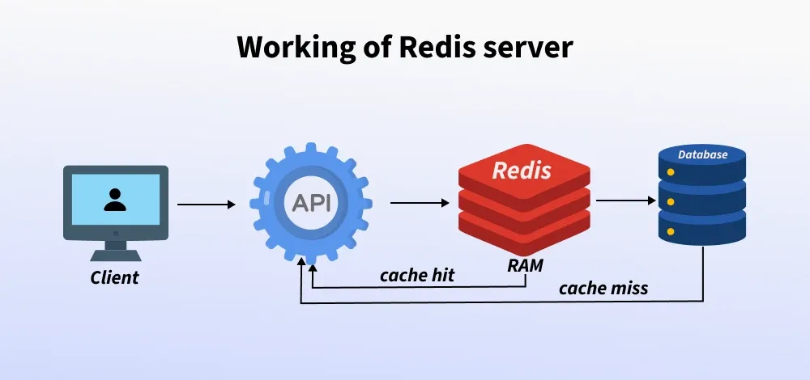

如果 Redis 中有数据（缓存命中），它会通过 API 网关快速将数据返回给客户端。如果数据缺失（缓存未命中），Redis 会从数据库中检索数据，将其存储在缓存中以供后续请求使用，然后再通过 API 网关将其返回给客户端。这种流程可以加快响应速度并降低数据库负载。

在开始学习 Redis 之前，我们需要在系统上[安装 Redis](https://www.geeksforgeeks.org/python/install-redis-on-windows/)。

**现在让我们通过一个示例来理解它：**

```python

import redis
r = redis.Redis(host='localhost', port=6379, db=0)

r.set('name', 'Alia')
print(r.get('name').decode('utf-8'))

r.set('name', 'Riya')
print(r.get('name').decode('utf-8'))

r.delete('name')
print(r.get('name'))

```

**输出：**

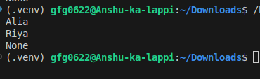

**理解上述示例：**

```python

import redis

```

这行代码导入了 Redis Python 库，它允许你从 Python 代码中与 Redis 服务器通信。

```python

r = redis.Redis(host='localhost', port=6379, db=0)

```

这里，你创建了一个 Redis 连接：

- host='localhost'：连接到运行在你本地计算机上的 Redis 服务器
- port=6379：Redis 监听的默认端口
- db=0：Redis 支持多个逻辑数据库，编号从 0 开始，你使用的是数据库 0

现在，变量 "r" 就是你与 Redis 通信的句柄。

```python

r.set('name', 'Alia')

```

这行代码将键名为 name、值为 Alia 的字段存储到 Redis 中。

```python

print(r.get('name').decode('utf-8'))

```

这行代码从 Redis 中检索键名为 name（即 Alia）下存储的值。

- `r.get('name')` 返回**字节**格式的值，例如 `b'Alia'`。
- `.decode('utf-8')` 将这些字节转换为普通字符串，因此会打印出 `Alia`。

**注意：**本例中，Redis 与 Python 集成，但 Redis 也可以使用其他编程语言（例如 Java、JavaScript (Node.js)、Go、Ruby、C# (.NET)、PHP 等）及其各自的 Redis 客户端库来实现。

### 何时使用 Redis 服务器？

假设您有一个 [MySQL](https://www.geeksforgeeks.org/sql/what-is-mysql/) 数据库，并且您不断地查询该数据库。数据库会从二级存储读取数据，计算结果，然后返回结果。

如果数据库中的数据变化不大，您可以将查询结果存储在 Redis 服务器中。这样，您就无需再次查询数据库（这需要 100-1000 毫秒的时间），只需检查查询结果是否已存在于 Redis 中，如果已存在，则返回结果。由于结果已存在于内存中，因此速度会快得多。

**注意：**在消息应用中，可以使用 Redis 内置的列表数据结构来存储用户最近发送和接收的五条消息。

### 为什么 Redis 如此之快？

Redis 速度快的原因在于它将所有数据都保存在内存中，而不是磁盘上，因此不会浪费时间从硬盘读取数据。它还使用单线程事件循环来处理命令，避免了管理多线程带来的复杂性和延迟。

此外，Redis 使用了优化良好的数据结构和名为 RESP 的简单轻量级通信协议进行网络通信。这些设计选择意味着 Redis 可以同时处理大量请求，延迟极低，并且几乎可以瞬间响应。

了解更多：[为什么 Redis 如此快速且流行？](https://www.geeksforgeeks.org/system-design/why-redis-is-so-fast-and-popular/)

### Redis 与 MongoDB 的区别

Redis 和 MongoDB 都是广泛使用的数据库，但它们之间存在一些关键区别，您应该了解：

|                       MongoDB                        |                           Redis                           |
| :--------------------------------------------------: | :-------------------------------------------------------: |
|               基于文档的 NoSQL 数据库                |                    内存键值存储，NoSQL                    |
|        以 BSON 文档（类似 JSON）格式存储数据         |    以键值对、字符串、集合、列表、哈希表等格式存储数据     |
|                 基于磁盘的持久化存储                 | 主要在内存中存储，但也可以持久化到磁盘（关系数据库，AOF） |
|           与 Redis 等内存存储相比速度较慢            |                  由于内存存储，速度极快                   |
|             内置持久化功能，支持自动备份             |         可选持久化功能，支持 RDB 快照或 AOF 日志          |
| 支持使用 $gt、$lt、$regex 等丰富的运算符进行复杂查询 |           查询功能有限（仅支持基本的键值操作）            |
|     非常适合大型数据集、复杂查询和丰富的文档结构     |      非常适合缓存、实时分析、消息传递和高速应用程序       |
|     管理起来比较复杂凭借其丰富的功能，可扩展性强     |        易于使用，主要适用于高速、低延迟的应用场景         |

**注意：**Redis 比 MongoDB 快得多，尤其是在处理依赖于简单、高吞吐量操作的任务时。具体速度提升幅度可能有所不同，但对于基本操作，Redis 通常比 MongoDB 快 **10 到 100 倍**。

### 结论

Redis 是一款快速的内存数据存储系统，非常适合缓存、实时分析和消息传递。它提供高性能、可扩展性和可选的持久化功能，使其成为微服务和高速应用程序的理想选择。Redis 的速度优于 MongoDB，尤其是在低延迟任务方面。
