# 一致性、可用性、可靠性和可维护性

## [系统设计中的可用性](https://www.geeksforgeeks.org/system-design/availability-in-system-design/)

**系统或服务在任何给定时刻的就绪状态和用户可访问性称为可用性**。它计算的是系统可用且功能正常的总时间比例。通常采用冗余、容错和有效的恢复技术来实现高可用性，从而保证用户可以正常使用系统，而不会遇到任何重大中断或停机。

### 如何衡量可用性？

可用性是指系统或服务在特定时间段内正常运行且用户可访问的时间百分比。其计算公式为：

```text

可用性 (%) = ((正常运行时间) / (正常运行时间 + 停机时间)) * 100;

```

#### 关键术语

- **正常运行时间：**系统按预期运行的总时间。
- **停机时间：**系统由于故障、维护或其他问题而无法使用的总时间。

#### 例如

如果一个系统一年的可用性为 99.9%：

- 一年总时间：**365 × 24 × 60 = 525,600 分钟**
- 允许的停机时间：0.1% × 525,600 = 525.6 分钟（约 8.76 小时）。

### 为什么可用性在系统设计中至关重要？

**1. 用户体验：**良好的用户体验源于可用性，它确保用户在需要时能够访问系统及其服务。如果系统经常不可用或出现停机，用户会感到沮丧，甚至可能产生不满。
**2. 业务连续性：**为了确保持续运营和业务连续性，可用性至关重要。即使是短暂的停机，也可能给依赖系统提供服务或开展交易的公司造成巨大的经济损失、声誉损害和法律后果。
**3. 服务级别协议 (SLA)：**许多企业使用 SLA 来约束自身与利益相关者或消费者之间的可用性目标。违反这些 SLA 可能会导致罚款或合同义务。
**4. 竞争优势：**企业可以利用高可用性在市场中脱颖而出，尤其是在可靠性和正常运行时间至关重要的行业。与竞争对手相比，可用性更高的系统更有可能吸引并留住用户。
**5. 灾难恢复：**弹性和灾难恢复与可用性直接相关。如果系统设计时具备冗余、故障转移机制和灾难恢复策略，就能在硬件故障、网络中断、自然灾害或网络攻击等不可预见的事件中生存并恢复。
**6. 合规性：**许多行业都有监管要求或标准，规定了系统的最低可用性水平。不遵守这些法规可能会导致法律后果、罚款或制裁。

### 如何实现高可用性？

对于需要持续运行的系统而言，高可用性至关重要，因为任何中断都可能导致经济损失、声誉损害，甚至安全隐患。通常需要高可用性的系统包括云基础设施、应急响应服务、医疗保健系统、电子商务平台和银行应用程序。

系统设计人员会实施各种策略和技术来实现高可用性，例如：

- **冗余：**使用冗余服务器或组件，以便在发生故障时，其他组件可以无缝接管。数据中心、网络和硬件冗余就是这方面的几个例子。
- **[负载均衡](https://www.geeksforgeeks.org/what-is-load-balancer-system-design/)：**将传入请求分配到多个服务器或资源上，以提高系统性能和容错能力，同时避免单个部分过载。
- **故障转移机制：**实施自动化流程来检测故障，并在无需人工干预的情况下切换到冗余系统。
- **灾难恢复 (DR)：**制定全面的计划，以便在发生影响主基础设施的灾难性事件时恢复系统。
- **监控和告警：**部署可靠的监控系统，能够即时识别问题并向管理员发出警报，以便他们迅速采取行动。
- **性能优化：**通过确保系统构建和调整能够高效地管理预期负载，从而降低出现瓶颈和故障的可能性。
- **[可扩展性](https://www.geeksforgeeks.org/what-is-scalability/)：**设计系统时，根据需要添加更多资源，使其能够轻松扩展以满足不断增长的需求。

### 系统可用性与资产可靠性

系统可用性和资产可靠性是系统设计中相关但又不同的概念：

- **系统可用性：**
  - 指整个系统正常运行并可供用户访问的频率。
  - 它不仅考虑硬件和软件的可靠性，还考虑网络问题和依赖关系等因素。
- **资产可靠性：**
  - 指单个组件或资产（例如服务器、数据库或硬件）无故障执行其任务的能力。
  - 可靠的资产可以降低系统停机的可能性。
- **主要区别：**
  - 系统可用性考虑的是整体情况，包括恢复时间和冗余。
  - 资产可靠性则侧重于特定部件的性能。

### 可用性与容错的区别

以下是可用性和容错之间的区别：

|   方面   |                                     可用性                                      |                                          容错性                                          |
| :------: | :-----------------------------------------------------------------------------: | :--------------------------------------------------------------------------------------: |
|   定义   |                       系统正常运行且可供使用的时间比例。                        |              系统在出现故障或失效时，即使性能有所降低，仍能继续运行的能力。              |
|   目标   |                    最大化系统正常运行时间，最小化停机时间。                     |                   确保系统在硬件、软件或网络故障的情况下仍能保持运行。                   |
|   重点   |                           强调对服务的持续稳定访问。                            |                          关注系统处理故障和从故障中恢复的能力。                          |
| 衡量指标 | 通常以特定时间段内的正常运行时间百分比表示（例如，每月 99.9% 的正常运行时间）。 |               通常以平均故障间隔时间 (MTBF) 和平均恢复时间 (MTTR) 来表示。               |
|   策略   |                 冗余、负载均衡、故障转移机制、灾难恢复计划等。                  |         使用冗余组件、数据复制、故障转移机制，并在发生故障时实现性能的优雅降级。         |
| 目标实现 |                    通过最小化潜在故障的影响来实现高可用性。                     |             容错是通过检测故障并从中恢复来实现的，且不会导致系统范围的中断。             |
| 用户体验 |                侧重于提供一致可靠的用户体验，并将中断降至最低。                 |                       侧重于维护系统的整体功能，防止系统完全崩溃。                       |
| 应用场景 |  对于几乎需要始终保持可访问性和运行状态的系统（例如电子商务、银行）至关重要。   | 在安全关键型系统、航空航天、医疗保健以及其他系统故障可能导致严重后果的场景中也十分重要。 |
| 冗余级别 |            高可用性可能包含一定的冗余，但无法完全消除所有单点故障。             |                 容错通常需要更高程度的冗余，以便为各种组件提供备份机制。                 |

## [系统设计中的高可用性是什么？](https://www.geeksforgeeks.org/system-design/what-is-high-availability-in-system-design/)

系统设计中的高可用性是指系统在大部分时间内保持运行和可访问状态的能力，通常为 99.9% 或更高。这种可用性确保系统可靠，即使在发生故障或中断的情况下，也能保证系统正常运行。

### 为什么高[可用性](https://www.geeksforgeeks.org/system-design/availability-in-system-design/)对系统如此重要？

高可用性对系统至关重要，原因如下：

- **最大限度减少停机时间：**
  - 高可用性确保系统在较长时间内保持可访问和运行状态，从而最大限度减少停机时间。
  - 这一点对于即使是短暂中断也可能导致重大经济损失或影响用户体验的系统至关重要。
- **确保可靠性：**
  - 高可用性系统更加可靠，因为它能够承受故障并持续运行而不会中断。
  - 这种可靠性有助于建立用户和利益相关者之间的信任。
  - 高可用性确保满足服务级别协议 (SLA)，避免罚款并保持客户满意度。
- **提升用户体验：**
  - 用户期望系统在他们需要时随时可用。
  - 高可用性确保用户可以在需要时访问系统，从而提升用户体验。
- **支持关键功能：**
  - 在持续运行至关重要的系统中，例如医疗保健系统或应急响应服务，高可用性对于确保关键功能始终可用至关重要。
- **抵御灾难：**
  - 高可用性能够抵御灾难，确保系统即使在遭遇灾难性事件时也能快速恢复并继续运行。

### 如何实现高[可用性](https://www.geeksforgeeks.org/system-design/availability-in-system-design/)？

对于持续运行至关重要的系统而言，高可用性至关重要，任何中断都可能导致经济损失、声誉损害，甚至安全隐患。通常，需要高可用性的系统包括银行应用程序、电子商务平台、医疗保健系统、应急响应服务和云基础设施。

系统设计人员实施各种策略和技术来实现高可用性，例如：

- **冗余：**采用冗余组件或服务器，确保在某个组件或服务器发生故障时，另一个组件或服务器可以无缝接管。这可以包括不同级别的冗余，例如硬件、网络和数据中心。
- **负载均衡：**将传入请求分配到多个服务器或资源上，以防止任何单个组件过载，并提高整体系统性能和容错能力。
- **故障转移机制：**实施自动化流程，检测故障并自动切换到冗余系统，无需人工干预。
- **灾难恢复 (DR)：**制定全面的计划，以便在发生影响主基础设施的灾难性事件时恢复系统。
- **监控和告警：**实施强大的监控系统，能够实时检测问题并及时通知管理员采取相应措施。
- **性能优化：**确保系统经过精心设计和调优，能够高效处理预期负载，从而降低瓶颈和故障的风险。
- **可扩展性：**设计系统时充分考虑可扩展性，可根据需求随时添加更多资源以满足不断增长的需求。

## [系统设计的一致性](https://www.geeksforgeeks.org/system-design/consistency-in-system-design/)

系统设计中的一致性是指确保分布式系统中所有节点在任何给定时间点都能看到相同的数据，即使存在并发操作和网络延迟。

### 系统设计中一致性的重要性

一致性在[系统设计](https://www.geeksforgeeks.org/system-design/what-is-system-design-learn-system-design/)中扮演着至关重要的角色，原因如下：

- **正确性：**一致性保证了各个系统组件访问的信息始终正确且最新。
- **[可靠性](https://www.geeksforgeeks.org/system-design/reliability-in-system-design/)：**由于一致性降低了错误和不一致的可能性，从而避免了不可预测的行为或数据损坏，因此一致性系统更加可靠。用户可以信赖系统提供可靠且准确的结果。
- **数据完整性：**一致性维护了系统中数据的完整性。一致性通过确保所有更改都得到正确应用和分发，有助于防止数据丢失和损坏。
- **并发控制：**一致性策略有助于访问控制，防止冲突，并确保在分布式或多用户系统中，多个客户端可能同时访问和修改相同的数据时，变更能够以协调的方式应用。
- **用户体验：**一致性使系统交互可预测且流畅，从而提升用户体验。系统能够可靠地为用户提供最新且符合逻辑的信息，进而提高用户满意度和系统效用。

### 一致性的类型

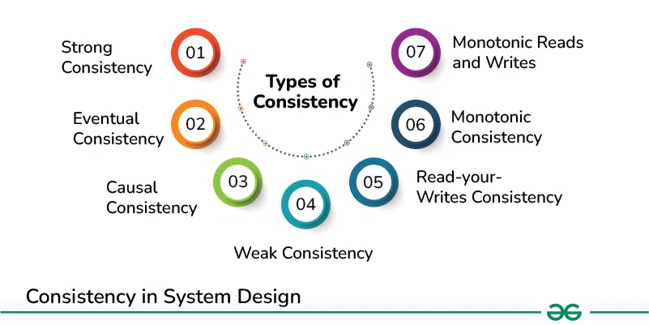

#### 1. [强一致性](https://www.geeksforgeeks.org/system-design/strong-consistency-in-system-design/)

强一致性也称为线性一致性或严格一致性，它保证每次读取操作都会接收到最近一次写入操作的值，否则就会返回错误。它确保所有客户端看到的更新序列相同，并且更新看起来是瞬时的。实现强一致性通常需要在分布式节点之间进行协调和同步，这可能会影响系统的性能和可用性。

**示例：**

一个传统的 SQL 数据库系统，具有单个主节点和多个副本，可以确保强一致性。当客户端向主节点写入数据时，后续从任何副本读取的数据都会立即反映最新写入的值。所有副本同步更新，确保所有客户端看到的都是一致的数据视图。

#### 2. [最终一致性](https://www.geeksforgeeks.org/system-design/eventual-consistency-in-distributive-systems-learn-system-design/)

最终一致性保证数据副本最终会收敛到相同的值，即使它允许它们短暂地出现分歧。它通过放宽一致性要求来提高分布式系统的可用性和性能。尽管最终一致性可能会导致短期不一致，但它能确保所有修改最终都会被共享并保持平衡。

**示例：**

亚马逊的 DynamoDB 是一款分布式 NoSQL 数据库，它提供了最终一致性。当数据写入 DynamoDB 时，它最初存储在单个节点的本地，然后异步传播到系统中的其他节点。虽然客户端在写入后可能会立即读取到略微过时的值，但随着时间的推移，所有副本最终都会收敛到相同的值。

#### 3. [因果一致性](https://www.geeksforgeeks.org/system-design/causal-consistency-model-in-system-design/)

因果一致性维护分布式系统中相关事件之间的因果关系。如果事件 A 先于事件 B 发生，则系统中的所有节点都会对此顺序达成一致。因果一致性确保观察并发事件的客户端对其因果关系保持一致的视图，这对于维护应用程序的语义和正确性至关重要。

**示例：**

协作文档编辑应用程序（用户可以同时编辑文档的不同部分）需要因果一致性。如果用户 A 的编辑依赖于用户 B 编写的内容，则所有用户都应按正确的因果顺序看到这些编辑。这确保文档保持连贯性，并保证所有用户理解的文档含义一致。

#### 4. [弱一致性](https://www.geeksforgeeks.org/system-design/weak-consistency-in-system-design/)

在各种一致性模型中，弱一致性提供的保证最少。它仅确保更新最终会传播到每个副本，即使允许副本之间存在显著差异。与最终一致性（保证收敛）不同，弱一致性不保证副本何时收敛。相反，它允许同时更新，并可能导致短期差异。在那些高可用性和低延迟比严格一致性更重要的系统中，通常会采用弱一致性。

**示例：**

分布式缓存系统（例如 [Redis](https://www.geeksforgeeks.org/system-design/introduction-to-redis-server/) 或 Memcached）通常实现弱一致性。在这样的系统中，数据存储在内存缓存中，可以快速检索，但更新可能会异步传播到其他节点。这可能会导致暂时的不一致，客户端可能会看到旧的或不同的值，直到更新完全传播为止。

#### 5. [读写一致性](https://www.geeksforgeeks.org/system-design/read-your-writes-consistency-in-system-design/)

这种一致性保证客户端向数据项写入值后，始终能够读取该值或其后续写入的任何值。它为单个客户端提供更强的一致性保证，确保它们能够立即看到自己的更新。读写一致性对于维护用户期望立即看到自身更新的应用程序的会话一致性至关重要。

**示例：**

社交媒体平台确保用户帖子和评论的读写一致性。用户发布新帖子或评论后，希望在查看时间线或个人资料时立即看到自己的内容。这种一致性模型确保用户在执行写入操作后能够立即看到自己的更新。

#### 6. [单调一致性](https://www.geeksforgeeks.org/system-design/monotonic-writes-consistency/)

单调一致性确保如果客户端观察到对数据项的更新（读取或写入）遵循特定顺序，则永远不会观察到冲突的更新顺序。单调一致性防止系统回滚到之前的状态或出现不一致的更新序列，从而有助于维护数据的完整性和一致性。

**示例：**

分布式键值存储通过保证客户端一旦观察到特定的更新序列，就永远不会观察到与之冲突的更新序列来维护单调一致性。例如，如果客户端按顺序读取值 A、B 和 C，则之后永远不会观察到值 C、A 和 B。

#### 7. [单调读取和写入](https://www.geeksforgeeks.org/system-design/monotonic-reads-consistency/)

这些一致性保证确保客户端执行一系列读取或写入操作时，观察到的值或更新序列是单调递增的。单调读取确保客户端在后续读取中永远不会看到旧值，而单调写入保证来自单个客户端的写入操作在所有副本上都按相同的顺序执行。

**示例：**

Google 的 Spanner 是一个全球分布式关系数据库，它确保了单调读取和写入一致性。当客户端读取或写入数据时，它看到的是一个单调递增的值或更新序列。这确保客户端始终看到最新数据，并且写入操作在所有副本上都按相同的顺序执行。

### 维护一致性的挑战

**1. 协调开销：**为了保证一致性，分布式节点之间通常需要进行协调，而随着系统规模的扩大，这种协调会增加系统开销。系统可扩展性可能会受到同步协调技术（例如分布式锁定或两阶段提交协议）造成的瓶颈影响。
**2. [延迟](https://www.geeksforgeeks.org/system-design/latency-in-system-design/)：**如果强一致性模型需要在完成写入操作之前等待多个节点的确认，则延迟可能会增加。随着系统物理规模或客户数量的增长，这种延迟的增加可能会影响用户体验。
**3. 运维复杂性：**确保一致性通常涉及配置和管理复杂的分布式系统。在配置复制设置、一致性级别或协调机制时出现人为错误，可能会导致数据不一致或性能问题。
**4. 数据同步：**强大的同步方法对于保证跨多个平台和设备的数据一致性至关重要。设备特定的限制、网络延迟和异步更新可能会增加跨平台数据一致同步的难度。
**5. 并发控制：**在保持一致性的同时协调跨不同平台对共享数据的并发访问，需要精心设计和实现并发控制机制。

### 实现一致性的策略

在分布式系统中，实现一致性需要运用多种策略，例如最佳实践、一致性模型、设计模式和冲突解决机制。以下概述了每种策略的基本内容：

#### 1. [设计模式](https://www.geeksforgeeks.org/system-design/software-design-patterns/)和最佳实践

- **单一数据源：**为关键数据设计单一权威数据源。这可以降低因多个冲突数据源而导致的不一致性。
- **不变操作：**设计可以多次执行而不改变结果的操作。幂等操作对于确保在网络故障和重试情况下的一致性至关重要。
- **版本控制：**为数据对象实施版本控制机制，以跟踪其随时间的变化。版本控制有助于检测冲突和解决不一致性。
- **异步更新：**使用异步通信模式来解耦组件。通过使组件能够独立处理更新，异步更新可以降低拥塞并提高可扩展性。

#### 2. 一致性模型

- **最终一致性：**在不需要即时一致性的情况下，接受最终一致性。允许副本之间存在短暂的差异，但保证它们最终会收敛到一致状态。
- **强一致性：**当严格一致性对于正确性至关重要时，例如金融交易或关键系统操作，应使用强一致性模型。确保所有更新对所有客户端都立即可见。
- **因果一致性：**应用因果一致性来维护分布式系统中事件之间的因果关系。确保所有副本中因果相关的事件都按正确的顺序被观察到。

#### 3. 冲突解决技术

- **后写者胜出 (LWW)：**通过优先选择时间戳或版本号最新的更新来解决冲突。LWW 是一种简单的冲突解决策略，但在某些情况下可能会导致数据丢失或不一致。
- **合并策略：**使用自定义的合并策略或针对特定应用领域需求定制的冲突解决算法。合并策略基于应用程序特定的语义和用户偏好来协调冲突的更新。

### 理解一致性的路线图

#### 1. 一致性简介

- [系统设计中的一致性](https://www.geeksforgeeks.org/system-design/consistency-in-system-design/)
- [一致性模式](https://www.geeksforgeeks.org/system-design/consistency-patterns/)
- [CAP 定理](https://www.geeksforgeeks.org/system-design/cap-theorem-in-system-design/)

#### 2. 一致性模型类型

- [强一致性](https://www.geeksforgeeks.org/system-design/strong-consistency-in-system-design/)
- [最终一致性](https://www.geeksforgeeks.org/system-design/eventual-consistency-in-distributive-systems-learn-system-design/)
- [弱一致性](https://www.geeksforgeeks.org/system-design/weak-consistency-in-system-design/)
- [顺序一致性](https://www.geeksforgeeks.org/system-design/sequential-consistency-in-distributive-systems/)
- [因果一致性](https://www.geeksforgeeks.org/system-design/causal-consistency-model-in-system-design/)
- [读写一致性](https://www.geeksforgeeks.org/system-design/read-your-writes-consistency-in-system-design/)
- [单调读取一致性](https://www.geeksforgeeks.org/system-design/monotonic-reads-consistency/)
- [单调写入一致性](https://www.geeksforgeeks.org/system-design/monotonic-writes-consistency/)

#### 3. 实现一致性的技术

- [系统设计中的仲裁](https://www.geeksforgeeks.org/system-design/quorum-in-system-design/)
- [Paxos 算法](https://www.geeksforgeeks.org/operating-systems/paxos-algorithm-in-distributed-system/)
- [分布式系统中的向量时钟](https://www.geeksforgeeks.org/computer-networks/vector-clocks-in-distributed-systems/)

#### 4. 高级概念和权衡

- [微服务之间的最终一致性](https://www.geeksforgeeks.org/system-design/what-is-eventual-consistency-between-microservices/)
- [MongoDB 是否使用最终一致性？](https://www.geeksforgeeks.org/system-design/does-mongodb-use-eventual-consistency/)
- [Redis 是否具有最终一致性？](https://www.geeksforgeeks.org/system-design/does-redis-have-eventual-consistency/)
- [一致性与可用性](https://www.geeksforgeeks.org/system-design/consistency-vs-availability-in-system-design/)
- [弱一致性与最终一致性](https://www.geeksforgeeks.org/system-design/weak-vs-eventual-consistency-in-system-design/)
- [强一致性与最终一致性](https://www.geeksforgeeks.org/system-design/strong-vs-eventual-consistency-in-system-design/)
- [软状态一致性与最终一致性的区别](https://www.geeksforgeeks.org/system-design/difference-between-soft-state-and-eventual-consistency/)
- [最终一致性的度量]()

## [一致性模式](https://www.geeksforgeeks.org/system-design/consistency-patterns/)

系统设计中的一致性模式是指用于管理分布式系统中数据一致性的策略或方法。想象一下，多个用户同时访问和更新信息，例如在社交媒体平台上。在分布式系统中，确保数据在所有实例中保持准确和一致至关重要。

- **[强一致性](https://www.geeksforgeeks.org/system-design/strong-consistency-in-system-design/)：**确保系统中的所有节点始终拥有最新数据，副本之间不存在延迟或不一致。
- **[最终一致性](https://www.geeksforgeeks.org/system-design/eventual-consistency-in-distributive-systems-learn-system-design/)：**允许副本之间存在暂时的不一致，但保证它们最终会在无需干预的情况下收敛到一致状态。
- **[因果一致性](https://www.geeksforgeeks.org/system-design/causal-consistency-model-in-system-design/)：**维护相关操作之间的因果关系，确保所有节点以相同的顺序看到因果相关的事件。

这些模式有助于设计人员根据系统的具体需求和约束，做出明智的决策，从而管理数据一致性。

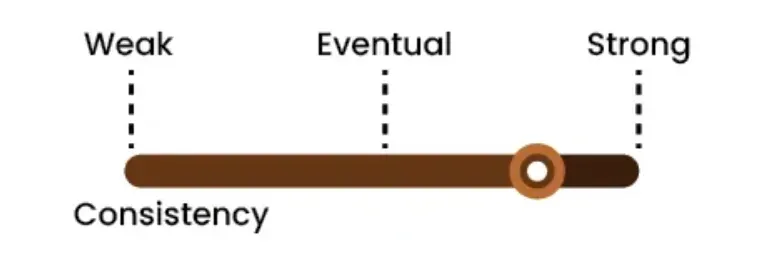

### 一致性模式的重要性

一致性模式在系统设计中至关重要，原因如下：

- **数据完整性：**它们确保数据在分布式系统中保持准确和一致，防止并发访问或更新可能导致的不一致或冲突。
- **用户体验：**一致性模式有助于保持流畅的用户体验，确保用户无论访问哪个节点都能看到最新信息。
- **[可靠性](https://www.geeksforgeeks.org/system-design/reliability-in-system-design/)：**通过实施适当的一致性模式，设计人员可以创建更可靠、更具故障恢复能力的系统，确保即使在节点故障或网络分区的情况下，数据也能保持一致。
- **[可扩展性](https://www.geeksforgeeks.org/system-design/what-is-scalability/)：**一致性模式提供管理一致性的机制，使系统能够高效扩展，而不会随着系统规模的增长而牺牲性能或可用性。
- **性能优化：**一致性模式使设计人员能够根据具体的用例和需求，选择在数据一致性和系统性能之间取得最佳平衡的一致性模式，从而优化系统性能。

### 强一致性模式

[强一致性](https://www.geeksforgeeks.org/system-design/strong-consistency-in-system-design/)确保在分布式系统中，无论何时对数据进行更改，系统中的每个部分都能立即知晓并达成一致。这就像无论身处何地，每个人都能同时看到同一幅画面。

- 这种模式优先考虑准确性和可靠性，确保所有用户都能获得最新信息，且信息完全一致。
- 虽然它非常有利于维护数据完整性，但有时也会降低系统速度，尤其是在大型或分布式系统中。对于银行或医疗保健等对准确性要求极高的关键应用而言，强一致性至关重要。

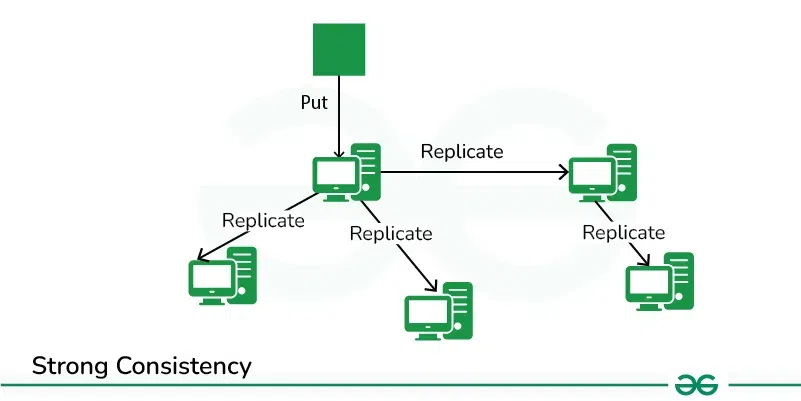

强一致性模式确保分布式系统中所有数据副本同步且一致地更新。以下是一些关键模式：

- **严格两阶段锁定：**此模式采用锁定机制，确保同一时间只有一个事务可以访问数据。它保证事务按可串行化的顺序执行，从而维护整个系统的强一致性。
- **可串行化：**事务的执行方式能够保持系统一致性，如同它们按顺序执行一样，即使它们可能并发执行。这确保系统的最终状态与事务的顺序执行一致。
- **仲裁一致性：**在此模式中，数据值必须得到大多数副本的同意才能被视为已提交。这确保冲突的更新得到解决，并且所有副本最终收敛到相同的值，从而维护强一致性。
- **同步复制：**所有数据更新在写入操作被视为完成之前都会同步传播到所有副本。这确保所有副本始终保持最新状态并彼此一致。

这些模式优先考虑数据一致性而非可用性和分区容错性，因此适用于对数据一致性要求极高的场景，例如金融交易或关键数据处理系统。然而，与最终一致性模式相比，它们可能会引入更高的延迟和更低的可用性。

### 最终一致性模式

分布式系统中的[最终一致性](https://www.geeksforgeeks.org/system-design/eventual-consistency-in-distributive-systems-learn-system-design/)模式允许数据副本之间存在暂时性差异，但确保它们最终无需人工干预即可同步。这就像给不同时区的朋友发送消息一样；即使他们阅读消息的时间不同，最终每个人都会收到相同的信息。

- 自动数据修复、定期协调、跟踪更新之间的因果关系以及使用无冲突数据类型等技术有助于实现最终一致性。
- 虽然最终一致性不像强一致性那样能够即时同步，但它在数据准确性和系统性能之间取得了平衡，因此适用于对实时同步要求不高的应用场景。

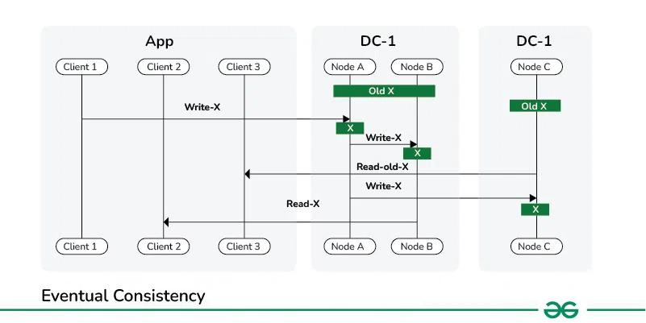

最终一致性模式允许分布式系统中存在暂时的不一致，但保证所有副本最终无需任何干预即可收敛到一致状态。以下是一些关键模式：

- **读取修复：**当读取操作遇到过时或不一致的值时，系统会自动更新或修复数据，使其反映最新版本。这确保所有副本最终收敛到相同的一致状态。
- **反熵机制：**系统定期比较副本之间的数据并协调任何差异。此过程有助于随着时间的推移逐步减少不一致，从而确保最终一致性。
- **向量时钟：**每次数据更新都与一个向量时钟相关联，该向量时钟跟踪跨副本的事件因果关系。通过比较向量时钟，系统可以确定更新顺序并相应地解决不一致问题。
- **无冲突复制数据类型 (CRDT)：**CRDT 是一种旨在确保最终一致性而无需副本之间协调的数据结构。它们允许并发更新数据而不会产生冲突，从而实现无缝收敛到一致状态。

这些模式在分布式系统中尤为有用，因为分布式系统并不严格要求立即一致性，并且可以容忍最终一致性。它们在一致性、可用性和分区容错性之间取得了平衡，因此适用于各种应用，包括协作编辑工具、内容分发网络和社交媒体平台。

### 混合一致性模式

混合一致性模式在分布式系统中融合了强一致性和最终一致性的优势。它结合了强一致性的即时准确性和最终一致性的灵活性。想象一下，一个系统能够确保重要更新立即达成一致，同时允许不太重要的数据逐步同步。

- 这些模式使开发人员能够根据需求、工作负载或网络状况微调一致性级别，从而在不牺牲可靠性的前提下优化性能。
- 这就像汽车的不同档位：有时需要速度，有时需要精度，而混合一致性能够根据应用程序的需求灵活切换档位。

在分布式系统中，混合一致性模式通过结合最终一致性和强一致性的元素，平衡了数据的可用性、正确性和性能。以下是一些常见的混合一致性模式：

- **具有强一致性保证的最终一致性：**这种模式结合了最终一致性的灵活性和在必要时强制执行强一致性的机制，例如在关键操作期间或出现冲突时。
- **一致性级别：**系统可以为不同的操作或数据类型提供不同的一致性级别，使开发人员能够根据每个用例的需求选择合适的一致性级别。
- **可调一致性：**这种模式使开发人员能够根据网络状况、工作负载或用户偏好等因素动态调整一致性级别，从而在确保数据完整性的同时优化性能。
- **一致性桶：**数据被划分到不同的桶中，每个桶根据其重要性或使用模式分配不同的一致性模型。这种方法允许为系统的不同部分提供定制化的一致性保证。

混合一致性模式提供灵活性和可定制性，使系统能够适应分布式环境中的各种需求和权衡。它们在强一致性的严格性和最终一致性的可扩展性之间取得平衡，提供满足特定应用程序需求的解决方案。

### 弱一致性模式

[弱一致性](https://www.geeksforgeeks.org/system-design/weak-consistency-in-system-design/)模式在分布式系统中优先考虑可用性和分区容错性，而不是严格的数据一致性。它们允许副本之间存在暂时的不一致，但确保最终收敛到一致状态。想象一下在线共享文件：虽然更新可能不会立即对所有用户可见，但最终会在所有设备间同步。

- 弱一致性模式包括最终一致性、读写一致性（确保用户看到自己的更新）以及单调读/写一致性（保证不会看到旧值）。
- 这些模式适用于实时一致性并非至关重要的系统，这些系统更注重系统可用性和容错性，而非即时数据准确性。

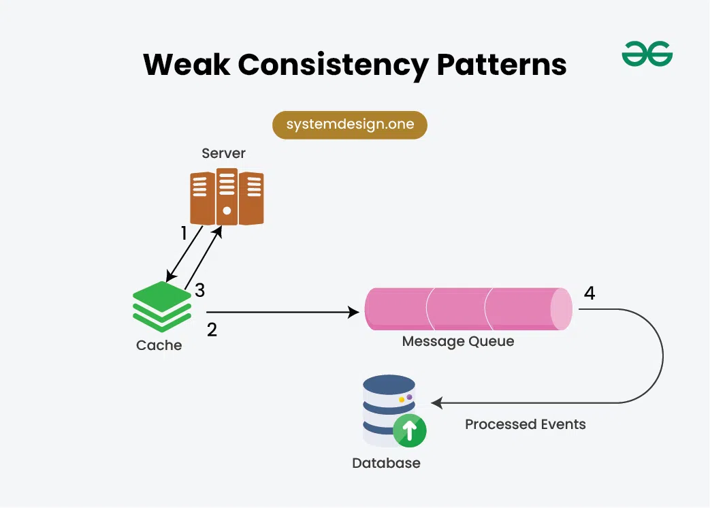

在分布式系统中，弱一致性模式优先考虑可用性和分区容错性，而非严格的数据一致性。以下是一些常见的弱一致性模式：

- **最终一致性：**允许数据副本暂时不一致，但确保它们最终会在无需人工干预的情况下收敛到一致状态。
- **读写一致性：**保证进程始终能看到自己的写入操作，即使在弱一致性系统中也是如此。这确保用户能够根据自身的操作感知到一致性。
- **单调读/写一致性：**确保进程读取或写入某个值后，在后续读取操作中永远不会看到较早的值。
- **因果一致性：**维护相关操作之间的因果关系，确保所有节点以相同的顺序看到因果相关的事件。

弱一致性模式适用于对即时一致性要求不高的场景，例如缓存、内容分发网络或协作编辑工具，这些场景优先考虑可用性和分区容错性，而非严格的一致性。

### 用例和应用

一致性模式在分布式系统普遍存在的各个领域都有应用。以下是一些用例和应用：

**1. 金融交易：**强一致性模式对于金融系统至关重要，因为准确且最新的数据对于确保交易正确处理和账户余额准确无误至关重要。
**2. 电子商务平台：**在在线购物平台中，强一致性确保跨多个仓库的库存水平得到准确维护，防止产品超卖。
**3. 社交媒体平台：**社交媒体平台通常使用最终一致性模式来处理大量数据更新，确保用户的帖子和互动最终会传播到所有关注者的时间线，而无需立即同步。
**4. 协作编辑工具：**弱一致性模式（例如最终一致性和冲突解决机制）被应用于 Google Docs 等协作编辑工具中，允许多个用户同时编辑文档并最终实现同步。
**5. [内容分发网络 (CDN)](https://www.geeksforgeeks.org/system-design/what-is-content-delivery-networkcdn-in-system-design/)：**CDN 使用弱一致性模式（例如最终一致性）将内容分发到更靠近用户的位置，从而改善延迟和可扩展性，并最终实现分布式边缘服务器之间的内容同步。
**6. 实时分析：**实时分析系统使用强一致性模式，以确保分析查询在分布式数据源中返回准确且一致的结果。

### 一致性模式的实现注意事项

在分布式系统中实现一致性模式需要仔细考虑各种因素，以确保其有效性和效率。以下是一些关键的实现注意事项：

- **用例分析：**理解应用程序或用例的具体需求，包括数据一致性的重要性、可用性需求以及对最终一致性的容忍度。
- **性能影响：**评估不同一致性模式对系统延迟、吞吐量和可扩展性的性能影响。选择能够在一致性和性能之间取得适当平衡的模式。
- **数据模型设计：**设计与所选一致性模式相一致的数据模型和模式。例如，对于非组织化数据，可以使用诸如 CRDT 之类的专用数据结构来实现最终一致性。
- **并发控制：**实现适当的并发控制机制，例如锁定、版本控制或乐观并发控制，以管理对数据的并发访问和更新，同时保持一致性。
- **冲突解决：**定义解决弱一致性系统中可能出现的冲突的策略，例如基于时间戳的协调或特定于应用程序的冲突解决逻辑。
- **复制与同步：**实现跨分布式节点的数据复制和同步机制，在确保数据一致性的同时，考虑网络延迟、可靠性和分区容错性等因素。
- **可扩展性和弹性：**确保所选的一致性模式能够随着数据量和用户负载的增长而高效扩展，并支持弹性扩展，以便根据需求动态调整资源。
- **容错性：**设计具有内置容错机制的系统，以容忍节点故障、网络分区和其他类型的故障，同时不影响数据一致性。

### 一致性模式的挑战

在分布式系统中实现一致性模式面临诸多挑战：

**1. 性能开销：**强一致性模式由于同步和协调的要求，可能会引入显著的性能开销，从而影响系统延迟和吞吐量。
**2. 可扩展性限制：**强一致性模式可能面临可扩展性限制，尤其是在大规模分布式系统中，因为维护严格一致性的开销会随着节点数量和数据量的增加而增加。
**3. 可用性权衡：**强一致性模式通常需要在网络分区或节点故障的情况下牺牲可用性以维护数据一致性，从而导致此类事件发生时系统可用性降低。
**4. 复杂性：**实现一致性模式（尤其是强一致性）会增加系统设计、开发和维护的复杂性，需要复杂的并发控制机制和冲突解决策略。
**5. 冲突解决：**弱一致性模式（例如最终一致性）在冲突解决方面可能面临挑战，尤其是在共享数据存在并发更新或冲突操作的情况下。
**6. 运维复杂性：**管理和排查分布式系统中的一致性问题可能非常复杂，需要具备分布式系统、数据建模和一致性模式方面的专业知识。
**7. 性能和延迟权衡：**弱一致性模式虽然提供了更好的可扩展性和可用性，但由于数据同步和冲突解决可能需要时间，因此可能会在性能和延迟方面带来权衡。

## [系统设计中的 CAP 定理](https://www.geeksforgeeks.org/system-design/cap-theorem-in-system-design/)

根据 CAP 定理，在网络共享数据系统或分布式系统中，一致性、可用性和分区容错性这三个理想特性中，只能同时具备其中两个。

- 该定理提供了一种思考分布式系统设计和构建过程中权衡取舍的方法。
- 它有助于解释为什么某些类型的系统更适合特定的用例。
- 该定理指出，分布式系统最多只能具备这三个特性中的两个。

.jpg>)

### CAP 定理的性质

CAP 定理涉及分布式系统的三个特性：

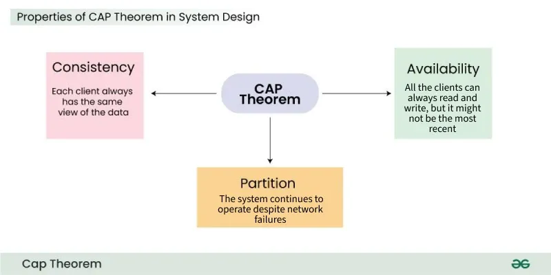

#### 1. 一致性

[一致性](https://www.geeksforgeeks.org/system-design/consistency-in-system-design/)是指在分布式系统中，无论客户端连接到哪个节点，都能同时看到相同的数据。最终一致性的保证则较为宽松。最终一致性保证意味着客户端最终会在未来的某个时刻在所有节点上看到相同的数据。

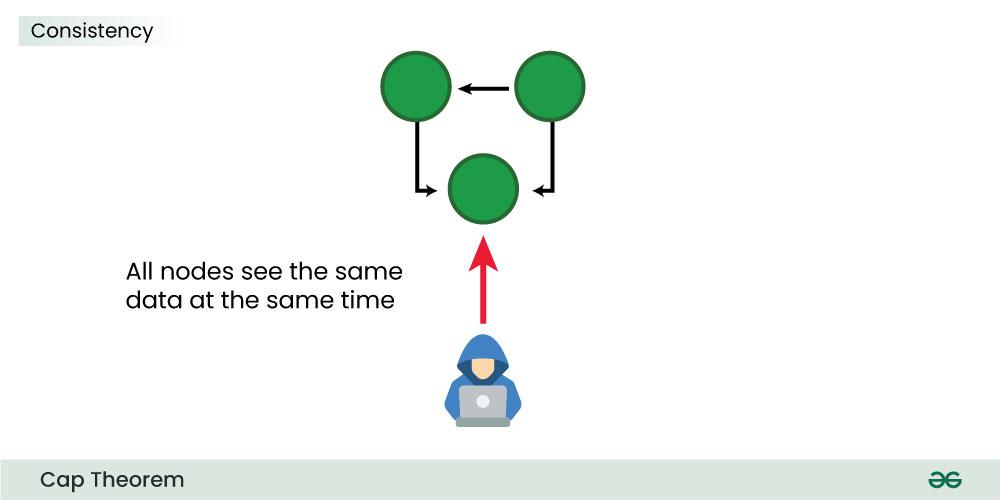

**以下是对上述图表的解释：**

- 系统中的所有节点同时看到相同的数据。这是因为节点之间不断通信并共享更新。
- 对一个节点上的数据所做的任何更改都会立即传播到所有其他节点，从而确保每个节点都拥有相同的最新信息。

#### 2. 可用性

可用性是指分布式系统中所有未发生故障的节点都能在限定的时间内响应所有读写请求，即使一个或多个其他节点发生故障。

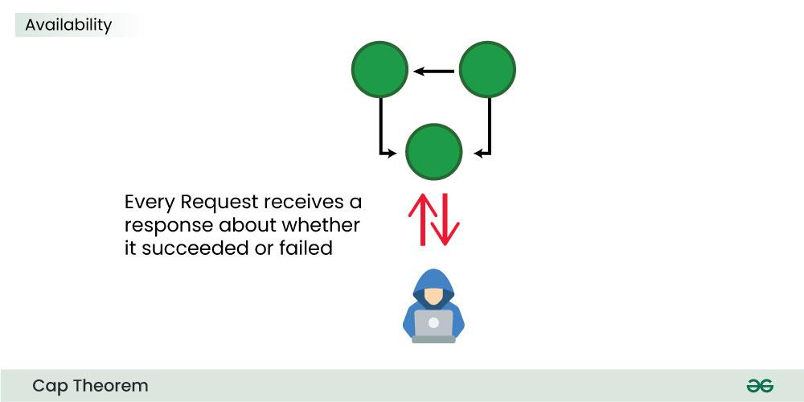

**以下是对上述图表的解释：**

- 即使我们看不到具体的网络组件，用户仍然会发送请求。这表明系统可用且运行正常。
- 每个请求都会收到响应，无论成功与否。这是可用性的关键方面，因为它保证了用户始终能够获得反馈。

#### 3. 分区容错性

分区容错性是指即使系统部分组件发生任意消息丢失或故障，系统仍能继续运行。具备分区容错性的分布式系统能够在分区恢复后优雅地从分区中恢复。

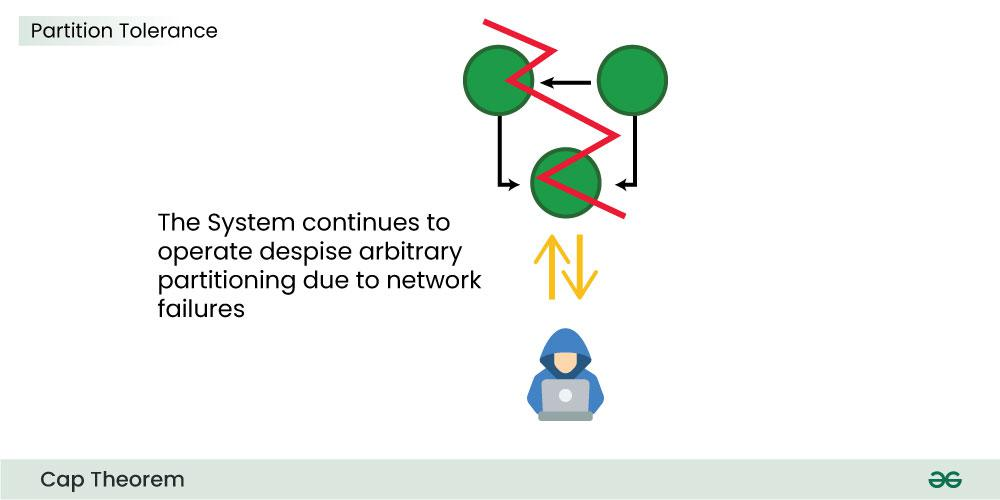

**以下是对上述图表的解释：**

- 它解决了网络故障的问题，这是导致系统分区的一个常见原因。这表明，即使部分网络无法访问，系统也能正常运行。
- 该系统可以适应任意分区，这意味着它可以处理不可预测的网络故障而不会完全失效。

### CAP 定理中的权衡

我们可以将系统分为以下三类：

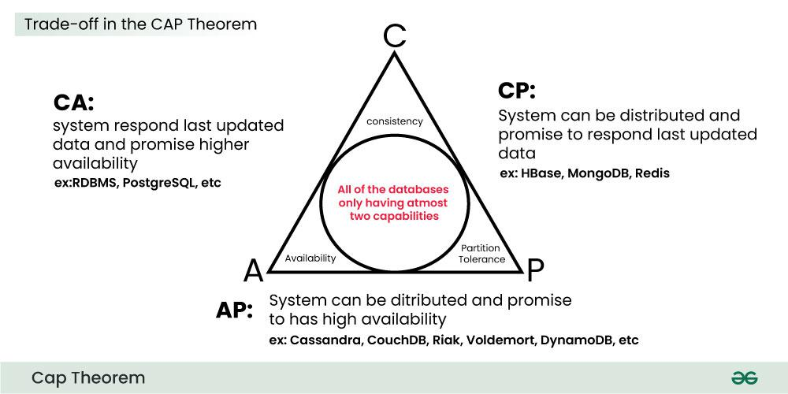

#### 1. 一致性保证系统 (CA 系统)

一致性保证系统 (CA 系统) 确保所有节点的一致性和可用性。如果系统中任意两个节点之间存在分区，则无法保证一致性和可用性，因此不支持分区容错。

#### 2. 分区容错系统 (CP 系统)

分区容错系统 (CP 系统) 以牺牲可用性为代价来提供一致性和分区容错。当两个节点之间发生分区时，系统会关闭不可用的节点，直到分区问题解决。MongoDB、Redis 和 HBase 等数据库就是 CP 系统的例子。

#### 3. 分区容错系统 (AP 系统)

分区容错系统 (AP 系统) 以牺牲一致性为代价来提供可用性和分区容错。当发生分区时，所有节点仍然可用，但位于分区错误一端的节点可能会返回比其他节点更旧版本的数据。例如：CouchDB、Cassandra 和 Dynamics DB 等。

### 理解 CAP 定理的示例

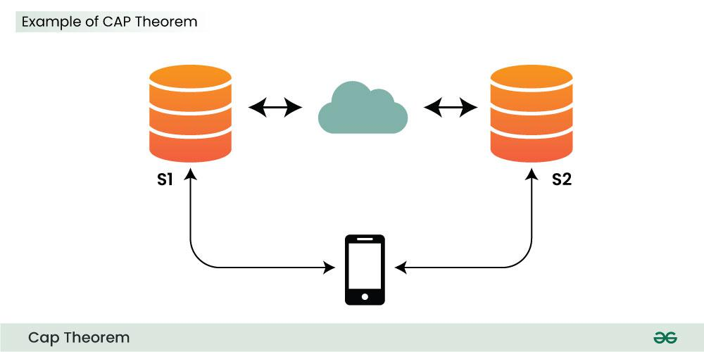

在上图中，

- 我们有一个简单的[分布式系统](https://www.geeksforgeeks.org/computer-networks/what-is-a-distributed-system/)，其中 S1 和 S2 是两个服务器。这两个服务器可以互相通信。这里，系统具有分区容错性。我们将证明系统可以保持一致性或可用性。
- 假设发生网络故障，S1 和 S2 无法互相通信。现在假设客户端向 S1 发送写入请求。然后客户端向 S2 发送读取请求。
- 由于 S1 和 S2 无法通信，它们对数据的视图不同。如果系统要保持一致性，则必须拒绝该请求，从而放弃可用性。
- 如果系统要保持可用性，则系统必须放弃一致性。这就证明了 CAP 定理。

### CAP 定理在系统设计中的应用案例

接下来，我们将看到如何在实际应用中使用权衡系统：

#### 1. 银行交易（CP 系统）

**问题描述：**

```text
想象一下，银行柜员正在一个安全的计算机系统上更新您的账户余额。该系统优先考虑一致性 (C) 和分区容错性 (P)。
```

##### 为什么使用 CP 系统？

- 即使个别分支机构遭遇网络中断（分区容错性），每笔交易也必须在所有服务器上准确反映（一致性）。
- 不一致可能导致重复支出或余额错误，这在金融交易中是不可接受的情况。
- 虽然数据始终保持一致，但由于更严格的同步要求，部分用户在网络出现问题时可能会遇到短暂的延迟。

#### 2. 社交媒体信息流（AP 系统）

**问题陈述：**

```text
想象一下您在社交媒体平台上不断更新的新闻推送。该系统优先考虑可用性 (A) 和分区容错性 (P)。
```

##### 为什么使用 AP 系统？

- 用户期望能够立即访问他们的信息流（可用性），即使部分网络暂时中断（分区容错性）。在这种情况下，数据上的轻微不一致是可以容忍的，例如在某个设备上看到朋友帖子的时间略早于其他设备。
- 数据更新后可能无法在所有服务器上立即完全一致。在数据传播到整个系统之前，用户偶尔可能会看到略有不同的信息流版本。

#### 3. 在线购物车（混合系统 CAP 系统）

**问题陈述：**

```text
想象一下在线购物车，添加商品并结账。该系统可能采用混合方法，以平衡 CAP 的权衡取舍。
```

##### 为什么我们使用 AP 和 CP 系统？

- 将商品添加到购物车可以采用可用性和分区容错 (AP) 模式，即使出现临时网络故障，也能保证浏览不中断。
- 但在确认订单和处理付款时，系统可能会切换到 CP 模式，以确保在完成交易之前所有服务器上的数据一致性。
- 该系统需要精心设计，以便在适当的节点无缝切换可用性和一致性模式，从而有效地处理用户旅程的不同阶段。

## [系统设计中的可靠性](https://www.geeksforgeeks.org/system-design/reliability-in-system-design/)

可靠性是系统设计中的关键要素，它确保系统性能稳定可靠，并将故障降至最低。

- 系统可靠性是指系统在特定运行条件下，在给定时间内持续稳定地执行其预期功能而不发生故障的能力。
- 这意味着即使在压力或不同条件下，系统也能可靠地正常运行。
- 可靠的系统能够最大限度地减少停机时间，平稳地处理错误，并为用户提供稳定的性能。

### 影响可靠性的因素

**1. 设计质量：**设计缺陷或缺乏合理的规划会导致频繁的故障。
**2. 硬件质量：**低质量的组件或磨损会导致故障。
**3. 软件缺陷：**软件代码中的错误会导致崩溃或故障。
**4. 维护：**缺乏定期更新、修复或测试会降低可靠性。
**5. 工作负载：**系统负载过高会导致故障。
**6. 外部环境：**温度、电压波动或网络问题等环境因素会影响性能。
**7. 冗余：**缺乏备份系统或故障保护措施会降低系统的可靠性。

### 如何实现高可靠性？

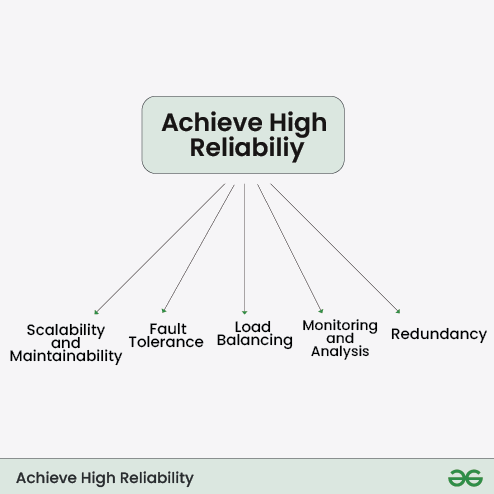

- **[可扩展性](https://www.geeksforgeeks.org/system-design/what-is-scalability/)和[可维护性](https://www.geeksforgeeks.org/system-design/maintainability-in-system-design/)：**这指的是开发能够随着时间推移不断发展和扩展，并持续高效运行的系统。
- **[容错性](https://www.geeksforgeeks.org/system-design/fault-tolerance-in-system-design/)：**在设计系统时应考虑容错性，这包括包含能够自动识别并从错误中恢复的功能。
- **[负载均衡](https://www.geeksforgeeks.org/system-design/what-is-load-balancer-system-design/)：**通过在多个系统之间分配工作负载，负载均衡可以帮助防止高流量故障，并确保没有单个系统过载。
- **监控和分析：**使用监控和分析工具跟踪系统性能，并在潜在问题演变成重大问题之前识别它们。
- **[冗余](https://www.geeksforgeeks.org/system-design/redundancy-system-design/)：**为了确保即使一个或多个组件发生故障，系统也能继续运行，请使用冗余来确保关键组件的备份。

### 可靠性和可用性的区别

以下是可靠性和[可用性](https://www.geeksforgeeks.org/system-design/availability-in-system-design/)之间的一些区别：

|   特性   |                                   可靠性                                   |                                                    可用性                                                     |
| :------: | :------------------------------------------------------------------------: | :-----------------------------------------------------------------------------------------------------------: |
|   定义   |       可靠性是指系统在给定条件下，在给定时间段内正确提供服务的能力。       |                           可用性是指系统在给定时间点，在正常情况下保持运行的概率。                            |
|   测量   | 可靠性可以使用平均故障间隔时间 (MTBF) 或平均修复时间 (MTTR) 等指标来衡量。 | 可用性通常以百分比表示，计算方法是系统在给定时间段内的正常运行时间与总时间（正常运行时间 + 停机时间）的比值。 |
|  关注点  |                   可用性是指在一段时间间隔内无故障运行。                   |                              可用性是指在特定时刻，系统在正常情况下无故障运行。                               |
| 时间范围 |    可靠性是一个长期指标，用于评估系统在其整个运行生命周期内的整体性能。    |              可用性是一个短期指标，用于评估系统的当前状态及其在任何给定时刻的可用性和运行能力。               |

### 如何衡量可靠性？

以下公式可用于更清晰地衡量可靠性：

#### 1. 正常运行时间百分比

```text
正常运行时间百分比 = ((总运行时间 - 停机时间) / 总运行时间) * 100
```

**例如：**如果一个系统一周内停机 2 小时（共 168 小时），则`正常运行时间 = ((168 - 2) / 168) * 100 = 98.81%`；

#### 2. 平均故障间隔时间 (MTBF)

```text
MTBF = (总运行时间 / 故障次数)
```

**例如：**如果一个系统运行 1000 小时并发生 5 次故障，则 `MTBF = (1000 / 5) = 200 小时`。

#### 3. 平均修复时间 (MTTR)

```text
MTTR = 总修复时间 / 故障次数
```

**例如：**如果系统修复 5 次故障耗时 10 小时，则 MTTR = 10 / 5 = 2 小时。

#### 4. 错误率

```text
错误率 = (错误次数 / 总事务或操作次数) \* 100
```

**例如：**如果 10,000 次操作中出现 50 次错误，则`错误率 = (50 / 10000) × 100 = 0.5%`。

这些公式有助于量化可靠性，从而更容易识别薄弱环节和需要改进的领域。

### 什么是单点故障 (SPOF)？

单点故障 (SPOF) 是指系统中的任何部分，例如软件、流程或设备，如果这些部分发生故障，可能会导致整个系统崩溃。存在单点故障会导致系统整体可靠性降低，变得脆弱。

- 供应链、网络和软件应用等系统都存在单点故障的风险，因为它们需要高可用性和可靠性。
- 为了提高系统的可靠性和鲁棒性，我们需要消除单点故障。

### 如何避免单点故障？

避免单点故障 (SPOF) 对于增强系统的可靠性和弹性至关重要。以下是一些有助于缓解或消除单点故障的策略：

**1. 冗余：**通过复制关键组件、系统或流程来引入冗余。如果其中一个发生故障，冗余组件可以接管，确保持续运行。这可以应用于硬件、软件，甚至整个系统。
**2. 负载均衡：**将工作负载分配到多个服务器或资源上，以防止过度依赖单个组件。负载均衡有助于确保不会出现单点过载导致故障的情况。
**3. 故障转移机制：**实施故障转移机制，以便在主组件或系统发生故障时自动将操作重定向到备份组件或系统。这有助于维持不间断的服务。
**4. 定期测试：**为了发现潜在的缺陷和漏洞，应进行例行测试，例如压力测试和模拟。这有助于在问题出现之前有效地减少其发生的可能性。
**5. 监控和警报：**部署强大的监控系统，实时检查组件的性能和运行状况。设置通知，以便管理员了解可能出现的问题，从而能够立即修复。
**6. 文档：**维护系统架构、配置和依赖关系的详细文档。这些信息对于故障排除和解决潜在的单点故障至关重要。
**7. 持续改进：**为了整合新技术、最佳实践和经验教训，应定期评估和更新系统设计和配置。持续开发有助于提前发现潜在问题。

## [系统设计中的容错性](https://www.geeksforgeeks.org/system-design/fault-tolerance-in-system-design/)

容错性是指系统即使面临硬件或软件问题也能继续运行的能力。必须采用冗余、错误检测和错误恢复技术来避免代价高昂的故障。这将使系统能够继续运行或以较慢的速度降低性能下降。

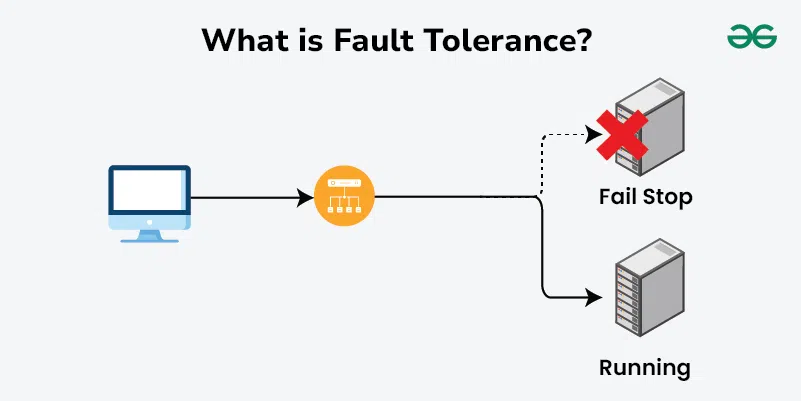

### 容错至关重要的场景

- **RAID（独立磁盘冗余阵列）：**在存储系统中，[RAID 配置](https://www.geeksforgeeks.org/dbms/how-to-configure-raid/)将数据分布在多个磁盘上，实现冗余备份，即使一个磁盘发生故障，系统也能继续运行。
- **负载均衡：**将网络流量分配到多个服务器上，确保即使一个服务器发生故障，其他服务器也能处理负载。
- **集群：**创建服务器集群，确保即使一个服务器发生故障，另一个服务器也能无缝接管工作负载。
- **虚拟化：**在服务器上运行虚拟机，可以在硬件故障时轻松地将工作负载迁移到其他服务器。
- **微服务架构：**将应用程序拆分成更小的独立服务，可以隔离故障，防止单个服务出现问题导致整个系统崩溃。
- **分布式云架构：**将应用程序分布在多个[云区域](https://www.geeksforgeeks.org/cloud-computing/cloud-native-distributed-systems/)或云提供商上，通过降低特定区域或服务故障的影响，增强容错能力。

### 增强容错能力的复制策略

#### 1. 完全复制

在多个节点上完整复制系统或数据。

- **完全复制的优势：**系统能够确保简单的**容错能力**，在发生故障时可以无缝切换到备份节点。
- **完全复制的挑战：**在每个节点上托管完整副本会使系统资源消耗巨大，因此[同步](https://www.geeksforgeeks.org/operating-systems/introduction-of-process-synchronization/)机制对于维护[一致性](https://www.geeksforgeeks.org/system-design/consistency-in-system-design/)至关重要。

**实现方式：**每个节点都维护着整个系统或数据集的完全相同的副本。了解更多[详情](https://www.geeksforgeeks.org/system-design/data-replication-strategies-in-system-design/)。

#### 2. 部分复制

选择性地复制关键组件或数据。

- **部分复制的优势：**部分复制通过仅**复制**关键组件来提高资源效率，但这需要仔细选择哪些组件对于复制最为关键。
- **部分复制的挑战：**确定哪些部分是关键的会增加复杂性，并且选择性复制的组件会带来**同步方面的挑战**。

**实现方式：**仅复制系统功能所必需的基本元素，优化资源利用。

#### 3. 影子复制或被动复制

维护被动副本，仅在主系统发生故障时激活。

- **影子复制或被动复制的优势：**影子复制或被动复制在正常运行期间可提高资源效率，并在发生故障时确保快速响应。
- **影子复制或被动复制的挑战：**确保从被动状态过渡到主动状态期间的同步至关重要，而有效的故障检测机制对于维护系统可靠性至关重要。

**实现方式：**当主系统发生故障时，非活动副本将变为活动状态。

#### 4. 主动复制

所有副本同时主动处理相同的输入。

**实现方式：**

- **主动复制的优势：**主动复制提供高容错性，即使某些副本发生故障，也能确保处理无缝继续。
- **主动复制的挑战：**然而，由于多个副本同时进行处理，因此会增加通信开销，并且管理这些活动副本之间的一致性可能很**复杂**。

请求被分发到所有副本，并比较它们的输出以确定正确的结果。

### 容错与高可用性负载均衡

以下是[容错](https://www.geeksforgeeks.org/computer-networks/fault-tolerance-in-distributed-system/)和[高可用性](https://www.geeksforgeeks.org/system-design/what-is-high-availability-in-system-design/)负载均衡之间的区别：

#### 容错

- **定义：**确保系统即使某些组件发生故障也能继续正常运行。
- **主要目标：**在发生故障时保持系统功能。
- **关键技术：**冗余、复制、​​ 故障转移机制、错误检测和纠正。
- **冗余：**高水平的冗余（多个组件执行相同的任务）。
- **示例：**RAID（独立磁盘冗余阵列）、具有复制功能的分布式数据库。
- **对性能的影响：**由于冗余检查和错误处理，可能会对性能产生轻微影响。

#### 高可用性负载均衡

- **定义：**将工作负载分配到多个服务器上，以确保没有单个服务器成为瓶颈，从而保证系统可用性。​
- **主要目标：**通过负载均衡最大限度地提高正常运行时间和资源利用率。
- **关键技术：**[负载分配算法](https://www.geeksforgeeks.org/system-design/load-balancing-algorithms/)（轮询、最小连接数等）、健康检查、故障转移。
- **冗余：**适度冗余（足以平衡负载并确保可用性）。
- **示例：**DNS 负载均衡、应用负载均衡器（例如 [NGINX](https://www.geeksforgeeks.org/operating-systems/what-is-nginx-web-server-and-how-to-install-it/)、HAProxy）。
- **对性能的影响：**通常通过均匀分配工作负载来提高性能。

#### 实现容错的挑战

- **可扩展性问题：**可扩展性是指系统在不牺牲性能或可用性的前提下，优雅地处理不断增长的工作负载或数据量的能力。容错的可扩展性挑战在于确保容错机制能够随着系统的增长而扩展。
- **性能影响：**容错机制（例如冗余和纠错）可能会影响系统性能。这一挑战在于如何在保持高容错性的同时，最大限度地减少性能下降。
- **成本考虑：**实施强大的容错策略通常会产生额外的成本，因为需要冗余硬件、软件许可、维护和监控系统。

## [系统设计中的可维护性](https://www.geeksforgeeks.org/system-design/maintainability-in-system-design/)

可维护性决定了维护、更新和升级该软件系统的难易程度和成本效益。一个易于维护的系统应具备以下特征：

- **模块化：**系统被组织成不同的模块，使维护人员能够理解和修改各个部分，而不会影响系统的其他部分。
- **可读性：**代码库清晰、简洁且易于阅读，便于维护人员或其他团队成员理解和修改。
- **错误处理：**系统旨在有效处理问题，提供有意义的错误分派信息，避免灾难性故障。
- **使用版本控制系统：**系统使用类似 Git 的版本控制系统，以有效地跟踪变更并简化协作。
- **可测试性：**系统具有良好的可测试性，有助于快速发现隐性问题。

### 可维护性评估

虽然可维护性的评估具有一定的主观性，但以下是一些可用于评估的指标：

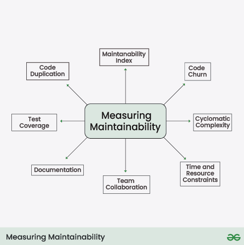

#### 代码重复

系统中重复代码的百分比可以作为可维护性的一个指标。当相同或非常相似的代码出现在系统中的多个位置时，就会发生代码重复。在这种情况下，对重复代码的一个组件所做的更改可能需要应用到其他区域。可以使用静态代码分析工具来测量代码重复性，这些工具可以识别重复的代码段。

#### 可维护性指数

它提供了一个总体评分，代表特定组件/代码模块/整个系统的可维护性。可维护性指数的计算公式因您使用的集成开发环境 (IDE) 而异，它基本上结合了复杂性、重复性和其他因素来生成一个单一值。更高的可维护性指数分数表示更好的可维护性，许多技术人员使用此指标来识别代码库中需要改进的部分。

#### 测试覆盖率

它衡量自动化测试覆盖代码库的程度，有助于防止引入回归问题。测试覆盖率工具评估自动化测试执行的代码范围，并以百分比表示。

#### 文档

良好的文档可以降低新开发人员的学习曲线，并帮助现有团队在维护期间更好地理解项目。一份好的文档不仅能让新人理解项目，还应涵盖代码注释、架构决策、系统设计、API 参考等内容。

#### 团队协作

开发团队内部强大的协作文化有助于成员之间分享知识、开展知识转移 (KT) 项目、指导新人以及共同完成维护任务。这有助于团队成员共同成长，并确保没有人会在执行特定任务时遇到困难。

#### 时间和资源限制

开发速度和可维护性之间的平衡至关重要。开发团队为了赶工而忽略可维护性，可能会导致未来维护工作变得复杂。

#### 代码变更率

代码变更率是指使用版本控制系统的数据来衡量代码模块随时间推移的变更频率。积极的维护对于改进和修复错误至关重要，但过多的代码变更也可能表明系统不稳定，需要进行更全面的测试。通过监控，可以识别出系统中在维护期间可能需要更多关注的重点区域。

#### 圈复杂度

它衡量代码模块的复杂度。更高的复杂度表明代码更难理解，并且可能存在更简便的方法来降低特定代码模块的复杂性。

### 如何实现高可维护性

设计一个高可维护性的系统需要在开发过程中采取积极主动的方法。以下是一些在系统设计中实现和提高可维护性的策略：

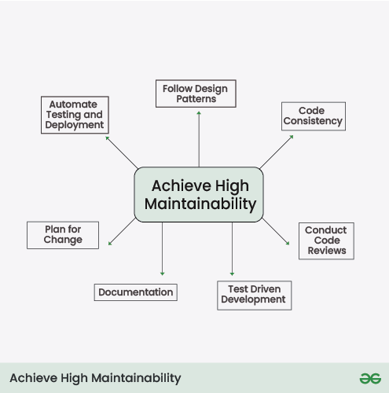

#### 遵循设计模式

设计模式，例如模型-视图-控制器（MVC）和 SOLID 原则，能够提升模块化和灵活性。遵循这些模式可以增强整体架构，并使其更易于维护。

#### 代码一致性

编写良好、易读的代码，并包含有意义的变量、注释和文档，能够使维护工作更加顺畅。因此，在编写代码或文档时，应尽可能简化设计和实现。

#### 进行代码审查

同行和维护人员进行代码审查有助于及早发现潜在问题，并确保代码符合可维护性标准和推荐的代码风格。

#### 测试驱动开发（TDD）

采用 TDD 可以确保在代码实现之前编写测试用例，从而帮助开发人员在排查问题时轻松理解代码库。

#### 文档

良好的文档可以降低新开发人员的学习曲线，并帮助现有团队在维护期间更好地理解系统。维护系统架构、API、模块和依赖项的完整文档。

#### 变更规划

系统设计应便于添加新功能，并能适应日常改进中不断变化的需求。

#### 自动化测试和部署

自动化测试和部署流程可降低人为错误的概率，有助于在更新过程中保持系统稳定性，同时还能节省团队成员的时间和精力，使他们能够专注于更重要的工作。
