# 负载均衡

## [什么是负载均衡器？负载均衡器的工作原理是什么？](https://www.geeksforgeeks.org/system-design/what-is-load-balancer-system-design/)

负载均衡器是一种网络设备或软件应用程序，它在服务器之间分配和平衡传入流量，以提供高可用性、高效的服务器利用率和高性能。

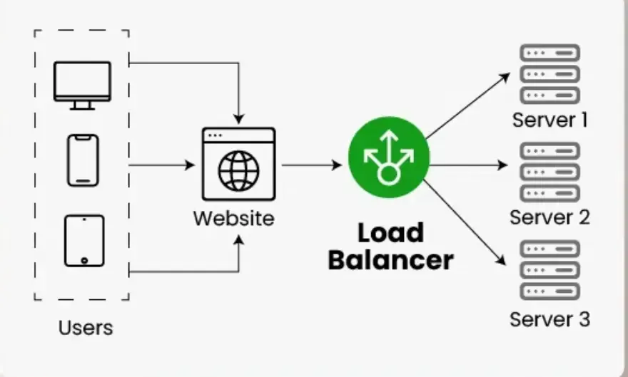

- 负载均衡器就像“交通警察”，负责将客户端请求路由到所有服务器。
- 它确保单个服务器不会承受过多的请求，从而有助于提升应用程序的性能、可靠性和可用性。
- 负载均衡器广泛应用于云计算、数据中心和需要管理流量的大型 Web 应用中。

### 没有负载均衡器会遇到什么问题？

如果没有负载均衡器，会出现以下几个问题：

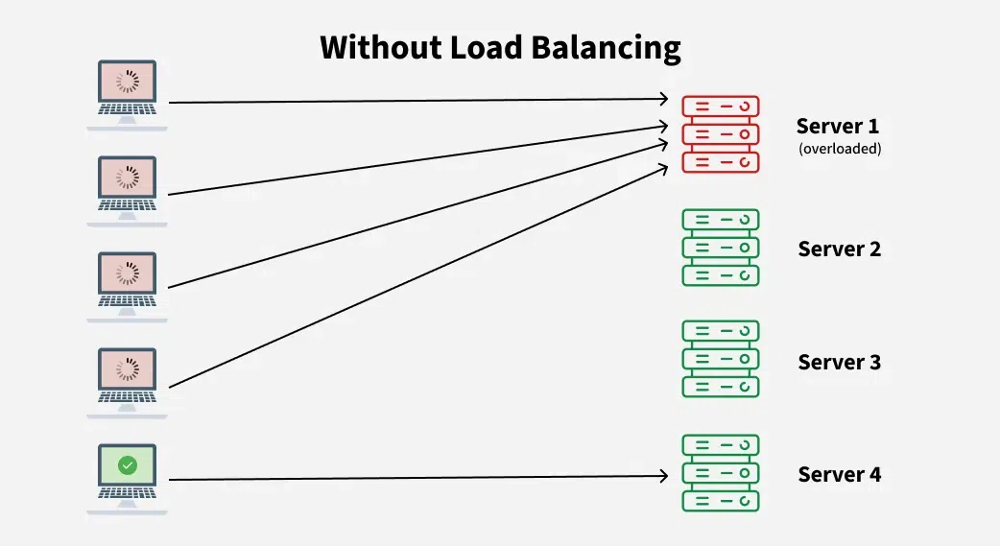

- **单点故障：**如果服务器宕机或出现其他故障，整个应用程序将中断，用户将在一段时间内无法访问。这将给用户带来糟糕的体验，这是服务提供商无法接受的。
- **服务器过载：**Web 服务器能够处理的请求数量是有限的。随着业务增长和请求数量的增加，服务器将不堪重负。
- **可扩展性有限：**如果没有负载均衡器，添加更多服务器来分担流量将非常复杂。所有请求都集中在一台服务器上，添加新服务器并不能自动解决负载问题。

**注：**以上问题均可通过负载均衡器解决。

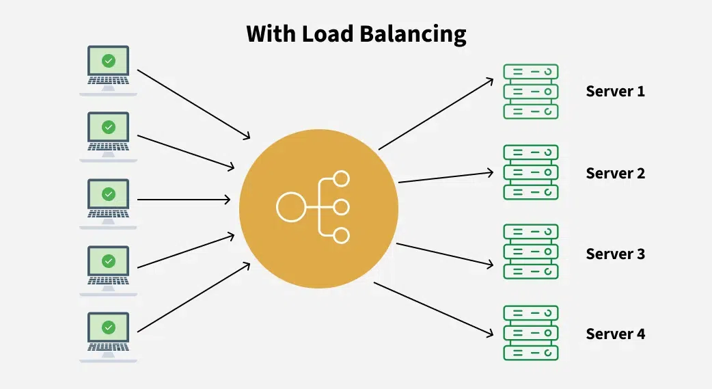

### 负载均衡器的关键特性

- 流量分配：为了避免单个服务器过载，负载均衡器会将传入的请求平均分配到多个服务器上。
- 高可用性：负载均衡器通过将流量分配到多个服务器上，提高了应用程序的可靠性和可用性。如果某个服务器发生故障，负载均衡器会将流量重新路由到状态良好的服务器。
- 可扩展性：负载均衡器可以轻松添加服务器或资源以满足不断增长的流量需求，从而实现横向扩展。
- 优化：负载均衡器优化资源利用率，确保服务器容量的高效利用，并防止出现瓶颈。
- 健康监控：负载均衡器通常会监控服务器的健康状况，并将流量从出现问题或宕机的服务器上转移出去。
- SSL 终止：一些负载均衡器可以处理 SSL/TLS 加密和解密，从而将这项资源密集型任务从服务器上卸载。

### 负载均衡器的工作原理是什么？

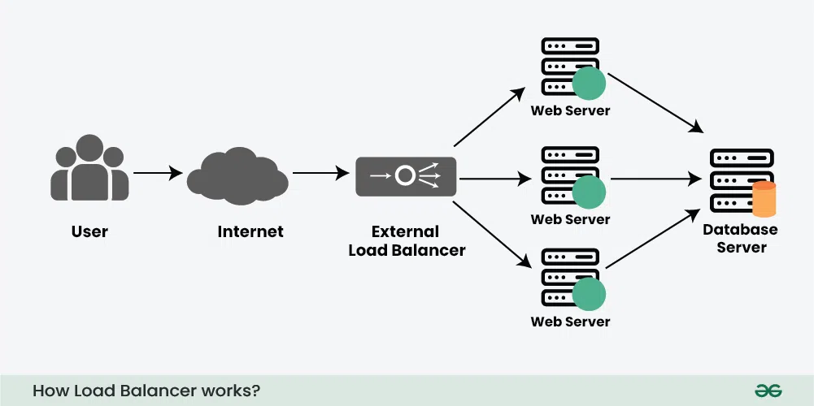

- **接收传入请求：**当用户尝试访问网站或应用程序时，他们的请求首先会发送到负载均衡器，而不是直接发送到服务器。
- **检查服务器健康状况：**负载均衡器持续监控所有服务器的状态，检查哪些服务器运行状况良好并已准备好处理请求。
- **分配流量：**负载均衡器会根据服务器负载、响应时间或距离等因素，将每个请求转发到最合适的服务器。这有助于避免任何服务器过载。
- **处理服务器故障：**如果服务器宕机或无响应，负载均衡器会自动停止向该服务器发送流量，并将其重定向到其他仍在正常运行的服务器。
- **优化性能：**通过高效地分配流量并利用运行状况良好的服务器，负载均衡器可以提高整体性能并减少延迟。

### 负载均衡器的优势

- **更佳的性能** - 将流量分配到各个服务器，避免单个服务器过载，从而减少停机时间并提高速度。
- **可扩展性** - 可与自动扩展功能配合使用，在高流量期间添加更多服务器，并在低流量期间移除服务器。
- **故障处理** - 检测不健康的服务器并将流量重定向到健康的服务器，从而保持系统可用性。​​
- **防止瓶颈** - 通过均匀分配请求，平稳应对流量的突然激增。
- **高效资源利用** - 确保所有服务器公平地分担工作负载。
- **会话持久性** - 可以维护用户会话，从而确保需要持续会话的应用程序（例如购物车）正常运行。

### 负载均衡器的挑战

- **单点故障** - 如果负载均衡器本身发生故障，除非有备份，否则可能会中断流量。
- **成本和复杂性** - 优秀的负载均衡解决方案可能价格昂贵，并且需要正确的设置和管理。
- **配置问题** - 正确配置可能很棘手，尤其对于复杂的应用程序而言。
- **额外开销** - 由于每个请求都要经过负载均衡器，因此会增加少量延迟。
- **SSL 管理** - 在负载均衡器上处理加密（SSL 终止）可能会使端到端安全性更加复杂。

## [负载均衡器类型](https://www.geeksforgeeks.org/system-design/types-of-load-balancer/)

[负载均衡器](https://www.geeksforgeeks.org/system-design/what-is-load-balancer-system-design/)将传入的网络流量分配到多个服务器上，以确保最佳的资源利用率、最大限度地缩短响应时间并防止服务器过载。根据基础设施和可扩展性需求，负载均衡器可以采用不同的实现方式。

- 硬件负载均衡器可在标准服务器或操作系统上运行，提供灵活性和成本效益，包括基于云或虚拟的设备，以便于扩展和部署。
- 专用物理设备，专为高性能和高可靠性而设计。

**例如：** 一个流行的电子商务平台可能使用硬件负载均衡器处理本地流量，使用软件负载均衡器处理内部微服务，并使用云端虚拟负载均衡器来应对季节性流量高峰。

### 负载均衡器类型

负载均衡器可以根据其配置和处理网络流量的方式进行分类。

#### 基于配置

这些负载均衡器根据其在系统中的设置和管理方式进行分类。它们定义了流量分配是由硬件、软件还是基于云的配置来处理的。

**1. 软件负载均衡器：** 软件负载均衡器是运行在通用服务器上的应用程序或组件。它们以软件形式实现，因此具有灵活性，能够适应各种环境。

- 应用程序会选择列表中的第一个服务器并向其请求数据。
- 如果某个服务器持续出现故障（经过可配置的重试次数后），导致服务器不可用，应用程序会放弃该服务器，并从列表中选择另一个服务器继续请求。
- 这是实现负载均衡最经济的方式之一。

**示例：** NGINX、HAProxy。

- **优点：** 灵活、经济高效、易于在标准服务器上部署。
- **缺点：** 与专用硬件相比性能有限；依赖于底层服务器资源。

**2. 硬件负载均衡器：** 顾名思义，我们使用物理设备将流量分配到网络服务器集群中。这些负载均衡器也称为 4-7 层路由器，能够处理各种 HTTP、HTTPS、TCP 和 UDP 流量。

- 负载均衡器 (HLB) 可以处理大量流量，但价格昂贵且灵活性有限。
- 如果任何服务器未能提供预期的响应，HLB 会立即停止向该服务器发送流量。
- 这些负载均衡器的购置和配置成本都很高，因此许多服务提供商仅将其用作用户请求的第一入口点。
- 之后，内部软件负载均衡器会将数据重定向到基础设施之后。

**例如：** F5 BIG-IP、Citrix ADC。

- **优点：** 高性能、可处理大量流量、非常可靠。
- **缺点：** 价格昂贵、灵活性较差；需要物理部署和维护。

**3. 虚拟负载均衡器：** 虚拟负载均衡器是一种基于软件的解决方案（以虚拟机形式运行），可将传入流量分配到多个服务器上。它有助于提高性能、优化资源利用率并防止服务器过载。

**示例：** AWS Elastic Load Balancer、Kemp Virtual LoadMaster。

- **优点：** 可扩展，易于在云或虚拟环境中部署；兼具灵活性和高性能。
- **缺点：** 性能取决于底层虚拟基础设施；可能需要支付许可费用。

#### 按功能分类

这些负载均衡器根据其管理和分配网络流量的方式进行分类。它们在不同的层（网络层、传输层或应用层）运行，以确保高效的请求处理和高可用性。

**1. 第 4 层 (L4) 负载均衡器/网络负载均衡器：** 第 4 层负载均衡器在 OSI 模型的传输层运行。它们根据网络层协议中可用的信息（例如 IP 地址和端口号）做出转发决策。

**示例：**

- **HAProxy** （配置为 TCP 模式，用于 L4）
- **F5 BIG-IP** （第 4 层 TCP/UDP 负载均衡）

- **优点：** 快速高效；由于工作在传输层，因此延迟低。
- **缺点：** 无法进行基于内容的路由决策；智能程度有限。

**特性**

这些负载均衡器专注于在网络层快速高效地分配流量。

- **传输层：** 工作在传输层（TCP/UDP）。
- **基本负载均衡：** 基于 IP 地址和端口号分配流量。
- **效率：** 由于不检查数据包内容，因此处理速度更快。
- **网络地址转换 (NAT)：** 可以执行基本 NAT 以隐藏服务器地址。

**2. 第 7 层 (L7) 负载均衡器/应用层负载均衡器：** 第 7 层负载均衡器工作在 OSI 模型的应用层。它们可以根据内容（包括 URL、HTTP 标头或 Cookie 等信息）进行负载均衡决策。

**示例：**

- **NGINX** （HTTP/HTTPS 反向代理和基于内容的路由）
- **AWS 应用程序负载均衡器** （基于 URL、标头和 Cookie 路由流量）

- **优点：** 内容感知；可基于 URL、标头、Cookie 或 SSL 进行路由。
- **缺点：** 由于需要进行更深层次的包检测，速度比 L4 层慢；资源占用更高。

**功能**

这些负载均衡器提供智能且内容感知的流量分配。

- **基于内容的路由：** 根据内容信息分配流量。
- **高级路由：** 可根据应用程序特定数据做出智能路由决策。
- **SSL 终止：** 能够终止 SSL 连接。

**3. GSLB（全局服务器负载均衡器）：** GSLB 代表全局服务器负载均衡器，也称为多站点负载均衡器。这种类型的负载均衡器超越了传统的本地负载均衡，旨在跨多个数据中心或地理位置分散的服务器分配流量。

**示例：**

- **Cloudflare 负载均衡** （跨多个区域的地理路由和故障转移）
- **AWS Route 53 的基于延迟的路由** （将用户定向到延迟最低的端点）

- **优点：** 通过将用户路由到最近或运行状况最佳的数据中心来提高全局性能。
- **缺点：** 配置复杂；依赖于准确的运行状况检查和 DNS 传播。

**功能**

全局负载均衡 (GSLB) 专注于全球或广域流量管理，以提高可用性和性能。

- **基于邻近性的路由：** 将用户定向到最近或延迟最低的服务器位置。
- **运行状况感知：** 监控服务器运行状况，避免将流量发送到运行状况不佳的区域。
- **地理智能：** 考虑位置和性能因素，智能地路由流量。

## [负载均衡算法](https://www.geeksforgeeks.org/system-design/load-balancing-algorithms/)

为了控制网络中服务器间的流量，负载均衡算法至关重要。

- 其目标是确保当大量用户访问应用程序时，不会出现单个服务器过载的情况。
- 负载均衡算法大致可以分为两类：**动态负载均衡**和**静态负载均衡**。

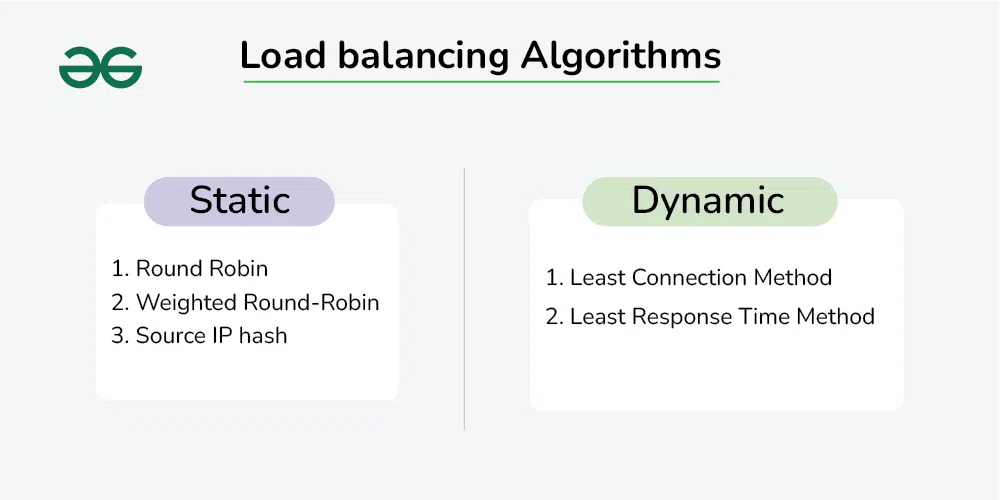

### 静态负载均衡算法

静态负载均衡是指预先设定任务或资源的分配，而不考虑系统的实时变化。这种方法依赖于将工作负载固定分配给服务器或资源，并且不会根据运行时的变化进行调整。

静态负载均衡算法的类型包括：

#### 1. 轮询负载均衡算法

轮询算法是一种简单的静态负载均衡方法，它将请求按顺序或轮换的方式分配到各个服务器上。它易于实现，但不会考虑服务器上的现有负载，因此存在某个服务器接收大量请求而过载的风险。

```text
假设你有一群朋友，你想把一袋糖果平均分给他们。你围成一圈，给每个朋友发一颗糖，然后重新开始。这就好比轮询——确保每个人都能公平地分到糖果。
```

.webp>)

我们需要实现一个基本的轮询负载均衡算法。其目标是将传入的请求均匀地分配到一组服务器中。第一个请求发送到第一个服务器，第二个请求发送到第二个服务器，第三个请求发送到第三个服务器，以此类推，直到所有请求都得到处理。

##### 以下是轮询负载均衡算法的实现

```js
class LoadBalancer {
  constructor(servers) {
    this.servers = servers;
    this.currentIndex = 0;
  }

  getNextServer() {
    const nextServer = this.servers[this.currentIndex];
    this.currentIndex = (this.currentIndex + 1) % this.servers.length;
    return nextServer;
  }
}

// Sample list of servers
const serverList = ["Server1", "Server2", "Server3"];

// Create a load balancer with the server list
const loadBalancer = new LoadBalancer(serverList);

// Simulate requests to the load balancer
for (let i = 0; i < 10; i++) {
  const nextServer = loadBalancer.getNextServer();
  console.log(`Request ${i + 1}: Routed to ${nextServer}`);
}
```

##### 以下是对上述代码的解释

**负载均衡器类 (LoadBalancer)：**

维护一个服务器名称列表。
实现一个方法 (getNextServer)，以轮询方式返回下一个服务器。
跟踪当前索引以确定下一个服务器。

**主类 (RoundRobinExample)：**

创建要在负载均衡器中使用的服务器名称列表。
使用服务器列表实例化一个 LoadBalancer 对象。
通过重复调用 getNextServer 方法模拟一系列请求。
打印每个请求路由到的服务器。

**主类 (RoundRobinExample)：**

创建要在负载均衡器中使用的服务器名称列表。
使用服务器列表实例化一个 LoadBalancer 对象。
通过重复调用 getNextServer 方法模拟一系列请求。
打印每个请求路由到的服务器。

##### 何时使用轮询负载均衡算法

- 适用于所有服务器容量和性能相似的应用程序。
- 适用于负载分布均匀的情况，例如基本的 Web 请求。
- 最适合资源需求简单的环境。
- 在请求顺序不如服务器间均衡分配重要的情况下，此方法非常实用。

##### 轮询负载均衡算法的优缺点

- **优点：**
  简单：易于实现和理解。
  公平性：确保每台服务器获得相同的负载份额。
- **缺点：**
  容量不均：未考虑服务器容量的差异；对所有服务器一视同仁。
  可预测性：对于服务器容量差异较大的场景，可能并非最佳选择。

#### 2. 加权轮询负载均衡算法

加权轮询算法也是一种静态负载均衡方法，与轮询技术非常相似。唯一的区别在于，它为列表中的每个资源分配了一个加权分数。根据加权分数，请求会被分配给相应的服务器。

- 权重越高的服务器将获得更大比例的请求。
- 分配过程是循环的，类似于轮询技术，但每个服务器接收到的请求数量与其权重成正比。
- 如果服务器达到其处理能力上限，它可能会开始拒绝或将额外的请求排队，具体取决于服务器的行为。

**例如：**

```text
假设你的朋友们对糖果的渴望程度不同。为了公平起见，你把更多的糖果给了最爱吃糖果的朋友。加权轮询算法的工作原理与之类似——它将更多的任务分配给那些能够更好地处理这些任务的朋友。
```

假设你有三个服务器，它们的权重分别为：`服务器 1（权重 0.3）`、`服务器 2（权重 0.2）`和`服务器 3（权重 0.1）`。总权重为 `0.3 + 0.2 + 0.1 = 0.6`。在每个周期中，`服务器 1` 将接收 `0.3/0.6 (50%)` 的请求，`服务器 2` 将接收 `0.2/0.6 (33.33%)` 的请求，`服务器 3` 将接收 `0.1/0.6 (16.67%)` 的请求。

.webp>)

##### 以下是加权轮询负载均衡算法的实现

```js
class Server {
  constructor(name, weight) {
    this.name = name;
    this.weight = weight;
  }

  getName() {
    return this.name;
  }

  getWeight() {
    return this.weight;
  }
}

class WeightedRoundRobinBalancer {
  constructor(servers) {
    this.servers = servers;
    this.totalWeight = this.calculateTotalWeight(servers);
    this.cumulativeWeights = this.calculateCumulativeWeights(servers);
    this.currentIndex = 0;
    this.random = Math.random;
  }

  calculateTotalWeight(servers) {
    let totalWeight = 0;
    for (let server of servers) {
      totalWeight += server.getWeight();
    }
    return totalWeight;
  }

  calculateCumulativeWeights(servers) {
    let cumulativeWeights = new Array(servers.length).fill(0);
    cumulativeWeights[0] = servers[0].getWeight();
    for (let i = 1; i < servers.length; i++) {
      cumulativeWeights[i] = cumulativeWeights[i - 1] + servers[i].getWeight();
    }
    return cumulativeWeights;
  }

  getNextServer() {
    let randomValue = Math.floor(this.random() * this.totalWeight);
    for (let i = 0; i < this.cumulativeWeights.length; i++) {
      if (randomValue < this.cumulativeWeights[i]) {
        this.currentIndex = i;
        break;
      }
    }
    return this.servers[this.currentIndex];
  }
}

// Sample list of servers with weights
let serverList = [
  new Server("Server1", 3),
  new Server("Server2", 2),
  new Server("Server3", 1),
];

// Create a weighted round-robin load balancer with the server list
let balancer = new WeightedRoundRobinBalancer(serverList);

// Simulate requests to the load balancer
for (let i = 0; i < 10; i++) {
  let nextServer = balancer.getNextServer();
  console.log(`Request ${i + 1}: Routed to ${nextServer.getName()}`);
}
```

##### 以下是对上述代码的解释

- **WeightedRoundRobinBalancer 类：**
  管理一个包含权重的服务器列表。
  在初始化期间计算总权重和累计权重。
  提供一个方法 (getNextServer)，用于根据加权轮询算法检索下一个服务器。
  包含一个内部类 (Server)，用于表示具有名称和权重的服务器。

- **WeightedRoundRobinExample 类：**
  演示 WeightedRoundRobinBalancer 的用法。
  创建一个包含权重的示例服务器列表。
  实例化一个 WeightedRoundRobinBalancer 对象。
  模拟请求并打印每个请求路由到的服务器。

##### 何时使用加权轮询负载均衡算法？

- 当服务器容量或性能水平不同时。
- 适用于服务器资源（CPU、内存等）不同的环境。
- 当您希望最大化所有服务器的资源利用率时非常有用。
- 有助于防止小型服务器过载，同时高效利用大型服务器。

##### 加权轮询负载均衡算法的优缺点

- **优点：**
  容量考虑：通过分配权重来考虑不同服务器的容量。
  灵活性：可调整以有效处理不同的工作负载。

- **缺点：**
  复杂性：比简单的轮询算法更复杂。
  维护性：需要根据服务器容量的变化调整权重。

#### 3. 源 IP 哈希负载均衡算法

源 IP 哈希负载均衡算法是一种网络负载均衡方法，它根据源 IP 地址的哈希值将传入的请求分配到一组服务器。该算法旨在确保来自同一源 IP 地址的请求始终被定向到同一服务器。

如果负载均衡器配置了会话持久性，则可以确保来自同一源 IP 地址的后续请求始终被定向到同一服务器。这对于需要维护会话信息或状态的应用程序非常有用。

**例如：**

```text
想象一下你的朋友来你家玩，你希望每次都能记住他们玩了哪个玩具。IP 哈希就像记住上次哪个朋友玩了哪个玩具一样，这样你每次都能给他们同一个玩具。
```

.webp>)

我们需要实现一种负载均衡算法，根据源 IP 地址的哈希值将传入请求分配到一组服务器上。目标是确保来自同一源 IP 地址的请求始终路由到同一台服务器。

##### 以下是源 IP 哈希负载均衡算法的实现

```js
const languageMap = [
  "cpp",
  "c",
  "java",
  "python3",
  "csharp",
  "html",
  "css",
  "javascript",
  "php",
  "cpp14",
  "cobol",
  "dart",
  "go",
  "julia",
  "kotlin",
  "lisp",
  "matlab",
  "node",
  "objc",
  "perl",
  "r",
  "rust",
  "ruby",
  "scala",
  "swift",
  "solidity",
  "xml",
];

class SourceIpHashLoadBalancer {
  constructor() {
    this.ipToServerMap = new Map();
  }

  addServer(serverName) {
    // Add server to the mapping
    this.ipToServerMap.set(serverName, serverName);
  }

  getServerForIp(sourceIp) {
    // Calculate hash of the source IP
    let hash = sourceIp.hashCode();

    // Helper function to get a hash code from a string
    String.prototype.hashCode = function () {
      let hash = 0,
        i,
        chr;
      if (this.length === 0) return hash;
      for (i = 0; i < this.length; i++) {
        chr = this.charCodeAt(i);
        hash = (hash << 5) - hash + chr;
        hash |= 0; // Convert to 32bit integer
      }
      return hash;
    };

    // Get the list of available servers
    let servers = Array.from(this.ipToServerMap.keys());

    // Map the hash value to a server index
    let serverIndex = Math.abs(hash) % servers.length;

    // Return the selected server
    return servers[serverIndex];
  }
}

// Create a source IP hash load balancer
let loadBalancer = new SourceIpHashLoadBalancer();

// Add servers to the load balancer
loadBalancer.addServer("Server1");
loadBalancer.addServer("Server2");
loadBalancer.addServer("Server3");

// Simulate requests with different source IPs
let sourceIps = ["192.168.1.1", "10.0.0.1", "172.16.0.1"];

for (let sourceIp of sourceIps) {
  let selectedServer = loadBalancer.getServerForIp(sourceIp);
  console.log(`Request from ${sourceIp} routed to ${selectedServer}`);
}
```

##### 以下是对上述代码的解释

- **SourceIpHashLoadBalancer 类：**
  **字段：**ipToServerMap，服务器名称到服务器名称的映射（用于一致性哈希）。
  **方法：**addServer，将服务器添加到负载均衡器；getServerForIp，计算源 IP 的哈希值并确定处理请求的服务器。

- **SourceIpHashLoadBalancerExample 类：**
  演示 SourceIpHashLoadBalancer 的用法。
  创建负载均衡器的实例，添加服务器，并模拟来自不同源 IP 的请求。

##### 何时使用源 IP 哈希负载均衡算法？

- 非常适合需要会话一致性的应用，例如网上银行，其中同一用户必须在整个会话期间连接到同一服务器。
- 当特定区域的用户需要连接到专用服务器以获得更好的性能或合规性时非常有用。
- 当少数 IP 产生大部分流量时非常有效，可确保均衡的负载分配，而不会随机切换。

##### 源 IP 哈希负载均衡算法的优缺点

- **优点：**
  一致性：确保来自同一源 IP 的请求始终发送到同一服务器，从而维护会话状态。
  可预测性：在连接持久性至关重要的情况下非常有用。

- **缺点：**
  分布有限：如果某些源 IP 过于活跃，则可能导致负载分布不均。
  扩展性挑战：添加或移除服务器可能会中断会话持久性。

### 动态负载均衡算法

动态负载均衡是指实时决定如何将传入的网络流量或计算工作负载分配到多个服务器或资源上。这种方法可以适应系统不断变化的情况，例如服务器负载、网络流量或资源可用性的变化。

```text
动态负载均衡和静态负载均衡的选择取决于系统的特性、工作负载的性质以及所需的适应性级别。动态负载均衡通常适用于动态、高流量的环境，而静态负载均衡可能更适合更可预测的场景。
```

#### 1. 最少连接数负载均衡算法

最少连接数算法是一种动态负载均衡方法，它将新请求分配给活动连接数最少的服务器。其理念是以一种能够最大限度降低每台服务器当前负载的方式来分配传入的工作负载，目标是在所有可用资源上实现连接数的均衡分布。

- 为此，负载均衡器需要进行一些额外的计算来识别连接数最少的服务器。
- 与轮询算法相比，这种方法可能稍微昂贵一些，但它的评估是基于服务器的当前负载。

**例如：**

```text
假设你在游乐场，一些孩子正在不同的秋千上玩耍。你想去玩孩子最少的秋千，这样就不会太拥挤。最少连接数算法就像是选择已经玩了最少孩子的秋千。
```

.webp>)

我们需要实现一种负载均衡算法，将传入的请求分配到一组服务器上，并尽可能减少每台服务器上的活动连接数，方法是将新请求定向到活动连接数最少的服务器。这可以确保工作负载的均衡分配，并防止单个服务器过载。

##### 以下是最小连接数法负载均衡算法的实现

```js
class LeastConnectionLoadBalancer {
  constructor() {
    this.serverConnections = {};
  }

  addServer(serverName) {
    // Add a server to the load balancer with 0 initial connections
    this.serverConnections[serverName] = 0;
  }

  getServerWithLeastConnections() {
    // Find the server with the least active connections
    let minConnections = Infinity;
    let selectedServer = null;

    for (let server in this.serverConnections) {
      if (this.serverConnections[server] < minConnections) {
        minConnections = this.serverConnections[server];
        selectedServer = server;
      }
    }

    // Increment the connection count for the selected server
    if (selectedServer !== null) {
      this.serverConnections[selectedServer] = minConnections + 1;
    }

    return selectedServer;
  }
}

if (require.main === module) {
  // Create a Least Connection load balancer
  const loadBalancer = new LeastConnectionLoadBalancer();

  // Add servers to the load balancer
  loadBalancer.addServer("Server1");
  loadBalancer.addServer("Server2");
  loadBalancer.addServer("Server3");

  // Simulate requests and print the server to which each request is routed
  for (let i = 0; i < 10; i++) {
    const selectedServer = loadBalancer.getServerWithLeastConnections();
    console.log(`Request ${i + 1}: Routed to ${selectedServer}`);
  }
}
```

##### 以下是对上述代码的解释

- **LeastConnectionLoadBalancer 类**
  **字段：**
  - serverConnections：跟踪每个服务器的活动连接数。
    **方法：**
  - addServer：添加一个初始连接数为 0 的服务器。
  - getServerWithLeastConnections：返回连接数最少的服务器，并增加其连接数。

- **LeastConnectionLoadBalancerExample 类**

**主方法：**

- 创建 LeastConnectionLoadBalancer 实例。
- 添加服务器。
- 模拟请求并将请求路由到连接数最少的服务器。

##### 何时使用最少连接数负载均衡算法？

- 非常适合某些请求的处理时间比其他请求更长的应用（例如，视频流或大文件上传）。
- 当某些连接保持活动状态的时间较长时，此算法非常有用，因为它能确保新请求被发送到活动连接数较少的服务器。
- 非常适合流量波动较大的系统，因为它基于实时服务器负载进行负载均衡，而不仅仅是统计请求数量。

##### 最少连接数负载均衡算法的优缺点

- **优点：**
  负载均衡：将流量分配给活动连接数最少的服务器，防止服务器过载。
  动态性：能够适应不断变化的服务器工作负载。

- **缺点：**
  忽略服务器容量：忽略服务器容量；连接数较少的服务器可能容量仍然较小。
  会话粘性：可能不适用于需要会话持久性的场景。

#### 2. 最短响应时间负载均衡算法

最短响应时间是一种动态负载均衡方法，旨在通过将新请求定向到响应时间最快的服务器来最大限度地缩短响应时间。

- 它会考虑服务器的历史性能来决定将传入请求路由到哪里，从而优化处理速度。
- 其动态性体现在对服务器响应时间的持续监控以及算法的自适应性，即将传入请求路由到历史响应时间最短的服务器。

**例如：**

```text
想象一下你在一家小吃店，可以从不同的服务员那里点餐。你注意到有些服务员动作比其他服务员快。每次去，你都会选择看起来上菜最快的服务员。最短响应时间就好比选择排队最短的服务员。
```

.webp>)

我们需要实现一种负载均衡算法，将传入的请求分配到一组服务器上，并力求通过将新请求定向到累计响应时间最短的服务器来最大限度地缩短响应时间。这可以确保工作负载的均衡分配，并有助于优化系统整体性能。

##### 以下是最小响应时间负载均衡算法的实现

```js
class LeastResponseLoadBalancer {
  constructor() {
    this.serverResponseTimes = {};
  }

  addServer(serverName) {
    this.serverResponseTimes[serverName] = 0;
  }

  getServerWithLeastResponseTime() {
    let minResponseTime = Infinity;
    let selectedServer = null;

    for (let server in this.serverResponseTimes) {
      if (this.serverResponseTimes[server] < minResponseTime) {
        minResponseTime = this.serverResponseTimes[server];
        selectedServer = server;
      }
    }

    if (selectedServer !== null) {
      this.serverResponseTimes[selectedServer] = minResponseTime + 1;
    }

    return selectedServer;
  }
}

if (require.main === module) {
  let loadBalancer = new LeastResponseLoadBalancer();

  loadBalancer.addServer("Server1");
  loadBalancer.addServer("Server2");
  loadBalancer.addServer("Server3");

  for (let i = 0; i < 10; i++) {
    let selectedServer = loadBalancer.getServerWithLeastResponseTime();
    console.log(`Request ${i + 1}: Routed to ${selectedServer}`);
  }
}
```

##### 以下是对上述代码的解释

- **LeastResponseLoadBalancer 类：**
  **字段：**
  - serverResponseTimes：一个用于跟踪每个服务器累计响应时间的映射。
    **方法：**
  - addServer：向负载均衡器添加一个服务器，初始响应时间为 0。
  - getServerWithLeastResponseTime：确定累计响应时间最短的服务器，并递增其响应时间。

- **LeastResponseLoadBalancerExample 类：**

**Main 方法：**
创建 LeastResponseLoadBalancer 实例。
向负载均衡器添加服务器。
模拟请求，并根据最短响应时间算法打印每个请求路由到的服务器。

##### 何时使用最短响应时间负载均衡算法？

- 非常适合用户流量大且波动较大的应用程序，因为响应时间至关重要。
- 非常适合电子商务网站或流媒体服务等应用程序，因为快速响应可以提升用户体验。
- 当服务器负载水平不同时，这种方法效果显著，因为它会将流量定向到可用且响应速度最快的服务器。

##### 最短响应时间负载均衡算法的优缺点

- **优点：**
  **性能优化：**将流量定向到响应速度最快的服务器，从而优化系统整体性能。
  **适应性强：**能够根据服务器响应速度随时间的变化进行调整。

- **缺点：**
  **历史偏差：**受历史响应时间的影响较大，可能无法始终反映服务器的当前性能。
  **实现复杂：**需要跟踪和管理历史响应时间。

#### 3. 基于资源的负载均衡算法

基于资源的负载均衡算法根据每台服务器当前的可用资源（例如 CPU 使用率、内存或网络带宽）来分配传入的请求。与简单地平均分配流量或基于历史性能不同，该算法会评估每台服务器当前的“资源健康状况”，以决定新请求应该发送到哪里。

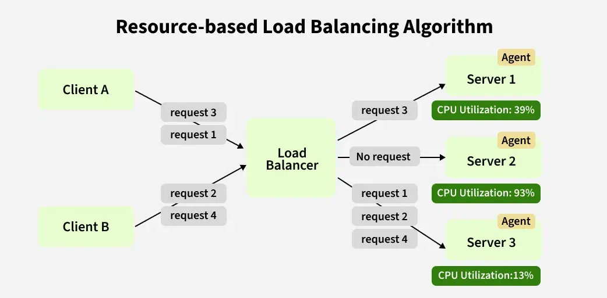

**例如：**

```text
想象一下，这就像根据办公室里每个员工当前的工作量分配任务——有些员工很忙，有些员工则很空闲。基于资源的负载均衡会将请求定向到拥有最多可用资源的服务器。
```

要实现基于资源的负载均衡，您需要跟踪每个服务器的当前资源，然后根据实时数据将每个新请求路由到最适合处理该请求的服务器。以下是一个基于资源的负载均衡算法的示例实现。这个简单的实现使用 CPU 负载作为指标来决定哪个服务器应该处理每个请求。

```js
class Server {
  constructor(name) {
    this.name = name;
    this.cpuLoad = 0.0; // Represents the current CPU load percentage of the server
  }

  // Simulate updating the CPU load for the server
  updateCpuLoad(load) {
    this.cpuLoad = load;
  }

  getCpuLoad() {
    return this.cpuLoad;
  }

  getName() {
    return this.name;
  }
}

class ResourceBasedLoadBalancer {
  constructor() {
    this.servers = {};
  }

  // Adds a server to the load balancer
  addServer(server) {
    this.servers[server.getName()] = server;
  }

  // Finds the server with the lowest CPU load and assigns the request to it
  getServerWithMostResources() {
    let bestServer = null;
    let lowestLoad = Infinity;

    for (let server of Object.values(this.servers)) {
      if (server.getCpuLoad() < lowestLoad) {
        lowestLoad = server.getCpuLoad();
        bestServer = server;
      }
    }
    return bestServer;
  }

  // Simulate handling a request
  handleRequest() {
    let bestServer = this.getServerWithMostResources();
    if (bestServer !== null) {
      console.log(
        `Routing request to server: ${bestServer.getName()} with current CPU load: ${bestServer.getCpuLoad()}%`,
      );
      // Here, you might update the server's load after handling a request
    } else {
      console.log("No servers available.");
    }
  }
}

if (require.main === module) {
  let loadBalancer = new ResourceBasedLoadBalancer();

  // Create servers and add them to the load balancer
  let server1 = new Server("Server1");
  let server2 = new Server("Server2");
  let server3 = new Server("Server3");

  loadBalancer.addServer(server1);
  loadBalancer.addServer(server2);
  loadBalancer.addServer(server3);

  // Simulate updating CPU load for each server
  server1.updateCpuLoad(30.0);
  server2.updateCpuLoad(50.0);
  server3.updateCpuLoad(20.0);

  // Route requests based on current CPU load
  loadBalancer.handleRequest(); // This should route to Server3, as it has the lowest CPU load
}
```

**输出**

```text
将请求路由到服务器：Server3，当前 CPU 负载：20.0%
```

以下是上述代码的解释：

- **Server 类：**
  表示一个服务器，包含 name 和 cpuLoad 等属性。updateCpuLoad 方法更新 CPU 负载，以模拟实时监控。
- **ResourceBasedLoadBalancer 类：**
  管理服务器并根据可用资源路由请求。addServer 添加服务器。getServerWithMostResources 查找 CPU 负载最低的服务器。handleRequest 将请求路由到可用资源最多的服务器。
- **ResourceBasedLoadBalancerExample 类：**
  设置负载均衡器，添加服务器，更新 CPU 负载，并模拟路由请求。

##### 何时使用基于资源的负载均衡算法？

- 适用于执行 CPU 密集型或内存密集型任务的应用程序。
- 当服务器资源水平不同时，该算法效果良好，因为它会根据每个服务器的实时容量进行调整。
- 通过将请求路由到负载最低的服务器来确保可用性，从而降低停机风险。

##### 基于资源的负载均衡算法的优缺点

- **优点：**
  **资源优化：**基于实时资源数据平衡工作负载，提高系统效率。
  **适应性强：**能够根据每个服务器的资源当前状态动态调整。

- **缺点：**
  **实现复杂：**需要持续监控服务器资源，这会增加复杂性。
  **开销较高：**实时跟踪资源可能会消耗额外的系统资源。

## [并发性和并行性的区别](https://www.geeksforgeeks.org/operating-systems/difference-between-concurrency-and-parallelism/)

并发和并行是计算机科学中的基础概念，尤其是在多线程和分布式系统中。虽然它们听起来相似，但实际上指的是管理多个任务的不同方式。理解它们的区别对于设计高效、可扩展的应用程序至关重要。

**并发：**就像一个收银员快速切换服务多个顾客一样。
**并行：**就像多个收银员同时服务多个顾客一样。

### 并发

并发是指同时处理多个任务，但不一定同时执行。相反，任务通过共享同一处理资源的时间来推进。并发是一种利用单个处理单元来缩短系统响应时间的方法。它营造了一种并行的假象。

#### 主要特征

- 任务在重叠的时间段内启动、运行和完成。
- 单个处理器可以在任务之间快速切换（上下文切换），从而产生同时执行的假象。
- 在响应速度至关重要的环境中很常见（例如，处理多个用户请求）。

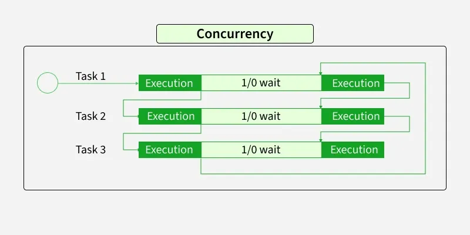

首先，任务 1 执行完毕后进入 I/O 阶段；此时，任务 2 开始执行，随后也进入 I/O 阶段；接着是任务 3，以此类推。最后，任务 1 完成 I/O 阶段并开始执行剩余部分；任务 2 随后执行剩余部分；最后是任务 3。

**示例：**单核 CPU 运行多个线程：CPU 在线程间快速切换，确保每个线程都能取得进展。

并发性是通过中央处理器 (CPU) 上进程的交错操作实现的，或者说是通过上下文切换实现的。它提高了同时完成的工作量。

### 并行

并行性是指在多个处理单元上同时执行多个任务。这里，任务被分解成更小的子任务，这些子任务看似同时或并行地处理。它通过使用多个处理器来提高系统的吞吐量和计算速度。

#### 主要特点

- 任务被分解成在不同的内核或处理器上同时运行的子任务。
- 主要通过真正的同时执行来提高性能。
- 常用于数据处理、科学计算和高性能应用。

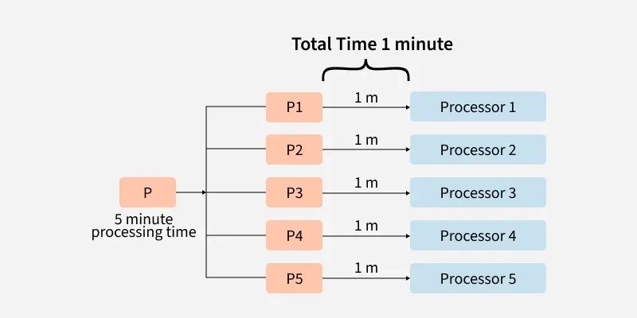

**例如：**一个四核 CPU 运行四个线程：每个线程分配到一个单独的核心，并真正并行执行。

并行性是指一个进程的中央处理器和输入输出任务与另一个进程的中央处理器和输入输出任务重叠执行。而并发性则是通过一个进程的输入输出活动与另一个进程的 CPU 进程重叠来提高速度。

### 并发性与并行性

|                                并发                                 |                        并行                        |
| :-----------------------------------------------------------------: | :------------------------------------------------: |
|                并发是指同时运行和管理多个计算任务。                 |           并行是指同时运行多个计算任务。           |
| 并发是通过中央处理器 (CPU) 上进程的交错操作（即上下文切换）实现的。 |     并行则需要多个中央处理器 (CPU) 才能实现。      |
|                    并发可以通过单个处理器完成。                     |               并行则需要多个处理器。               |
|                   并发可以增加一次完成的工作量。                    |       并行则可以提高系统的吞吐量和计算速度。       |
|                     并发可以同时处理很多事情。                      |            并行也可以同时执行很多事情。            |
|                  并发是一种非确定性的控制流方法。                   |           并行是一种确定性的控制流方法。           |
|                        并发的调试非常困难。                         | 并行的调试虽然也很困难，但比并发的调试要简单一些。 |

### 为什么这很重要？

**理解并发与并行有助于您：**

- 选择合适的性能和可扩展性设计。
- 避免常见的陷阱，例如竞态条件。
- 有效利用系统资源。

## [无状态负载均衡与有状态负载均衡](https://www.geeksforgeeks.org/system-design/stateless-vs-stateful-load-balancing/)

[负载均衡](https://www.geeksforgeeks.org/system-design/what-is-load-balancer-system-design/)是现代网络和应用架构的基本要素，旨在将传入的网络流量分配到多个服务器或资源上。这种分配方式确保不会出现单个服务器过载的情况，从而提高应用程序的[可用性](https://www.geeksforgeeks.org/system-design/availability-in-system-design/)、[可靠性](https://www.geeksforgeeks.org/system-design/reliability-in-system-design/)和性能。

负载均衡器主要分为两大类：无状态负载均衡和有状态负载均衡。

### 无状态负载均衡

无状态负载均衡是指将传入的请求分发到各个服务器，而不考虑先前交互的状态或上下文。在这种模型中，每个请求都被独立处理，并且不维护任何关于先前请求的信息。

- 每个请求都独立处理，无需维护会话状态，这使得系统更易于实现和管理。
- 由于可以添加新服务器而无需跟踪或共享会话信息，因此可以轻松进行水平扩展。
- **优点：** 高度可扩展、简单、容错性更好
- **缺点：** 没有会话持久性；不适用于用户依赖型应用程序

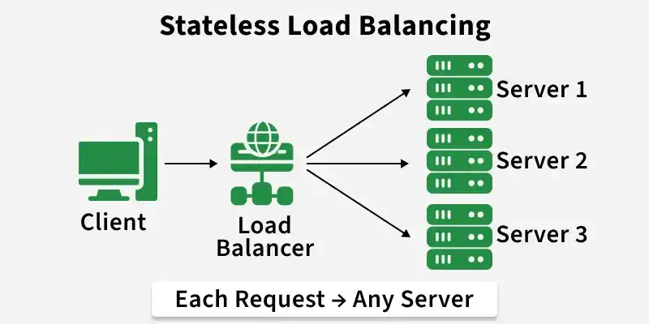

#### 应用场景

无状态负载均衡的应用场景包括：

- **RESTful API：** 无需会话管理的 API 可以受益于无状态负载均衡，它允许将请求路由到任何服务器，而无需维护会话连续性。
- **微服务：** 无状态[微服务架构](https://www.geeksforgeeks.org/system-design/microservices/)可以利用无状态负载均衡实现高效扩展和灵活管理服务请求。
- **内容分发网络 (CDN)：** 提供静态内容或数据的[CDN](https://www.geeksforgeeks.org/system-design/what-is-content-delivery-networkcdn-in-system-design/)可以使用无状态负载均衡来高效地分配流量，而无需会话上下文。
- **搜索引擎：** 无状态负载均衡非常适合搜索引擎和其他处理独立查询而无需记住先前交互的应用程序。

### 有状态负载均衡

与之相反，有状态负载均衡会根据当前会话的状态或上下文来分配请求。这意味着负载均衡器会跟踪会话状态，并确保来自特定会话的所有请求都被路由到同一服务器。

- 它将来自同一用户/会话的请求路由到同一服务器，并通过维护会话信息来确保连续性。
- 由于需要在整个系统中存储和处理会话状态，因此管理起来更为复杂。
- **优点：** 保持会话一致性，提升用户体验。
- **缺点：** 管理复杂，难以扩展，存在会话丢失的风险。

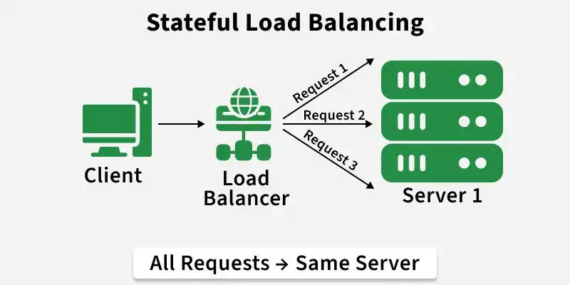

#### 应用场景

有状态负载均衡的应用场景包括：

- **电子商务平台：** 购物车和用户会话需要保持一致的管理，因此需要有状态负载均衡来确保用户购物车在不同请求之间保持一致。
- **网上银行：** 金融应用通常需要会话持久性，以确保用户交互在整个会话期间保持一致。
- **游戏服务器：** 多人在线游戏需要保持玩家会话和交互的一致性，因此可以利用有状态负载均衡来维护游戏状态和玩家数据。
- **协作工具：** 实时协作工具和聊天平台等应用需要会话一致性来管理持续的交互和数据同步。

### 无状态负载均衡与有状态负载均衡

为了更清晰地进行比较，下表列出了无状态负载均衡和有状态负载均衡之间的主要区别：

| 无状态负载均衡                                             | 有状态负载均衡                                         |
| ---------------------------------------------------------- | ------------------------------------------------------ |
| 分发请求时不维护任何会话信息。                             | 在多个请求之间维护会话信息。                           |
| 不保留客户端会话信息。                                     | 保留并管理客户端会话信息。                             |
| 请求根据当前负载进行分发，不考虑之前的交互。               | 请求被定向到同一服务器以保持会话连续性。               |
| 通常更具可扩展性，因为没有会话管理开销。                   | 但由于会话跟踪，可能存在可扩展性限制。                 |
| 如果服务器发生故障，请求会被重新分发，而不会丢失会话数据。 | 如果服务器发生故障且会话未复制，则可能会发生会话丢失。 |
| 由于无需会话跟踪，因此更容易实现。                         | 由于需要会话持久性或复制，因此更复杂。                 |
| 适用于 API 和 Web 服务等无状态应用程序。                   | 适用于购物车等需要会话持久性的应用程序。               |
| 通常速度更快，因为开销更低。                               | 但由于会话管理，可能存在性能开销。                     |
| 每个请求都是独立的，从而减少了与状态相关的问题。           | 确保对来自同一客户端的请求进行一致的处理。             |

## [负载均衡与故障转移](https://www.geeksforgeeks.org/system-design/load-balancing-vs-failover/)

[负载均衡](https://www.geeksforgeeks.org/system-design/what-is-load-balancer-system-design/)和[故障转移](https://www.geeksforgeeks.org/system-design/failover-mechanisms-in-system-design/)通过管理流量和处理故障来确保系统可靠性和流畅性能。负载均衡分配请求，而故障转移在发生故障时提供备份。

- 负载均衡将流量分散到多个服务器上以避免过载。
- 故障转移切换到备用服务器以维持服务的持续性。

### 负载均衡

[负载均衡](https://www.geeksforgeeks.org/system-design/what-is-load-balancer-system-design/)是一种将传入的网络或应用程序流量分配到多个服务器上的技术，以确保没有单个服务器过载。这可以提高应用程序的性能、可靠性和可用性。

- 它有助于高效地处理高流量。
- 它确保更好的资源利用率和容错能力。

**例如：** 一个电子商务网站在促销期间会同时收到数千个用户。负载均衡器将这些请求分配到多个服务器上，从而避免单个服务器崩溃，并确保用户获得快速响应。

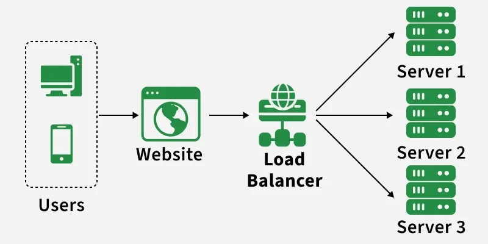

#### 优势

负载均衡通过高效分配流量，提升系统性能、可靠性和可扩展性。

- 将负载均匀分配到各个服务器，从而降低服务器压力，缩短响应时间，并高效应对不断增长的流量。
- 自动将流量从故障服务器重定向到正常服务器，减少停机时间，确保高可用性。
- 通过添加更多服务器，轻松实现扩展；并通过在恶意流量到达服务器之前将其拦截，提高安全性。

#### 劣势

负载均衡会给系统带来额外的复杂性、成本和依赖性。

- 需要精心设置和持续监控，以确保正常运行并快速解决问题。
- 如果负载均衡器发生故障，除非有备用系统，否则可能会阻止对所有服务器的访问。
- 由于需要额外的工具、基础设施和维护，成本可能较高。

### 故障转移

[故障转移](https://www.geeksforgeeks.org/system-design/failover-mechanisms-in-system-design/)是一种机制，当主系统发生故障时，自动将流量或操作切换到备用系统，从而确保服务的持续可用性。

- 它通过快速激活备用资源来提供高可用性。
- 它最大限度地减少系统故障期间的停机时间。

**例如：** 在网上银行系统中，如果主服务器宕机，故障转移系统会自动将用户切换到备用服务器，从而确保交易不间断地继续进行。

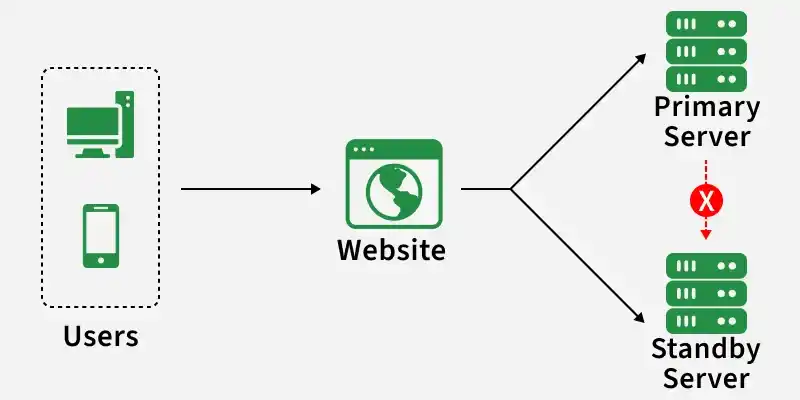

在图中

- 用户向网站发送请求，正常情况下，请求首先发送到主服务器。
- 如果主服务器发生故障（图中以叉号表示），系统会检测到故障并自动切换到备用服务器。
- 备用服务器随后接管并继续处理请求，确保服务不中断。

#### 优点

故障转移通过确保在故障期间备份资源接管，提高了系统可用性。​​

- 如果主服务器发生故障，故障转移会切换到备份系统，从而保证服务平稳运行。
- 故障转移通过平滑地切换到备份资源来减少停机时间，从而保持服务可用。
- 通常比负载均衡系统更容易设置，尤其是在确保备份方面。

#### 缺点

故障转移侧重于可用性，但不会提高性能或流量分配。

- 故障转移会在需要时切换到备份服务器，但不处理或分配流量，因此不会提高性能。
- 切换到备份服务器时可能会有短暂的延迟，这可能会导致轻微的服务中断。
- 维护备份系统可能成本高昂，并且可能会浪费不常用的资源。

### 负载均衡与故障转移的区别

以下是负载均衡与故障转移的区别：

| 负载均衡                                   | 故障转移                                             |
| ------------------------------------------ | ---------------------------------------------------- |
| 将传入流量分配到多个服务器上               | 当主服务器发生故障时，切换到备用服务器或系统         |
| 旨在优化性能和资源利用率                   | 专注于在故障期间保持服务可用性                       |
| 通过根据需要添加更多服务器来提高可扩展性   | 通过备用系统提供冗余                                 |
| 容易导致配置和管理复杂                     | 通常更容易实现，但负载分配较少                       |
| 如果负载均衡器发生故障，可能会造成单点故障 | 通过切换到备用系统来减少停机时间，但可能会有一些延迟 |
| 需要定期检查和更新                         | 涉及维护备用系统，这可能成本较高                     |
| 有助于平衡负载并避免服务器过载             | 确保连续性，但不管理跨系统的负载                     |
| 通常涉及更高的基础设施成本                 | 可能需要额外成本来维持未使用的备用系统运行           |

## [一致性哈希 - 系统设计](https://www.geeksforgeeks.org/system-design/consistent-hashing/)

一致性哈希是一种分布式哈希技术，常用于负载均衡。其目标是在系统节点数量发生变化时，最大限度地减少重新哈希的需要。

- 它将客户端和服务器节点的请求表示在一个称为**哈希环**的虚拟环状结构中。
- 该环中的位置数量并非固定，而是被视为具有无限多个点。
- 服务器节点可以随机放置在该环上，这可以通过哈希来实现。
- 请求也使用相同的哈希函数放置在同一个环上。

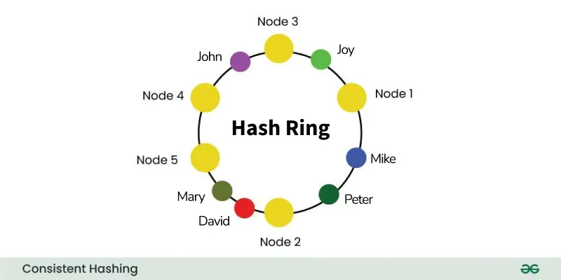

### 如何决定哪个请求由哪个服务器处理？

假设环的顺序是顺时针遍历时，地址的顺序也随之递增，那么每个请求都可以由顺时针遍历时最先出现的服务器节点来处理。

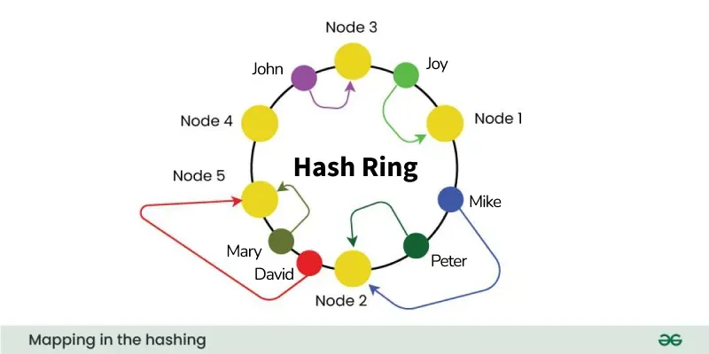

### 传统哈希方法的不足之处

以下用通俗易懂的语言解释了传统哈希方法的一些主要问题：

- **数据分布不均：**传统哈希方法通常会导致数据在服务器之间的分布不均。使用简单的哈希函数时，一些服务器可能会获得更多数据，而另一些服务器则很少。
- **可扩展性问题：**在传统哈希算法中，每当添加或移除服务器（节点）时，都必须将大量数据重新分配到所有服务器。因此，几乎所有数据都必须重新哈希和重新分配，这不仅效率低下，还会导致延迟或停机。
- **服务器数量变化时的灵活性不足：**如果您的应用程序需要通过添加更多服务器来扩展规模，或通过移除一些服务器来缩减规模，传统哈希方法难以适应。整个系统会变得不稳定，并且需要迁移大量数据。
- **节点故障处理：**在传统哈希架构中，当服务器发生故障时，该服务器上的所有数据都将无法访问，直到服务器恢复运行或数据重新分配为止。目前尚无妥善处理节点故障的方法。
- **重哈希的开销：**当系统规模增大或缩小时，传统哈希算法需要将大部分键重新哈希到不同的服务器，这会导致大量的开销。

### 一致性哈希的用途是什么？

一致性哈希是分布式系统中常用的一种技术，用于解决如何在网络中高效地将键或数据元素分布到多个节点/服务器的问题。一致性哈希的主要目标是减少在网络中添加或移除节点时所需的重映射操作次数，从而提高系统的稳定性和可靠性。

- 一致性哈希可用于分担节点间的负担，并减轻节点故障的影响。
- 例如，当向网络中添加新节点时，只需将少量键重新映射到新节点，这有助于减少与添加节点相关的开销。
- 同样，当某个节点发生故障时，只有少量键会受到影响，这有助于最大限度地减少故障对整个系统的影响。
- 一致性哈希对于确保分布式系统中的数据可用性和一致性也十分有用。

### 一致性哈希的阶段/工作原理

一致性哈希过程包含以下几个阶段：

- **阶段 1：**哈希函数选择：选择用于将键与网络节点关联起来的哈希算法是一致性哈希的第一阶段。该哈希函数应该是确定性的，并且每个键都会产生不同的值。选定的哈希函数将用于以一致且可预测的方式将键映射到节点。
- **阶段 2：**节点分配：基于哈希函数的计算结果，在此阶段为网络中的节点分配键。节点被排列成一个圆圈，并按顺时针方向将键分配给圆圈中距离该键哈希值最近的节点。
- **阶段 3：**密钥复制：确保分布式系统中的数据即使在节点故障的情况下也能访问至关重要。密钥可以在多个网络节点之间进行复制以实现这一点。如果某个节点发生故障，这有助于保证数据始终可访问。
- **阶段 4：**节点添加/移除：当网络中添加或删除节点时，可能需要将密钥重新映射到新节点，以维持系统平衡。一致性哈希仅将少量密钥重新映射到新节点，从而最大限度地减少节点添加或删除的影响。
- **阶段 5：**[负载均衡](https://www.geeksforgeeks.org/system-design/what-is-load-balancer-system-design/)：一致性哈希有助于在网络节点之间分配负载。为了在节点过载时保持系统的平衡和高效，可以将该节点的部分密钥重新映射到其他节点。
- **阶段 6：**故障恢复：如果某个节点发生故障，可以将其分配的密钥重新映射到网络中的其他节点。即使发生节点故障，这也能确保数据的准确性和可用性。

**例如：**

假设环中有 5 个节点，节点 3 发生故障，那么下一个服务器节点的响应范围就会扩大，所有在这个范围内的请求都会被转发到新的服务器节点。这表明，由于使用了一致性哈希算法，只有一小部分键会受到影响。

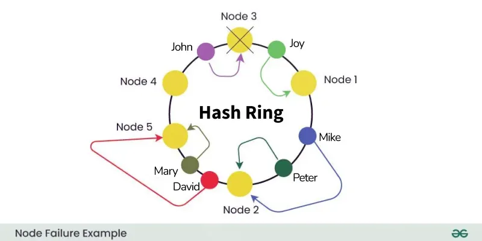

### 一致性哈希算法的实现

- **步骤 1：**选择哈希函数：
  - 选择一个能够生成均匀分布的哈希值范围的哈希函数。常用的哈希函数包括 MD5、SHA-1 或 SHA-256。
- **步骤 2：**定义哈希环：
  - 将哈希值范围表示为一个环。该环应覆盖所有可能的哈希值范围，并且均匀分布。
- **步骤 3：**将节点分配到环上：
  - 为系统中的每个节点在哈希环上分配一个位置。通常的做法是使用选定的哈希函数对节点的标识符进行哈希运算。
- **步骤 4：**密钥映射：
  - 当需要存储或检索密钥时，使用选定的哈希函数对密钥进行哈希运算，得到一个哈希值。
  - 找到哈希值在哈希环上的位置。
  - 沿顺时针方向遍历哈希环，找到遇到的第一个节点。该节点将成为密钥的所有者。
- **步骤 5：**节点添加：
  - 添加新节点时，使用哈希函数计算其在哈希环上的位置。
  - 确定新节点将拥有的键的范围。这通常需要找到环上的前驱节点。
  - 更新哈希环，将新节点添加到其中，并将受影响的键重新映射到新节点。
- **步骤 6：**节点移除：
  - 移除节点时，确定其在哈希环上的位置。
  - 确定受移除影响的键的范围。这通常需要找到环上的后继节点。
  - 更新哈希环，将移除的节点排除在外，并将受影响的键重新映射到后继节点。
- **步骤 7：**[负载均衡](https://www.geeksforgeeks.org/system-design/what-is-load-balancer-system-design/)：
  - 定期检查每个节点的负载，方法是监控每个节点拥有的键的数量。
  - 如果负载不均衡，则考虑重新分配一些键，以实现更均匀的分布。

#### 以下是一致性哈希的示例实现

```c++
#include <bits/stdc++.h>

using namespace std;

class ConsistentHashRing {
private:
    map<int, string> ring;
    set<int> sorted_keys;
    int replicas;

    int get_hash(const string& value) {
        hash<string> hash_function;
        return hash_function(value);
    }

public:
    ConsistentHashRing(int replicas = 3) : replicas(replicas) {}

      // Function to add Node in the ring
    void add_node(const string& node) {
        for (int i = 0; i < replicas; ++i) {
            int replica_key = get_hash(node + "_" + to_string(i));
            ring[replica_key] = node;
            sorted_keys.insert(replica_key);
        }
    }

      // Function to remove Node from the ring
    void remove_node(const string& node) {
        for (int i = 0; i < replicas; ++i) {
            int replica_key = get_hash(node + "_" + to_string(i));
            ring.erase(replica_key);
            sorted_keys.erase(replica_key);
        }
    }

    string get_node(const string& key) {
        if (ring.empty()) {
            return "";
        }

        int hash_value = get_hash(key);
        auto it = sorted_keys.lower_bound(hash_value);

        if (it == sorted_keys.end()) {
            // Wrap around to the beginning of the ring
            it = sorted_keys.begin();
        }

        return ring[*it];
    }
};

int main() {
    ConsistentHashRing hash_ring;

    // Add nodes to the ring
    hash_ring.add_node("Node_A");
    hash_ring.add_node("Node_B");
    hash_ring.add_node("Node_C");

    // Get the node for a key
    string key = "first_key";
    string node = hash_ring.get_node(key);

    cout << "The key '" << key << "' is mapped to node: " << node << endl;

    return 0;
}
```

**输出**

```text
The key 'first_key' is mapped to node: Node_C
```

**注意：**本示例使用简单的哈希函数和二分查找来查找环上的位置。

### 使用一致性哈希的优势

以下是使用一致性哈希的一些主要优势：

**1. 负载均衡：**即使数据量随时间增长和变化，一致性哈希也能通过均衡地将网络工作负载分配到各个节点，从而保持系统的效率和响应能力。
**2. 可扩展性：**由于一致性哈希具有很强的可扩展性，它可以适应节点数量或处理数据量的变化，而对系统整体性能的影响微乎其微。
**3. 最小化重映射：**通过最大限度地减少每次添加或移除节点时需要重映射的键的数量，一致性哈希确保即使网络不断发展，系统也能保持稳定可靠。
**4. 更高的容错能力：**即使节点发生故障，一致性哈希也能确保数据始终可访问且保持最新。系统整体的稳定性和可靠性得益于跨多个节点复制键并在发生故障时将键重新映射到其他节点的能力。
**5. 简化操作：**一致性哈希简化了在网络中添加或删除节点的操作，从而简化了大型分布式系统的管理和维护。

### 使用一致性哈希的缺点

**1. 哈希函数复杂性：**一致性哈希的有效性取决于是否使用了合适的哈希函数。哈希函数必须为每个键生成唯一值，并且具有确定性才能发挥作用。哈希函数的复杂程度会影响系统的整体有效性和效率。
**2. 性能开销：**将键映射到节点、复制键以及在添加或删除节点时重新映射键所需的计算资源，在使用一致性哈希时可能会导致一定的性能开销。
**3. 缺乏灵活性：**在某些情况下，系统适应不断变化的需求或网络状况的能力可能会受到一致性哈希的严格限制。
**4. 资源占用率高：**随着网络节点的增减，一致性哈希算法有时会导致资源占用率过高。这可能会影响系统的整体性能和效率。
**5. 管理复杂性：**管理和维护使用一致性哈希算法的系统可能非常困难且要求很高，通常需要特定的专业知识和技能。

**学习完整的系统设计：**[系统设计面试训练营——完整指南](https://www.geeksforgeeks.org/system-design/system-design-interview-bootcamp-guide/)
