# 延迟、吞吐量和缓存

## [系统设计中的延迟和吞吐量](https://www.geeksforgeeks.org/system-design/latency-in-system-design/)

**延迟**是指请求从发起点到达目的地并收到响应所需的时间。它综合考虑了多种延迟因素——响应时间、传输时间和处理时间。

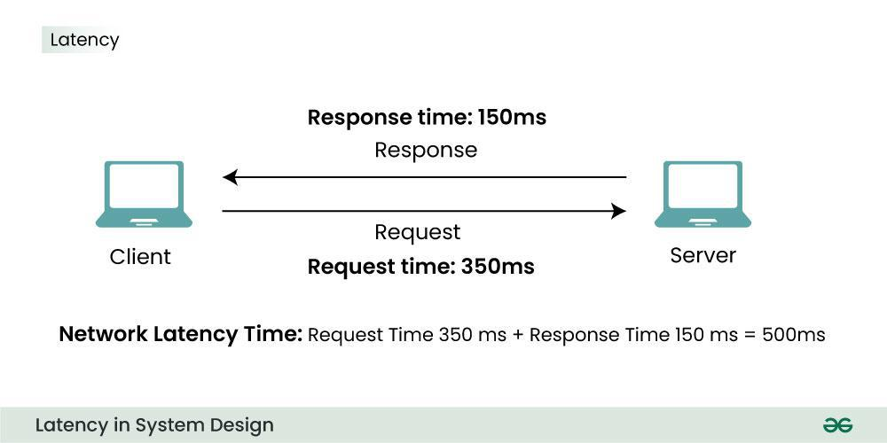

- 延迟是指动作与其相应反应之间的时间差。
- 根据系统和应用程序的不同，延迟可以用秒、毫秒和纳秒等不同的单位来衡量。

##### 延迟包含哪些内容？

延迟涉及诸多因素，例如处理时间、组件间网络传输时间以及排队时间。

- **往返时间：**这包括请求发送到服务器所需的时间、服务器的处理时间以及服务器响应发送方所需的时间。
- **不同组件：**处理时间、传输时间（通过网络或组件间传输）、排队时间（等待处理的时间）甚至人的反应时间都会影响总延迟。

#### 什么是吞吐量？

系统、进程或网络在特定时间内移动数据或执行操作的速率称为吞吐量。比特每秒 (bps)、字节每秒、事务每秒等都是常用的计量单位。吞吐量的计算方法是将执行的操作或对象的总数除以所花费的时间。

```text
例如，一家冰淇淋工厂每小时生产 50 个冰淇淋，那么该工厂的产量就是每小时 50 个冰淇淋。
```


以下是一些吞吐量常用的场景：

**1. 网络吞吐量：**网络吞吐量是指在特定时间内通过网络传输的数据量。评估通信路径的有效性时，该指标非常重要。
**2. 磁盘吞吐量：**在存储系统中，吞吐量衡量从存储设备读取或写入数据的速度，通常以每秒字节数 (B/s) 表示。
**3. 处理吞吐量：**在计算机领域，尤其是在 CPU 或处理器方面，吞吐量是指单位时间内完成的操作数量。它可以指每秒执行的指令数。

### 吞吐量与延迟的区别（吞吐量 vs. 延迟）

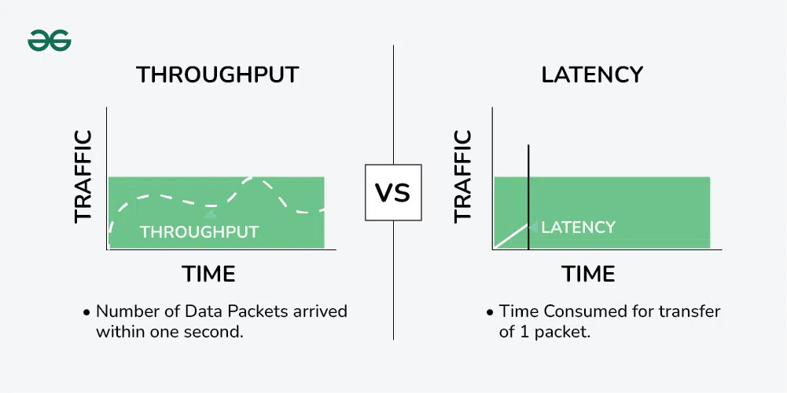

|     方面     |                     吞吐量                     |                           延迟                           |
| :----------: | :--------------------------------------------: | :------------------------------------------------------: |
|     定义     |         在给定时间段内完成的任务数量。         |                 完成单个任务所需的时间。                 |
|   计量单位   |      通常以每秒操作数或每秒事务数来衡量。      |               以毫秒或秒等时间单位来衡量。               |
|     关系     | 与延迟成反比。更高的吞吐量通常对应更低的延迟。 |     与吞吐量成反比。更低的延迟通常对应更高的吞吐量。     |
|     示例     |      高吞吐量的网络可以快速传输大量数据。      | 在游戏中，低延迟意味着用户输入和屏幕动作之间的延迟最小。 |
| 对系统的影响 |  反映系统的整体容量和同时处理多个任务的能力。  |       反映从用户角度来看系统的响应速度和感知速度。       |

### 延迟是如何运作的？

每个步骤所需的时间——包括发送操作、服务器处理、发送响应以及更新屏幕——都会影响整体延迟。

**例如：**我们来看一个玩家在在线游戏中开火的例子。

- **如果你的延迟很高：**你按下“开火”按钮。
- 命令通过互联网传输到服务器，这需要时间。
- 服务器处理射击操作。
- 处理结果返回到你的设备。
- 你的屏幕更新结果。

```text
在此期间，其他玩家可能已经移动或射击了你，但由于延迟，他们的操作尚未到达你的设备。这会导致所谓的“射击注册延迟”。你的操作感觉不够即时，并且你可能会发现屏幕上的画面与游戏世界中实际发生的事情不一致。
```

延迟的运作方式可以从两个方面来理解：

#### 1. 网络延迟

.jpg>)

在系统架构中，网络延迟是一种描述数据在网络中两点之间传输所需时间的延迟。以电子邮件为例，我们可以将其理解为电子邮件发送到收件人实际收到邮件之间的时间差。对于实时应用程序，网络延迟的单位是毫秒甚至微秒，与总延迟一样。

#### 2. 系统延迟

系统延迟是指请求从系统源头到达目标并收到响应所需的总时间。可以将延迟理解为系统中的“等待时间”。点击页面到看到更新后的网页之间的时间就是系统延迟。它包括客户端和服务器的处理时间、网络传输时间和渲染延迟。

### 导致高延迟的因素

高延迟会严重影响分布式系统的性能和用户体验。以下是导致高延迟的关键因素：

**1. 网络拥塞：**网络流量过大会导致数据包排队等待传输，从而造成延迟。
**2. 带宽限制：**带宽不足会导致数据传输延迟，尤其是在数据密集型应用中。
**3. 地理距离：**分布式节点间长距离传输数据会增加延迟，这是由于传输本身存在延迟。
**4. 服务器负载：**服务器负载过高会导致处理请求的时间延长，从而造成高延迟。
**5. 数据库查询延迟：**复杂或低效的数据库查询会显著增加响应时间。

### 如何测量延迟？

测量延迟的方法有很多种。以下是一些常用方法：

- **Ping：**这种广泛使用的工具会向目标服务器发送数据包并测量往返时间 (RTT)，从而估算两点之间的网络延迟。`（RTT = 2 * 单向延迟）`。
- **Traceroute：**该工具会显示数据包到达特定目的地的路径，从而揭示哪些网络跃点对整体延迟的贡献最大。
- **MTR（traceroute 和 ping）：**结合了 traceroute 和 ping 的功能，显示路径上每一跃点的路由信息 ​​ 和 RTT。
- **性能分析工具：**专门的性能分析工具跟踪系统内的资源使用情况和执行时间，从而提供关于系统延迟影响因素的详细信息。
- **应用性能监控 (APM) 工具：**类似于网络监控工具，APM 工具监控应用程序的性能，包括各个组件的响应时间和延迟。

#### 延迟计算示例

**问题描述：**

```text
计算数据包从纽约市客户端传输到英国伦敦服务器的往返时间 (RTT) 延迟，假设两者之间通过光纤直接连接，传播速度为 200,000 公里/秒。
```

- **距离：**纽约市和伦敦之间的距离：5570 公里
- **传播速度：**200,000 公里/秒
- **约束条件：**假设没有网络拥塞或处理延迟。
- **预期输出：**RTT 延迟（以毫秒为单位）。

**1. 计算单向延迟：**单向延迟是指数据从客户端传输到服务器所需的时间：

```text
单向延迟 = 距离 / 传播速度 = 5570 公里 / 200,000 公里/秒 = 27.85 毫秒
```

**2. 计算往返时间 (RTT)：**往返时间 ​​ 是单向延迟的两倍：

```text
RTT = 2 × 27.85 毫秒 = 55.7 毫秒
```

### 延迟的应用场景

以下是一些重要的延迟应用场景：

**1. 应用程序用户体验：**低延迟可确保在线银行、电子商务或流媒体平台等应用程序的流畅体验。
**2. 游戏和虚拟现实 (VR)：**多人游戏或 VR 系统中的实时交互需要极低的延迟才能实现快速响应。
**3. 视频流媒体：**YouTube 和 Netflix 等平台依赖低延迟来提供流畅无缓冲的流媒体服务。
**4. 在线会议：**视频会议工具（例如 Zoom、Google Meet）依赖低延迟来实现实时通信。
**5. 金融交易：**在股票交易或支付系统中，低延迟有助于更快地执行交易并降低风险。
**6. 物联网和智能设备：**智能恒温器或自动驾驶汽车等设备需要低延迟才能及时响应。
**7. 医疗保健：**远程医疗或机器人手术等应用需要低延迟来实现实时反馈和精准操作。

### 影响吞吐量的因素

- **网络拥塞：**网络流量过高会导致拥塞，从而降低可用带宽并影响吞吐量。
- **带宽限制：**网络或通信信道的最大容量会限制吞吐量。升级到更高带宽的连接可以解决此限制。
- **硬件性能：**路由器、交换机和其他网络设备的性能会影响吞吐量。升级硬件或优化配置可能是提高性能的必要条件。
- **软件效率：**低效的软件设计或优化不足的算法会导致吞吐量降低。
- **延迟：**高延迟会影响吞吐量，尤其是在实时数据处理至关重要的应用中。

### 提高吞吐量的方法

**1. 网络优化：**

- 使用高效的网络协议来最大限度地减少开销。
- 优化路由算法以减少延迟和丢包。

**2. [负载均衡](https://www.geeksforgeeks.org/system-design/what-is-load-balancer-system-design/)：**

- 将网络流量均匀分配到多个服务器或路径上。
- 防止特定节点上的资源过度使用，从而提高整体吞吐量。

**3. 硬件升级：**

- 将路由器、交换机和网卡等网络设备升级到性能更高的型号。
- 确保服务器和存储设备满足工作负载的需求。

**4. 软件优化：**

- 优化算法和代码以减少处理时间。
- 减少不必要的计算，提高代码效率。

**5. 压缩技术：**

- 使用数据压缩来减少网络传输的数据量。
- 缩短数据传输时间，提高吞吐量。

**6. 缓存策略：**

- 实施缓存机制，在本地存储和检索常用数据。
- 减少从速度较慢的外部数据源获取数据的需求，提高响应速度和吞吐量。

## [缓存 - 系统设计概念](https://www.geeksforgeeks.org/system-design/caching-system-design-concept-for-beginners/)

缓存是指将频繁访问的数据存储在易于快速访问的位置。缓存的目的是通过减少访问频繁数据所需的时间来提高系统的性能和效率。

- 缓存充当数据的本地存储，从本地或临时存储中检索数据比从数据库中检索数据更容易、更快捷。
- 在典型的 Web 应用程序中，我们可以在应用服务器旁边添加应用服务器缓存和类似 [Redis](https://www.geeksforgeeks.org/system-design/introduction-to-redis-server/) 的内存存储。

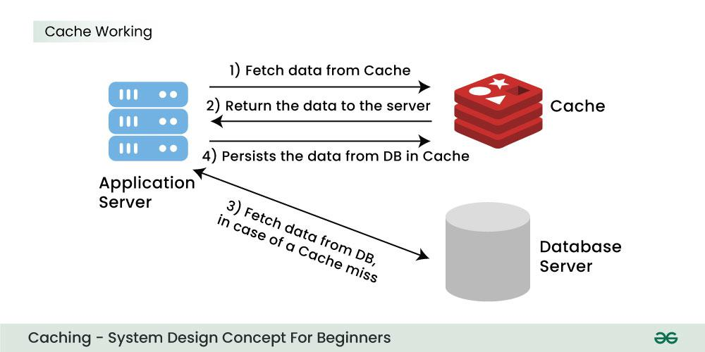

**例如：**在推特上，当一条推文爆红时，大量客户端会请求同一条推文，因此为了减少对数据库的调用次数，我们可以使用缓存，从而更快地提供推文。

### 缓存是如何工作的？

Web 应用程序将数据存储在数据库中。从数据库读取数据需要网络调用和 I/O 操作，这是一个耗时的过程。缓存可以减少对数据库的网络调用，从而提高系统性能。

- 当用户首次发出请求时，需要调用数据库来处理查询。这被称为缓存未命中。
- 在将结果返回给用户之前，结果会被保存到缓存中。
- 当用户第二次发出相同的请求时，应用程序会首先检查缓存，查看该请求的结果是否已缓存。
- 如果已缓存，则会直接从缓存中返回结果。这被称为缓存命中。
- 第二次请求的响应时间将比第一次请求的响应时间短得多。

### 为什么不将所有数据都存储在缓存中呢？

如您所知，缓存有很多优点，但这并不意味着我们会将所有信息都存储在缓存中以加快访问速度。出于多种原因，我们不能这样做，例如：

- 缓存硬件比普通数据库昂贵得多。
- 此外，如果缓存中存储大量数据，搜索时间将会增加。
- 缓存通常是易失性存储，这意味着如果系统崩溃或重启，数据将会丢失。对于关键和长期数据，仅将其存储在缓存中会带来数据丢失的风险。
- 简而言之，缓存需要根据未来即将到来的请求存储最相关的信息。

### 缓存类型

常见的缓存类型有四种：

#### 1. 应用服务器缓存

应用服务器缓存是应用服务器内部的一个存储层，用于临时保存频繁访问的数据，以便快速检索，而无需每次都访问主数据库。这有助于减轻数据库负载并加快用户响应速度，从而提高应用程序的运行速度。

**例如：**当应用频繁需要某些数据时，应用服务器可以将这些数据存储在缓存中。当用户请求数据时，应用可以立即提供缓存版本，而无需执行完整的数据库查询。

.webp>)

##### 应用服务器缓存的缺点

- 当您添加多个服务器来处理大量请求时。
- 使用多个服务器时，负载均衡器会将请求发送到不同的节点，但每个节点只有自己的缓存，无法了解其他节点上的缓存数据。
- 这会导致大量的缓存未命中，意味着数据需要频繁地重新获取，从而降低性能。

**注意：**为了解决这个问题，主要有两种方案：分布式缓存和全局缓存。

#### 2. 分布式缓存

在[分布式缓存](https://www.geeksforgeeks.org/system-design/what-is-a-distributed-cache/)中，每个节点都拥有一部分缓存空间，然后使用一致性哈希函数将每个请求路由到可以找到缓存请求的位置。

- 每个节点都拥有缓存数据的一小部分。
- 为了确定哪个节点处理哪个请求，缓存使用一致性哈希函数进行划分，以便将每个请求路由到可以找到缓存请求的位置。
- 如果请求节点正在查找某个数据，它可以快速知道在分布式缓存中哪里查找，以检查数据是否可用。

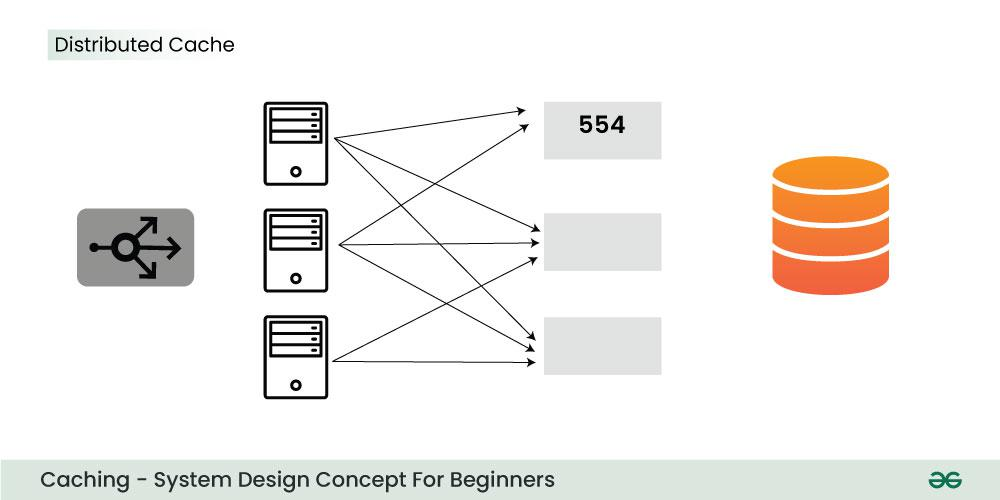

#### 3. 全局缓存

顾名思义，全局缓存是一个统一的缓存空间，所有节点都使用这个空间。所有请求都会先发送到这个缓存空间。全局缓存有两种类型：

- 第一种，当全局缓存中找不到请求的数据时，缓存会负责从底层存储（数据库、磁盘等）中查找缺失的数据。
- 第二种，如果请求到达后缓存中仍然找不到数据，则请求节点会直接与数据库或服务器通信以获取请求的数据。

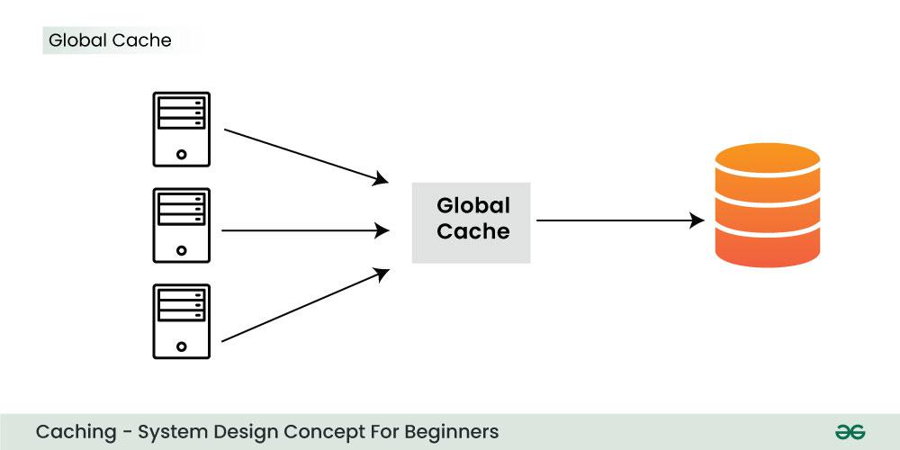

#### 4. CDN（内容分发网络）

CDN 本质上是一组战略性地部署在全球各地的服务器，旨在加速网络内容的交付。CDN：

- 管理分布在不同地理位置的服务器。
- 将网络内容存储在其服务器上。
- 尝试将每个用户定向到 CDN 中距离用户最近的服务器，以便快速交付内容。
- 适用于网站提供大量静态内容的情况。

**注意：**静态内容可以是 HTML、CSS、JavaScript 文件、图片、视频等。首先，请求会向 CDN 查询数据，如果数据存在，则会返回该数据。如果数据不存在，CDN 会查询后端服务器，然后将其缓存到本地。

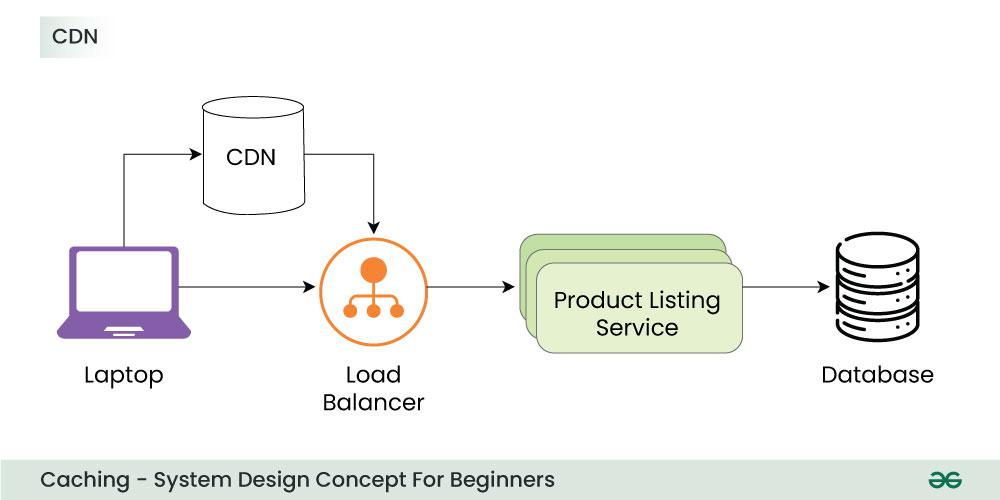

### 缓存的应用

缓存技术广泛应用于各个领域，以加快处理速度、降低负载并提高系统效率。以下是一些常见的缓存应用：

- **网页缓存：**为了加快未来的网页加载速度，浏览器会保存常用网页的副本。这可以节省带宽并缩短网页加载时间。
- **数据库缓存：**频繁的数据库查询会给服务器带来压力并导致延迟。缓存技术允许应用程序将常用数据存储在内存中，从而快速检索数据，而无需重复访问数据库。
- **内容分发网络 (CDN)：**CDN 使用缓存技术在全球多个位置保存数据副本（例如图片和视频）。这使得访问者能够更快地从附近的服务器获取内容，从而提升网站性能。
- **会话缓存：**应用程序将会话数据存储在缓存中，以便在用户访问之间记住用户信息（例如登录状态），从而提供无缝且个性化的体验，无需重新登录。
- **API 响应缓存：**频繁请求的 API 数据，例如股票价格或天气数据，可以进行缓存，从而加快响 ​​ 应速度，减轻服务器负载，并实现实时数据交付。

### 缓存失效策略

对于使用缓存来提升性能的系统而言，缓存失效至关重要。数据在缓存时会被临时保存，以便更快地访问。但是，如果原始数据发生更改，缓存版本就会失效。

- 为了确保用户获得最新信息，[缓存失效技术](https://www.geeksforgeeks.org/system-design/cache-invalidation-and-the-methods-to-invalidate-cache/)会确保过时的记录被更新或删除。
- 常见的策略包括基于时间的过期机制（缓存数据在一定时间后被丢弃）和事件驱动的失效机制（由底层数据更改触发）。
- 适当的缓存失效机制可以优化性能，避免向用户提供缓存中过时或不准确的内容。

### 缓存淘汰策略

为了使缓存系统能够有效地管理其有限的缓存容量，[淘汰策略](https://www.geeksforgeeks.org/system-design/cache-eviction-policies-system-design/)至关重要。缓存驱逐策略决定了当缓存已满且需要存储新数据时，应该移除哪个现有数据项。

- 最近最少使用 (LRU) 策略是一种常用的策略，它会移除最近访问次数最少的数据项。根据这一假设，最近使用过的数据项更有可能在不久的将来再次被使用。
- 另一种方法是最不常用 (LFU) 策略，它会移除访问频率最低的数据项。
- 此外，还有先进先出 (FIFO) 策略，它会移除缓存中最旧的数据项。

### 缓存的优点

缓存能够最大限度地利用资源、降低服务器负载并增强整体可扩展性，因此是软件开发中一项非常有用的技术。

- **性能提升：**通过显著减少获取常用数据所需的时间，缓存可以提高系统的响应速度和性能。
- **降低原始数据源的负载：**通过显著减少获取常用数据所需的时间，缓存可以提高系统的响应速度和性能。
- **成本节约：**缓存可以通过提高现有资源的效率，减少对昂贵硬件或基础设施升级的需求。

### 缓存的缺点

尽管缓存有很多优点，但也存在一些缺点，例如：

- **数据不一致：**如果缓存一致性维护不当，缓存可能会导致数据一致性问题。
- **缓存淘汰问题：**如果缓存淘汰策略设计不当，缓存可能会导致性能问题或数据丢失。
- **增加复杂性：**缓存会增加系统的复杂性，从而增加系统设计、实现和维护的难度。

## [分布式缓存](https://www.geeksforgeeks.org/system-design/what-is-a-distributed-cache/)

分布式缓存将数据存储在多个服务器（节点）上，而不是单个机器上，从而实现更快的访问速度和更好的可扩展性。它通过减少从数据库重复获取数据的次数来帮助提高应用程序性能。

- 数据分布在多个节点上，每个节点使用自己的内存以实现快速访问。
- 它易于扩展，即使某些节点发生故障，也能保持可用性。

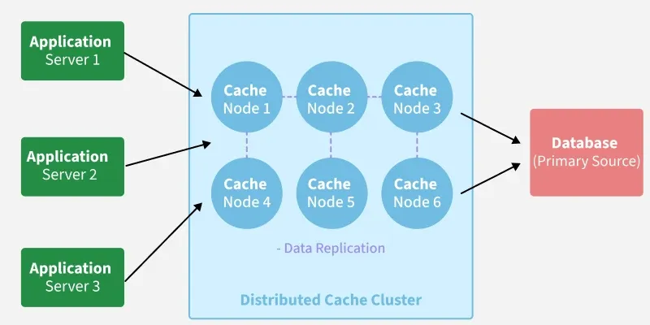

### 工作原理

以下解释了分布式缓存的典型工作原理：

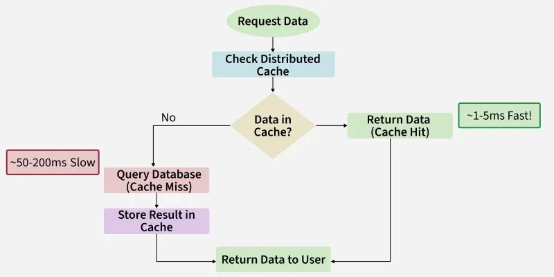

**1. 数据存储：** 每个缓存节点使用 RAM 存储缓存数据，与基于磁盘的存储相比，读写速度更快。
**2. 数据复制：** 缓存条目在多个节点上进行复制，以确保高可用性和容错性。
**3. 缓存淘汰：** 当达到内存限制时，自动移除低价值的条目。

- **LRU（最近最少使用）：** 移除长时间未访问的数据，假设这些数据再次使用的可能性较低。
- **LFU（最不常用）：** 移除访问次数最少的数据，并将常用数据保留在缓存中。
- **TTL（生存时间）：** 在固定的时间段后自动删除数据，以确保清除过期数据。
- **FIFO（先进先出）：** 无论使用频率如何，都优先移除缓存中最旧的数据。

**4. 缓存失效：** 当底层数据发生更改时，使缓存条目过期或移除，以防止读取过时的数据。
**5. 缓存一致性：** 保持所有节点上的缓存副本同步，确保更新在整个集群中生效。
**6. 缓存访问：** 应用程序使用简单的 API（GET/SET/DELETE）从最近的缓存节点检索或更新数据，从而最大限度地降低延迟。

### 组件

分布式缓存的关键组件包括：

**1. 缓存服务器或节点：** 缓存服务器是分布式缓存系统的主要组件。它们将临时数据存储在多台机器或节点上，确保数据在需要时触手可及。
**2. 缓存数据：** 这是存储在分布式缓存系统中的实际数据。它可以包含频繁访问的对象、数据库查询结果，或任何其他因存储在内存中而受益于快速访问的数据。
**3. 缓存客户端：** 应用程序使用缓存客户端与分布式缓存系统通信。它们提供了一个用于保存、检索和修改缓存数据的接口。缓存客户端通过抽象化缓存管理和与缓存节点通信的复杂性，简化了开发人员将缓存集成到应用程序中的过程。
**4. 缓存 API：** 缓存 API 为应用程序提供了一种与缓存系统交互的方式，允许它们存储、检索、更新和删除数据。
**5. 缓存管理器：** 缓存管理器负责协调缓存操作并管理分布式缓存系统的整体行为。

### 优势

使用分布式缓存方法的主要优势如下：

- 将频繁访问的数据保存在内存中，从而提升用户体验和应用程序响应速度。
- 它适用于需要高吞吐量的应用程序，因为它能够处理大量数据请求，并可向集群添加更多节点，从而实现应用程序的横向扩展而不影响性能。
- 可以将数据复制到多个节点，确保即使一个或多个节点发生故障，数据也始终可用。
- 减少了对昂贵的硬件升级或额外数据库许可的需求，使其成为扩展应用程序的一种经济高效的解决方案。
- 可以存储用户会话数据，从而提高 Web 应用程序的性能和[可扩展性](https://www.geeksforgeeks.org/system-design/what-is-scalability/)。

### 应用场景

应用程序开发人员可以在许多应用场景中使用分布式缓存来构建其架构。这些场景包括：

- **应用程序性能加速：** 将频繁访问的数据存储在内存中，以减少数据库 I/O 瓶颈，并将响应时间从数百毫秒缩短到几毫秒。
- **Web 会话数据管理：** 使购物车和偏好设置等用户会话数据可在多个应用服务器上访问，确保无论请求由哪个服务器处理，都能提供无缝的用户体验。
- **网络流量优化：** 在多个位置缓存数据，以降低带宽消耗和数据传输成本，这在采用按需付费模式的云环境中尤为重要。
- **中断期间的高可用性：** 即使主数据库不可用，也能继续处理读取请求，确保关键应用程序功能在数据库故障或维护期间保持运行。
- **地理数据分布：** 在不同区域部署缓存集群，以最小的延迟服务全球用户，确保全球范围内性能的一致性。

### 实施步骤

从选择最佳缓存解决方案到在分布式环境中进行定制和实施，设置分布式缓存涉及多个流程。以下提供一般分步说明：

- **步骤 1：** 根据应用程序需求和基础架构选择合适的分布式缓存解决方案。
- **步骤 2：** 在分布式系统中的每个节点或服务器上安装和配置缓存软件。
- **步骤 3：** 定义数据分区和复制策略，以确保高效的数据分发和高可用性。
- **步骤 4：** 将缓存解决方案与应用程序集成，确保数据读写操作都指向缓存。
- **步骤 5：** 监控并优化缓存性能，根据需要调整配置以获得最佳效果。

### 分布式缓存解决方案

一些流行的分布式缓存解决方案包括：

**1. Redis：** Redis 是一款非常流行的内存数据存储，支持缓存、数据库和消息代理。它以速度和灵活性著称，并内置数据复制和持久化选项，非常适合分布式缓存。
**2. Memcached：** Memcached 是一款轻量级的内存键值存储。它广泛用于缓存频繁访问的数据，并且易于设置，但缺少一些高级功能，例如持久化和复制。
**3. Amazon ElastiCache：** AWS 提供的一项完全托管服务，它同时支持 Redis 和 Memcached，使您能够在分布式云环境中使用缓存，而无需自行管理基础设施。
**4. Apache Ignite：** Apache Ignite 是一款内存计算平台，提供分布式缓存以及事务和实时流等高级功能。它专为高性能计算场景而设计。
**5. Hazelcast：** 一种可扩展的内存数据网格，提供分布式缓存、数据分区和故障转移功能。它常用于高度可扩展的企业级应用。

### 挑战

分布式缓存面临的一些挑战包括：

- **数据一致性：** 保持多个服务器上的缓存数据同步非常困难。如果一个缓存已更新而其他缓存未更新，则会导致数据过时或冲突。
- **缓存失效：** 决定何时删除或更新缓存非常困难。如果数据在缓存中保留时间过长，用户将获得过时的信息。
- **可扩展性：** 随着系统规模的增长，管理和协调跨多个服务器的缓存变得越来越困难，并会降低系统速度。
- **网络延迟：** 从多个位置的分布式缓存获取数据可能会引入延迟，尤其是在服务器距离较远的情况下。
- **容错性：** 如果一个缓存服务器发生故障，系统需要在不影响性能或数据可用性的情况下进行处理。在多个服务器之间平衡故障非常困难。

## [分布式缓存设计 | 系统设计](https://www.geeksforgeeks.org/system-design/design-distributed-cache-system-design/)

设计分布式缓存系统需要构建一个快速、[可扩展](https://www.geeksforgeeks.org/system-design/what-is-scalability/)且可靠的缓存层，用于存储频繁访问的数据。这有助于降低延迟并提升系统整体性能。

- 重点关注可扩展性和容错性，以应对大流量。
- 利用高效的缓存策略优化数据访问速度。

### 缓存

在计算机领域，[缓存](https://www.geeksforgeeks.org/system-design/caching-system-design-concept-for-beginners/)是一种高速存储层，用于临时存储频繁访问的数据以提高性能。与从主存储中获取数据相比，它有助于更​​快地响应后续请求。

- 存储常用或最近访问的数据。
- 通过避免从主数据源重复检索数据来降低延迟。

### 分布式缓存

[分布式缓存](https://www.geeksforgeeks.org/system-design/what-is-a-distributed-cache/)是一种将缓存数据存储在多个服务器上的技术，以提高可扩展性和性能。它可以减轻主数据库的负载并加快数据访问速度。

- 将缓存分布在多个节点上，以获得更好的可扩展性。
- 通过更快地提供频繁访问的数据来降低延迟。

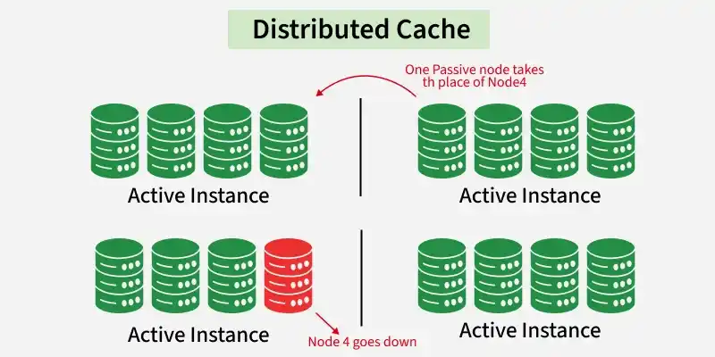

### 1. 系统需求

本节定义了分布式缓存系统应该实现的功能以及在不同条件下的性能表现。

#### 1. 分布式缓存设计的功能需求

[功能需求](https://www.geeksforgeeks.org/system-design/what-are-functional-requirements-in-system-design-examples-definition/)定义了缓存系统必须实现的功能，以满足应用程序的需求。

- **读取数据：** 快速从缓存中检索数据。
- **写入数据：** 将数据存储到缓存中。
- **驱逐策略：** 自动驱逐最近最少使用/最不常用的项。
- **复制：** 在多个节点之间复制数据以实现容错。
- **节点管理：** 动态地添加和移除缓存节点。

#### 2. 分布式缓存设计的非功能需求

[非功能需求](https://www.geeksforgeeks.org/system-design/what-are-non-functional-requirements-in-system-design-examples-definition/)定义了缓存系统在各种条件下的性能表现。

- **性能：** 读写操作的低延迟。
- **可扩展性：** 系统应能够通过添加更多节点进行横向扩展。
- **可靠性：** 确保高可用性和容错性。
- **持久性：** 根据需要持久化数据。
- **安全性：** 安全地访问缓存系统。

### 2. 用例图

用例图有助于将用户与系统之间的交互可视化。

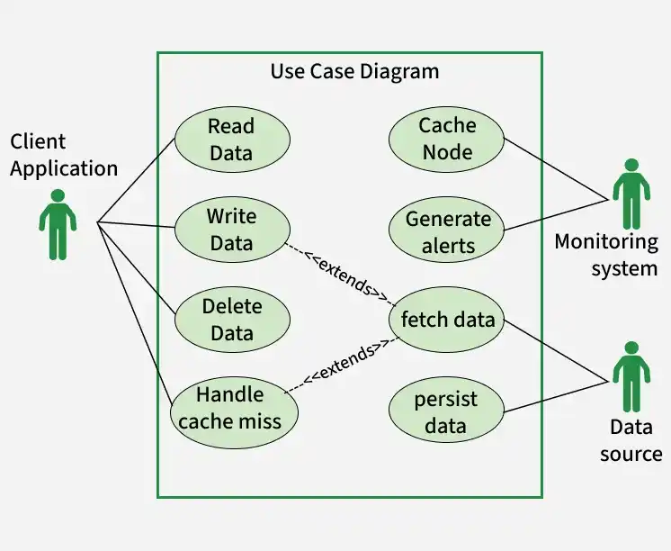

### 3. 容量估算

[容量估算](https://www.geeksforgeeks.org/system-design/capacity-estimation-in-systems-design/)包括计算系统预期负载。

#### 1. 流量估算

估算每秒的读取和写入请求数，以确保缓存能够处理预期负载。

- **读取流量：** 估算每秒的读取请求数。
- **写入流量：** 估算每秒的写入请求数。

例如，如果我们预期每秒有 10,000 次读取请求和 1,000 次写入请求，那么我们的缓存应该能够处理此负载。

#### 2. 存储空间估算

确定缓存中要存储的总数据大小。

- **数据大小：** 估算每个缓存条目的平均大小。
- **总数据量：** 计算缓存中要存储的总数据量。

如果每个条目为 1KB，并且我们有 100 万个条目，则所需的总存储空间为 1GB。

#### 3. 带宽估算

计算读取和写入操作所需的带宽。

- **读取带宽：** 计算读取操作所需的带宽。
- **写入带宽：** 计算写入操作所需的带宽。

例如，如果每次读取操作的数据量为 1KB，且每秒读取 10,000 次，则读取带宽为 10MB/s。

#### 4. 内存估算

确定每个节点和整个集群的内存需求。

- **节点内存：** 估算每个节点所需的内存量。
- **总内存：** 计算所有节点所需的总内存。

如果每个节点处理 10GB 的数据，且有 10 个节点，则总内存需求为 100GB。

### 4. 高级设计

分布式缓存系统的[高级设计](https://www.geeksforgeeks.org/system-design/what-is-high-level-design-learn-system-design/)概述了整体架构、关键组件及其交互。它着眼于全局，确保系统具有可扩展性、容错性和高效性。高级设计概述了系统的整体架构。

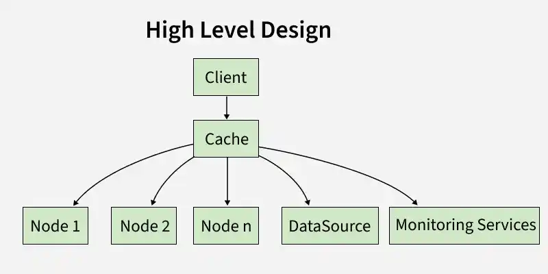

如上图所示，分布式缓存系统的高级设计概述了主要组件及其交互，以实现可扩展、容错且高效的缓存机制。关键组件包括：

- **客户端：** 客户端是指与缓存系统交互以执行读写操作并发送请求来检索或更新数据的任何应用程序或服务。
- **缓存：** 这是管理分布式缓存逻辑的核心组件，负责处理读写操作，将请求转发到相应的节点，并确保系统内数据的一致性。
- **节点（节点 1、节点 2、…、节点 n）：** 这些是独立的服务器或实例，它们使用 Redis 或 Memcached 等内存存储缓存数据，并处理对其缓存部分的读写请求。
- **数据源：** 代表持久化的后端数据库；如果发生缓存未命中，则会从数据源获取数据并缓存起来，以供后续请求使用，从而提高性能。
- **监控服务：** 负责跟踪缓存系统的性能和健康状况，收集缓存命中、未命中和节点状态等指标，以确保高效运行。

### 5. 底层设计

分布式缓存系统的[底层设计(LLD)](https://www.geeksforgeeks.org/system-design/what-is-low-level-design-or-lld-learn-system-design/)如下图所示，它详细描述了系统中每个组件的交互和职责。该设计深入探讨了具体的类或模块、它们的功能以及它们如何协作以实现所需的功能。底层设计提供了系统组件及其交互的详细描述。

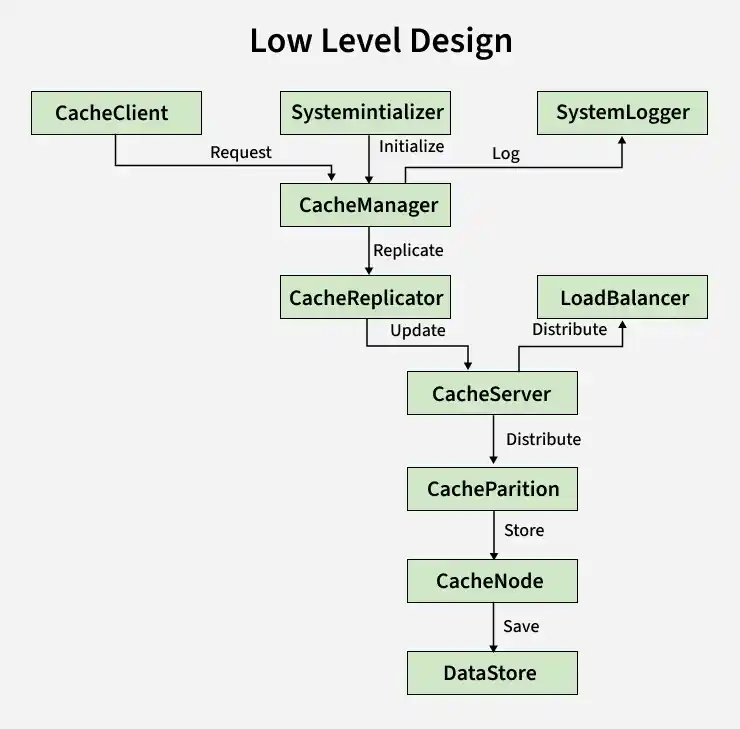

#### 底层设计组件包括：

- **CacheClient：** 发起数据检索或更新请求，并与 CacheManager 交互以执行操作。
- **SystemInitializer：** 设置并初始化缓存系统，确保所有组件配置完毕并准备好处理请求。
- **SystemLogger：** 记录系统活动和事件，用于调试和监控。
- **CacheManager：** 缓存操作的中央协调器，接收来自 CacheClient 的请求，将其转发给相应的组件，并管理整体缓存逻辑。
- **CacheReplicator：** 处理数据复制，以确保容错性以及跨多个 CacheNode 的一致复制。
- **Load Balancer：** 将传入的请求均匀分配到多个 CacheServer，以确保高效的资源利用并防止过载。
- **CacheServer：** 管理一个或多个 CachePartition，并充当 CacheManager 和 CachePartition 之间的中介。
- **缓存分区 (CachePartition)：** 缓存服务器 (CacheServer) 的一个子分区，用于存储缓存数据的子集，并确保数据的正确存储和检索。
- **缓存节点 (CacheNode)：** 缓存分区内的实际存储实体，将数据存储在内存中，并处理 CRUD 操作。
- **数据存储 (DataStore)：** 持久化后端数据库，提供持久存储，并在缓存未命中时作为备用方案。

### 6. 数据库设计

分布式缓存系统将内存存储与后端数据库相结合，以提供快速的数据访问和持久性。其设计确保数据一致性、容错性和高效的缓存管理，通常与数据库集成以实现持久化。

#### 缓存条目表 (CacheEntry Table)

- **用途：** 持久存储缓存数据。
- **key：** 每个缓存条目的唯一标识符，确保缓存中的唯一性。
- **value：** 实际的缓存数据，通常以文本或二进制格式存储。
- **expiration_time：** 缓存条目失效的时间戳，用于辅助缓存驱逐。
- **created_at：** 缓存条目创建时间戳，用于审计和管理。
- **updated_at：** 缓存条目上次更新时间戳，修改后自动刷新。

上述数据库表的 SQL 语句：

```sql
CREATE TABLE CacheEntry (
    key VARCHAR(255) PRIMARY KEY,
    value TEXT,
    expiration_time TIMESTAMP,
    created_at TIMESTAMP DEFAULT CURRENT_TIMESTAMP,
    updated_at TIMESTAMP DEFAULT CURRENT_TIMESTAMP ON UPDATE CURRENT_TIMESTAMP
);
```

### 7. 微服务和 API

在分布式缓存系统中，微服务在确保模块化、[可扩展性](https://www.geeksforgeeks.org/system-design/what-is-scalability/)和可维护性方面发挥着至关重要的作用。每个微服务处理一组特定的功能，并通过定义完善的 API 与其他微服务进行交互。

#### 1. 缓存服务

缓存服务负责处理缓存的读写操作。

##### 1. 设置缓存数据 API：

```txt
端点：POST /cache
```

**请求：**

```json
{
  "key": "string",
  "value": "string",
  "ttl": "integer" // Time-to-live in seconds
}
```

**响应：**

```json
{
  "status": "success",
  "message": "Data cached successfully."
}
```

##### 2. 获取缓存数据 API：

```txt
端点：GET /cache/{key}
```

**请求：** 无（key 是 URL 的一部分）

**响应：**

```json
{
  "key": "string",
  "value": "string",
  "ttl": "integer" // Remaining time-to-live in seconds
}
```

##### 3. 删除缓存数据 API：

```txt
端点：DELETE /cache/{key}
```

**请求：** 无（key 是 URL 的一部分）

**响应：**

```json
{
  "status": "success",
  "message": "Data deleted successfully."
}
```

#### 2. 数据复制服务

数据复制服务负责管理跨多个缓存节点的数据复制，以确保数据可用性和容错能力。

##### 1. 数据复制 API：

```txt
端点：POST /replicate
```

**请求：**

```json
{
  "key": "string",
  "value": "string"
}
```

**响应：**

```json
{
  "status": "success",
  "message": "Data replicated successfully."
}
```

##### 2. 获取复制状态 API

```txt
端点：GET /replication/status/{key}
```

**请求：** 无（key 是 URL 的一部分）

**响应：**

```json
{
  "key": "string",
  "replication_status": "string" // e.g., "completed", "in_progress", "failed"
}
```

#### 3. 节点管理服务

节点管理服务负责缓存节点的添加和移除，确保系统能够动态扩展。

##### 1. 添加节点 API

```txt
端点：POST /node/add
```

**请求：**

```json
{
  "node_id": "string",
  "node_address": "string"
}
```

**响应：**

```json
{
  "status": "success",
  "message": "Node added successfully."
}
```

##### 2. 删除节点 API

```txt
端点：DELETE /node/remove/{node_id}
```

**请求：** 无（node_id 是 URL 的一部分）

**响应：**

```json
{
  "status": "success",
  "message": "Node removed successfully."
}
```

#### 4. 协调器服务

协调器服务负责管理缓存节点的哈希一致性、重新平衡和整体协调。

##### 1. 重新平衡数据 API

```txt
端点：POST /rebalance
```

**请求：**

```json
{
  "action": "start" // or "stop" to halt rebalancing
}
```

**响应：**

```json
{
  "status": "success",
  "message": "Rebalancing initiated."
}
```

##### 2. 获取重新平衡状态

```txt
端点：GET /rebalance/status
```

**请求：** 无

**响应：**

```json
{
  "rebalance_status": "string" // e.g., "in_progress", "completed", "not_started"
}
```

#### 5. 监控与管理服务

此服务跟踪缓存系统的性能指标和运行状况，为管理员提供洞察信息。

##### 1. 获取缓存指标 API

```txt
端点：GET /metrics
```

**请求：** 无

**响应：**

```json
{
  "cache_hits": "integer",
  "cache_misses": "integer",
  "node_health": [
    {
      "node_id": "string",
      "status": "string" // e.g., "healthy", "unhealthy"
    }
  ]
}
```

##### 2. 获取节点健康状况

```txt
端点：GET /node/health/{node_id}
```

**请求：** 无（node_id 是 URL 的一部分）

**响应：**

```json
{
  "node_id": "string",
  "status": "string" // e.g., "healthy", "unhealthy"
}
```

#### 8. 分布式缓存设计的可扩展性

为确保可扩展性，系统应支持水平扩展、负载均衡和高效数据分发。

- **水平扩展：** 动态地向缓存集群添加节点，并使用一致性哈希算法重新平衡数据，以最大限度地减少节点移动。
- **负载均衡：** 使用负载均衡器将客户端请求均匀地分配到各个缓存节点。
- **高效数据分发：** 使用一致性哈希算法将数据均匀地分配到各个节点，从而减少重新平衡的次数。

## [边缘缓存 - 系统设计](https://www.geeksforgeeks.org/system-design/edge-caching-system-design/)

边缘缓存将用户频繁访问的数据存储在用户附近（例如，CDN 或边缘服务器），以减少数据传输距离。它通过从附近位置而非中央服务器提供数据，实现更快的访问速度和更低的延迟，从而提升整体性能。

- 将数据存储在用户附近，以降低延迟、提高响应速度并加快内容访问速度。
- 减少中央服务器的负载和带宽使用，通常用于 CDN 中静态和频繁访问的数据。

**示例：** 当您在 YouTube 上观看视频时，视频加载速度很快，因为视频是从附近的 CDN 边缘服务器而不是远处的中央服务器提供的。

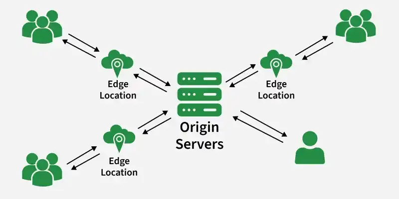

在上图中：

- 用户将请求发送到最近的边缘节点，而不是直接发送到源服务器，从而降低延迟并提高速度。
- 如果数据已存储在缓存中（缓存命中），则立即返回；否则（缓存未命中），则从源服务器获取数据并存储到缓存中。
- 源服务器提供原始数据，而边缘节点处理重复请求，从而减轻主服务器的负载并提高整体性能。

### 实际应用

边缘缓存已成为各行各业各种实际应用的关键组件，可提升性能和用户体验。以下是一些值得注意的应用案例：

- **内容分发网络 (CDN)：** Akamai、Cloudflare 和 Amazon CloudFront 等平台使用边缘缓存，通过将数据存储在全球分布式边缘服务器上，更快地交付 Web 内容、视频和更新。
- **视频流媒体服务：** Netflix 和 YouTube 等平台在边缘节点缓存热门视频，减少缓冲，即使在高流量期间也能确保流畅播放。
- **电子商务网站：** 亚马逊和 eBay 等平台会缓存产品图片、描述和静态内容，以在高峰时段提升页面加载速度和用户体验。
- **在线游戏：** 堡垒之夜等游戏以及 Xbox Live 等平台使用边缘缓存将游戏资源存储在更靠近玩家的位置，从而减少延迟并提升实时游戏体验。
- **物联网应用：** 智慧城市和工业物联网系统使用边缘缓存将传感器数据本地存储和处理，无需与中央服务器持续通信即可更快地做出实时决策。
- **社交媒体平台：** Facebook 和 Instagram 等平台会在边缘位置缓存用户生成的内容（图片、视频），以确保信息流和帖子快速加载。

### 组件

边缘缓存包含多个关键组件，它们协同工作以优化内容分发并提升系统性能。以下是主要组件：

- **边缘节点：** 靠近用户的分布式服务器，用于在本地存储缓存内容，以降低延迟并提升速度。
- **缓存机制：** LRU、LFU 和 TTL 等策略决定缓存哪些数据、缓存时间以及何时清除缓存。
- **内容分发网络 (CDN)：** 由地理位置分散的边缘服务器组成的网络，可高效地复制和分发内容。
- **负载均衡器：** 将传入流量分配到各个边缘节点，以防止过载并确保高性能。
- **数据同步：** 使用缓存失效、定期刷新或推送更新等技术保持缓存数据的最新状态。
- **边缘计算：** 在用户附近处理数据，以降低延迟并实现更快的实时响应。
- **安全组件：** 使用加密和身份验证来保护缓存数据并确保安全访问。
- **分析与监控：** 跟踪缓存性能、用户行为和使用模式，以优化分发。
- **API：** 实现边缘节点和中央服务器之间的通信，用于获取和更新数据。
- **用户设备：** 终端设备请求内容，并且可能存储本地缓存以提高访问速度。

### 工作原理

边缘缓存的工作原理是将内容存储在更靠近用户的位置，并从附近的边缘节点处理请求，而不是每次都访问中央服务器，从而降低延迟并提高性能。

#### 1. 请求流程

每当客户端发送 HTTP 请求时，系统首先会检查该请求是否符合从边缘缓存中提供服务的条件（基于缓存规则，例如 TTL、标头等）。如果请求符合缓存条件，则最近的边缘节点会检查其本地缓存中是否存在请求的内容。这减少了每次请求都访问中央服务器的需要。

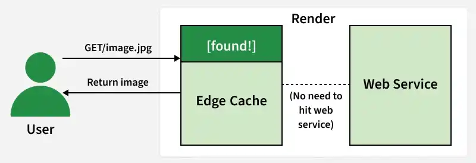

#### 2. 缓存命中（快速路径）

如果请求的内容已存在于边缘缓存中且未过期，则直接提供给用户。

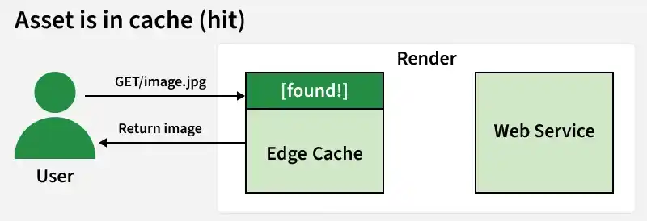

在这种情况下，请求不会到达中央服务器，从而加快响​​应速度并降低后端负载。

#### 3. 缓存未命中（回退路径）

如果缓存中没有所需内容（缓存未命中），边缘节点会将请求转发到中央服务器以获取数据。

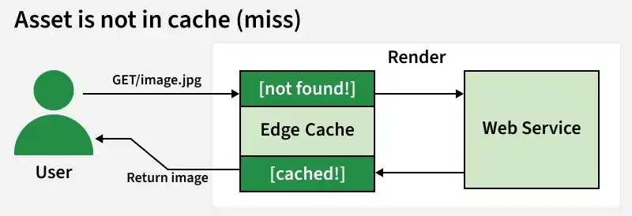

数据检索完成后，会返回给用户，同时也会存储在缓存中以供后续请求使用。

#### 4. 缓存管理与更新

为了保持性能和数据新鲜度，系统应用了多种缓存技术，例如 TTL（过期时间）、缓存淘汰策略（LRU/LFU）和缓存失效机制。边缘节点还会定期与中央服务器同步，以更新过时的内容。

#### 5. 优化

系统持续监控缓存命中率、未命中率和用户行为，以优化缓存策略，确保边缘节点始终能够访问常用内容。

### 重要性

边缘缓存因其以下几个关键优势，在现代系统设计中扮演着至关重要的角色：

- **降低延迟：** 通过将内容存储在更靠近用户的位置，边缘缓存可以最大限度地缩短数据检索时间。这对于需要实时响应的应用（例如在线游戏、视频流媒体和交互式 Web 应用）尤为重要。
- **提升用户体验：** 更快的加载速度带来更流畅的用户体验，从而降低用户挫败感和放弃率。利用边缘缓存的网站和应用程序即使在高峰使用时段也能保持高性能。
- **带宽优化：** 边缘缓存通过在本地提供缓存内容，减少了需要通过核心网络传输的数据量。这可以缓解网络拥塞，降低带宽成本，并提高整体网络效率。
- **可扩展性：** 随着用户需求的增长，边缘缓存使系统能够更有效地扩展。通过将请求从中央服务器卸载到本地缓存，系统可以在不降低性能的情况下处理更多并发用户。
- **更高的可靠性：** 即使中央服务器出现故障或网络问题，边缘缓存也能继续提供内容。这种冗余增强了系统可靠性，并确保内容的持续可用性。

### 挑战

虽然边缘缓存具有显著优势，但也带来了一些必须在系统设计中解决的挑战。以下是与边缘缓存相关的一些主要挑战：

- **边缘缓存的挑战：** 增加了在分布式节点上维护一致性、性能和高效资源利用的复杂性。
- **缓存一致性：** 保持边缘缓存数据与中央服务器同步十分困难，容易导致内容过时或陈旧。
- **缓存清除策略：** 缓存满时选择要清除哪些数据非常复杂；策略不当会增加缓存未命中率。
- **网络差异：** 不同区域的网络状况（延迟、带宽）会影响性能和可靠性。
- **管理复杂性：** 需要高级监控、分析和维护才能有效管理分布式边缘节点。
- **存储空间有限：** 边缘节点内存有限，因此需要高效的缓存策略来仅存储有用数据。
- **地理分布：** 节点分布广泛，使得数据同步和更新更具挑战性，且资源消耗更大。

### 实施策略

有效实施边缘缓存需要周全的规划，以确保最佳性能、可靠性和安全性。以下是一些成功实施边缘缓存的最佳实践：

- **定义清晰的缓存策略：** 制定具体的缓存策略，明确缓存哪些内容、缓存时长（生存时间，TTL）以及何时刷新或使缓存内容失效。这有助于维护缓存的一致性和性能。
- **使用智能缓存算法：** 实施高效的缓存算法，例如最近最少使用 (LRU)、最不常用 (LFU) 或自适应缓存方法。这些算法可以根据使用模式确定缓存中保留内容的优先级。
- **优化内容选择：** 仅缓存访问频率最高且对性能要求最高的内容。利用分析工具识别热门内容和用户行为，确保缓存为用户提供相关内容。
- **实施缓存失效策略：** 开发缓存失效机制，确保及时删除或更新过时的内容。当底层内容发生更改时，使用推送通知或轮询来刷新缓存条目。
- **监控性能和使用情况：** 持续监控缓存性能和用户交互。使用分析工具收集缓存命中率、响应时间和内容使用模式等数据，以指导优化。

### 边缘缓存在微服务架构中的作用

边缘缓存在提升[微服务架构](https://www.geeksforgeeks.org/system-design/microservices/)的性能和效率方面发挥着重要作用。以下是它如何为该架构模型做出贡献：

- **边缘缓存在微服务中的作用：** 通过减少对后端的依赖并将数据更靠近用户，提高性能、可扩展性和可靠性。
- **降低延迟：** 在微服务中，多个服务通过网络进行通信；边缘缓存将频繁访问的数据存储在更靠近用户的位置，从而减少数据传输距离并缩短响应时间。
- **提升性能：** 通过缓存响应（例如图像、配置或静态数据），边缘缓存可以更快地交付数据，而无需重复调用后端微服务。
- **负载均衡：** 边缘节点通过提供缓存的内容来处理一部分用户请求，从而减轻核心微服务的负载，使其能够专注于复杂的处理。
- **增强弹性：** 即使某个微服务不可用，边缘缓存仍可提供先前缓存的数据，确保服务连续性并提升用户体验。
- **可扩展性：** 随着流量增长，边缘缓存支持横向扩展，可将请求从中心服务卸载到分布式边缘节点。
- **带宽优化：** 减少发送到后端服务的重复请求次数，降低带宽使用量和成本，尤其是在云环境中。

## [CDN 与边缘服务器 - 系统设计](https://www.geeksforgeeks.org/system-design/cdn-vs-edge-server-system-design/)

CDN 和边缘服务器都能通过将数据更靠近用户来提升性能。CDN 专注于快速内容分发，而边缘服务器则在用户附近进行数据处理。

- CDN 主要从分布式服务器分发静态且访问频繁的内容，从而降低延迟和服务器负载。
- 边缘服务器不仅存储数据，还能在更靠近用户的位置处理请求，实现更快的实时响应。

### CDN（内容分发网络）

[内容分发网络(CDN)](https://www.geeksforgeeks.org/system-design/what-is-content-delivery-networkcdn-in-system-design/)是一个分布式服务器网络，分布在不同位置，用于高效地分发 Web 内容和服务。其主要目标是通过从更靠近用户的服务器提供数据来降低延迟，从而最大限度地减少数据传输距离。

- CDN 缓存静态资源，例如图像、视频、样式表和脚本，确保全球用户都能获得更快的加载速度。CDN 通常用于提升网站性能、降低服务器负载并增强整体用户体验。
- 常用的 CDN 包括 Cloudflare、Akamai 和 AWS CloudFront。

#### 优势

CDN 通过将内容分发到更靠近用户的位置来提高性能和可靠性。

- 内容从最近的服务器提供，从而降低延迟。
- 缓存减少了对源服务器的多次请求。
- CDN 通常具有冗余性，即使部分服务器宕机，也能确保网站可用。

#### 劣势

CDN 会带来成本和复杂性，尤其是在处理动态内容时。

- CDN 可能很昂贵，尤其是在大规模使用时。
- 当内容缓存在不同位置时，管理内容更新可能很复杂。
- CDN 更适合静态内容，例如图像、CSS 或视频。

### 边缘服务器

[边缘服务器](https://www.geeksforgeeks.org/cloud-computing/what-is-edge-architecture/)位于网络边缘，更靠近最终用户或设备，用于处理数据、执行计算任务和存储内容。其主要目的是通过在本地处理任务来降低延迟，最大限度地减少与远程数据中心来回发送数据的需求。

- 边缘服务器通常用于实时数据处理、物联网应用和本地化内容分发，从而提升性能和用户体验。
- 它们在边缘计算中扮演着关键角色，边缘计算是指在数据源附近进行计算。

#### 优势

边缘计算通过在更靠近用户的位置处理数据来提高性能。

- 边缘服务器距离用户更近，从而最大限度地减少延迟。
- 通过在边缘处理数据，可以减轻集中式数据中心的负载。
- 借助边缘服务器，系统可以在不占用过多中央资源的情况下处理更多用户。

#### 劣势

边缘计算带来了复杂性、成本和安全方面的挑战。

- 设置和维护多个边缘服务器可能具有挑战性。
- 数据分散化会在多个位置引入新的安全风险。
- 边缘计算基础设施的部署和管理成本可能很高。

### CDN 架构

CDN 不是单个服务器，而是一个由分布式边缘服务器组成的全球网络。多个 CDN 提供商在同一国家/地区运营，每个 CDN 由分布在不同城市的多个边缘服务器组成，以便高效地为用户提供服务。

- **CDN：** 公司/网络（例如 Cloudflare、Akamai、Amazon CloudFront）
- **边缘服务器：** CDN 内部的物理服务器

**示例（印度）：** Cloudflare：在德里、孟买和班加罗尔拥有众多边缘服务器

### CDN 与边缘服务器

以下是 CDN 和边缘服务器的区别：

| CDN                          | 边缘服务器                         |
| ---------------------------- | ---------------------------------- |
| 降低静态内容的延迟           | 降低处理和动态数据的延迟           |
| 全球分发内容                 | 在用户附近处理数据                 |
| 全球分布式服务器             | 靠近用户/设备                      |
| 最适合静态内容（图像、视频） | 最适合实时处理（物联网、应用程序） |
| 主要用于缓存和分发           | 可以处理和分析数据                 |
| 订阅式定价                   | 部署和维护成本高                   |

## [缓存淘汰策略 | 系统设计](https://www.geeksforgeeks.org/system-design/cache-eviction-policies-system-design/)

缓存淘汰是指当缓存已满时，从中移除数据以腾出空间存储新的或更相关的数据的过程。它确保有限的缓存内存得到高效利用，同时保持常用数据的可用性。

- 当缓存达到容量上限时，移除不太有用或过时的数据，从而保持高效的内存使用。
- 使用 LRU、LFU 和 FIFO 等策略来决定要淘汰哪些数据，以提高性能。

**例如：** 在 YouTube 中，如果缓存了大量视频且内存已满，则会移除不太有用或最近访问较少的视频，以便保留常用视频并加快加载速度。

### 缓存淘汰策略

一些最重要和最常见的缓存淘汰策略包括：

#### 1. 最近最少使用 (LRU)

LRU（最近最少使用）是一种缓存淘汰策略，当缓存已满时，它会移除访问时间最长的数据项。它假设最近使用的数据更有可能再次使用，因此它会跟踪访问顺序并驱逐最近最少使用的项目。

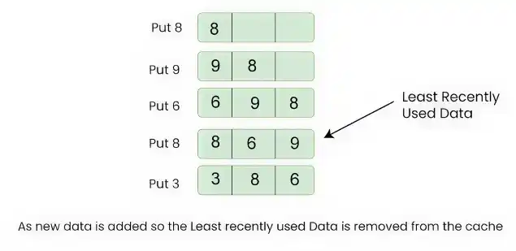

##### 示例

假设一个最大容量为 3 的缓存，初始时依次包含 A、B 和 C 这三个元素。

- 如果访问新元素 D，缓存即满，LRU 策略会将最近最少使用的元素 A 驱逐出去，因为与 B 和 C 相比，A 的访问时间较晚。此时缓存包含元素 B、C 和 D。
- 如果接下来访问元素 B，则顺序变为 C、D、B。
- 如果访问另一个元素 E，缓存再次满，LRU 策略会将 C 驱逐出去，最终缓存包含元素 D、B 和 E。此时顺序变为 B、E、D。

LRU 策略确保最近访问的元素保留在缓存中，尤其适用于近期访问模式能够预测未来访问的场景。

##### 优势

LRU 策略提供了一种简单有效的缓存管理方法，能够保持最近使用的数据可用。

- **易于实现：** LRU 策略易于理解和实现，因此是许多缓存应用的理想选择。
- **高效利用缓存：** 当前访问能够可靠地预测未来访问时，LRU 算法效果显著。它确保最近访问过的项保留在缓存中，无论它们之前的访问频率如何。
- **适应性强：** LRU 算法适用于各种类型的应用程序，包括数据库、Web 缓存和文件系统。

##### 缺点：

当访问模式不可预测或资源受限时，LRU 算法存在一些局限性。

- **严格的顺序性：** LRU 算法假设访问顺序能够准确反映项的未来可用性。在某些情况下，此假设可能不成立，导致缓存策略并非最优。
- **冷启动问题：** 当缓存初始填充时，LRU 算法可能无法发挥最佳性能，因为它需要足够的历史数据来做出合理的淘汰决策。
- **内存开销：** 实现 LRU 算法通常需要额外的内存来存储时间戳或维护访问顺序，这会影响系统的整体内存消耗。

##### 应用场景

LRU 算法广泛应用于那些能够利用近期数据访问模式来提升性能和速度的系统中。

- **Web 缓存：** LRU 算法通常用于存储频繁访问的网页、图片或资源。它通过保持最近使用的内容随时可用来降低延迟，从而提升网站的整体性能。
- **数据库管理：** LRU 算法常用于数据库系统中，用于缓存查询结果或频繁访问的数据页面。它通过将最近使用的数据保存在内存中来加快查询响应速度，减少了从速度较慢的磁盘存储中获取数据的需要。
- **文件系统：** 文件系统在缓存文件元数据或目录信息时可以从 LRU 算法中受益。频繁访问的文件和目录会被保留在缓存中，从而提高文件访问速度并降低底层存储的负载。

#### 2. 最少使用 (LFU) 算法

在 LFU 缓存淘汰策略中，访问频率最低的条目会首先被清除。其基本思想是：使用频率最低的内容，以后也不太可能需要。当缓存已满时，LFU 会跟踪每个项目的访问次数，然后删除访问频率最低的项目。

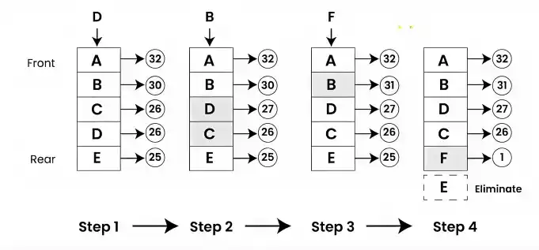

##### 示例

考虑一个包含元素 X、Y 和 Z 的缓存。如果元素 Z 的访问次数少于元素 X 和 Y，则 LFU 策略将保留元素 X 和 Y，并在缓存达到容量上限时可能将元素 Z 驱逐出缓存。

##### 优点

LFU 适用于那些访问频率随时间变化比近期访问更重要的系统。

- **适应不同的访问模式：** LFU 在某些元素访问频率较低但仍然至关重要的场景中非常有效。它能够很好地适应不同的访问模式。
- **针对长期趋势优化：** 当元素的相关性与其近期访问次数相比，其随时间变化的总体访问频率更能体现时，LFU 可能更有优势。
- **内存开销低：** 由于 LFU 不需要维护时间戳，因此它的内存开销可能比某些 LRU 实现更低。

##### 缺点

LFU 可能难以处理动态工作负载，并且需要仔细实现访问频率跟踪。

- **对初始访问的敏感性：** 在访问频率尚未建立的初始阶段，LFU 的性能可能并非最佳。它依赖于历史访问模式，因此，对于新数据或访问频率较低的数据项，可能要等到其长期访问频率建立后才会保留在缓存中。
- **难以处理不断变化的访问模式：** 在访问模式频繁变化的场景下，LFU 可能会遇到困难。曾经访问频繁但现在已不再相关的数据项可能仍然保留在缓存中。
- **频率计数器的复杂性：** 为数据项实现精确的频率计数会增加 LFU 实现的复杂性。

##### 应用场景

LFU 适用于长期访问模式比近期活动更重要的系统。

- **数据库查询缓存：** 在数据库管理系统中，LFU 可用于缓存查询结果或频繁访问的数据。
- **网络路由表：** LFU 可用于缓存网络应用程序的路由信息​​。代表不常用路由的数据项会保留在缓存中，从而可以根据历史使用情况做出高效的路由决策。
- **内容推荐：** 在内容推荐系统中，低访问频率（LFU）可用于缓存用户偏好或内容建议信息。它确保即使是访问频率较低的推荐内容也会随着时间的推移而被考虑在内。

#### 3. 先进先出（FIFO）

先进先出（FIFO）是一种缓存淘汰策略，当缓存已满时，它会移除缓存中最旧的条目。在这种策略中，数据按照到达顺序存储在缓存中，当缓存达到容量上限时，缓存中存在时间最长的条目将首先被移除。

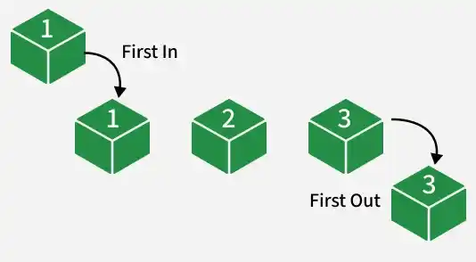

##### 示例

假设一个缓存容量为三个物品：

1. A 被添加到缓存中。
2. B 被添加到缓存中。
3. C 被添加到缓存中。

此时，缓存已满（容量 = 3）。

如果需要添加新物品 D，先进先出 (FIFO) 策略会规定先移除最旧的物品 A。此时缓存的状态如下：

- D 被添加到缓存中（A 被移除）。
- 缓存中物品的顺序变为 B、C 和 D，反映了它们到达缓存的时间顺序。

##### 优点

FIFO 简单且可预测，因此适用于基于顺序的移除操作。

- **易于实现：** FIFO 易于实现，因此是注重简洁性的场景的理想选择。
- **行为可预测：** FIFO 中的移除过程是可预测的，并严格按照进入缓存的时间顺序进行。
- **内存效率：** 由于 FIFO 无需额外跟踪时间戳和访问频率，因此与其他一些缓存淘汰策略相比，其内存开销相对较小。

##### 缺点

FIFO 不考虑使用模式，这可能导致缓存决策效率低下。

- **适应性不足：** FIFO 可能无法很好地适应不同的访问模式。它严格遵循进入顺序，但这可能无法反映数据项的实际重要性或相关性。
- **处理可变重要性时的效率低下：** 当新数据项比旧数据项更重要或访问频率更高时，FIFO 可能会导致效率低下。
- **冷启动问题：** 在缓存初始填充或缓存刷新后，FIFO 的性能可能并非最佳，因为它倾向于仅根据数据项的进入时间将其保留在缓存中，而不考虑其实际使用情况。

##### 应用场景

FIFO 适用于维护顺序比优化访问模式更重要的场景。

- **操作系统中的任务调度：** 在任务调度中，可以使用先进先出 (FIFO) 来确定进程或任务的执行顺序。
- **消息队列：** 在消息队列系统中，FIFO 保证消息按照接收顺序进行处理。对于依赖消息通信的应用来说，这对于保持进程顺序至关重要。
- **流式应用缓存：** 对于某些对数据顺序要求极高的流式应用，FIFO 可能非常适用。例如，FIFO 可以保证视频流缓存中的帧按正确的顺序显示。

#### 4. 随机替换

随机替换是一种缓存淘汰策略。当缓存已满且需要存储新项时，会随机选择一个现有项来释放空间。与 LRU（最近最少使用）或 FIFO（先进先出）等确定性策略不同，后者具有选择要淘汰项的特定标准，而随机替换只是随机选择一个项。

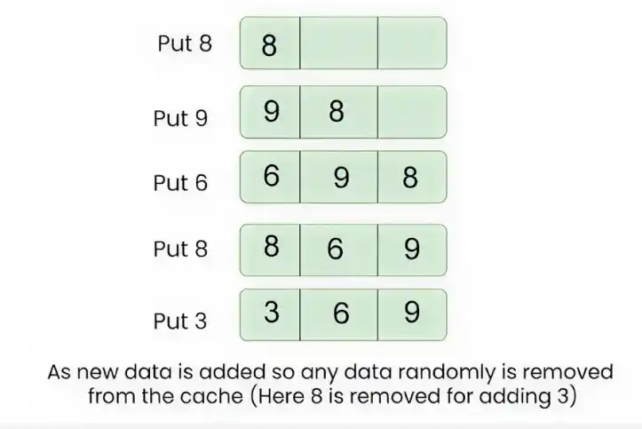

##### 示例

考虑一个包含三个槽位的缓存，其中存储着以下数据：

```txt
1. Item A
2. Item B
3. Item C
```

现在，如果缓存已满，需要存储新项目 D，随机替换策略可能会选择移除项目 B，结果如下：

```txt
1. Item A
2. Item D
3. Item C
```

在这种策略中，移除项目 B 完全是随机的，因此与其他策略相比，它虽然简单直接，但可预测性较差。

##### 优点

随机替换简单高效，适用于对开销要求较低的系统。

- **简单性：** 随机替换是一种简单易行的策略，无需复杂的访问模式跟踪或分析。
- **避免偏差：** 由于随机替换不依赖于历史使用模式，因此避免了确定性策略中可能出现的潜在偏差。
- **低开销：** 该算法的计算开销极小，因此在处理需求方面非常高效。

##### 缺点

随机替换忽略了使用模式，这可能会降低缓存效率。

- **性能欠佳：** 与更复杂的策略相比，随机替换可能导致缓存性能欠佳。它没有考虑实际的使用模式或未来访问的可能性。
- **缺乏适应性：** 它缺乏对不断变化的访问模式的适应性。其他淘汰策略，例如 LRU 或 LFU，会考虑项的历史行为并适应不断变化的模式，从而随着时间的推移提供更好的缓存性能。
- **命中率可能较低：** 随机淘汰的特性可能导致命中率较低，即频繁访问的项会被意外淘汰，从而导致更多的缓存未命中。

##### 应用场景

随机替换适用于资源有限或简单的环境，在这些环境中，效率比优化更重要。

1. **非关键缓存环境：** 在缓存未命中影响很小或缓存用于非关键用途（例如临时存储非必要数据）的情况下，随机替换可能就足够了。
2. **仿真与测试：** 在测试场景和仿真环境中，如果简单易用比复杂的驱逐策略更重要，则随机替换非常有用。
3. **资源受限系统：** 在计算资源有限的资源受限环境中，随机替换的低开销可能更具优势。

## [系统设计中的冷缓存和热缓存](https://www.geeksforgeeks.org/system-design/cold-and-warm-cache-in-system-design/)

[缓存](https://www.geeksforgeeks.org/system-design/caching-system-design-concept-for-beginners/)是一种将频繁访问的数据存储在临时层中的技术，旨在加快数据检索速度并降低延迟。它通过减少重复的数据获取和降低后端负载来提升性能。了解冷缓存（空缓存）和热缓存（预加载缓存）有助于优化响应时间。

- 将频繁访问的数据存储在更靠近用户或应用程序的位置，从而提高访问速度。
- 降低延迟、带宽使用量和后端负载；冷缓存初始速度较慢，而热缓存可以加快重复请求的速度。

**例如：** 当您第一次在 YouTube 上打开视频时，加载速度较慢（冷缓存），但稍后重新打开时速度会更快，因为数据已被缓存（热缓存）。

### 冷缓存

冷缓存是新初始化的缓存，几乎没有数据，因此大多数请求都会导致缓存未命中，需要从后端获取数据，从而导致性能下降。

- 大多数请求都会导致缓存未命中。 （缓存中未找到数据）
- 数据从后端（数据库/主存储）获取，速度较慢。
- 由于重复获取数据，导致延迟更高，后端系统负载增加。

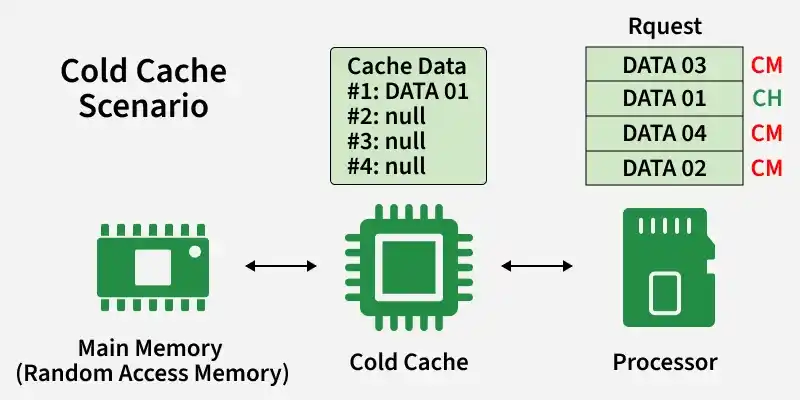

#### 挑战

冷缓存会导致初期性能问题，因为缓存数据不足。

- **高延迟：** 频繁的缓存未命中会导致响应时间延长。
- **负载增加：** 主存储系统需要处理更多请求，从而增加其负载。
- **用户体验：** 响应速度变慢可能会导致用户体验下降。

#### 应用场景

冷缓存通常发生在系统全新或近期重启时。

- **系统启动：** 系统或应用程序首次启动时，其缓存通常为冷缓存。
- **灾难恢复：** 系统故障恢复后，缓存通常为冷缓存。
- **新系统部署：** 新部署的系统启动时缓存为冷缓存。

#### 实际案例

冷缓存常见于数据从未被访问过的情况。

- **首次访问网站：** 用户首次访问网站时，其浏览器缓存基本上为冷缓存。它不包含任何之前访问过的网站数据，因此每个资源（图像、脚本、样式表）都需要从服务器获取，导致加载时间更长。
- **刚启动的应用程序：** 当计算机应用程序在系统启动后立即启动时，其缓存是冷的。它没有存储任何先前会话的数据，因此需要从磁盘或网络获取数据，导致初始性能较慢。

### 热缓存

热缓存包含频繁访问的数据，从而提高缓存命中率和响应速度。它减少了对后端系统的依赖，并提高了整体性能。

- 大多数请求直接从缓存中处理，减少了对数据库或服务的调用。
- 降低了后端负载和延迟，从而加快了响应速度。

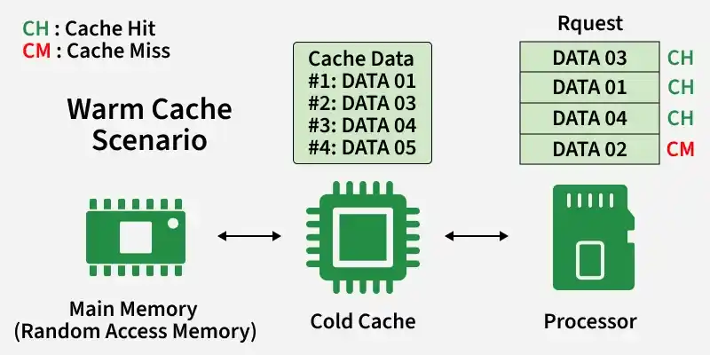

#### 挑战

热缓存系统面临数据准确性、一致性和资源高效利用方面的挑战。

- **缓存失效：** 确保从缓存中移除过期或失效的数据。
- **一致性：** 维护缓存和主存储之间的数据[一致性](https://www.geeksforgeeks.org/system-design/consistency-in-system-design/)。
- **资源利用率：** 管理缓存使用的内存和存储资源。

#### 应用场景

热缓存广泛应用于对频繁访问数据速度要求极高的系统中。

- **Web 服务器：** 频繁访问的网页和资源可受益于热缓存。
- **数据库系统：** 存储在热缓存中的查询结果可降低数据库负载并缩短响应时间。
- **内容分发网络 (CDN)：** 配备热缓存的 CDN 通过将热门内容存储在更靠近用户的位置，从而更快地向用户提供内容。

##### 实际案例

热缓存通过存储频繁访问的数据以便快速重用，从而提升日常应用程序的性能。

- **常用网站：** 用户多次访问某个网站后，其浏览器缓存就会变成“热缓存”。常用资源（例如徽标、CSS 文件和 JavaScript 库）已存储在本地，从而加快后续访问的加载速度。
- **数据库查询结果：** 在数据库系统中，当使用相似参数多次执行查询时，查询结果会在首次执行后缓存到内存中。后续使用相似参数执行相同查询时，可以利用缓存结果，从而加快响​​应速度。

### 冷缓存与热缓存

冷缓存命中率低，因为它初始状态为空，导致性能下降和后端请求增多。热缓存命中率高，因为它存储了频繁访问的数据，从而加快响​​应速度并降低后端负载。

| 冷缓存                   | 热缓存                   |
| ------------------------ | ------------------------ |
| 空缓存，不存储任何数据   | 缓存已包含常用数据       |
| 首次请求会导致缓存未命中 | 大多数请求会导致缓存命中 |
| 初始性能较慢             | 整体性能较快             |
| 首次访问延迟较高         | 重复访问延迟较低         |
| 需要时间构建缓存数据     | 已针对快速响应进行优化   |
| 初始效率较低             | 由于已存储数据，效率更高 |
| 适用于测试和基准测试     | 适用于生产环境           |
| 初始阶段会增加后端负载   | 显著降低后端负载         |

### 缓存预热

缓存预热是指将常用或可能被访问的数据填充到冷缓存中，使系统能够快速进入热缓存状态并提升性能。它有助于降低初始延迟，并确保早期请求得到更快的响应。

#### 技术

缓存预热应侧重于选择性预取，而不是加载所有数据，因为预加载所有数据会浪费内存和处理资源。

- **选择性预取：** 根据使用模式仅加载高优先级或频繁访问的数据。
- **元数据预取：** 首先加载常用元数据以减少查找时间。
- **目标数据加载：** 仅预取可能很快被请求的高概率数据。
- **热缓存复制：** 将常用数据从已预热的缓存复制到新的或冷缓存中。

#### 优势

缓存预热可以提高系统响应速度和整体性能。

- 加快初始请求的响应速度。
- 降低延迟并提高系统效率。
- 在 CDN 等系统中提供更好的用户体验。

#### 挑战

必须谨慎使用缓存预热，以避免效率低下。

- 不必要的数据加载会增加系统开销。
- 缓存未使用的数据会浪费资源。
- 使缓存管理和驱逐更加复杂。

### 缓存工具和技术

这些工具有助于在实际系统中实现高效的缓存。

- **Redis：** 一种内存数据结构存储，通常用作数据库、缓存和消息代理。
- **Memcached：** 一种分布式内存缓存系统，旨在加速动态 Web 应用程序。
- **Varnish Cache：** 一种专为 HTTP 缓存设计的 Web 应用程序加速器。
- **Apache Ignite：** 一个提供缓存功能的内存计算平台。
- **Ehcache：** 一种基于 Java 的缓存解决方案，广泛应用于企业级应用程序。
