# API 网关、消息队列和速率限制

## [什么是 API 网关？](https://www.geeksforgeeks.org/system-design/what-is-api-gateway-system-design/)

API 网关是系统设计中的关键组件，尤其是在微服务架构和现代 Web 应用程序中。它作为集中式入口点，用于管理和路由来自客户端的请求，并将请求路由到系统中相应的微服务或后端服务。

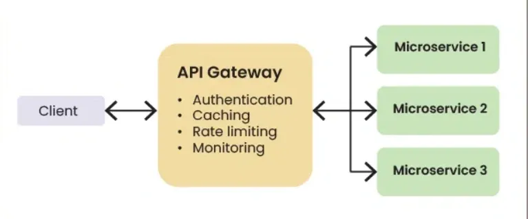

- API 网关充当客户端和后端服务之间的反向代理。
- 接收到客户端请求后，它会处理一系列事务，包括[速率限制](https://www.geeksforgeeks.org/system-design/rate-limiting-in-system-design/)、路由和身份验证，然后将请求转发到相应的后端服务。
- 它提供一致的接口，并隐藏底层架构的复杂性。

.png>)

**在上图中：**

- 用户将通过移动应用或网页应用发送请求。
- API 网关将确定请求的类型。
- 身份验证是指用户需要通过提供 User_Id 和密码来向服务器或客户端证明其身份。例如：登录或注册页面。
- SSL 全称为安全套接字层 (Secure Socket Layer)，用于在服务器和客户端之间建立加密连接。
- 它提供协议转换功能，可以将传入的请求从一个通道转换为另一个通道。
- 当请求聚合时，API 网关接收到的请求将触发对不同端点的请求，并将响应返回给客户端。

```text
API 网关的主要目的是简化客户端与底层服务的交互，增强安全性，并提供各种用于管理和监控 API 流量的功能。
```

### API 网关如何工作？

让我们看看 API 网关的工作原理：

- **路由** – 根据 URL、方法或标头将客户端请求定向到相应的服务。
- **协议转换** – 在不同协议之间转换请求（例如，HTTP → gRPC/WebSocket）。
- **请求聚合** – 将多个后端调用合并为一个，以减少往返次数。
- **身份验证与授权** – 验证客户端身份和访问权限。
- **速率限制与节流** – 控制请求速率，以防止滥用并确保资源均衡。
- **负载均衡** – 将请求分配到各个服务实例，以提高可扩展性和可用性。
- **缓存** – 存储后端响应，以加快重复请求的处理速度。
- **监控与日志记录** – 跟踪指标和日志，以了解性能和使用情况。

### API 网关在[微服务](https://www.geeksforgeeks.org/system-design/microservices/)和[单体架构](https://www.geeksforgeeks.org/software-engineering/monolithic-application/)中的工作方式有何不同？

API 网关在微服务和单体架构中的工作方式在以下几个关键方面有所不同：

|                                                       方面                                                       |                                           单体架构                                           |                                               微服务架构                                                |
| :--------------------------------------------------------------------------------------------------------------: | :------------------------------------------------------------------------------------------: | :-----------------------------------------------------------------------------------------------------: |
|                                                     请求路由                                                     |     在单体架构中，API 网关通常会根据请求 URL 或其他条件将请求路由到单体架构的不同部分。      | 在微服务架构中，API 网关会根据请求 URL 或其他条件将请求路由到不同的微服务，充当微服务生态系统的“入口”。 |
|                                                     服务发现                                                     |       在单体架构中，服务发现通常不是问题，因为应用程序的所有部分都包含在同一代码库中。       |        在微服务架构中，API 网关可能需要使用服务发现机制来动态定位请求并将其路由到相应的微服务。         |
| [身份验证和授权](https://www.geeksforgeeks.org/system-design/authentication-and-authzrization-in-microservices/) |                       在两种架构中，API 网关都可以处理身份验证和授权。                       |             但是，在微服务架构中，授权场景可能更复杂，因为请求可能需要多个微服务进行授权。              |
|           [负载均衡](https://www.geeksforgeeks.org/system-design/what-is-load-balancer-system-design/)           |                          在两种架构中，API 网关都可以执行负载均衡。                          |  然而，在微服务架构中，负载均衡可能更加复杂，因为请求可能需要在多个微服务的多个实例之间进行负载均衡。   |
|             [容错性](https://www.geeksforgeeks.org/system-design/fault-tolerance-in-system-design/)              | 在两种架构中，API 网关都可以通过重试失败的请求并将请求路由到运行正常的服务实例来提供容错性。 |          但是，在微服务架构中，容错性可能更为关键，因为单个微服务的故障不应导致整个系统崩溃。           |

### 基于[微服务](https://www.geeksforgeeks.org/system-design/microservices/)的 API 网关示例

**示例场景：**

```text
假设有一个基于微服务的电子商务系统。该系统包含用户管理、产品目录、购物车和订单处理等服务。客户通过 Web 应用程序与系统交互。
```

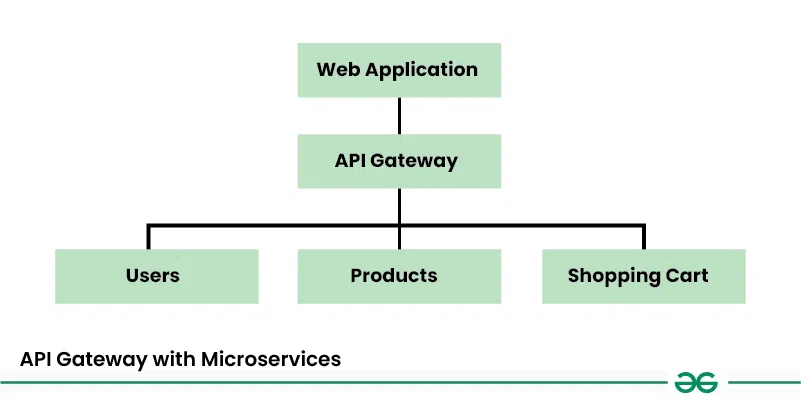

**上图说明**

- Web 应用程序与 API 网关通信。
- API 网关将请求路由到相应的微服务（例如，将用户相关请求路由到用户服务）。
- 它处理身份验证、速率限制、缓存和其他功能。
- API 网关还对错误响应进行标准化。

### API 网关与单体架构示例

**示例场景：**

```text
考虑一个传统的电子商务单体应用。API 网关仍然可以作为中心入口点，并管理身份验证、请求转换、缓存和其他功能。
```

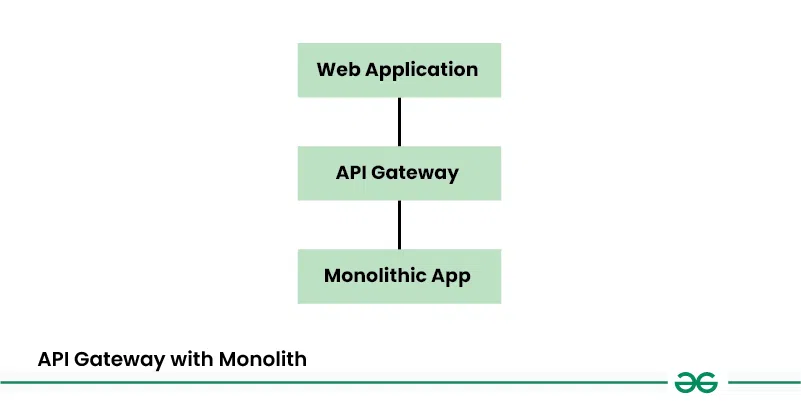

**以上图表说明**

- Web 应用程序与 API 网关通信。
- API 网关简化客户端交互，并提供安全性、缓存和其他功能。
- 它还管理 API 版本控制和错误处理。

### API 网关最佳实践

以下是 API 网关的最佳实践：

- **安全性：**为防止滥用，请使用 SSL/TLS 进行加密，实施强身份验证和授权方法，并使用 IP 白名单和速率限制。
- **性能优化：**通过使用[缓存](https://www.geeksforgeeks.org/system-design/caching-system-design-concept-for-beginners/)、请求/响应压缩和有效的路由来降低[延迟](https://www.geeksforgeeks.org/system-design/latency-in-system-design/)并加快响应速度。
- **可扩展性：**设计时考虑水平扩展，使用负载均衡，并监控性能指标以根据需要扩展资源。
- **监控和日志记录：**使用监控工具跟踪性能指标，与日志和监控系统对接以进行集中管理，并实施全面的日志记录。
- **错误处理：**实施强大的错误处理机制，并使用标准化的错误代码和消息以确保一致性。
- **版本控制和文档：**保持向后兼容性，并通过版本控制管理变更。此外，保持文档更新，以便开发人员了解如何使用 API。

### 使用 API 网关的优势

- **集中式入口点** – 客户端通过单个网关访问多个微服务。
- **路由与负载均衡** – 将请求定向到相应的服务，并在实例间分配负载。
- **身份验证与授权** – 使用 JWT、OAuth 或 API 密钥验证身份并强制执行访问控制。
- **请求与响应转换** – 转换数据格式（例如，JSON ↔ XML），以确保服务之间的兼容性。

### 使用 API 网关的挑战

API 网关可能会带来一些挑战，尤其是在复杂的环境中或配置不当的情况下。一些常见的挑战包括：

- **性能瓶颈：**在处理大量请求时，API 网关可能会成为性能瓶颈或单点故障。为了确保其能够承受负载，需要进行仔细的配置和设计。
- **延迟增加：**引入 API 网关后，请求的延迟可能会增加，尤其是在需要执行复杂的路由、身份验证或其他流程时。可以通过使用缓存和优化网关配置来减少此问题。
- **复杂性：**管理和配置 API 网关可能非常复杂，尤其是在拥有大量服务和端点的环境中。完善的文档和自动化工具可以帮助降低这种复杂性。
- **安全风险：**设计不当的 API 网关可能导致安全漏洞，例如权限错误、身份验证错误或私有数据泄露。为了降低这些威胁，定期进行安全评估和更新至关重要。
- **可扩展性挑战：**扩展 API 网关可能很困难，尤其是在需求不断变化的动态环境中。为了保证[可扩展性](https://www.geeksforgeeks.org/system-design/what-is-scalability/)，负载均衡和[横向扩展](https://www.geeksforgeeks.org/system-design/system-design-horizontal-and-vertical-scaling/)技术至关重要。

### 热门 API 网关解决方案

以下是一些 API 网关解决方案：

#### 1. Amazon API Gateway

它是一项完全托管的服务，使开发人员能够轻松创建、发布、维护、监控和保护任何规模的 API。它支持 RESTful API 以及用于实时通信的 WebSocket API。

#### 2. Apigee

它现在是 Google Cloud 的一部分，是一个使组织能够设计、保护、部署、监控和扩展 API 的平台。它提供 API 分析、API 货币化和开发者门户管理等功能。

#### 3. Kong

它是一个开源的 API 网关和微服务管理层。它构建于 Nginx 之上，并提供请求路由、身份验证、速率限制和日志记录等功能。

#### 4. Microsoft Azure API Management

它是一项完全托管的服务，可帮助组织发布、保护和管理 API。它提供 API 网关功能、开发者门户管理和 API 版本控制等功能。

#### 5. Apache APISIX

Apache APISIX 是 Apache 软件基金会的顶级项目，在 GitHub 上拥有超过 15,000 个 star 和 460 多位贡献者。APISIX 以其高性能、云原生架构和丰富的插件生态系统而闻名，已成为领先的 API 网关之一。

## [消息队列 - 系统设计](https://www.geeksforgeeks.org/system-design/message-queues-system-design/)

消息队列支持系统组件之间的异步通信，充当缓冲区，将生产者（发送者）与消费者（接收者）解耦。这提高了可扩展性、容错性和负载均衡性，即使组件延迟或不可用，系统也能正常运行。

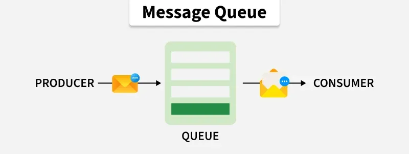

```text
想想你最喜欢的披萨店，他们制作并配送披萨。在幕后，有一个神奇的系统确保一切顺利运行。这个神奇的系统叫做消息队列。它就像一个特殊的待办事项清单，帮助厨师和外卖员准确地知道要制作哪些披萨以及要送到哪里。
```

典型的消息结构包含两个主要部分：

- **消息头：**包含消息的元数据，例如唯一标识符、时间戳、消息类型和路由信息。
- **消息体：**消息体包含实际的消息有效负载或内容。它可以是任何格式，包括文本、二进制数据或结构化数据（例如 JSON）。

### 消息队列的实际应用

- **电子商务：**收到订单后，将订单放入订单队列，这样客户就不会被阻塞。
- **支付服务：**监听订单队列，处理付款。
- **库存服务：**监听付款完成队列，更新库存。
- **电子邮件服务：**监听订单确认队列，发送确认邮件。

### 消息队列系统的关键组件

- **消息生产者：**消息由消息生产者创建并发送到消息队列。任何生成数据以供共享的程序或系统组件都可以被视为消息生产者。
- **消息队列：**在消息消费者消费消息之前，消息由称为消息队列的数据结构或服务存储和管理。它充当消费者和生产者之间的中介或缓冲区。
- **消息消费者：**消息队列中的消息必须由消息消费者检索和处理。队列中的消息可以被多个用户并发读取。
- **消息代理（可选）：**在某些消息队列系统中，消息代理充当生产者和消费者之间的中介，提供消息路由、过滤和消息转换等附加功能。

### 消息队列的工作原理

以下步骤有助于理解消息队列的工作原理：

- **步骤 1：**发送消息：消息生产者创建消息并将其发送到消息队列。消息通常包含需要处理或通信的数据或指令。
- **步骤 2：**消息排队：消息队列会临时存储消息，供一个或多个消费者使用。消息通常按先进先出 (FIFO) 的顺序存储。
- **步骤 3：**消息消费：消息消费者在准备好处理消息时，会从队列中检索消息。它们可以按照自己的节奏进行操作，从而实现异步通信。
- **步骤 4：**确认（可选）：在某些消息队列系统中，消费者可以向队列发送确认信息，表明它们已成功处理消息。这对于确保消息传递和防止消息丢失至关重要。

**例如：**

```text
电子邮件收件箱就是一个简单的消息队列示例。当您发送电子邮件时，它会被放入收件人的收件箱中。收件人可以随时阅读邮件。此电子邮件收件箱充当发件人和收件人之间的缓冲区，使两者彼此解耦。
```

### 为什么我们需要消息队列？

消息队列对于解决[分布式系统](https://www.geeksforgeeks.org/computer-networks/what-is-a-distributed-system/)中的诸多挑战至关重要，其中包括：

- **异步通信：**由于消息队列的存在，应用程序无需等待响应即可发送和接收消息。构建可扩展且可靠的系统需要异步通信。
- **解耦：**消息队列能够将应用程序彼此解耦，从而允许它们独立开发。这使得系统更加灵活且易于维护。
- **[可扩展性](https://www.geeksforgeeks.org/system-design/what-is-scalability/)：**消息队列可以通过添加更多服务器来扩展以处理大量消息。这使其成为高流量应用程序的理想选择。
- **[可靠性](https://www.geeksforgeeks.org/system-design/reliability-in-system-design/)：**消息队列可以设计得非常可靠，例如通过消息持久化、重试机制和死信队列等功能。这确保即使发生故障，消息也不会丢失。
- **工作流管理：**消息队列可用于实现复杂的工作流，例如订单处理和支付处理。这有助于提高这些流程的效率和准确性。

### 消息队列的类型

系统设计中主要有两种类型的消息队列：

#### 1. 点对点消息队列

点对点消息队列是最简单的消息队列类型。当生产者向点对点队列发送消息时，该消息会存储在队列中，直到消费者将其取出。一旦消息被消费者取出，它就会从队列中移除，并且不能再被其他消费者处理。

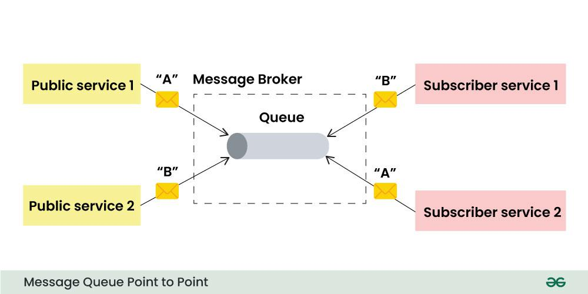

点对点消息队列可用于实现多种模式，例如：

- **请求-响应模式：**生产者向队列发送请求消息，消费者检索该消息并发送响应消息。
- **工作队列模式：**生产者向队列发送工作项，消费者检索工作项并进行处理。
- **保证交付模式：**生产者向队列发送消息，消费者可以配置重试机制，直到消息被成功处理。

#### 2. 发布/订阅消息队列

发布/订阅消息队列比点对点消息队列更复杂。当生产者向发布/订阅队列发布消息时，该消息会被路由到所有订阅该队列的消费者。消费者可以订阅多个队列，也可以随时取消订阅。

- 发布/订阅消息队列常用于实现实时流式应用，例如社交媒体和股票行情。
- 它们还可以用于实现事件驱动架构，在这种架构中，系统组件通过发布和订阅事件进行相互通信。

### 什么是消息路由？

消息路由涉及确定如何将消息定向到其预期的接收者。可以使用以下方法：

- **基于主题的路由：**消息被发送到主题或通道，订阅者表达对特定主题的兴趣。消息将传递给特定主题的所有订阅者。
- **直接路由：**消息根据其地址或路由键直接发送到特定的队列或消费者。
- **基于内容的路由：**路由决策基于消息的内容。定义过滤器或规则来路由符合特定条件的消息。

### 消息队列的可扩展性

可扩展性对于确保消息队列系统能够高效地处理不断增加的负载至关重要。为了实现可扩展性：

- **分布式队列：**将消息队列实现为具有多个节点的分布式系统，从而实现横向扩展。
- **分区：**将队列拆分成多个分区，以便将消息处理任务分配到不同的节点或集群上。
- **[负载均衡](https://www.geeksforgeeks.org/system-design/what-is-load-balancer-system-design/)：**使用负载均衡器将传入的消息均匀地分配给队列中的消费者。

### 死信队列和消息队列中的消息优先级

#### 1. 死信队列

死信队列 (DLQ) 是一种用于处理无法成功处理的消息的机制。这些消息包括：

- 内容或格式存在错误的消息。
- 超过生存时间 (TTL) 或投递尝试次数的消息。
- 无法投递给任何消费者的消息。

DLQ 提供了一种方法来调查并可能重新处理失败的消息，同时防止它们阻塞系统。

#### 2. 消息优先级

消息优先级是为消息分配优先级以控制其处理顺序的过程。优先级标准可以包括：

- **紧急程度：**优先级较高的消息可能需要在优先级较低的消息之前处理。
- **消息内容：**包含关键信息或命令的消息可能会获得更高的优先级。
- **业务规则：**可以使用自定义业务规则或算法来确定消息优先级。

### 消息队列实现

消息队列的实现方式多种多样，但通常遵循一个简单的模式：

- **生产者：**向队列发送消息的应用程序。
- **消息代理：**存储消息并在生产者和消费者之间转发消息的服务器。
- **消费者：**从队列接收消息的应用程序。

**问题陈述：**

在实际应用中，您可能需要考虑使用专用的消息队列服务，例如 RabbitMQ 或 Apace Kafka，以构建分布式系统。

以下是在 Javascript 中实现基本消息队列的分步指南：

#### 步骤 1：定义消息结构

首先定义消息结构。该结构应包含系统不同部分之间通信所需的信息。

```js
class Message {
  constructor(messageType, payload) {
    this.messageType = messageType;
    this.payload = payload;
  }
  // Add any other fields as needed
}
```

#### 步骤 2：实现消息队列

创建一个用于消息队列的类。该类应处理入队和出队等操作。

```js
class MessageQueue {
  constructor() {
    this.queue = [];
    this.mutex = new Promise((resolve) => (this.resolveMutex = resolve));
  }

  // Enqueue a message
  async enqueue(message) {
    await this.mutex;
    try {
      this.queue.push(message);
    } finally {
      this.resolveMutex();
    }
  }

  // Dequeue a message
  async dequeue() {
    await this.mutex;
    try {
      while (this.queue.length === 0) {
        await new Promise((resolve) => (this.resolveWait = resolve));
      }
      return this.queue.shift();
    } finally {
      this.resolveMutex();
    }
  }
}
```

#### 步骤 3：创建生产者和消费者

实现充当生产者和消费者的函数或类。生产者将消息入队，消费者将消息出队。

```js
// Producer function
function producer(messageQueue, messageType, payload) {
  let message = { messageType: messageType, payload: payload };

  messageQueue.enqueue(message);
}

// Consumer function
function consumer(messageQueue) {
  while (true) {
    let message = messageQueue.dequeue();
    // Process the message
    // ...
  }
}
```

#### 步骤 4：使用消息队列

创建消息队列、生产者和消费者的实例，并在程序中使用它们。

```js
class MessageQueue {
  constructor() {
    this.queue = [];
    this.waiting = [];
  }

  // Producer sends a message
  async send(message) {
    if (this.waiting.length > 0) {
      // If a consumer is waiting, resolve it immediately
      const resolve = this.waiting.shift();
      resolve(message);
    } else {
      // Otherwise, push message to queue
      this.queue.push(message);
    }
  }

  // Consumer receives a message
  receive() {
    return new Promise((resolve) => {
      if (this.queue.length > 0) {
        // If a message is available, resolve immediately
        resolve(this.queue.shift());
      } else {
        // Otherwise, wait until a message is available
        this.waiting.push(resolve);
      }
    });
  }
}

// Producer function
async function producer(mq, id, message) {
  console.log(`Producer ${id} sending: ${message}`);
  await mq.send(message);
}

// Consumer function
async function consumer(mq) {
  const msg = await mq.receive();
  console.log(`Consumer received: ${msg}`);
}

// Main thread logic
(async () => {
  const messageQueue = new MessageQueue();

  // Start consumer first (to simulate waiting)
  consumer(messageQueue);

  // Simulate delay before sending
  setTimeout(() => {
    producer(messageQueue, 1, "Hello, World!");
  }, 1000);
})();
```

**输出**

```text
Producer 1 sending: Hello, World!
Consumer received: Hello, World!
```

## [系统设计中的速率限制](https://www.geeksforgeeks.org/system-design/rate-limiting-in-system-design/)

速率限制是一种系统架构技术，用于控制系统处理或响应传入请求或操作的速度。它限制客户端请求的数量或频率，以防止系统过载、维持稳定性并确保资源公平分配。

速率限制降低了资源滥用和拒绝服务 (DoS) 攻击的可能性，从而最大限度地提高系统的性能、可靠性和安全性。

速率限制广泛应用于各种场景，包括 Web 服务器、API、网络流量管理和数据库访问。

速率限制器的示例包括 AWS API 网关限流、AWS WAF（Web 应用程序防火墙）、Azure API 管理速率限制和配额策略以及 GCP 的 API 网关配额策略。

速率限制器是控制系统流量或请求速率的组件。它是用于强制执行速率限制的特定实现或工具。

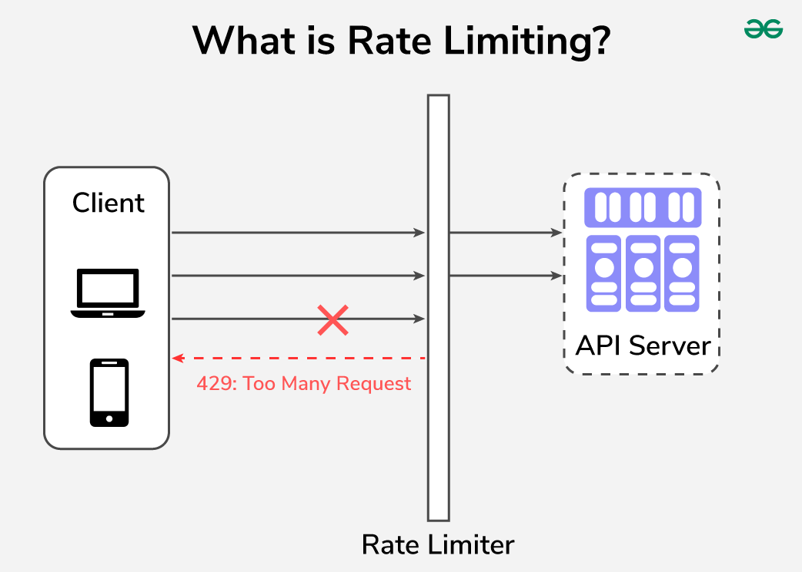

### 速率限制的应用场景

以下是速率限制的应用场景：

- **API 速率限制：**API 通常采用速率限制来控制客户端请求量，确保资源的公平访问，并防止滥用。
- **Web 服务器速率限制：**Web 服务器采用速率限制来防御拒绝服务攻击，并防止服务器过载。
- **数据库速率限制：**为了避免数据库服务器承受过大的压力并保持数据库性能，会对数据库查询应用速率限制。例如，为了避免资源耗尽并确保流畅运行，电子商务网站可以限制每个用户的数据库查询次数。
- **登录速率限制：**为了防止密码猜测和暴力破解攻击，登录系统采用速率限制。系统可以通过限制每个用户或 IP 地址的登录尝试次数来防止未经授权的访问。

### 速率限制类型

以下是主要的速率限制类型：

#### 1. 基于 IP 的速率限制

基于 IP 的速率限制是指在指定时间内，单个 IP 地址可以发送的请求数量（例如，每分钟 10 个请求）。通过限制单个 IP 地址的流量，它常用于阻止诸如机器人程序和拒绝服务攻击等恶意行为。

- **优点：**
  - 在网络层和应用层都易于实现。
  - 如果有人试图用请求淹没系统，限制其 IP 地址可以阻止这种情况发生。
- **缺点：**
  - 攻击者可以使用 VPN、代理服务器甚至僵尸网络等技术来伪造不同的 IP 地址，从而绕过限制。
  - 如果多个用户共享同一个 IP 地址（例如在企业网络中），则如果同一网络中的其他用户超过了限制，合法用户可能会被阻止访问。

**例如：**一家在线零售商可能会将每个 IP 地址每分钟的请求数限制为 10 次，以防止机器人抓取产品数据。这确保了机器人无法大规模窃取数据，同时普通用户仍然可以不间断地购物。

#### 2. 基于服务器的速率限制

基于服务器的速率限制控制着在预定时间内可以发送到特定服务器的请求数量（例如，每秒 100 次请求）。

- **优点：**
  - 有助于防止服务器过载，尤其是在高峰使用期间。
  - 通过限制每个服务器的请求数，可以确保没有单个用户能够垄断资源并降低其他用户的体验。
- **缺点：**
  - 如果攻击者跨多个服务器发送请求，他们可能可以绕过任何一个服务器的速率限制。
  - 如果限制过低或服务器负载过重，即使是合法用户也可能遇到延迟或阻塞。

**例如：**一家音乐流媒体服务可能会实施基于服务器的速率限制，以防止其 API 在高峰时段过载。通过将每台服务器的请求限制在每秒 100 次，即使在使用高峰期，也能确保服务保持快速响应。

#### 3. 基于地理位置的速率限制

基于地理位置的速率限制会根据 IP 地址的地理位置来限制流量。它有助于阻止来自特定地区（例如，网络攻击高发国家/地区）的恶意请求，或遵守当地的法律法规。

- **优点：**
  - 如果您知道某些地区是大量恶意流量（例如垃圾邮件、黑客攻击）的来源，则可以限制来自这些地区的请求。
  - 有助于遵守当地的数据保护法律或某些国家/地区的内容限制。
- **缺点：**
  - 攻击者可以使用 VPN 或代理服务器来伪装其真实位置，从而绕过基于地理位置的限制。
  - 如果用户身处受限地区，则通过国际服务器访问服务的用户（例如使用 VPN 的员工或酒店中的客户）可能会被阻止访问。

**例如：**社交媒体平台可能会实施基于地理位置的速率限制来打击垃圾信息。如果某个地区存在大量虚假账户或机器人活动，平台可以设置规则，限制来自该地区的 IP 地址每分钟只能发出 10 个请求。

### 速率限制的工作原理是什么？

速率限制可以管理用户或系统在预定时间内向服务发出的查询次数。例如，一项服务可能允许每分钟 100 个请求。一旦达到限制，任何超出限制的请求都将被系统阻止或减慢，直到时间窗口重置。

- 这有助于防止滥用、机器人攻击或服务器过载等问题，同时确保所有用户都有公平的机会访问服务。
- 速率限制通常使用不同的方法来实现，例如令牌桶或滑动窗口，但其目标始终相同：保持系统平稳运行并防止其受到过大流量的影响。

让我们了解一下速率限制算法，看看它们是如何工作的：

### 速率限制算法

系统设计中通常使用多种速率限制算法来控制传入请求或操作的速率。以下是一些常用的速率限制算法：

#### 1. 令牌桶算法

- 令牌桶算法以固定的速率将令牌分配到“桶”中。
- 每个请求都会消耗存储桶中的一个令牌，只有当存储桶中有足够的令牌时，请求才会被允许。
- 未使用的令牌会存储在存储桶中，直至达到最大容量。
- 该算法提供了一种简单灵活的方法来控制请求速率并平滑流量峰值。

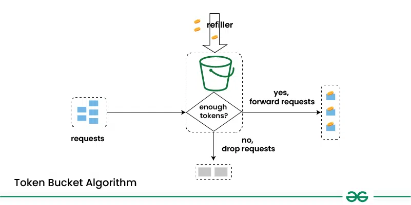

以下是用 Python 实现的令牌桶算法：

```python
import time

class TokenBucket:
    def __init__(self, capacity, refill_rate):
        self.capacity = capacity  # max number of tokens
        self.tokens = capacity  # current number of tokens
        self.refill_rate = refill_rate  # tokens added per second
        self.last_refill_time = time.time()

    def refill(self):
        current_time = time.time()
        elapsed_time = current_time - self.last_refill_time
        # Refill the bucket based on elapsed time
        new_tokens = elapsed_time * self.refill_rate
        self.tokens = min(self.capacity, self.tokens + new_tokens)
        self.last_refill_time = current_time

    def allow_request(self):
        self.refill()
        if self.tokens >= 1:
            self.tokens -= 1
            return True
        return False


# Example usage:
bucket = TokenBucket(5, 1)  # 5 tokens max, refill 1 token per second

for _ in range(10):
    if bucket.allow_request():
        print("Request allowed")
    else:
        print("Request denied")
    time.sleep(0.5)  # Simulate request interval
```

#### 2. 漏桶算法

- 漏桶算法模拟了一个带有泄漏孔的桶，请求以恒定速率添加到桶中，并以可控速率泄漏出去。
- 传入的请求被添加到桶中，如果桶的容量超过一定限值，超出部分的请求将被延迟或拒绝。
- 该算法提供了一种在允许一定流量突发性的同时，强制执行最大请求速率的方法。

.webp>)

以下是用 Python 实现的漏桶算法：

```python
import time

class LeakyBucket:
    def __init__(self, capacity, leak_rate):
        self.capacity = capacity  # max bucket size
        self.water = 0  # current amount of "water" in the bucket
        self.leak_rate = leak_rate  # rate at which water leaks per second
        self.last_time = time.time()

    def leak(self):
        current_time = time.time()
        elapsed_time = current_time - self.last_time
        self.water = max(0, self.water - elapsed_time * self.leak_rate)
        self.last_time = current_time

    def allow_request(self):
        self.leak()
        if self.water < self.capacity:
            self.water += 1  # Add 1 unit of "water" for each request
            return True
        return False


# Example usage:
bucket = LeakyBucket(5, 1)  # max 5 requests, leak 1 per second

for _ in range(10):
    if bucket.allow_request():
        print("Request allowed")
    else:
        print("Request denied")
    time.sleep(0.5)  # Simulate request interval
```

#### 3. 固定窗口计数算法

- 固定窗口计数算法跟踪固定时间窗口（例如，一分钟、一小时）内的请求数量。
- 超过预设阈值的请求将被拒绝或延迟，直到窗口重置。
- 该算法提供了一种在短时间内限制请求速率的直接方法，但可能无法很好地处理突发流量。

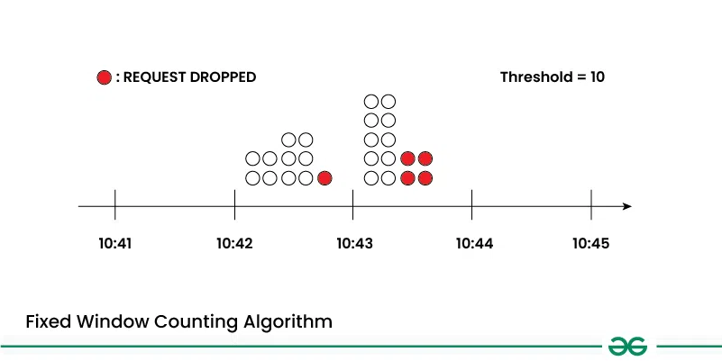

以下是 Python 中固定窗口计数算法的实现：

```python
import time

class FixedWindowCounter:
    def __init__(self, limit, window_size):
        self.limit = limit  # max requests allowed
        self.window_size = window_size  # time window in seconds
        self.count = 0  # current count of requests in the window
        self.start_time = time.time()

    def allow_request(self):
        current_time = time.time()
        if current_time - self.start_time > self.window_size:
            # Reset the window
            self.start_time = current_time
            self.count = 0
        if self.count < self.limit:
            self.count += 1
            return True
        return False


# Example usage:
window = FixedWindowCounter(5, 10)  # 5 requests per 10 seconds

for _ in range(10):
    if window.allow_request():
        print("Request allowed")
    else:
        print("Request denied")
    time.sleep(2)  # Simulate request interval
```

#### 4. 滑动窗口日志算法

- 滑动窗口日志算法会为每个收到的请求维护一个时间戳日志。
- 超过预设时间间隔的请求会从日志中移除，新的请求则会被添加到日志中。
- 请求速率是根据滑动窗口内的请求数量计算的。
- 与固定窗口计数相比，该算法能够实现更精确的速率限制，并更好地处理突发流量。

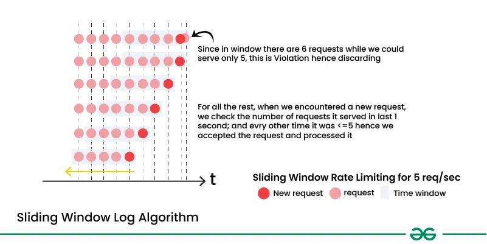

以下是用 Python 实现的滑动窗口对数算法：

```python
import time
from collections import deque

class SlidingWindowLog:
    def __init__(self, limit, window_size):
        self.limit = limit  # max requests allowed
        self.window_size = window_size  # time window in seconds
        self.requests = deque()  # stores timestamps of requests

    def allow_request(self):
        current_time = time.time()

        # Remove requests outside the window
        while self.requests and self.requests[0] <= current_time - self.window_size:
            self.requests.popleft()

        if len(self.requests) < self.limit:
            self.requests.append(current_time)
            return True
        return False


# Example usage:
sliding_window = SlidingWindowLog(5, 10)  # 5 requests per 10 seconds

for _ in range(10):
    if sliding_window.allow_request():
        print("Request allowed")
    else:
        print("Request denied")
    time.sleep(2)  # Simulate request interval
```

### 客户端速率限制与服务器端速率限制

以下是客户端速率限制与服务器端速率限制的区别：

|   方面   |                              客户端速率限制                              |                                        服务器端速率限制                                        |
| :------: | :----------------------------------------------------------------------: | :--------------------------------------------------------------------------------------------: |
| 执行位置 |                     由客户端应用程序或客户端库执行。                     |                               由服务器基础设施或 API 网关执行。                                |
| 请求控制 |                   请求在到达服务器之前会被限制或延迟。                   |               请求由服务器处理，服务器根据预定义的规则决定接受、拒绝或延迟请求。               |
|  灵活性  |               灵活性有限，因为它依赖于客户端的实现和配置。               |      灵活性更高，因为速率限制规则可以在服务器端集中管理和调整，而无需客户端进行任何更改。      |
|  安全性  |                安全性较低，因为它可能被客户端绕过或操纵。                |              安全性更高，因为执行由服务器集中控制，从而降低了滥用或被利用的风险。              |
| 可扩展性 | 可能会影响客户端的性能和可扩展性，尤其是在客户端数量庞大的分布式环境中。 | 更好的可扩展性，因为速率限制可以全局应用于所有客户端，并可根据服务器负载和资源可用性动态调整。 |

### 系统不同层级的速率限制

以下是在系统不同层级应用速率限制的方法：

- **应用层：**
  - 在应用程序代码内部实现速率限制逻辑称为应用层速率限制。
  - 它适用于应用程序处理的所有请求，无论这些请求来自何处或最终到达何处。
- **API 网关层：**
  - 在 API 网关基础架构内部设置速率限制规则称为 API 网关层速率限制。
  - 它涵盖 API 网关在将请求转发给下游服务之前接收到的请求。
- **服务层：**
  - 服务层速率限制涉及在各个服务或微服务内部实现速率限制逻辑。
  - 它适用于每个服务独立处理的请求，从而实现细粒度的控制和自定义。
- **数据库层：**
  - 数据库层速率限制涉及控制数据库查询或事务的速率。
  - 它适用于应用程序或服务执行的数据库操作，例如读取和写入操作。

### 速率限制的挑战

以下是速率限制面临的挑战：

- **[延迟](https://www.geeksforgeeks.org/system-design/latency-in-system-design/)：**速率限制可能会导致延迟，尤其是在请求因超出速率限制而被限速或延迟时。
- **误报：**如果速率限制逻辑存在缺陷或速率限制过于严格，则速率限制可能会无意中阻止合法请求。误报可能会导致用户感到沮丧并遭遇服务中断。
- **配置复杂性：**设置速率限制规则和阈值可能很困难，尤其是在具有各种流量模式和用例的系统中。
- **[可扩展性](https://www.geeksforgeeks.org/system-design/what-is-scalability/)挑战：**如果扩展不当，速率限制方法本身在过载时可能会造成瓶颈。最大的挑战之一是确保速率限制系统能够在不降低性能的情况下应对不断增长的流量。

## [速率限制算法 - 系统设计](https://www.geeksforgeeks.org/system-design/rate-limiting-algorithms-system-design/)

[速率限制](https://www.geeksforgeeks.org/system-design/rate-limiting-in-system-design/)算法是一种旨在控制系统处理或响应请求速率的机制。这些算法在 Web 服务、API、网络流量管理和[分布式系统](https://www.geeksforgeeks.org/computer-networks/what-is-a-distributed-system/)等各个领域都至关重要，它们能够确保系统的稳定性、公平性和防滥用性能。

### 1. 令牌桶算法

令牌桶算法通过不断生成新的令牌来控制数据传输量，这些令牌构成一个令牌桶。每个请求都需要一个令牌，如果请求者没有任何令牌，则其请求将被拒绝。该算法使系统能够处理不同强度的数据流，并可在给定的时间间隔内控制请求速率。


- **优点：**
  - 易于理解，易于实施。
  - 能够处理突发流量。
  - 允许速率限制方式更加灵活。
- **挑战：**
  - 对令牌构建速率的协调性要求很高。
  - 在高流量环境下可能有效，但在低流量环境下可能需要进行一些调整。
- **工作原理：**
  - 令牌桶可以使用计数器轻松实现。
  - 令牌初始值为零。
  - 每次添加令牌时，计数器加一。
  - 每次发送数据时，计数器减一。
  - 当计数器为零时，主机无法发送数据。

**令牌桶算法示例实现：**

```python
class TokenBucket:
    def __init__(self, rate, capacity):
        self.rate = rate
        self.capacity = capacity
        self.tokens = capacity
        self.last_refill = time.time()

    def allow_request(self):
        now = time.time()
        self.tokens += (now - self.last_refill) * self.rate
        self.tokens = min(self.tokens, self.capacity)
        self.last_refill = now

        if self.tokens >= 1:
            self.tokens -= 1
            return True
        else:
            return False
```

### 2. 漏桶算法

漏桶算法的核心在于，桶的大小固定不变，但存在一个“泄漏”，使得桶的大小会逐渐缩小。新收到的请求会被累积到桶中，如果桶已满，则拒绝这些请求。为了实现这一目标，该方法能够有效地控制请求流，使任何时间段内处理的请求速率对所有相关方都有利。

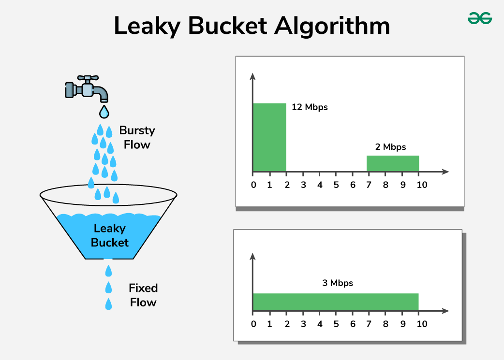

- **优点：**
  - 通过强制执行稳定的输出速率来平滑突发流量。
  - 确保用户或应用程序之间资源的公平分配。
  - 相对容易实现和理解。
  - 有助于缓解某些类型的拒绝服务 (DoS) 攻击。
- **挑战：**
  - 需要额外的计算开销来管理令牌。
  - 可能难以处理超出桶容量的极短突发流量。
  - 严格执行速率限制，这可能会影响偶尔需要突发流量的应用程序。
  - 选择最佳的桶大小和填充速率可能很复杂。
- **工作原理：**
  - 想象一个底部有泄漏的桶。
  - 数据（或令牌）以不规则的时间间隔到达桶中。
  - 每个到达的数据单元都会被保存在桶中，直到可以处理为止。
  - 数据以由泄漏速率决定的恒定速率从桶中移除。
  - 如果桶已满并溢出，则多余的数据将被丢弃或延迟处理。

**漏桶算法的示例实现：**

```python
class LeakyBucket:
    def __init__(self, capacity, leak_rate):
        self.capacity = capacity  # Maximum capacity of the bucket
        self.leak_rate = leak_rate  # Rate at which the bucket leaks (units per second)
        self.bucket_size = 0  # Current size of the bucket
        self.last_updated = time.time()  # Last time the bucket was updated

    def add_data(self, data_size):
        # Calculate time elapsed since last update
        current_time = time.time()
        time_elapsed = current_time - self.last_updated
        self.last_updated = current_time

        # Leak the bucket (remove data according to the leak rate)
        self.bucket_size -= self.leak_rate * time_elapsed

        # Add new data to the bucket
        self.bucket_size = min(self.bucket_size + data_size, self.capacity)

        # Check if data can be sent
        if self.bucket_size >= data_size:
            self.bucket_size -= data_size
            return True
        else:
            return False

# Example usage:
bucket = LeakyBucket(capacity=10, leak_rate=1)  # Bucket with capacity of 10 units and leak rate of 1 unit per second
data_to_send = 5  # Example data size to send
if bucket.add_data(data_to_send):
    print(f"Data of size {data_to_send} sent successfully.")
else:
    print(f"Bucket overflow. Unable to send data of size {data_to_send}.")
```

### 3. 固定窗口算法

固定窗口算法将时间划分为称为窗口的固定区间，并将请求数量限制在每个窗口内的特定数量。也就是说，如果请求数量超过限制，则请求将被关闭，并且至少在下一个允许的窗口到来之前，请求将无法再次发出。


- **优点：**
  - 易于实现。
  - 有利于稳定的流量。
- **挑战：**
  - 可能导致窗口边界处出现流量突发。
  - 虽然非常适合静态流量，但对于动态流量模式则不太适用。
- **工作原理：**
  - 固定窗口计数算法跟踪固定时间窗口（例如，一分钟、一小时）内的请求数量。
  - 超过预设阈值的请求将被拒绝或延迟，直到窗口重置。
  - 固定窗口算法示例实现：

```python
class FixedWindow:
    def __init__(self, window_size, max_requests):
        self.window_size = window_size
        self.max_requests = max_requests
        self.requests = 0
        self.window_start = time.time()

    def allow_request(self):
        now = time.time()
        if now - self.window_start >= self.window_size:
            self.requests = 0
            self.window_start = now

        if self.requests < self.max_requests:
            self.requests += 1
            return True
        else:
            return False
```

### 4. 滑动窗口算法

滑动窗口算法实际上是固定窗口算法和漏桶算法的变体。它采用动态时间窗口，并限制该时间窗口内请求的数量。由于窗口会定期更新，且请求速率理想地均匀分布在一段时间内，因此滑动窗口算法能够提供更精细、更有效的速率限制，从而更好地控制流量方向和发生频率。

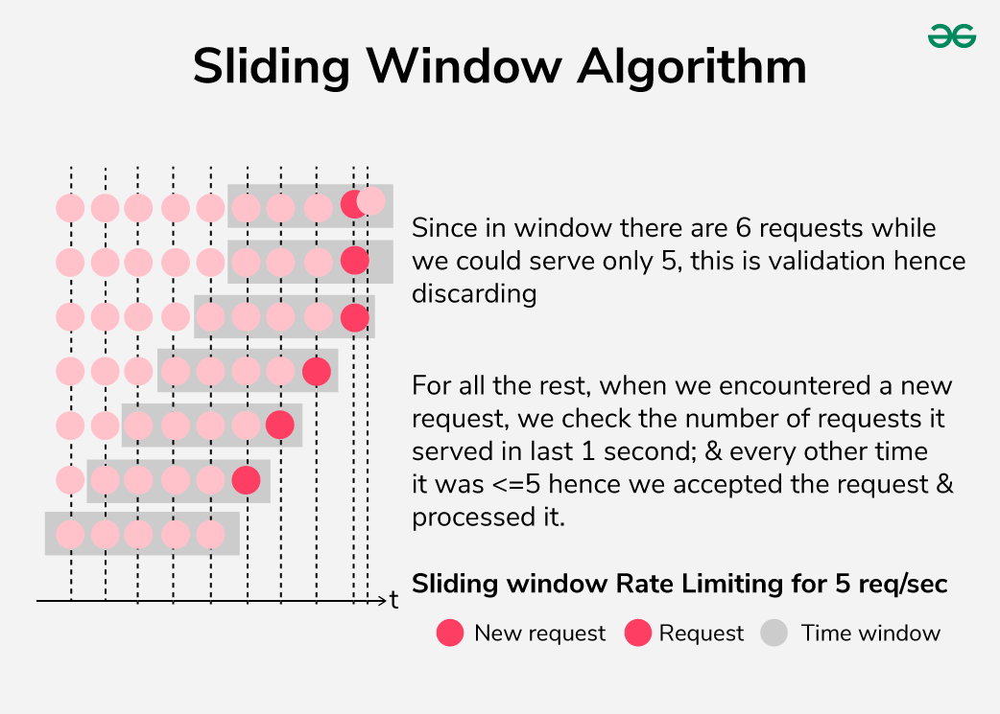

- **优点：**
  - 虽然精度不如固定窗口，但灵活性更高，因此通常被推荐使用。
  - 能更好地应对流量变化的情况。
- **挑战：**
  - 实现起来稍微复杂一些。
  - 比其他类型的算法更复杂，需要更多的内存和计算资源。
- **工作原理：**
  - 滑动窗口日志算法会为每个收到的请求维护一个时间戳日志。
  - 超过预定义时间间隔的请求会从日志中移除，新的请求则会被添加进去。
  - 请求速率是根据滑动窗口内的请求数量计算的。

**滑动窗口算法示例实现：**

```python
class SlidingWindow:
    def __init__(self, window_size, max_requests):
        self.window_size = window_size
        self.max_requests = max_requests
        self.requests = deque()

    def allow_request(self):
        now = time.time()
        while self.requests and self.requests[0] <= now - self.window_size:
            self.requests.popleft()

        if len(self.requests) < self.max_requests:
            self.requests.append(now)
            return True
        else:
            return False
```

### 如何选择合适的算法？

选择合适的速率限制算法取决于以下几个因素：

- **流量模式**
  - 确定流量是突发性的还是持续性的，以此来判断您将要处理的是流量峰值还是持续的流量流。
  - 通过了解峰值时间、平均请求速率和波动情况，可以根据给定系统的特性来确定应该使用哪种算法来管理系统中的流量。
- **实现复杂度**
  - 从这个角度来看，在其他条件相同的情况下，算法越复杂、资源消耗越大，安全性就越低。
  - 有些算法，例如固定窗口算法，实现起来比较简单，但可能缺乏足够的自定义选项；而另一些算法，例如滑动窗口算法或令牌桶算法，实现起来比较复杂，但可以为开发人员提供更好的自定义选项。
- **性能要求**
  - 确保所选算法符合系统对性能和延迟的要求。
  - 为了避免速率限制过程过于复杂，以及引入过多的延迟而给高性能系统带来压力，可能需要选择处理开销低的算法。
- **[可扩展性](https://www.geeksforgeeks.org/system-design/what-is-scalability/)**
  - 算法应能有效应对流量和用户数量的增长。
  - 选择一种不会因系统使用量增加而受到严重影响的算法，以便在系统扩展时仍能保持其有效性。
- **灵活性**
  - 选择一种能够满足应用程序所需灵活性的算法。某些算法允许根据当前应用程序流量调整其他参数，从而在严格的速率限制和偶尔的流量突发之间找到合适的平衡点。

### 处理突发流量和峰值流量

高效处理突发流量和峰值流量对于维持系统稳定性至关重要：

- **令牌桶 (Token Bucket)**
  - 令牌桶非常适合处理突发流量，因为它能够存储令牌。这有助于以最快的速度处理高流量突发，而无需立即拒绝请求。
- **漏桶 (Leaky Bucket)**
  - 漏桶能够以某种方式处理流量，即使请求可能以突发形式出现，也能有效控制流量。
- **滑动窗口 (Sliding Window)**
  - 滑动窗口能够通过固定窗口来应对流量波动，并通过改变窗口来提供更好的速率控制。
- **混合方法**
  - 并行使用多种技术并相互补充，例如，将令牌桶与固定窗口结合使用。因此，这种混合方法在管理稳定流量和突发流量方面都表现出色。

### 速率限制的挑战

以下是速率限制面临的挑战：

- **粒度和精度：**
  - 确定最佳速率限制粒度（例如，每秒、每分钟）和精度（例如，请求的确切数量）可能具有挑战性。
  - 粒度过粗可能无法有效控制突发流量，而粒度过细则会增加计算开销。
- **处理突发流量：**
  - 许多速率限制算法难以处理超出预定义速率限制的突发流量。
  - 这可能导致合法请求被延迟或丢弃，从而影响用户体验。
- **对用户体验的影响：**
  - 过于严格的速率限制可能会因引入延迟或拒绝合法请求而对用户体验产生不利影响。
  - 在保护系统和确保流畅的用户体验之间取得平衡至关重要，但也极具挑战性。
- **实现开销：**
  - 实现和管理速率限制机制会引入额外的计算开销。
  - 这种开销包括维护计数器、计时器或令牌，并且会影响系统性能，尤其是在大规模应用时。
- **可扩展性：**
  - 确保速率限制能够随着流量和系统复杂性的增加而扩展是一项重大挑战。
  - 我们需要可扩展的解决方案来应对不断增长的用户群和不断变化的应用程序需求，同时又不影响性能。

### 速率限制的实际应用示例

以下是一些速率限制的实际应用示例：

- **API：** 为了避免各种滥用行为，大多数 API（包括 Twitter、GitHub 和 Google Maps）都会限制在给定时间间隔内可以发出的请求数量。
- **Web 服务器：** Web 服务器使用速率限制来缓解拒绝服务 (DoS) 攻击，并在流量密度过高或过低时控制服务器资源的使用，以维持服务器的可用性。
- **[内容分发网络 (CDN)](https://www.geeksforgeeks.org/system-design/what-is-content-delivery-networkcdn-in-system-design/)：** CDN 会对缓存对象的访问施加速率限制，以避免各种类型的拥塞，从而向来自不同地理位置的用户稳定地分发内容。
- **电子商务平台：** 这就是为什么电子商务网站会实施限流的原因，以便在销售期间合理控制流量，防止机器人程序控制网站，并避免部分顾客多次购买而其他顾客却无法购买任何商品的情况。
