# 协议、CDN、代理和WebSocket

## [系统设计中的通信协议](https://www.geeksforgeeks.org/system-design/communication-protocols-in-system-design/)

通信协议定义了分布式系统中不同组件如何交换消息的规则。它们确保服务之间顺畅的协调和可靠的交互。选择合适的协议有助于构建可扩展且高效的系统。

- 实现服务之间的无缝通信和协调。
- 提高系统的可靠性、可扩展性和性能。

### 同步通信

同步通信是一种模式，其中一个服务向另一个服务发送请求，并在收到响应后才继续执行。这遵循请求-响应模型，常用于微服务中。

- **HTTP 请求-响应：** 服务使用 HTTP（REST API）或 SOAP 进行通信，并等待响应。
- **RPC（远程过程调用）：** 服务使用 gRPC 等框架调用远程函数并等待结果。
- **同步消息传递：** 一些消息代理支持请求-响应消息传递，其中发送方等待回复。

**示例：** 用户服务向支付服务发送请求，并在收到确认后才完成交易。

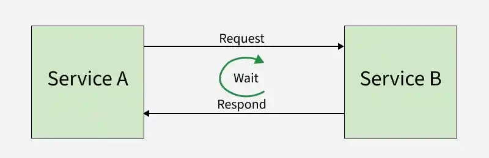

使用同步通信可以简化微服务的开发和调试，因为其请求-响应结构使其更易于理解和控制。

#### 应用场景

同步通信的应用场景包括：

- **实时消息应用：** WhatsApp/Slack 使用事件驱动的异步消息传递，而非严格的请求-响应通信。
- **数据库操作：** 适用于需要立即确认的操作，例如在事务系统中读取或更新关键数据。
- **支付网关：** 确保在线交易中支付授权或失败的即时反馈。
- **需要立即响应的 API：** 例如身份验证 API 或需要即时结果的搜索查询等服务。
- **视频会议和通话：** Zoom/Google Meet 等视频会议工具使用 WebRTC 等实时流媒体协议，而非标准的请求-响应 API。
- **远程过程调用 (RPC)：** 通常用于一个服务需要另一个服务立即响应的情况，例如在基于微服务的系统中。

#### 挑战

同步通信的挑战包括：

- **延迟：** 同步通信会引入延迟，尤其是在服务等待响应缓慢或无响应的服务时。
- **阻塞性：** 服务在等待响应时可能会被阻塞，从而导致性能问题。
- **复杂性：** 虽然同步通信比异步通信简单，但它仍然会增加复杂性，尤其是在大型微服务架构中。
- **错误处理：** 同步通信中的错误处理更具挑战性，因为服务需要处理立即发生的故障。
- **可扩展性：** 同步通信的可扩展性可能不如异步通信，因为服务需要处理更多的并发连接和请求。

#### 异步通信

异步通信是一种服务发送消息而无需等待立即响应的模式。这使得服务可以独立工作，并提高了分布式系统的可扩展性和灵活性。

- 服务使用消息队列和事件驱动/发布/订阅系统（例如 RabbitMQ、Kafka）进行异步通信，消息稍后由消费者处理。
- 发布者发出向多个订阅者广播的事件，从而实现解耦和响应式服务通信，而无需直接交互。

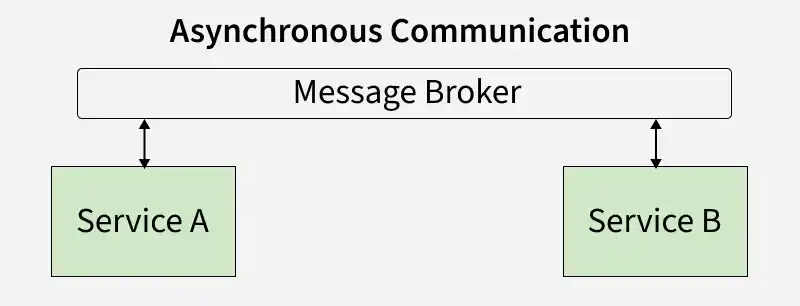

**例如：** 订单服务在用户下单后向队列发送消息，支付和通知服务稍后处理该消息，而不会阻塞用户。

#### 目的

异步通信的目的包括：

- **可扩展性：** 允许微服务同时处理多个请求而不会阻塞，从而提高可扩展性。
- **容错性：** 解耦服务可以防止一个服务故障对其他服务造成快速影响，从而提高容错性。
- **弹性：** 允许服务在发生瞬态故障时缓冲和重试消息，从而提高弹性。

#### 挑战

异步通信的挑战包括：

- **复杂性：** 异步通信需要额外的错误处理、重试和消息缓冲技术，从而增加了复杂性。
- **最终一致性：** 异步通信最终可能导致一致性问题，因为服务可能会使用过时或陈旧的数据。
- **调试和监控：** 由于消息流可能并不总是显而易见的，因此调试和监控异步系统可能比同步系统更困难。
- **消息排序：** 在异步系统中，很难保证消息的正确排序，尤其是在处理分布式系统和最终一致性时。

### 同步通信与异步通信的区别

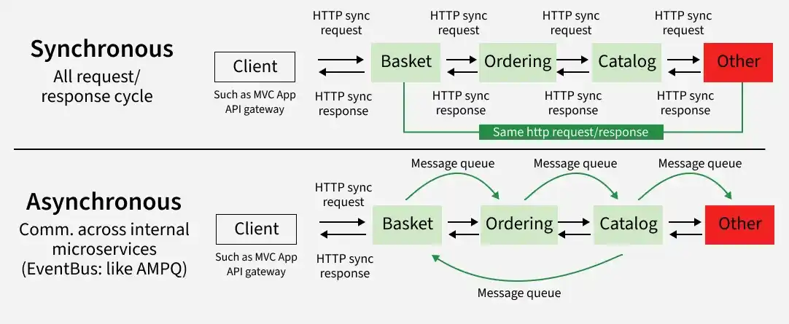

以下是同步通信和异步通信的区别：

| 同步通信                   | 异步通信                     |
| -------------------------- | ---------------------------- |
| 实时通信，服务等待响应     | 通信，服务无需等待响应       |
| 服务阻塞执行，直到收到响应 | 服务无需等待即可继续执行     |
| 需要两个服务同时可用       | 服务可以独立运行             |
| 示例：HTTP、REST、RPC      | 示例：消息队列、事件驱动系统 |
| 由于紧耦合，灵活性较低     | 由于松耦合，灵活性较高       |
| 更容易实现和理解           | 由于队列和消息处理，更复杂   |
| 由于阻塞特性，可扩展性较低 | 通过并行处理，可扩展性很高   |
| 更容易处理错误（立即响应） | 复杂的错误处理（延迟或异步） |
| 最适合实时请求-响应用例    | 最适合后台处理和高负载系统   |

#### 选择合适的通信协议时需要考虑的因素

选择合适的通信协议时，您需要考虑系统需要同步通信还是异步通信。以下是如何选择：

**响应时间要求：** 根据所需的响应速度来决定。

- **同步：** 适用于需要立即响应的情况（例如，面向用户的应用程序）。
- **异步：** 适用于可以接受延迟且任务可以在后台运行的情况。

**系统解耦：** 考虑服务的独立程度。

- **同步：** 适用于紧耦合系统。
- **异步：** 适用于松耦合、独立的服务。

**可扩展性需求：** 评估系统应对增长的能力。

- **同步：** 在高负载下可能出现瓶颈。
- **异步：** 通过负载均衡实现更好的可扩展性。

**可靠性和容错性：** 检查系统在故障期间的行为。

- **同步：** 依赖于所有服务的可用性。
- **异步：** 由于任务可以排队并重试，因此更可靠。

**实时处理与批处理：** 根据任务的时间要求来选择。

- **同步：** 最适合实时操作（例如，实时交互）
- **异步：** 适合后台或批量作业

**带宽和资源限制：** 考虑系统资源使用情况。

- **同步：** 需要持续连接和更高的资源占用
- **异步：** 使用队列处理，资源占用更少

## [域名系统（DNS）](https://www.geeksforgeeks.org/computer-networks/domain-name-system-dns-in-application-layer/)

将人类可读的域名解析为 IP 地址，使计算机能够通过互联网进行通信。这项功能由域名系统 (DNS) 实现，DNS 以分层分布式的方式运行，并通过缓存提升性能。

DNS 使用分层系统（根服务器、顶级域名服务器、权威服务器）提供名称到地址的解析，以查找域名信息。

DNS 通过使用缓存机制来提高性能，减少重复请求的查找时间。

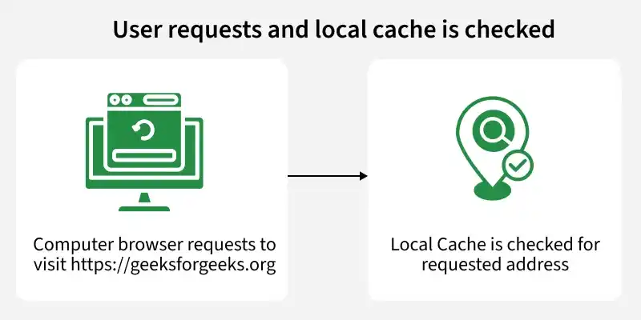
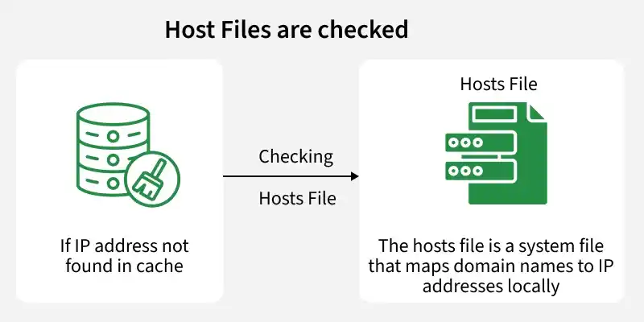
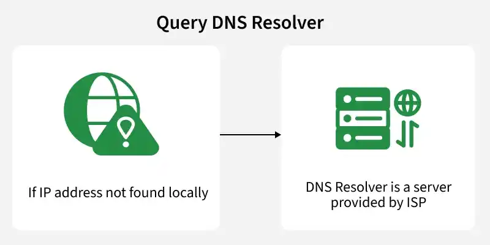
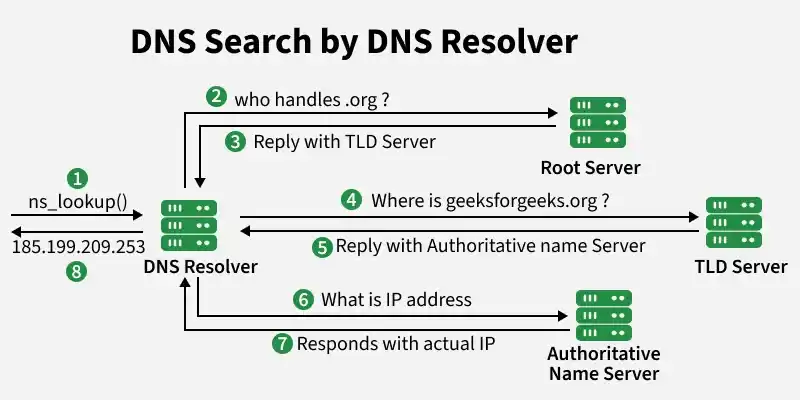
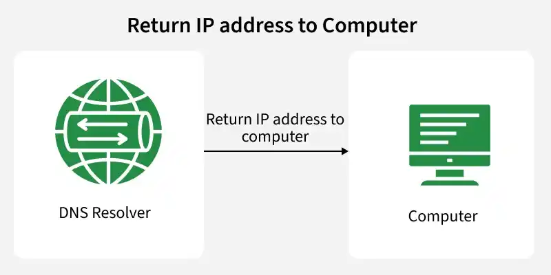

**例如：** 当您在浏览器中输入类似 google.com 的网站名称时，系统无法直接识别该名称。DNS 会将其转换为托管该网站的服务器的 IP 地址。这样，您的浏览器才能连接到正确的服务器并加载网页。

### 工作原理

DNS 解析过程可以分为几个步骤，确保用户只需在浏览器中输入域名即可访问网站。

- **用户输入：** 用户在浏览器中输入域名（例如 [www.geeksforgeeks.org](http://www.geeksforgeeks.org/)）。
- **本地缓存检查：** 浏览器或操作系统检查其缓存中是否存储了 IP 地址。
- **DNS 解析器查询：** 如果未找到，则将请求发送到 DNS 解析器（通常由 ISP 提供）。
- **根服务器查询：** 解析器查询根服务器，根服务器指向正确的顶级域名 (TLD) 服务器。
- **TLD 服务器响应：** TLD 服务器将解析器指向该域名的权威服务器。
- **权威服务器响应：** 权威服务器返回实际的 IP 地址。
- **最终响应：** 解析器将 IP 地址发送回用户，浏览器连接到服务器。

### DNS 结构

DNS 的结构本质上是分层的，这使得全球互联网能够实现可扩展且有序的域名解析。

#### 1. 根域名

DNS 层次结构的顶层。

- 以域名末尾的点号 (.) 表示。
- 作为域名解析的起点。

#### 2. 顶级域名 (TLD)

根域名之下的级别，定义了域名后缀。

- 包括 .com、.org、.net、.edu 等后缀。
- 有助于按用途或地区对域名进行分类。

#### 3. 二级域名

组织注册的主要域名。

- 出现在顶级域名之前（例如，example.com 中的“example”）。
- 唯一标识顶级域名下的域名。

#### 4. 子域名

组织使用的主要域名的扩展。

- 示例：www、mail、blog
- 有助于构建网站的不同部分

#### 5. 主机名

用于标识域内的特定服务器或设备。

- 示例：web1、mailserver、ftp
- 使用 DNS 记录映射到实际 IP 地址

### 域名类型

DNS 将域名分为不同类型，以组织全球命名系统并支持正向和反向解析。

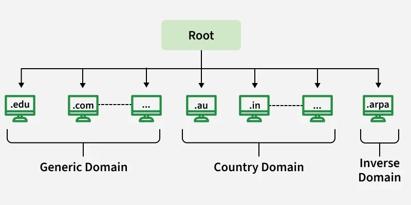

#### 1. 通用顶级域名 (gTLD)

这些域名用于一般用途，不与任何国家/地区绑定。

- 包括 .com、.org、.net 等后缀。
- 不受任何特定国家/地区的限制
- 用于商业、组织和教育用途

#### 2. 国家/地区代码顶级域名 (ccTLD)

这些域名代表特定的国家/地区或地理区域。

- 例如：.in（印度）、.us（美国）、.uk（英国）、.jp（日本）
- 由相应的国家/地区主管机构管理

#### 3. 反向 DNS

这些域名用于将 IP 地址映射回域名。

- 用于反向查找（IP 地址 -> 域名）
- IPv4 使用 in-addr.arpa
- IPv6 使用 ip6.arpa
- 使用 PTR（指针）记录

### 域名服务器

域名服务器负责存储 DNS 记录并响应将域名解析为 IP 地址的查询。

- 存储 DNS 记录，例如 A、AAAA、MX、CNAME、NS 和 PTR 记录。
- 响应来自客户端或其他 DNS 服务器的查询。
- 在分层 DNS 结构中运行。
- 可以执行递归查询或权威查询功能。
- 通过提供必要的 DNS 数据，实现用户与 Web 服务器之间的通信。

### DNS 查询

也称为 DNS 解析，是将域名转换为其对应的 IP 地址的过程，以便设备可以与目标服务器建立通信。

#### 关键组件

DNS 的关键组件协同工作，高效地将域名解析为 IP 地址。

**1. DNS 解析器：** 启动 DNS 查询过程，并充当客户端和 DNS 服务器之间的中介。

- 从客户端发起 DNS 查询。
- 将请求转发到相应的 DNS 服务器以获取 IP 地址。

**2. 递归查询：** 解析器代表客户端获取完整答案的查询。

- 解析器会在需要时跨多个 DNS 服务器执行完整查找。
- 向客户端返回最终 IP 地址或错误信息。

**3. 迭代查询：** 服务器提供其所掌握的最佳信息或指向其他 DNS 服务器的查询。

- 返回部分响应或指向其他 DNS 服务器。
- 帮助解析器逐步找到最终答案。

**4. 非递归查询：** 答案已存在于缓存或权威服务器中的查询。

- 立即返回响应，无需进一步查找。
- 无需与 DNS 服务器进行额外的通信。

### DNS 缓存

一种临时存储 DNS 记录的技术，旨在减少重复查询并提高解析效率。

- 将先前解析的域名记录存储在本地。
- 缩短未来请求的响应时间。
- 最大限度地减少外部 DNS 服务器的负载。
- 提升整体网络性能。

### TTL（生存时间）

TTL 定义了 DNS 记录在缓存中保持有效的时间。

- 指定 DNS 记录在缓存中保留的时间。
- 由权威 DNS 服务器定义。
- 以秒为单位。
- 过期后，需要进行新的 DNS 查询。

**例如：** 如果 TTL 值为 3600 秒，则记录将在缓存中保留一小时，之后必须刷新。

### 反向 DNS 查询

反向 DNS 查询是将 IP 地址解析为其关联的域名的过程，其功能与标准 DNS 解析相反。

- 将 IP 地址转换为域名。
- 使用特殊域名，例如 in-addr.arpa（IPv4）和 ip6.arpa（IPv6）。
- 依赖 PTR（指针）记录进行映射。

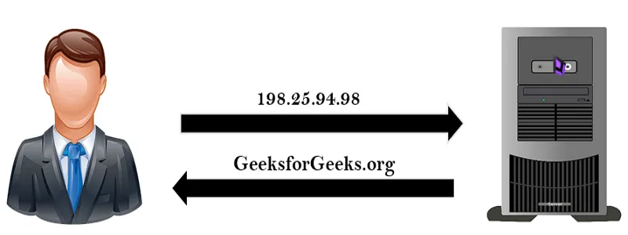

反向 DNS 通常用于：

#### 1. 网络诊断

有助于分析和排除网络故障。

- 帮助管理员识别与特定 IP 地址关联的域名。
- 协助进行流量分析和故障排除。

#### 2. 电子邮件安全

确保电子邮件来自合法来源。

- 邮件服务器使用它来验证发件人身份。
- 有助于减少垃圾邮件和欺诈性电子邮件活动。

### DNS 记录类型

不同的 DNS 记录类型用于存储有关域的特定信息。

- **A 记录：** 将域名映射到其对应的 IPv4 地址。
- **CNAME 记录：** 创建别名，将一个域名指向另一个域名。
- **MX 记录：** 指定负责接收域电子邮件的邮件服务器。
- **TXT记录：** 存储用于验证和电子邮件身份验证的文本信息。

## [DNS 缓存](https://www.geeksforgeeks.org/computer-networks/what-is-dns-caching/)

DNS 缓存是一种临时存储系统，用于存储最近的域名到 IP 地址的映射关系，以加快未来的查询速度。系统不会每次都查询 DNS 服务器，而是首先检查缓存，从而减少查询时间。

- 存储之前解析过的域名（例如，google.com -> IP 地址），以便更快地访问。
- 降低 DNS 服务器负载，提高整体浏览性能和效率。

**示例**

- 当您访问 [www.GeeksforGeeks.com](http://www.geeksforgeeks.com/) 等网站时，您的系统会解析其 IP 地址（例如，172.217.0.46）并将其临时存储在 DNS 缓存中。
- 如果您在 TTL 期限内再次访问同一网站，系统将使用缓存的 IP 地址，而无需再次查询 DNS，从而加快加载速度并减少网络流量。

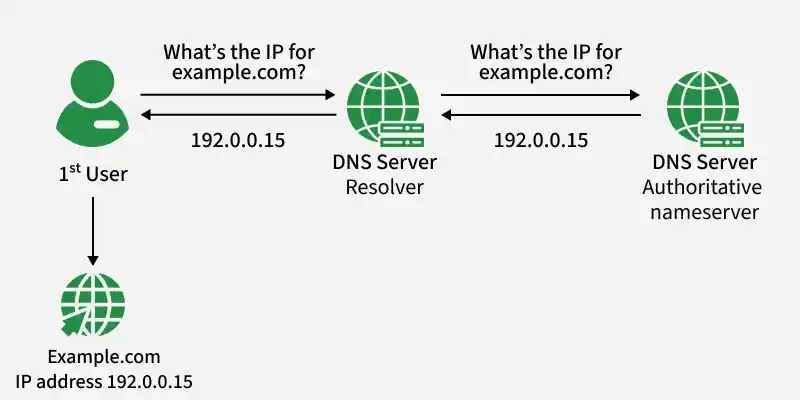

首次发出 DNS 查询时，DNS 解析器必须经过多个步骤才能从权威 DNS 服务器检索到对应的 IP 地址。获取到此信息后，它会被存储在缓存中，以便后续对同一域名的请求无需重复整个查找过程即可更快地得到响应。

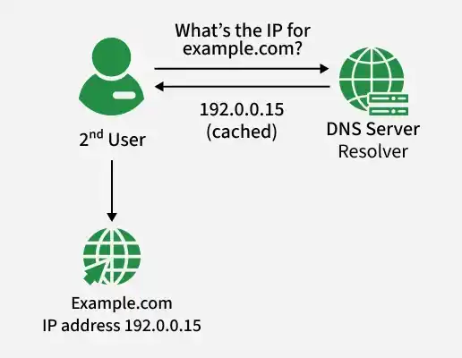

### 工作原理

DNS 缓存会临时存储域名对应的 IP 地址，以加快后续请求的速度。

- **首次请求：** 当您访问一个网站（例如 example.com）时，您的系统会向 DNS 服务器查询其 IP 地址。
- **缓存存储：** IP 地址会保存在本地——您的设备、路由器或 ISP 的服务器上——保存期限由 TTL（生存时间）定义。
- **后续请求：** 以后访问 example.com 时，系统会使用缓存的 IP 地址，从而跳过 DNS 查询，加快连接速度。

### DNS 缓存层级

[DNS](https://www.geeksforgeeks.org/computer-networks/domain-name-system-dns-in-application-layer/) 缓存发生在多个层级，形成一个层级结构，可以优化性能并减少重复的 DNS 查询。

- **浏览器缓存：** 第一层缓存发生在 Web 浏览器中。它会存储最近访问过的域名到 IP 地址的映射关系，以便快速检索。
- **操作系统 (OS) 缓存：** 如果浏览器缓存中没有所需的记录，则会检查操作系统缓存。操作系统会维护一个本地缓存，用于存储应用程序（包括浏览器）检索到的 DNS 记录。
- **DNS解析器缓存：** 如果操作系统缓存中缺少该记录，则请求会发送到DNS解析器缓存，该缓存通常由您的互联网服务提供商 (ISP) 或第三方DNS服务提供商维护。
- **权威DNS服务器：** 如果缓存中没有该记录，解析器会查询权威DNS服务器，该服务器保存着该域的最终DNS记录。

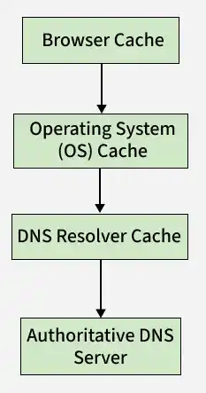

### DNS 缓存中的 TTL（生存时间）

TTL 决定了 DNS 记录在缓存中保持有效的时间，超过该时间后，记录将被刷新或丢弃。TTL 以秒为单位，对缓存效率和准确性起着关键作用。

**TTL 在 DNS 缓存中的作用：** TTL（生存时间）有助于管理 DNS 记录在缓存中的存储时间，从而确保速度和数据准确性。

- **设置 TTL：** 权威 DNS 服务器为每个记录设置 TTL。
- **缓存和倒计时：** DNS 查询解析成功后，TTL 倒计时开始。过期后，缓存的记录将被丢弃，触发新的 DNS 查询。

**重要性：** TTL 在平衡 DNS 查询速度和确保数据准确性方面起着关键作用。

- 减少重复 DNS 查询所需的时间
- 确保 DNS 记录及时更新
- 防止数据过时，同时保持快速访问

### 优势

DNS 缓存的优势包括：

- **更快的网站加载速度：** 它消除了重复的 DNS 查询，使网页在后续访问时能够快速加载。
- **减少网络流量：** 缓存最大限度地减少了 DNS 查询。这降低了本地网络和外部 DNS 服务器的负载。
- **降低 DNS 服务器负载：** 由于部分查询会到达权威 DNS 服务器，因此服务器过载或响应速度慢的风险得以降低。

### DNS 缓存的层次

DNS 缓存发生在系统的不同层级，以提高性能并减少重复的 DNS 查询。

- **路由器级 DNS 缓存：** 路由器将本地连接的设备的 DNS 查询缓存起来，从而减少外部 DNS 请求并提高网络效率。
- **DNS 解析器（ISP/第三方）缓存：** DNS 解析器缓存多个用户的响应，从而减少重复查询权威服务器的需求并提高解析速度。
- **内容分发网络 (CDN) 缓存：** CDN 缓存内容，并帮助将用户路由到最近的服务器，从而降低延迟并缩短加载时间。
- **主机文件缓存：** hosts 文件起到手动覆盖的作用，允许系统在发出任何 DNS 查询之前解析域名。

### 清除 DNS 缓存

清除 DNS 缓存会清除已存储的 DNS 记录，有助于解决诸如 IP 地址映射过时或错误等问题。

**1. 浏览器级 DNS 缓存清除（Chrome）：** 此操作会清除浏览器存储的缓存 DNS 记录，以确保浏览器获取最新数据。

- 打开 Chrome 浏览器并访问：chrome://net-internals/#dns
- 点击“清除主机缓存”按钮。

**2. 操作系统级 DNS 缓存清除（Windows）：** 此操作会清除操作系统存储的 DNS 记录，以确保获取新的域名解析结果。

- 以管理员身份打开命令提示符
- 输入 ipconfig /flushdns 并按 Enter 键
- 您应该会看到确认信息：“已成功刷新 DNS 解析器缓存”

详细阅读[何时以及如何刷新 DNS 缓存](https://www.geeksforgeeks.org/blogs/how-to-flush-dns-cache/)。

### DNS 缓存管理最佳实践

有效的 DNS 缓存管理可确保系统内域名解析快速、可靠且保持最新。

- **设置合适的 TTL 值：** 选择兼顾性能和数据新鲜度的 TTL 值。较短的 TTL 值可加快更新传播速度，而较长的 TTL 值可减少 DNS 查询并提高缓存效率。
- **定期刷新缓存：** 定期刷新 DNS 缓存，尤其是在 DNS 记录频繁更改的环境中。这有助于防止因记录过期或失效而导致的问题。
- **使用可靠的 DNS 服务器：** 配置多个 DNS 服务器以确保冗余并避免单点故障。

### DNS 缓存安全

保护 DNS 缓存对于抵御攻击和确保域名解析的完整性至关重要。

- **防止 DNS 缓存投毒：** 使用 DNSSEC 验证 DNS 响应的真实性和完整性，防止恶意篡改。
- **缓解 DNS 放大攻击：** 对 DNS 查询实施速率限制，防止攻击者利用您的服务器进行放大攻击。
- **防止未经授权的 DNS 更改：** 确保只有授权人员才能修改 DNS 记录，并使用多因素身份验证和加密通信通道等安全方法。

## [DNS缓存清理](https://www.geeksforgeeks.org/blogs/how-to-flush-dns-cache/)

有时，网站无法加载或网络速度缓慢是由于 DNS 缓存条目过时造成的。这些存储的记录可能包含错误信息，从而导致连接问题。清除 DNS 缓存有助于刷新这些记录，并提升浏览性能。

- 清除 DNS 缓存会移除过时或错误的记录，从而帮助解决`site not found`或加载缓慢等错误。
- 它确保使用最新的 DNS 查询，减少延迟，并防止因缓存数据损坏或恶意而导致的潜在问题。

**例如：** 当网站显示错误或加载过时的版本时，可能是由于 DNS 缓存数据陈旧造成的。清除 DNS 缓存会强制系统获取最新的 IP 地址。这有助于网站正确加载并提升性能。

### 清除 DNS 缓存的好处

清除 DNS 缓存有助于解决连接问题、提升浏览性能并确保域名解析的准确性。

#### 1. 修复网站加载问题

清除过时的 DNS 记录有助于系统连接到正确的服务器。

- 移除导致`site can't be reached`等错误的旧 IP 映射。
- 强制系统获取最新 IP 地址以确保正常访问。

#### 2. 解决网络变更后的问题

确保您的系统正确反映最新的 DNS 或主机更新。

- 在更改 DNS 服务器或迁移网站后非常有用。
- 防止因缓存数据过期而导致的冲突。

#### 3. 提升隐私和安全

移除潜在的不安全或被篡改的 DNS 条目。

- 防止 DNS 欺骗或恶意缓存修改。
- 确保连接到合法的服务器。

#### 4. 恢复浏览性能

修复因 DNS 条目损坏或过期而导致的延迟。

- 清除导致域名解析速度变慢的错误缓存数据。
- 有助于恢复正常的浏览速度和响应能力。

#### 5. 简化网络故障排除

作为快速解决常见网络问题的第一步。

- 通常无需重置路由器或系统即可解决问题。
- 在尝试复杂的修复方法之前，提供快速简便的解决方案。

### 在 Windows、Mac 和 Linux 操作系统中清除 DNS 缓存

如果您遇到上述任何问题，请阅读本节，了解如何在 macOS、Windows 和 Linux 系统中清除 DNS 缓存。

#### 1. 在 Windows 系统中清除 DNS 缓存

在 Windows 系统中清除 DNS 缓存需要使用命令提示符。请按照以下步骤操作，成功清除 Windows 系统中的 DNS 缓存。

##### 步骤 1：打开命令提示符

- 按 Win + R 打开命令提示符，输入 cmd，然后按 Enter 键。

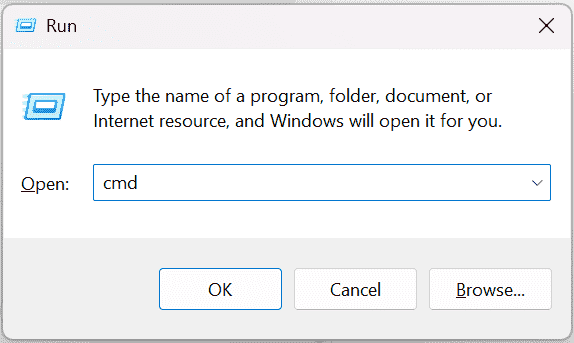

##### 步骤 2：使用 ipconfig

在打开的命令提示符窗口中，输入以下命令并按 Enter 键：

```sh
ipconfig /flushdns
```


##### 步骤 3：刷新 DNS 缓存

如果成功，您将看到一条消息，提示`已成功刷新 DNS 解析器缓存`。

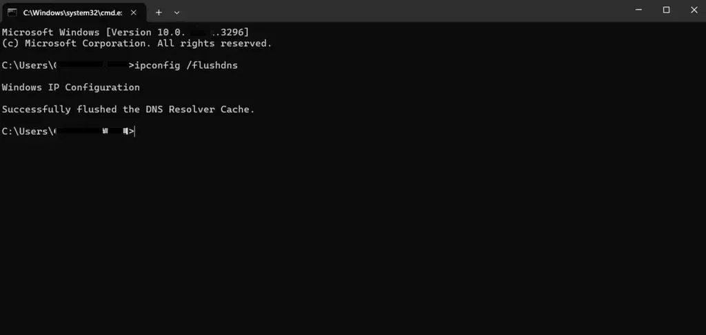

#### 2. 在 Mac 上刷新 DNS 缓存

以下是在 Mac 上刷新 DNS 缓存的方法：

- 按 F4 键打开 Spotlight。
- 将出现一个搜索栏；输入`Terminal`并点击打开。


- 输入以下命令并按 Enter 键：

```sh
sudo dscacheutil -flushcache; sudo killall -HUP mDNSResponder
```

- 出现提示时，输入您的管理员密码。这是以管理员权限运行命令所必需的。

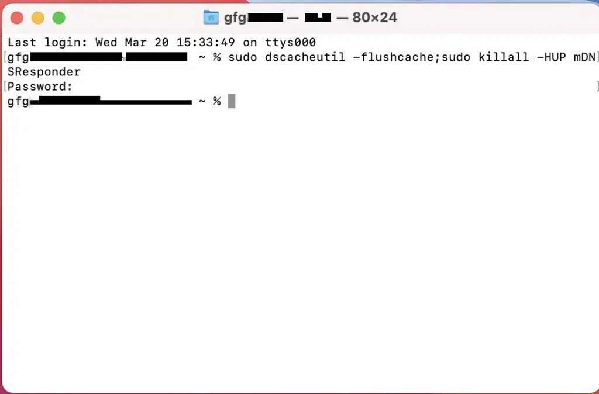

- 再次按 Enter 键。如果成功，您不会看到任何确认信息，但您的 DNS 缓存将被刷新。

#### 3. 在 Linux 上刷新 DNS 缓存

在 Linux 上刷新 DNS 缓存的具体命令可能因发行版而异。以下是一些常用方法：

##### 对于 Ubuntu 和 Debian

- 打开终端窗口。
- 输入以下命令并按 Enter 键：

```sh
sudo systemd-resolve --flush-caches
```

##### 对于较新版本的 Ubuntu

您可能需要使用以下命令：


```sh
sudo resolvectl flush-caches
```

如果成功，您不会看到任何确认信息，但您的 DNS 缓存将被刷新。

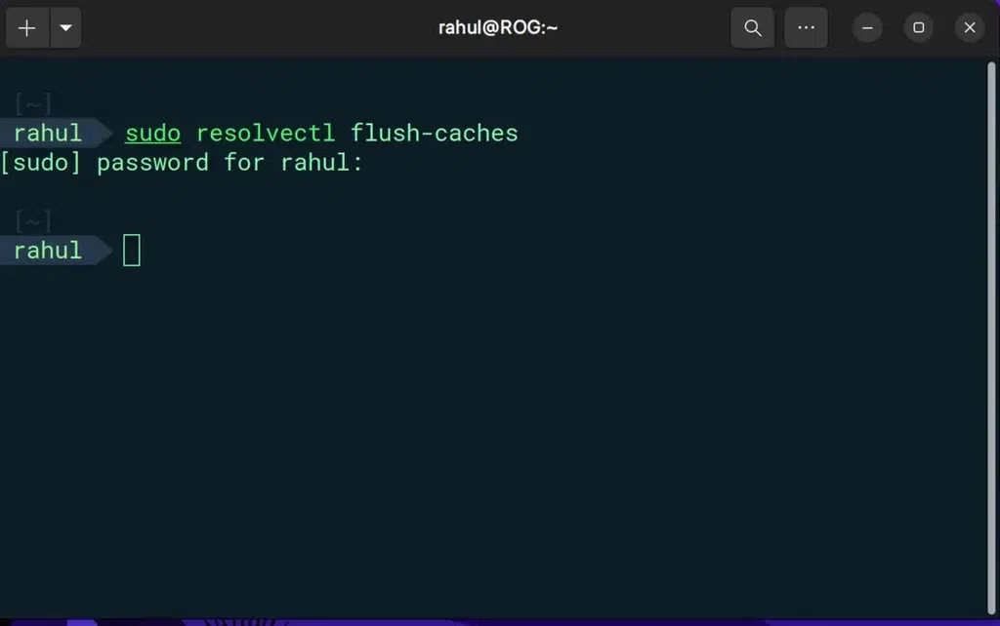

##### 其他发行版

以下是一些其他 Linux 发行版的示例：

###### Fedora/CentOS

```sh
sudo service nscd restart
```

###### Arch Linux

```sh
sudo systemd-resolve --flush-caches
```

清除 DNS 缓存后，首次访问网页时可能会出现轻微延迟。这是因为您的设备需要从 DNS 服务器获取新的 IP 地址。这种延迟应该很短，后续访问同一网站应该会以正常速度加载。

### 清除 DNS 缓存的局限性

清除[DNS（域名系统）](https://www.geeksforgeeks.org/computer-networks/working-of-domain-name-system-dns-server/)缓存并非解决所有计算机网络连接问题的万能方法。以下是一些可能无法解决的问题：

#### 1. 硬件或软件问题

清除 DNS 缓存无法解决与设备或网络设置相关的问题。

- 诸如网速慢、频繁断线或路由器故障等问题需要进行硬件或系统级修复。
- 网络驱动程序或系统配置错误也可能导致连接问题。

#### 2. 网站宕机

如果网站本身无法访问，DNS 刷新也无济于事。

- 正在维护或遇到服务器问题的网站无法访问。
- 问题出在服务器端，而不是您的本地系统。

#### 3. 网络配置错误

错误的网络设置会导致无法正常连接互联网。

- 错误的 DNS 服务器设置或 IP 配置可能会阻止访问。
- 请确保您的网络已根据您的互联网服务提供商 (ISP) 的要求正确配置。

## [生存时间（TTL）](https://www.geeksforgeeks.org/computer-networks/what-is-time-to-live-ttl/)

生存时间 (TTL) 定义了数据在网络或系统中被视为有效的时长，超过该时长后数据将过期。它有助于确保过时的信息在需要时自动删除和刷新。

- TTL 控制数据的生命周期，防止使用过时或陈旧的信息。
- 通过限制不必要的数据循环，有助于提高网络效率。
- TTL 常用于 DNS 缓存和内容分发网络 (CDN) 等系统中。

**例如：** 当您访问某个网站时，其 IP 地址会连同 TTL 值一起存储在您的 DNS 缓存中。如果您在 TTL 过期前再次访问该网站，则会使用缓存的 IP 地址；否则，将执行新的 DNS 查询以获取更新的信息。

### 工作原理

TTL 表示跳数限制，即数据包在被丢弃之前可以经过的路由器数量。

- 发送主机将初始 TTL 值设置为数据包头部的一个 8 位二进制字段。
- 数据报的 TTL 字段由发送方设置，并由到达目的地的路径上的每个路由器递减。
- 路由器在转发 IP 数据包时，会将数据包的 TTL 值至少减 1。
- 当数据包的 TTL 值降至 0 时，路由器会丢弃该数据包，并向源主机发送[ICMP 消息](https://www.geeksforgeeks.org/computer-networks/internet-control-message-protocol-icmp/)。
- 该系统确保网络中传输的数据包在经过一定时间后被丢弃。

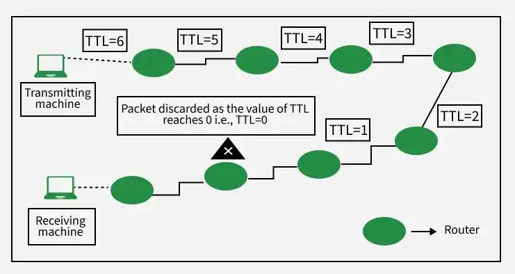

**示例**

主机 A 向主机 B 发送一个初始 TTL 值为 225 的 ping 数据包。

- 主机 A 发送一个初始 TTL 值为 255 的数据包。
- 路由器 A 将 TTL 值减 254 并将其转发给路由器 B。
- 路由器 B 将 TTL 值减 253 并将其发送给路由器 C。
- 路由器 C 将 TTL 值减 252 并将其继续转发。
- 数据包到达主机 B 时，TTL 值为 252。
- 如果在任何路由器处 TTL 值变为 0，则该数据包将被丢弃。
- 向发起主机发送 ICMP 超时消息。

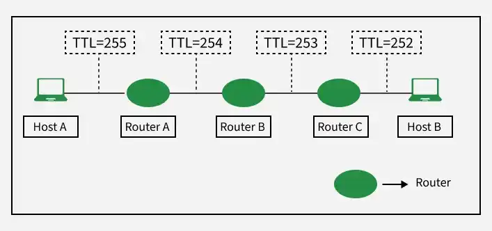

### DNS 中的 TTL

DNS 中的 TTL 定义了 DNS 记录在缓存中保存的时间，超过该时间后需要刷新。它是一个数值，设置在域的权威域名服务器上的 DNS 记录中。

- 它指定了缓存记录可以使用的秒数。
- TTL 过期后，缓存服务器会向权威服务器请求更新的数据。
- 有助于平衡性能和数据新鲜度。

### HTTP 中的 TTL

HTTP 中的生存时间 (TTL) 定义了资源在必须刷新之前可以缓存的时间。

- 以秒为单位计量，并通过 Cache-Control 等标头进行控制。
- 举例：max-age=60 表示资源缓存 60 秒。
- max-age=0 表示资源不应被缓存。
- 影响页面加载速度（缓存可提升性能）。
- 影响内容新鲜度（较长的 TTL 可能导致数据过时）。

TTL 配置指南

- 静态内容（图片、文档）：由于静态内容很少更改，因此应使用较长的 TTL。
- 动态内容（HTML、用户生成的数据）：应使用较短的 TTL 或避免缓存。
- 频繁更改的部分（例如评论）：通常不建议缓存。

### TTL 超时

当 IP 数据包的 TTL 值在到达目的地之前达到 0 时，就会发生 TTL 超时。

- 每个路由器在每次跃点后都会将 TTL 值减 1。
- 当 TTL 变为 0 时，路由器会丢弃该数据包。
- 路由器会向发送方发送 ICMP 超时消息。
- 这有助于使用 traceroute 等工具识别网络问题。

### TTL 的应用

TTL 值用于 ping、traceroute 和 pathping 等网络实用程序。

1. ping 命令用于测试目标计算机的可达性。它验证源计算机和目标计算机或网络设备之间是否可以通信。
2. ping 命令的工作原理是向目标计算机发送 ICMP 回显请求消息，然后等待响应。
3. ping 命令的执行会提供两个重要信息：返回的响应数量以及返回响应所需的时间。

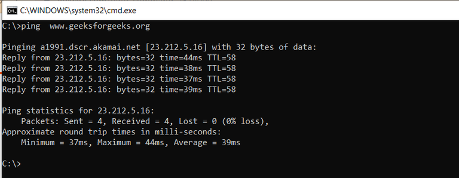

1. [tracert/traceroute 命令](https://www.geeksforgeeks.org/techtips/how-to-use-the-tracert-traceroute-command-in-windows/)用于追踪两台设备之间的路径。

2. 连接路径上可能经过多个路由器。因此，该命令会提供连接两台设备路径上所有路由器的名称或 IP 地址。

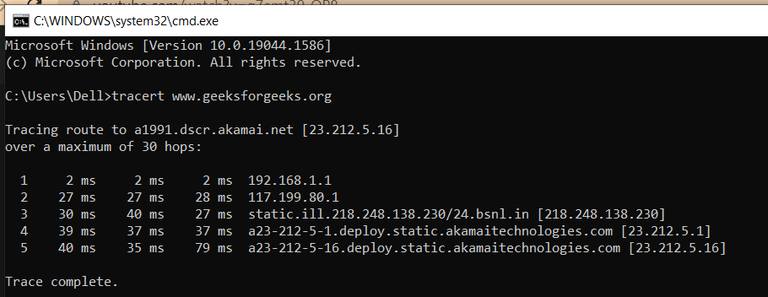

1. 在[互联网协议 (IP)](https://www.geeksforgeeks.org/computer-networks/what-is-internet-protocol-ip/)多播中，TTL 可以控制数据包的转发范围。

- TTL 0：限制在同一主机上
- TTL 1：限制在同一子网内（子网 0 限制在同一主机上）
- TTL 32：限制在同一站点内
- TTL 64：限制在同一区域内
- TTL 128：限制在同一洲内
- TTL 255：无限制

1. TTL 也用于域名系统 (DNS) 的缓存。TTL 是一个数值，表示 DNS 缓存服务器在联系权威服务器获取新副本之前，用于提供 DNS 记录的持续时间。

### TTL 中的时间限制或跳数限制

生存时间 (TTL) 定义了数据包在网络中可以传输的最大跳数，在 IPv6 中，它被称为跳数限制。

- 在 IPv4 中，该字段称为 TTL，而在 IPv6 中，它被称为跳数限制。
- 每个路由器在转发数据包时，都会将该值至少减 1。
- 当该值达到 0 时，数据包将被丢弃，并发送 ICMP 消息。
- 防止数据包无限循环，避免网络拥塞。
- 有助于维持网络的稳定性和高效运行。

### 常用 TTL 值

TTL 值定义了 DNS 记录在刷新前缓存的时间，有助于平衡性能和更新频率。

- 典型的 TTL 值为 86400 秒（24 小时）。
- MX 和 CNAME 记录通常具有更长的 TTL，因为它们的更改频率较低。
- 对于关键服务，建议使用 3600 秒（1 小时）的 TTL。
- 更长的 TTL 值可以提高性能，但可能会延迟更改的传播。
- 在迁移服务之前，通常会降低 TTL 值，以最大限度地减少停机时间。

### TTL 的其他用途

- 在物联网网络中，TTL 用于管理消息的生命周期，以防止过期消息在网络中传播。
- 通过使用跳数限制来防止路由协议中的路由环路，确保信息不会无限传播。
- 它有助于管理 P2P 网络的负载，并防止请求无限传播。
- 它用于管理 VPN 会话的持续时间，在预设时间后终止连接。
- 它为区块链中的交易验证设定了时间限制。

## [系统设计中的内容分发网络（CDN）](https://www.geeksforgeeks.org/system-design/what-is-content-delivery-networkcdn-in-system-design/)

CDN（内容交付网络）是一种分布式服务器网络，旨在提高内容交付的速度、可用性、可扩展性和可靠性。它通过缓存和提供来自靠近用户的战略位置边缘服务器的内容来实现这一点。

- 分布式服务器网络，这些服务器协同工作，更快、更高效地向用户交付内容（如图像、视频和静态文件）。
- 这些服务器称为边缘服务器，战略性地分布在不同的地理位置。
- 通过缓存更靠近用户的内容、减少延迟以及从源服务器卸载流量，帮助提高网站和应用程序的性能、可靠性和可扩展性。

**示例：** 当印度用户访问在美国托管的网站时，CDN 会从附近的印度服务器提供内容，从而使网站加载速度更快。

### 1.没有CDN

当用户从没有 CDN 的网站请求内容时，请求将直接发送到托管该网站的源服务器。源服务器处理请求并将请求的内容发送回用户的设备。


如果源服务器距离用户较远，则可能由于延迟增加而导致加载时间延长。

高流量或服务器过载会导致响应速度变慢，甚至服务器宕机，从而对用户体验产生负面影响。

### 2. 使用 CDN

当用户从使用 CDN 的网站请求内容时，CDN 会识别用户的位置并将请求路由到最近的边缘服务器。边缘服务器分布在不同的区域，并将缓存内容存储在更靠近用户的位置，从而实现更快的交付速度。


- 由于边缘服务器分布在全球各地，内容分发速度更快，从而降低了延迟并缩短了加载时间。
- CDN 还有助于将流量从源服务器分流，降低服务器过载的风险，即使在流量高峰期也能确保性能稳定。

### 实际应用

内容分发网络 (CDN) 被大型平台广泛用于快速高效地向全球用户分发内容。

- **流媒体分发（例如 Netflix、YouTube）：** CDN 通过从附近的服务器分发内容，帮助流畅地播放视频和音频内容。这减少了缓冲，即使在流量高峰期也能确保高质量的播放。
- **电子商务（例如 Amazon）：** CDN 可以快速加载产品图片、页面和其他内容。这改善了用户体验，并能高效地处理高流量，尤其是在促销期间。
- **软件分发：** CDN 用于在不同地区快速分发软件更新、补丁和应用程序。这确保了全球用户都能获得更快、更可靠的下载体验。
- **游戏：** CDN 通过从距离用户更近的服务器分发游戏数据来降低延迟。这使得在线游戏平台的游戏体验更加流畅，实时互动效果更佳。
- **API 分发：** CDN 可以提升移动和 Web 应用中使用的 API 的性能。它们可以缩短响应时间，并高效处理大量请求。

### CDN 的类型

CDN 可以根据其架构和功能分为以下几种类型：

#### 1. 公共 CDN

任何可供所有在线用户访问的 CDN 都称为公共 CDN。这些 CDN 用于快速高效地向用户提供内容，包括图片、视频和其他静态文件。它们通常由庞大的全球服务器网络组成。

**例如：** Cloudflare、Akamai 和 Amazon CloudFront。

#### 2. 私有 CDN

仅供一家公司或组织使用的 CDN 称为私有 CDN。这些 CDN 用于向内部用户或客户分发内容，它们通常部署在私有云或组织自身的内部基础设施中。私有 CDN 可以更好地控制内容分发，并可根据特定的性能和安全需求进行定制。

**例如：** Google Cloud CDN、Netflix Open Connect。

#### 3. 点对点 (P2P) CDN

这类 CDN 利用点对点网络技术直接在用户之间分发内容，从而减少对集中式服务器的依赖。

**例如：** BitTorrent、WebTorrent。

#### 4. 混合 CDN

混合 CDN 结合了公共 CDN 和私有 CDN 的特点。在混合 CDN 中，部分内容通过公共 CDN 分发，而其他内容则通过私有 CDN 分发。这种方法允许组织根据成本、性能和安全要求等因素优化内容分发。

**例如：** Microsoft Azure CDN。

#### 5. 推送 CDN

在推送 CDN 中，内容会在需要之前上传或“推送”到 CDN 服务器。这有助于提升性能，确保用户在请求内容时能够更便捷地获取。推送式 CDN 通常用于缓存大型文件或更新频率较低的内容。

**示例：** KeyCDN、CDN77

#### 6. 拉取式 CDN

拉取式 CDN 在用户请求时从源服务器获取内容，主要用于缓存静态或频繁访问的内容。动态内容也可以被分发，但通常会选择性地缓存或缓存时间较短。

**示例：** Amazon CloudFront、Cloudflare

### 组件

典型的 CDN 由以下关键元素组成：

- **边缘服务器：** 靠近最终用户的分布式服务器，负责快速分发和缓存内容。
- **源服务器：** 作为内容分发的主要来源，也是管理和存储原始内容的主要位置。
- **内容分发节点：** 负责在 CDN 内路由和优化内容分发的网络节点，确保高效的流量管理。
- **控制平面：** 内容缓存、路由、[负载均衡](https://www.geeksforgeeks.org/system-design/what-is-load-balancer-system-design/)和其他 CDN 功能由这些软件或服务进行管理和协调。

### 工作原理

CDN 的逐步工作原理：

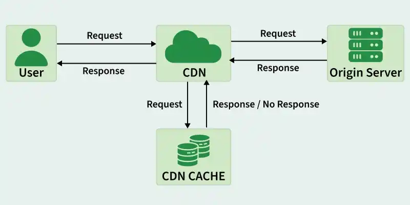

- 用户向网站发送内容请求（例如，图片）。
- CDN 识别用户位置并将请求路由到最近的边缘服务器。
- 如果内容已缓存在边缘服务器上，则直接交付给用户。
- 如果内容未缓存，边缘服务器会从源服务器检索内容，将其缓存到本地，然后交付给用户。
- 缓存的内容存储在边缘服务器上，供后续请求使用，从而优化性能并降低延迟。

### CDN 提供的内容类型

CDN 可以根据数据变化的频率和生成方式提供不同类型的内容。

#### 1. 静态内容

对所有用户保持不变且不经常变化的内容。

- 示例：图片、徽标、CSS、JavaScript 文件
- 易于缓存并从边缘服务器快速交付
- 无需处理，因此可提高性能

#### 2. 动态内容

根据用户交互、位置或偏好而变化的内容。

- 示例：社交媒体动态、登录数据、天气更新
- 由服务器实时生成
- 选择性缓存或短期缓存

### 重要性

CDN 具有多项关键优势，使其成为互联网内容分发的重要工具：

- **更快的内容交付：** CDN 通过将内容缓存在更靠近最终用户的服务器上，缩短数据传输的物理距离，从而缩短加载时间并降低延迟。
- **提升网站性能：** 更快的加载速度可直接带来网站性能的提升，包括更长的访问时长、更高的用户参与度和更高的转化率。
- **可扩展性：** CDN 通过将负载分配到多个服务器上，帮助网站应对流量高峰和高负载。这种可扩展性对于拥有全球受众或流量突然激增的网站尤为重要。
- **冗余性和可靠性：** CDN 通过在多个服务器上存储内容副本提供冗余。如果一个服务器发生故障，另一个服务器可以无缝接管，确保内容的持续可用性。
- **成本节约：** 通过降低源服务器负载并优化内容分发，CDN 可以帮助网站所有者降低带宽成本和基础设施支出。
- **安全性：** CDN 提供额外的安全功能，例如 DDoS 防护、SSL/TLS 加密和 Web 应用防火墙，有助于保护网站免受各种网络威胁。

### 挑战

使用 CDN 的挑战包括：

- **成本：** 与仅依赖源服务器相比，实施和维护 CDN 会产生额外的成本。
- **复杂性：** 管理和优化 CDN 需要技术专长和持续维护。
- **安全注意事项：** 在使用 CDN 时确保数据安全需要仔细配置并遵循安全最佳实践。

## [系统设计中的代理](https://www.geeksforgeeks.org/system-design/network-protocols-and-proxies-in-system-design/)

代理服务器充当客户端和服务器之间的中介，负责在两者之间转发请求和响应。它有助于管理和控制流量，同时提升性能、安全性和隐私性。

- 将客户端请求转发到服务器并返回响应，同时隐藏客户端身份以增强安全性。
- 通过缓存和高效的流量控制机制提升性能。

**示例：** 当用户通过代理服务器访问网站时，请求首先发送到代理服务器，代理服务器将其转发到网站。网站响应代理服务器，代理服务器再将数据发送回用户。

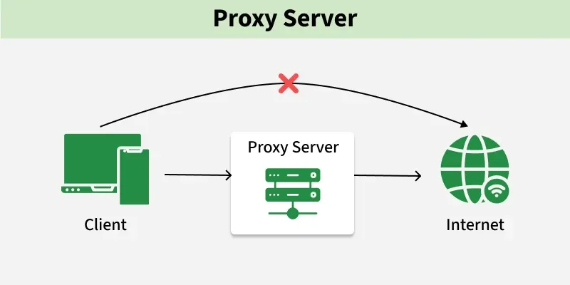

### 用途

代理服务器用于提升网络流量的安全性、性能和控制。

- **内容过滤：** 代理可以根据策略阻止对特定网站或内容类别的访问，从而帮助强制执行使用规则并防止访问有害内容。
- **隐私与匿名：** 正向代理会隐藏客户端的 IP 地址，提供匿名性并保护用户身份和位置信息。
- **安全与访问控制：** 代理会检查传入流量、阻止恶意内容并强制执行访问控制，以保护敏感资源。
- **负载均衡：** 反向代理会将传入请求分配到多个服务器上，从而提高性能并防止服务器过载。
- **缓存：** 代理会将频繁访问的数据存储在本地，从而降低服务器负载并缩短响应时间。

### 代理类型

代理服务器可以根据其代表客户端还是服务器进行大致分类。

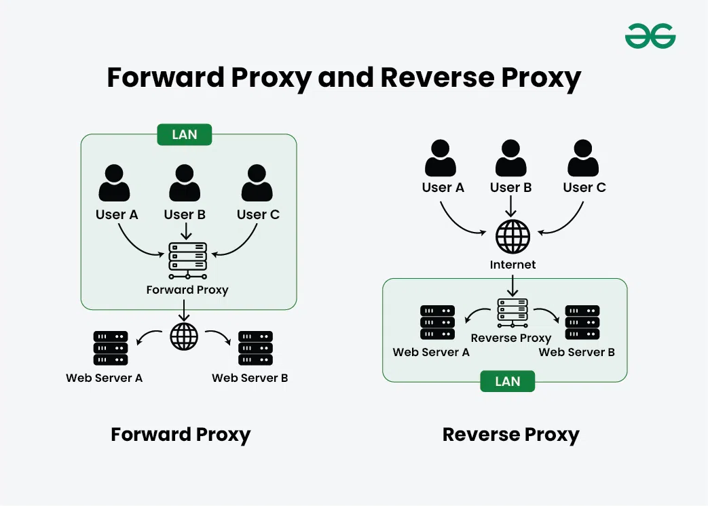

#### 1. 正向代理

正向代理服务器是指充当您的计算机或其他设备与互联网之间的中介的服务器。当您尝试访问某个网站时，您的请求会先经过正向代理服务器，然后再到达该网站。代理服务器会代表您向网站提交请求，接收响应，然后将其发送回您。

**示例：** 用于企业网络，以限制员工的互联网访问。

##### 何时使用

- **IP 地址掩码：** 向服务器隐藏客户端的 IP 地址。
- **流量管理：** 通过单个代理服务器处理来自多个客户端的请求。
- **内容过滤：** 阻止访问特定网站或内容。

#### 2. 反向代理

反向代理服务器位于客户端（例如 Web 浏览器）和另一台服务器之间，代表该服务器处理请求。客户端无需直接连接到主服务器，反向代理服务器会拦截请求并将其转发给该服务器。

**示例：** Netflix 或 Amazon 等公司使用反向代理服务器通过负载均衡来处理数百万用户请求。

##### 何时使用

- **负载均衡：** 将流量分配到多台服务器上。
- **安全性：** 通过隐藏后端服务器来帮助减少 DDoS 攻击。
- **缓存：** 存储服务器响应以提高性能。

### 常用代理工具

根据不同的用例（例如缓存、负载均衡和安全），可以使用各种工具来实现代理服务器。

- **Nginx：** 充当反向代理和负载均衡器
- **HAProxy：** 高性能负载均衡代理
- **Squid：** 主要用于缓存和过滤的前向代理
- **Varnish：** HTTP 缓存代理，用于加速 Web 应用程序

### 在系统设计中的应用

代理服务器广泛应用于现代架构中，以提高性能、安全性和可扩展性。

- 用于 API 网关以路由和管理请求（反向代理行为）
- 用于 CDN 以从边缘服务器分发内容
- 用于微服务架构以进行路由、安全和通信
- 用于企业网络以进行监控、过滤和访问控制

### 代理服务器实现策略

代理服务器的实现涉及设计和配置代理，以提高系统的性能、安全性和可扩展性。

- **反向代理与正向代理：** 反向代理代表服务器处理请求（用于负载均衡和安全），而正向代理代表客户端处理请求（用于匿名性和访问控制）。
- **代理服务器软件：** 根据性能、可扩展性和与系统的兼容性，选择合适的工具，例如 Nginx、Apache、HAProxy、Squid 或 Varnish。
- **部署架构：** 选择集中式（单代理）或分布式（多代理）架构，以获得更好的性能和容错能力。
- **负载均衡：** 将传入流量分配到多个服务器上，以避免过载并确保高可用性。
- **身份验证和授权：** 使用基本身份验证、LDAP 或基于令牌的身份验证等方法实施访问控制，以限制访问权限。
- **安全措施：** 使用 SSL/TLS 加密、防火墙和访问控制列表 (ACL) 来防止未经授权的访问和攻击。
- **缓存和内容过滤：** 缓存常用数据以减少延迟，并根据策略过滤不需要或有害的内容。
- **日志记录与监控：** 跟踪请求、错误和性能指标，以确保系统健康并排查问题。
- **可扩展性与高可用性：** 使用集群、复制和故障转移技术来处理不断增长的流量并避免停机。

### 优势

代理服务器的优势如下：

- **增强安全性：** 代理服务器充当客户端和互联网之间的屏障，过滤恶意内容，并为抵御网络威胁提供额外的防御层。
- **提升性能：** 代理服务器中的缓存机制通过将常用数据存储在本地来提升内容交付速度，从而减少从源服务器获取资源的需求。
- **负载均衡：** 反向代理将传入的访问者分配到多个服务器上，优化资源利用率，并确保高可用性。

### 劣势

代理服务器的劣势如下：

- **延迟：** 引入代理服务器可能会增加用户和服务器之间的通信延迟，影响响应时间，尤其对于实时应用程序而言。
- **配置复杂性：** 代理服务器的设置和管理可能很复杂，需要具备网络和安全方面的知识才能确保正确配置并提高整体性能。

### 正向代理与反向代理

这两种代理的区别在于它们代表客户端还是服务器行事，以及它们如何处理请求流。

| 正向代理                           | 反向代理                     |
| ---------------------------------- | ---------------------------- |
| 代表客户端执行操作                 | 代表服务器执行操作           |
| 客户端知晓并配置                   | 客户端通常不知晓             |
| 用于匿名性、访问控制和过滤         | 用于负载均衡、安全性和性能   |
| 缓存互联网数据以提高客户端访问速度 | 缓存服务器响应以减少后端负载 |

## [正向代理和反向代理的区别](https://www.geeksforgeeks.org/system-design/difference-between-forward-proxy-and-reverse-proxy/)

代理在管理客户端和服务器之间的数据流中扮演着重要角色。正向代理和反向代理以不同的方式用于控制和优化数据流。

- **正向代理：** 代表客户端行事，以增强隐私和控制访问权限。
- **反向代理：** 代表服务器行事，以优化性能和安全性。

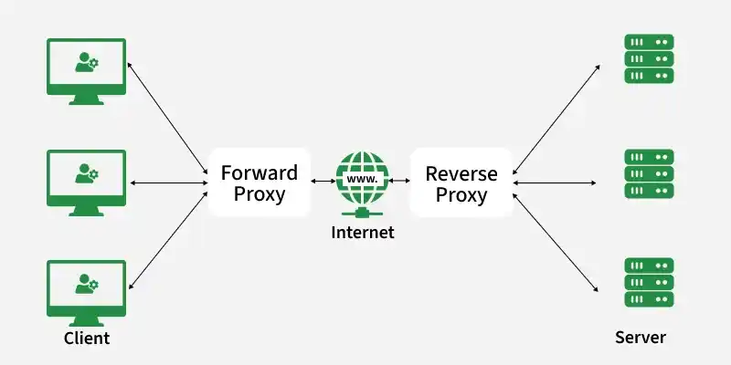

### 正向代理

正向代理（也称为“代理服务器”）是位于客户端设备和互联网之间的服务器。当客户端发送访问网站或在线资源的请求时，该请求首先被定向到正向代理。然后，代理代表客户端将请求转发到目标服务器。

#### 应用场景

- 增强客户端匿名性
- 访问受地理位置限制或受限的内容
- 在组织中进行内容过滤和监控
- 通过代理服务器上的缓存来降低带宽消耗
- 记录和跟踪用户活动以确保合规性

### 反向代理

反向代理的工作方式与正向代理相反。正向代理代表客户端执行操作，而反向代理则代表服务器执行操作。它用于保护和管理服务器，确保客户端不会直接与源服务器通信。

#### 应用场景

- 跨多个 Web 服务器进行负载均衡
- 缓存内容以提升服务器性能
- 保护后端服务器免受直接互联网攻击
- SSL/TLS 卸载以提升服务器效率
- 缓解 DDoS 攻击并增强安全性

### 正向代理与反向代理

以下是基于各项功能的正向代理和反向代理的详细比较：

| 正向代理                                            | 反向代理                                               |
| --------------------------------------------------- | ------------------------------------------------------ |
| 代表客户端控制访问权限并增强隐私。                  | 代表服务器优化性能并提高安全性。                       |
| 位于客户端和互联网之间。                            | 位于互联网和服务器之间。                               |
| 客户端知道代理的存在，并且必须对其进行配置。        | 客户端通常不知道代理的存在。                           |
| 客户端需要配置其设备以使用代理。                    | 服务器配置为使用反向代理。                             |
| 绕过内容过滤器、控制访问权限、增强隐私。            | 负载均衡、缓存、DDoS 防护、SSL 卸载。                  |
| 拦截客户端向互联网发出的请求并将其转发。            | 拦截来自互联网的请求并将其转发到相应的服务器。         |
| 可以在客户端缓存内容以缩短响应时间。                | 可以缓存服务器响应以减少负载并加快内容分发速度。       |
| 正向代理通常转发加密的 HTTPS 流量而不对其进行解密。 | 可以处理 SSL/TLS 卸载，从而减轻服务器的加密/解密任务。 |

## [系统设计中的 Web 服务器和应用服务器](https://www.geeksforgeeks.org/system-design/web-server-proxies-and-their-role-in-designing-systems/)

Web 服务器和应用服务器是系统设计中不可或缺的组件，它们高效地处理用户请求并返回响应。Web 服务器管理客户端通信，而应用服务器处理业务逻辑和动态操作。

- Web 服务器处理 HTTP 请求、提供静态内容并管理客户端与服务器之间的通信。
- 应用服务器执行业务逻辑、处理动态数据并生成客户端请求的响应。

### Web 服务器

Web 服务器是一个存储、处理 Web 内容并通过互联网将其交付给用户的系统。它处理来自客户端（例如浏览器）的请求，并以网页、图像或数据作为响应。Web 服务器可以是硬件（机器），也可以是管理这些请求的软件。

- 托管网站并向用户提供内容，运行 Apache 或 IIS 等 Web 服务器软件。
- 需要持续的互联网连接来处理传入的客户端请求。

**例如：** 当您在浏览器中输入网站 URL 时，请求会发送到 Web 服务器，服务器处理请求并将网页发送回客户端以进行显示。

每个连接到互联网的 Web 服务器都会被分配一个唯一的 4 位数字地址，数字之间用点号分隔，例如 **68.122.31.125**。


#### 网络服务器类型

网络服务器可以根据其托管网站和处理流量的方式进行分类。

- **共享主机：** 在单个服务器上托管多个网站（通常超过 100 个）。它经济实惠，适合小型或个人网站。
- **专用主机：** 单个服务器专用于一个或几个网站，提供更好的性能、控制和安全性。
- **定制主机：** 专为具有独特需求的大型应用程序而构建，允许完全定制和高度可扩展。

小型或个人网站通常使用共享主机，而高流量应用程序则倾向于使用专用主机或定制主机以获得更好的性能和控制。

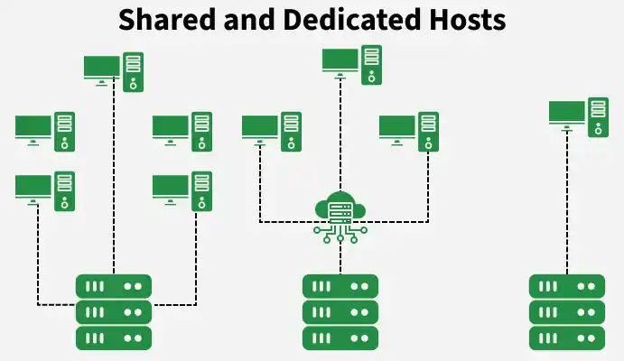

#### 工作原理

Web 服务器使用 HTTP/HTTPS 协议处理客户端请求并返回所需的网页内容。它充当用户（浏览器）和后端系统之间的桥梁。

- 当用户发送请求（例如打开网站）时，浏览器会向 Web 服务器发送 HTTP 请求。
- 如果请求的内容是静态的（HTML、CSS、图像），Web 服务器会直接将其发送回客户端。
- 如果请求的内容是动态的，Web 服务器会将其转发给应用服务器或后端服务进行处理。
- 应用服务器处理请求（例如，从数据库中获取数据）并将结果发送回 Web 服务器。
- 最后，Web 服务器将响应返回给客户端的浏览器。

**示例：** 当您打开一个购物网站时，首页（静态内容）会直接从 Web 服务器加载。但是，当您搜索产品时，请求会发送到后端，后端会从数据库中获取搜索结果，然后通过 Web 服务器将其发送回您的浏览器。

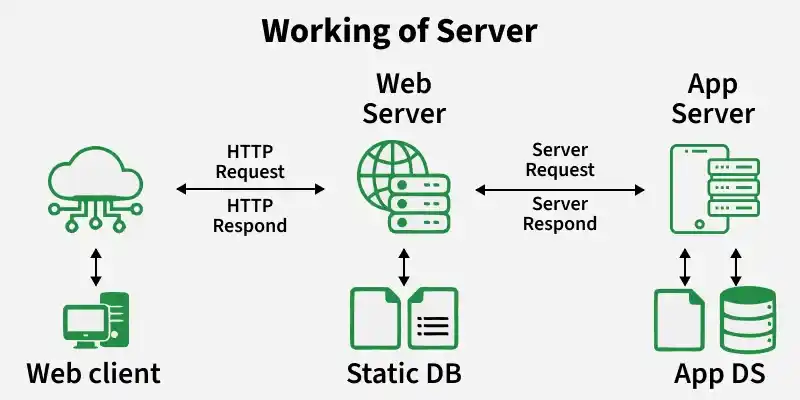

#### Web 服务器的作用

Web 服务器在处理客户端请求和高效安全地交付 Web 内容方面发挥着至关重要的作用。

- **处理客户端请求：** Web 服务器接收并处理来自客户端（浏览器）的 HTTP/HTTPS 请求，并将其路由到相应的资源或服务。
- **提供静态和动态内容：** 它们直接提供静态内容（HTML、CSS、图像），并与应用服务器协同工作以生成和交付动态内容。
- **负载均衡：** 在大型系统中，Web 服务器将传入流量分配到多个后端服务器，以提高性能并防止过载。
- **内容交付和缓存：** Web 服务器缓存频繁访问的内容，以缩短响应时间并降低服务器负载。
- **SSL/TLS 终止：** 它们处理数据的加密和解密，确保客户端和服务器之间的安全通信，而不会增加后端系统的负担。

#### 静态 Web 服务器与动态 Web 服务器

Web 服务器可以根据应用程序类型和所涉及的后端处理情况，提供静态和动态内容。

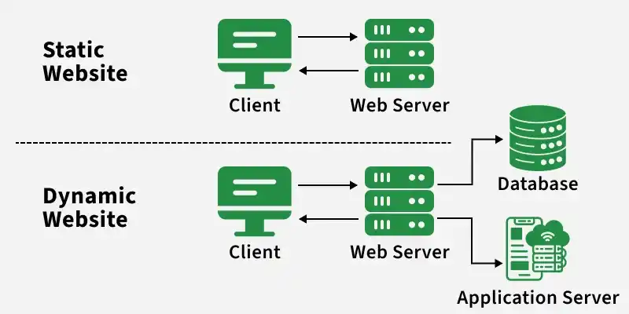

**静态 Web 服务器：** 直接提供存储的内容，不做任何修改。

- 直接向浏览器发送 HTML、CSS、图像等文件。
- 无需处理，性能更快。
- 适用于博客、作品集和简单的网站。

**动态 Web 服务器：** 使用应用服务器和数据库等附加软件实时生成和更新内容。

- 处理用户输入并动态获取数据。
- 提供个性化和交互式内容。
- 适用于社交媒体、电子商务和 Web 应用。

#### 使用的协议

Web 服务器使用标准通信协议通过互联网与客户端交换数据。

- **HTTP（超文本传输​​协议）：** 用于在客户端和服务器之间传输网页和资源。
- **HTTPS：** HTTP 的安全版本，使用 SSL/TLS 加密来保护传输过程中的数据。
- **FTP（文件传输协议）：** 用于在系统之间传输文件，通常用于上传网站内容。

#### 示例

一些在实际应用中常用的 Web 服务器包括：

- **Apache HTTP 服务器：** 应用最广泛的 Web 服务器之一，它能够高效地处理 HTTP 请求并提供网页和文件服务。它具有很高的可靠性，并拥有庞大的生态系统支持。
- **Tomcat 服务器：** 常用于基于 Java 的 Web 应用程序。它既可以作为 Web 服务器，也可以作为 Servlet 容器，但它并非功能齐全的应用服务器。
- **Node.js 服务器：** 提供了一个内置的 HTTP 模块，使开发人员能够创建轻量级且快速的 Web 服务器，尤其适用于实时应用程序。

### 应用服务器

应用服务器旨在运行和管理应用程序所需的业务逻辑和复杂操作。它提供了一个环境（硬件 + 软件），用于执行动态任务并处理客户端请求，而不仅仅是简单的内容分发。

- 处理复杂的逻辑和计算（例如，处理请求和交易），并与数据库/服务交互以生成动态内容。
- 提供运行应用程序（例如企业级或云端系统）的环境。

**示例：** 当您登录银行应用程序时，应用程序服务器会验证您的凭据，从数据库中获取账户数据，并将结果发送回 Web 服务器以在您的浏览器中显示。

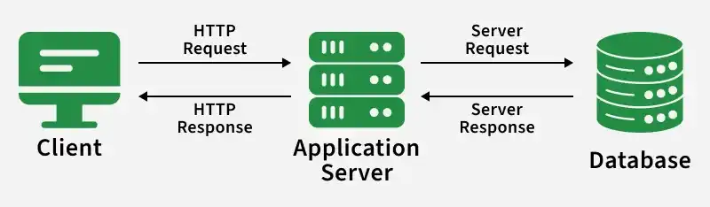

**注意：** 当系统需要处理大量数据或进行动态操作，而仅靠 Web 服务器无法高效处理时，则需要使用应用服务器。

#### 工作原理

应用服务器遵循客户端-服务器模型，负责处理用户请求、执行业务逻辑并返回动态响应。它们作为核心层，负责处理应用程序的功能和数据。

- 客户端（浏览器/移动应用）向 Web 服务器发送请求
- Web 服务器将动态请求转发给应用服务器
- 应用服务器执行业务逻辑（例如，身份验证、事务处理）
- 它与数据库或外部服务交互以获取或更新数据
- 处理后的结果发送回 Web 服务器，Web 服务器再将其返回给客户端

#### 涉及的层：

- 表示层：处理用户界面和请求/响应格式
- 应用层：包含业务逻辑和处理
- 数据访问层：管理与数据库的交互

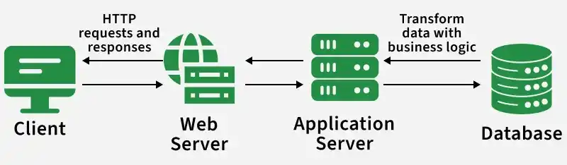

#### 常用应用服务器

应用服务器提供运行和管理应用程序的环境，支持不同的技术和框架。

- **Apache Tomcat：** 广泛用于基于 Java 的 Web 应用程序；充当 Servlet 容器和轻量级应用服务器。
- **JBoss (WildFly)：** 功能齐全的 Java EE 应用服务器，用于企业级应用程序。
- **IBM WebSphere 应用服务器：** 企业级服务器，专为大规模、安全和高性能应用程序而设计。
- **Oracle WebLogic 服务器：** 功能强大的应用服务器，用于关键任务型企业系统。
- **Microsoft IIS（Internet 信息服务）：** 支持 ASP.NET 应用程序，常用于 Windows 环境。

#### 优势

应用服务器提供强大的功能来处理复杂和动态的应用程序。

- **处理复杂逻辑：** 高效处理业务逻辑和繁重计算
- **可扩展性：** 通过适当的配置，可以应对不断增长的用户和流量
- **集成支持：** 轻松连接数据库、API 和外部服务
- **安全特性：** 支持身份验证、授权和安全交易

#### 缺点

尽管应用服务器有很多优点，但也存在一些局限性。

- **复杂性高：** 与 Web 服务器相比，设置和管理更为复杂
- **成本高：** 维护和部署成本可能很高
- **延迟开销：** 额外的处理可能会增加响应时间
- **简单应用无需应用服务器：** 对于小型或静态网站而言，应用服务器过于复杂

### Web 服务器与应用服务器

这两种服务器的区别在于它们的角色：Web 服务器处理客户端请求和内容分发，而应用服务器处理业务逻辑和动态操作。

| Web 服务器           | 应用服务器             |
| -------------------- | ---------------------- |
| 处理 HTTP/HTTPS 请求 | 处理业务逻辑和处理     |
| 提供静态内容         | 生成动态内容           |
| 轻量级且速度更快     | 更重且资源密集         |
| 数据库交互有限或无   | 直接与数据库交互       |
| 示例：Apache、Nginx  | 示例：Tomcat、WebLogic |

## [长轮询和短轮询](https://www.geeksforgeeks.org/javascript/what-is-long-polling-and-short-polling/)

轮询是一种客户端以固定时间间隔重复向服务器发送请求以检查新数据的技术。它广泛用于在不需要即时通信的情况下模拟实时更新。虽然它并非真正的实时，但轮询易于实现，并且在许多应用程序中都能可靠运行。

- 易于实现且被广泛支持，因为它不需要像 WebSocket 那样的持久连接。
- 然而，频繁的客户端请求会增加服务器负载并影响性能。

**例如：** 一个新闻应用程序每 10 秒刷新一次以获取服务器的最新头条新闻。

### 短轮询

短轮询是一种客户端以固定时间间隔持续向服务器发送请求的技术。服务器会立即响应——如果有数据，则返回数据；如果没有数据，则返回空响应。这个循环不断重复，使客户端能够定期检查更新。

- 使用标准的 HTTP/AJAX 请求即可轻松实现，无需复杂的设置。
- 即使没有新数据，频繁轮询也会导致不必要的请求，增加服务器负载。

**例如：** 一个聊天应用程序每 5 秒向服务器发送一次请求来检查是否有新消息，即使实际上并没有新消息到达。

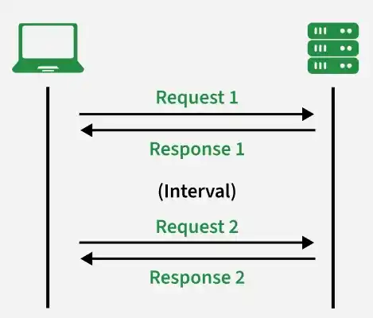

#### 实现示例

在本示例中，我们使用名为 data.json 的服务器文件，其中包含一些数据。

```html
<!DOCTYPE html>
<html lang="en">
  <head>
    <meta charset="UTF-8" />
    <meta
      name="viewport"
      content="width=device-width, 
                         initial-scale=1.0"
    />
    <title>Short Polling using AJAX</title>
    <style>
      h1,
      h3 {
        text-align: center;
        color: green;
      }

      button {
        margin-left: 34.5rem;
      }
    </style>

    <script>
      function loadInformation() {
        setInterval(function () {
          // Request
          var request = new XMLHttpRequest();
          request.open("GET", "./data.json");
          request.send();

          // Response
          request.onreadystatechange = function () {
            if (this.readyState == 4 && this.status == 200) {
              // Also checked status==200 to
              // verify its status is OK or not
              console.log(this.responseText);
            }
          };
        }, 1000);
      }
    </script>
  </head>

  <body>
    <h1>Geeks for Geeks</h1>
    <h3>Short Polling using AJAX</h3>
    <button onClick="loadInformation()">Click to Load</button>
  </body>
</html>
```

**data.json：**

```json
{
  "name": "Manish",
  "age": "22",
  "city": "Kolkata"
}
```

**输出：**


#### 使用场景

短轮询最适用于更新并非至关重要且可以容忍一定延迟的场景。常见使用场景：

- 定期刷新的新闻源和博客（例如，每隔几秒或几分钟刷新一次）
- 具有固定刷新间隔的天气更新和股票行情
- 无需立即更新的社交媒体信息流或仪表盘

#### 优势

这些优势突显了短轮询易于使用但效率可能不高的原因。

- 易于实现且支持广泛
- 适用于更新频率较低的系统
- 易于调试和维护

#### 劣势

这些劣势主要体现在性能和资源使用方面的局限性。

- 在没有数据可用时发送大量不必要的请求
- 增加服务器负载和网络流量
- 并非真正实时（取决于间隔延迟）

### 长轮询

长轮询是一种客户端发送请求后，服务器会等待直到有新数据可用才响应的技术，而不是立即响应。一旦有数据发送，客户端会迅速发出另一个请求，从而实现近乎实时的通信。

- 减少不必要的空响应，并提供近乎实时的更新，无需不断重复请求。
- 保持连接打开以进行更新，这可能会增加服务器资源的使用。

**例如：** 一个消息应用程序，客户端发送请求并等待新消息到达；一旦收到新消息，它会立即发送另一个请求以继续监听后续消息。

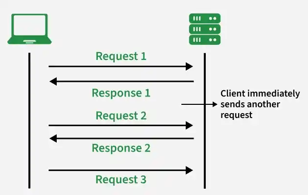

**实现示例**

在本示例中，我们将了解长轮询，并使用 AJAX 来实现，当然也可以使用普通的 HTTP 请求。步骤如下：

- 创建 XMLHttpRequest 发送请求的基本步骤与短轮询相同。
- 但由于服务器只有在收到响应时才会返回响应，因此无法按固定的时间间隔发送请求。
- 这就是为什么我们需要在收到前一个请求的响应后才发送下一个请求的原因。

```html
<!DOCTYPE html>
<html lang="en">
  <head>
    <meta charset="UTF-8" />
    <meta
      name="viewport"
      content="width=device-width, 
                         initial-scale=1.0"
    />
    <title>Long Polling using AJAX</title>
    <style>
      h1,
      h3 {
        text-align: center;
        color: green;
      }

      button {
        margin-left: 34.5rem;
      }
    </style>

    <script>
      function loadInformation() {
        // Request
        var request = new XMLHttpRequest();
        request.open("GET", "./data.json");
        request.send();

        // Response
        request.onreadystatechange = function () {
          if (this.readyState == 4 && this.status == 200) {
            // Also checked status==200 to
            // verify its status is OK or not
            console.log(this.responseText);
            loadInformation();
          }
        };
      }
    </script>
  </head>

  <body>
    <h1>Geeks for Geeks</h1>
    <h3>Long Polling using AJAX</h3>
    <button onClick="loadInformation()">Click to Load</button>
  </body>
</html>
```

**data.json：**

```json
{
  "name": "Mridul",
  "age": "24",
  "city": "Banglore"
}
```

**输出：**


#### 使用场景

长轮询非常适合需要近乎实时更新且不会出现空响应的应用。常见应用场景：

- 聊天应用，消息发送后应立即显示
- 通知系统（例如，警报、提醒、活动更新）
- 协作编辑工具或实时仪表盘，更改必须立即反映

#### 优势

这些优势使得长轮询对于类似实时应用来说更加高效。

- 通过等待数据来减少不必要的请求
- 提供近乎实时的更新
- 在许多情况下比短轮询更高效

#### 劣势

这些缺点主要与复杂性和服务器资源管理有关。

- 保持连接打开，增加服务器资源使用量
- 比短轮询更难实现
- 可能出现超时或连接断开问题

### 短轮询和长轮询的区别

这两种技术都用于从服务器获取更新的数据，但它们在请求频率和服务器响应方式上有所不同。

| 短轮询                                                             | 长轮询                                                     |
| ------------------------------------------------------------------ | ---------------------------------------------------------- |
| 它基于定时器。因此，它适用于需要按固定时间间隔更新数据的应用程序。 | 它基于获取响应。因此，它适用于不希望收到空响应的应用程序。 |
| 如果响应不可用，则可以发送空响应。                                 | 通常情况下会避免发送空响应，但在超时的情况下仍然可以发送。 |
| 它不太常用。                                                       | 与短轮询相比，它更适用于近实时用例，具体取决于系统要求。   |
| 它会产生大量流量。                                                 | 它也会产生流量，但比短轮询少。                             |

## [WebSocket 及其与 HTTP 的区别](https://www.geeksforgeeks.org/web-tech/what-is-web-socket-and-how-it-is-different-from-the-http/)

Web 应用程序处理数据主要有两种方式：非实时和实时。`非实时数据`仅在客户端请求时更新，而`实时数据`则会在信息发生变化时立即传递。选择合适的通信协议对于性能和用户体验至关重要。

- HTTP 用于非实时通信，客户端在需要时请求数据。
- WebSocket 用于实时通信，客户端和服务器之间的数据会立即传递。

### HTTP

HTTP 遵循请求-响应模型，每次请求后连接都会关闭。它简单可靠，但并不适合实时更新。

- 每个请求都包含完整的 HTTP 标头，这会增加开销，尤其是在频繁更新的情况下。
- HTTP 适用于对即时更新要求不高的传统 Web 应用程序，因为它无状态且支持事务。

**示例：** 一个新闻网站使用标准 HTTP 请求每 10 秒获取一次最新头条新闻。

正常的 HTTP 流程（当我们访问网页时）

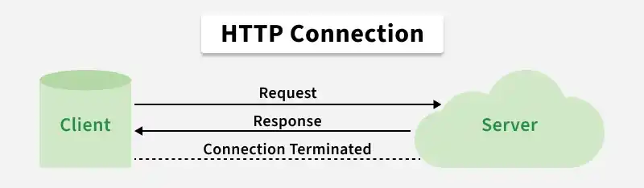

### WebSocket

WebSocket 支持客户端和服务器之间持久的全双工通信，实现实时数据交换。与轮询方式不同，它保持持续连接，因此更适合频繁且即时的更新。

- 它保持连接打开，从而实现客户端和服务器之间的持续双向通信。
- 它仅交换消息数据，减少了开销，因此非常适合实时聊天、在线游戏和股票行情等应用。

**例如：** 聊天应用程序，消息无需新的 HTTP 请求即可立即显示在客户端和服务器上。

WebSocket 流程（当我们使用基于 Web 的聊天应用程序时）
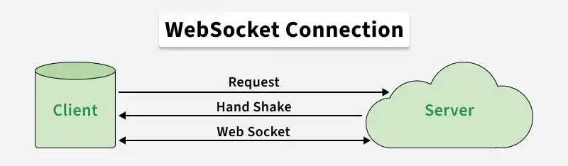

#### 工作原理

WebSocket 通过升级标准 HTTP 连接，实现实时全双工通信。流程如下：

- **连接发起：** 客户端发送一个带有 `Upgrade: websocket` 标头的 HTTP 请求，请求协议切换。
- **握手：** 服务器响应 `101 Switching Protocols` 以确认升级到 WebSocket。
- **持久连接：** 连接从 HTTP 切换到 WebSocket，保持打开状态以进行持续通信。
- **全双工通信：** 客户端和服务器可以随时独立发送消息，无需发起新的请求。
- **数据帧：** 消息以帧（文本或二进制）的形式传输，从而实现高效且结构化的数据交换。
- **低开销：** 仅交换消息数据；HTTP 标头不会重复，从而降低带宽使用。
- **保持连接：** 连接保持活动状态，直到客户端或服务器显式关闭它。
- **关闭握手：** 一方发送关闭帧，另一方确认，然后 TCP 连接正常终止。

#### 应用场景

WebSocket 广泛应用于需要实时、低延迟、双向通信的应用中。常见用例包括：

- **即时通讯和聊天应用：** WhatsApp Web、Slack、Facebook Messenger——实现设备间消息即时同步。
- **协作工具：** Google Docs——实时协作编辑，所有用户都能立即看到更改。
- **视频会议和实时协作：** Zoom、Microsoft Teams——提供实时在线状态显示、聊天消息和交互式会议控制。
- **金融和交易平台：** TradingView——实时更新股票、加密货币和外汇价格。
- **实时位置和行程追踪服务：** Uber——实时更新司机位置和行程状态。
- **在线多人游戏：** 许多基于浏览器的游戏使用 WebSocket 来实现玩家之间的低延迟交互。

#### 局限性

WebSocket 非常适合实时、连续的数据流，但并非总是最佳选择。

- 对于需要近乎实时通信的实时更新、连续数据流或交互式应用程序，请使用 WebSocket。
- 对于一次性请求或不常用的数据访问，例如获取历史记录或静态内容，请使用 HTTP。
- WebSocket 会保持连接打开状态，这可能会增加服务器资源的使用。
- 选择合适的协议可以确保更好的性能并避免不必要的开销。

### HTTP 与 WebSocket 连接

HTTP 是基于 TCP 的无状态协议（面向连接，通过重传实现可靠性），而 WebSocket 是有状态的、全双工的双向协议。

| HTTP                             | WebSocket                                      |
| -------------------------------- | ---------------------------------------------- |
| 无状态：每次请求后连接都会关闭。 | 持久连接：连接会一直保持打开状态，直到被关闭。 |
| 仅请求-响应模式。                | 全双工：客户端和服务器可以随时发送数据。       |
| 由于重复的头部信息，开销较高。   | 开销较低：仅交换消息数据。                     |
| 频繁更新时延迟较高。             | 低延迟：近乎实时更新。                         |
| 适用于标准网页、API、表单。      | 适用于在线聊天、在线游戏、股票行情、仪表盘。   |

**注意：** 根据您的项目需求，您需要选择使用 WebSocket 连接还是 HTTP 连接。
