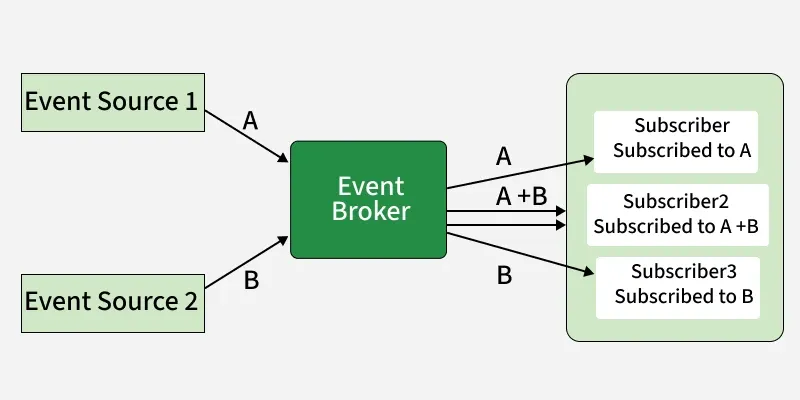
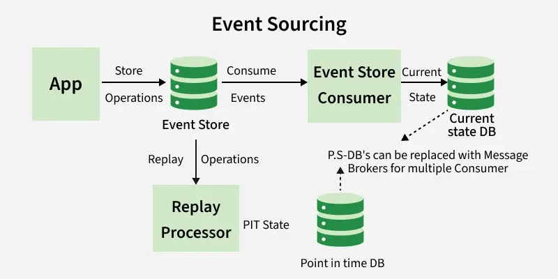
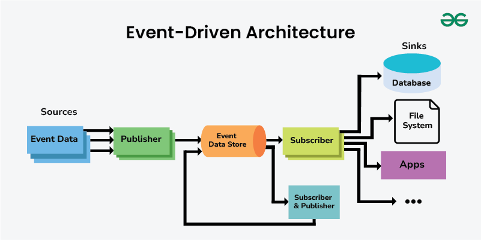
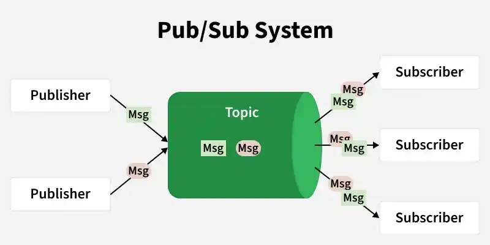
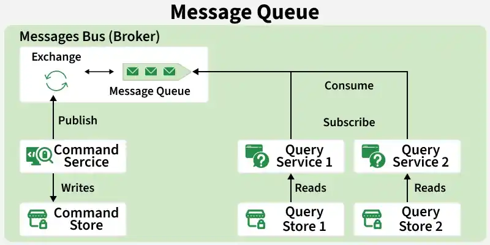
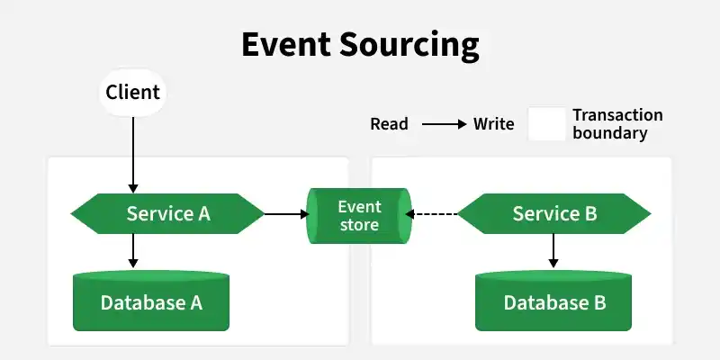
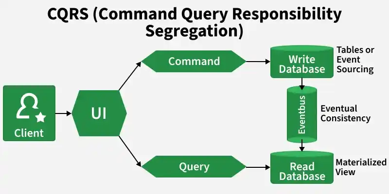
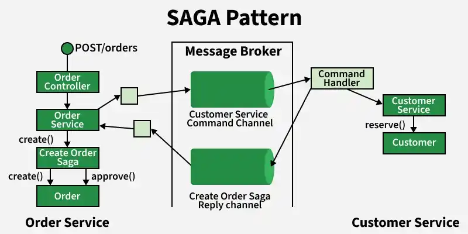
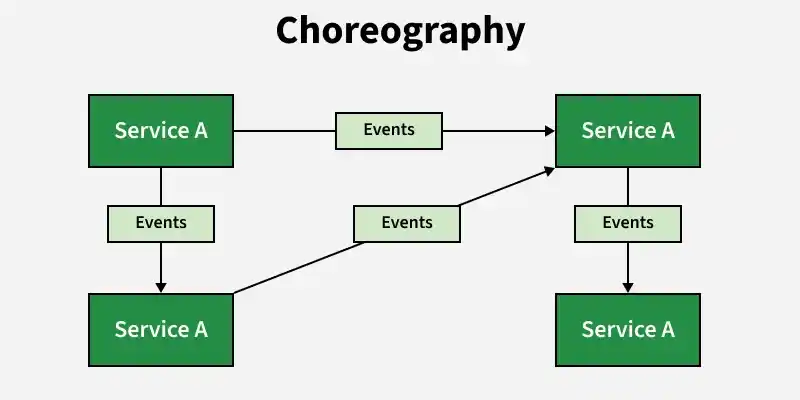

# 事件驱动架构

## [事件驱动架构 (EDA)](https://www.geeksforgeeks.org/system-design/event-driven-architecture-system-design/)

事件驱动架构 (EDA) 是一种软件设计方法，其中系统组件通过生成和响应事件（例如用户操作或系统状态变化）进行通信。组件之间松耦合，允许它们独立运行并实时响应事件。

- EDA 能够实现实时响应、可扩展性和模块化，同时提高系统的灵活性。
- 组件独立运行，无需紧密连接；当事件发生时，相关组件会做出相应的响应。

**例如：** 在[电子商务系统](https://www.geeksforgeeks.org/system-design/event-driven-architecture-in-an-e-commerce-system/)中，当客户下单时，会生成一个`订单已下单`事件。支付处理、库存管理和电子邮件通知等不同的服务不会持续检查订单系统；相反，它们会在事件发生时独立做出响应。



在图中

- 事件源 1 和事件源 2 将事件（A 和 B）发布到中央事件代理。
- 事件代理接收、过滤并根据订阅情况路由事件。
- 订阅者只能收到他们订阅的事件，例如 A、B 或 A + B。

### 实际应用

事件驱动架构 (EDA) 广泛应用于对实时处理、可扩展性和系统集成要求较高的行业。

- **金融服务：** 用于实时交易处理、欺诈检测和市场数据更新，其中支付或交易等事件会触发即时响应。
- **电子商务：** 通过实时事件处理和与外部服务的无缝集成，帮助管理订单处理、库存更新和支付工作流程。
- **电信：** 通过网络组件之间的事件驱动通信，支持网络监控、呼叫处理和动态负载处理。
- **在线游戏：** 支持实时玩家交互、游戏状态更新和事件处理，从而提供流畅的多人游戏体验。
- **实时应用：** 非常适合需要对用户操作或数据更改做出即时响应的系统。

### 重要性

事件驱动架构 (EDA) 在系统设计中具有重要意义，原因如下：

- **灵活性和响应性：** 得益于 EDA，系统能够快速适应不断变化的情况。系统可以通过基于事件启动操作来动态适应新信息，从而保证其敏捷性和响应性。
- **可扩展性：** 由于 EDA 具有可扩展性，因此可以添加或移除组件而不会影响当前配置。这种灵活性使得系统更容易根据不断变化的需求进行修改。
- **实时处理：** EDA 非常适合需要实时处理的场景。事件在发生时即被处理，使系统能够高效地管理对时间敏感的任务。
- **分散式通信：** 组件通过事件而非直接连接进行通信，从而减少了点对点交互的需求。这种分散式方法提高了可靠性并简化了系统维护。

### 事件驱动架构中的事件

事件是事件驱动架构 (EDA) 的关键组成部分，用于表示重大事件或系统变更。以下是 EDA 中事件的关键要点：

- **触发：** 用户操作或数据更改等各种来源都可以触发事件。
- **异步性：** EDA 通常使用异步通信，允许组件独立并行工作。
- **发布/订阅模型：** EDA 使用发布/订阅模型来管理事件，事件的创建者发布事件，感兴趣的各方订阅事件。
- **事件类型：** 事件按用途分组，例如`用户登录`或`订单已下单`。
- **有效载荷：** 事件通常包含提供上下文的额外信息，即有效载荷（例如，`已收到付款`事件可能详细说明付款金额）。
- **事件处理：** 组件具有特定的事件处理程序，用于决定其对事件的响应。

### 组件

事件驱动架构 (EDA) 包含多个关键要素，有助于促进通信并响应事件。以下是事件驱动架构的主要组件：

#### 1. 事件源

事件源是指在发生重大操作或状态变化时生成事件的任何组件。

- 可以是用户界面、传感器、数据库或外部系统。
- 作为事件流的起点。

#### 2. 事件

事件表示系统状态中有意义的事件或变化。

- 作为 EDA 中通信的核心单元。
- 包含描述所发生事件的相关数据。
- 事件一旦创建便不可更改。

#### 3. 事件代理/事件总线

事件代理充当管理事件通信的中央枢纽。

- 接收来自发布者的事件。
- 过滤事件并将其路由到相应的订阅者。

#### 4. 发布者

发布者负责向事件总线发送事件。

- 将系统操作或变化转换为事件。
- 异步发送事件。
- 无需知道谁会消费这些事件。

#### 5. 订阅者

订阅者注册对特定类型事件的兴趣。

- 监听事件总线上的相关事件。
- 事件发生时动态响应。

### 辅助模式

这些是有助于有效处理和管理事件的其他角色和模式，但它们并非事件驱动架构的核心组件。

#### 1. 事件处理程序

事件处理程序包含处理接收到的事件的逻辑。

- 定义响应事件而采取的操作。
- 实现业务规则或工作流。

#### 2. 调度器

调度器控制系统内事件的传递方式。

- 将事件路由到正确的事件处理程序。
- 管理事件处理流程。

#### 3. 监听器

监听器主动监控事件总线上的特定事件。

- 检测感兴趣的事件。
- 一旦接收到事件，立即触发处理。

### 挑战

事件驱动架构 (EDA) 虽然优势众多，但也存在一些值得考虑的挑战。

- **复杂性增加：** 随着事件和组件的增加，EDA 系统会变得复杂。管理事件流并保持所有事件协调一致可能非常困难。
- **事件顺序和一致性：** 保持事件顺序正确并确保系统一致性并非易事。处理乱序事件或确保操作完成可能需要额外的工作。
- **调试和追踪：** 在分布式和异步环境中查找和修复问题可能比传统系统更难。追踪问题可能需要更多时间。
- **事件延迟：** 由于事件是单独处理的，因此事件发生和响应之间可能存在延迟。在需要快速响应的情况下，这种延迟可能会造成问题。

## [事件溯源模式](https://www.geeksforgeeks.org/system-design/event-sourcing-pattern/)

事件溯源将每一次变更都记录为一个事件，而不仅仅是存储当前状态，从而创建完整的数据变更历史记录。通过重放这些事件，可以随时重建当前状态，有助于跟踪数据随时间推移的演变过程。

- 事件按顺序存储在日志或日志记录中，允许通过重放这些事件来恢复程序的状态。
- 事件溯源模式常用于金融和电子商务等领域，在这些领域，准确的历史数据跟踪至关重要。

**例如：** 在银行系统中，并非仅存储最终账户余额，而是将每笔交易（例如`存款`、`取款`和`转账完成`）都存储为一个事件。当前余额通过按顺序重放所有这些事件来计算。



### 实际应用

事件溯源技术在众多领域和用例中都有应用，尤其是在跟踪和分析历史数据至关重要的场景下。以下是一些值得注意的例子：

- **金融系统：** 为了保存不可更改的交易、账户活动和合规事件记录，银行和金融机构使用事件溯源技术。
- **医疗记录：** 电子健康记录 (EHR) 系统使用事件溯源技术来记录患者就诊记录、治疗史和医疗程序。
- **供应链管理：** 事件溯源技术应用于供应链和物流管理，用于跟踪库存变动、发货更新和供应链中断情况。
- **电子商务平台：** 事件溯源技术是电子商务应用程序记录客户互动、订单履行流程和库存变化的有效工具。这使得跟踪订单、提供个性化推荐以及分析客户行为成为可能，从而提升销售额和客户满意度。
- **游戏和虚拟环境：** 事件溯源技术应用于虚拟世界和多人在线游戏中，用于记录玩家移动、游戏状态变化和游戏内购买行为。

### 组件

系统设计中的事件溯源围绕以下几个核心概念和组件展开：

- **事件：** 系统状态变更的永久记录，包含重建系统在特定时间点状态所需的所有信息。
- **事件存储：** 持久存储，按顺序维护完整的事件流，并作为系统的事实来源。诸如 Apache Kafka 或 RabbitMQ 之类的消息系统也可以分发事件。
- **聚合：** 一组相关的领域对象的逻辑集合，用于处理命令、应用业务逻辑并生成事件。每个聚合都与其自身的事件流相关联。
- **命令：** 客户端或系统组件发出的执行操作的请求，由聚合进行验证和处理。
- **投影：** 从事件流创建的读取模型，用于表示当前系统状态，以便进行高效的查询和报告。
- **事件总线：** 消息传递基础设施，允许组件发布和订阅事件，从而实现异步通信。

### 工作原理

理解事件溯源模式工作原理的步骤如下：

- **捕获事件而非状态：** 系统每次变更都会被存储为一个事件，例如`订单创建`或`商品添加`，而不是仅仅保存最终状态。
- **按顺序存储事件：** 事件按照其发生的顺序存储，形成一个时间顺序的事件流，作为系统的数据源。
- **通过重放事件重建状态：** 通过从头开始重放和处理所有已存储的事件来重建当前系统状态。
- **处理新事件：** 新的变更会生成额外的事件，这些事件会被添加到事件流中，而不会修改之前的事件。
- **重放事件进行调试：** 可以重放事件来跟踪系统行为，了解状态随时间的变化，并调查问题或错误。

### 实现示例

通过注册系统示例理解事件溯源模式：

#### 1. 事件溯源之前的注册系统

在传统的事件注册系统中，更新直接作用于数据库，立即改变当前状态。这使得追踪历史记录、维护历史数据以及管理注册变更通知变得困难。

传统的注册方式存在以下几个问题：

- 当用户注册或取消注册时，系统会立即更新数据库，而不会保留操作历史记录。
- 系统不会记录注册变更的原​​因，因此难以审核过往操作。
- 必须单独处理用户通知，这可能导致沟通延迟和错误。

```js
class Database {
  static update(registration) {
    // Update the database directly
  }
}

class Registration {
  constructor() {
    this.state = null;
    this.userId = null;
    this.eventId = null;
  }

  register(userId, eventId) {
    this.state = RegistrationState.REGISTERED;
    this.userId = userId;
    this.eventId = eventId;
    // Update the database directly
    Database.update(this);
  }

  cancel() {
    this.state = RegistrationState.CANCELLED;
    // Update the database directly
    Database.update(this);
  }
}

const RegistrationState = {
  REGISTERED: "REGISTERED",
  CANCELLED: "CANCELLED",
};
```

- 注册或取消注册过程中直接更新数据库可能会导致数据不一致，尤其是在发生故障时。
- 通知功能未与注册流程集成，这可能会导致用户错过或延迟收到通知。

#### 2. 基于事件溯源的注册系统

通过采用事件溯源架构，系统会将每次重大变更记录为一个事件，从而实现更高效的跟踪和历史分析。

- 系统不再直接更新数据库，而是处理创建和取消注册的命令，并为每个操作生成事件。
- 每次状态变更都由一个事件表示，从而提供清晰的用户操作审计跟踪。
- 通知通过事件订阅者进行处理，确保用户能够及时了解其注册状态的变更。

事件溯源注册类：

```js
class Event {}
class EventRegisteredEvent extends Event {
  constructor(userId, eventId) {
    super();
    this.userId = userId;
    this.eventId = eventId;
  }
}
class RegistrationCancelledEvent extends Event {}

class RegistrationState {
  static REGISTERED = "REGISTERED";
  static CANCELLED = "CANCELLED";
}

class RegisterForEventCommand {
  constructor(userId, eventId) {
    this.userId = userId;
    this.eventId = eventId;
  }
  getUserId() {
    return this.userId;
  }
  getEventId() {
    return this.eventId;
  }
}
class CancelRegistrationCommand {}

class Registration {
  constructor() {
    this.state = null;
    this.userId = null;
    this.eventId = null;
  }
  getState() {
    return this.state;
  }
  process(cmd) {
    if (cmd instanceof RegisterForEventCommand) {
      return [new EventRegisteredEvent(cmd.getUserId(), cmd.getEventId())];
    } else if (cmd instanceof CancelRegistrationCommand) {
      return [new RegistrationCancelledEvent()];
    }
  }
  apply(event) {
    if (event instanceof EventRegisteredEvent) {
      this.state = RegistrationState.REGISTERED;
      this.userId = event.userId;
      this.eventId = event.eventId;
    } else if (event instanceof RegistrationCancelledEvent) {
      this.state = RegistrationState.CANCELLED;
    }
  }
}
```

通过过渡到事件溯源架构，事件注册系统在跟踪注册状态、维护完整的操作历史记录以及确保及时通知用户方面获得了显著优势。

### 挑战

事件溯源在带来诸多益处的同时，也带来了一些挑战：

- **事件版本控制与兼容性：** 随着系统的演进，事件结构可能会发生变化，因此在不丢失历史数据的情况下管理版本控制和向后兼容性至关重要。
- **高效的事件存储与检索：** 在高吞吐量系统或长事件历史记录中存储和查询大量事件需要高效的事件存储和查询机制。
- **处理最终一致性：** 不同的系统组件可能在不同的时间观察到状态变化，因此需要谨慎处理过时数据、进行同步和解决冲突。

### 何时使用事件溯源模式

在以下情况下可以使用事件溯源模式：

- 适用于具有复杂规则且需要跟踪事物随时间变化的应用程序。
- 当出于法律原因或审计需要完整的变更历史记录时，它非常有用。
- 事件溯源模式通过重放过去的事件，帮助您的应用快速从问题中恢复。
- 它适用于由多个独立部分（例如微服务）组成的系统，这些部分需要通信但彼此之间并非紧密关联。

### 何时不应使用事件溯源模式

在以下情况下，事件溯源可能并非最佳选择：

- 如果系统只需要维护最新状态，而不需要完整的历史记录或审计跟踪，那么事件溯源会增加不必要的复杂性。
- 由于每次更改都会存储为一个单独的事件，因此频繁的更新会随着时间的推移显著增加存储需求。
- 确保多个事件之间的一致性（尤其是在分布式系统中）可能很困难，需要仔细协调。
- 在对数据快速检索和低延迟要求很高的应用程序中，通过重放事件重建状态可能会影响性能。

## [系统设计中的事件溯源与事件流](https://www.geeksforgeeks.org/system-design/event-sourcing-vs-event-streaming-in-system-design/)

`事件溯源`和`事件流`是现代[系统设计](https://www.geeksforgeeks.org/system-design/getting-started-with-system-design/)中的两个基本概念，它们分别阐述了数据的捕获、存储和处理方式。事件溯源将应用程序状态存储为一系列不可变事件，而事件流则侧重于系统间事件的持续实时流动和处理。

### 事件溯源

[事件溯源](https://www.geeksforgeeks.org/system-design/event-sourcing-pattern/)是一种软件架构模式，它从一系列不可变事件中推导出应用程序的状态，而不是仅仅存储当前状态。它将每个状态变化捕获为一个事件，从而维护系统的完整历史记录。

- 它将每个变化存储为一个不可变事件，而不是仅仅更新当前状态，从而实现了完整的可追溯性和审计性。
- 它允许通过重放事件来重建状态，使调试和历史记录跟踪更加容易和可靠。

#### 优势

事件溯源提供了所有操作的完整记录，使理解和恢复系统状态变得更加容易。

- 您可以完整地了解系统中发生的所有事件。
- 您可以通过重新处理事件轻松修复错误。
- 您可以轻松了解当前状态是如何形成的。

#### 缺点

事件溯源功能强大，但如果管理不当，可能会变得复杂且资源消耗巨大。

- 随着时间的推移，事件管理可能会变得复杂。
- 它会存储每个事件，因此会占用大量空间。
- 从大量事件重建当前状态可能需要时间。

### 事件流

事件流是一种数据处理范式，它将数据作为事件流实时持续地生成、处理和分析。它使系统能够立即响应传入的数据，因此非常适合对时间敏感的应用。

- 它将数据作为连续的事件流进行处理，从而实现实时收集、处理和分析。
- 它帮助系统即时响应变化，因此对分析、决策和系统集成非常有用。

#### 优点

事件流提供实时处理，使系统能够立即响应新信息。

- 事件在发生时立即被处理，从而实现快速响应。
- 即使大量事件快速涌入，它也能有效运行。
- 系统的不同部分可以独立工作，只需读取所需的事件即可。

#### 缺点

事件流虽然功能强大，但如果管理不当，也会引入复杂性和潜在风险。

- 实时事件流可能很复杂。
- 如果系统配置不正确，则存在丢失事件的风险。
- 如果处理不当，保持所有事件同步可能很困难。

### 事件溯源与事件流

以下是事件溯源和事件流之间的区别：

| 功能     | 事件溯源                     | 事件流                                 |
| -------- | ---------------------------- | -------------------------------------- |
| 概念     | 存储每个事件以便稍后重建状态 | 实时处理事件                           |
| 数据处理 | 根据历史事件重建当前状态     | 实时处理数据                           |
| 应用场景 | 审计日志、重建应用程序状态   | 实时数据管道、实时数据流               |
| 数据存储 | 存储所有历史事件             | 通常只保留少量历史记录或不保留历史记录 |
| 性能     | 由于事件重放，速度较慢       | 由于事件实时处理，速度较快             |
| 复杂性   | 长期管理较为复杂             | 设置和维护较为复杂                     |
| 恢复     | 通过重放事件易于修复问题     | 从丢失的事件中恢复较为困难             |

## [微服务架构中的事件驱动 API](https://www.geeksforgeeks.org/system-design/event-driven-apis-in-microservice-architectures/)

微服务架构中的事件驱动 API 使微服务能够通过事件而非直接调用进行通信。当系统中发生某些事件时，会发布一个事件，其他服务可以独立地对此做出响应，从而使架构更加灵活和弹性。

- 服务之间松耦合，提高了可维护性和容错性，并且一个服务的故障不会立即影响其他服务。
- 异步事件处理能够实现更好的可扩展性和更高效的工作负载处理。

### 微服务架构

[微服务架构](https://www.geeksforgeeks.org/system-design/microservices/)是一种系统设计方法，它将大型应用程序构建为一组小型、松耦合且可独立部署的服务。每个服务（称为微服务）专注于特定的业务功能，并且可以独立于其他服务进行开发、部署和扩展。

- 微服务是独立的服务，每个服务处理特定的业务功能，例如身份验证、支付或库存管理，并且可以单独进行开发、部署和扩展。
- 它们通过轻量级 API（例如 HTTP/REST 或消息队列）进行通信，并且通常使用去中心化数据管理，以提高灵活性和可扩展性。
- 这种架构增强了自主性和弹性，并允许不同的服务根据自身需求使用不同的技术。

### 实际应用

事件驱动型 API 的实际应用案例在各个行业和应用中比比皆是。以下是一些值得注意的例子：

#### 1. 电子商务和零售

事件驱动型系统帮助在线商店和零售企业即时响应客户行为和运营需求。

- **订单处理：** 当客户下单时，事件驱动型 API 可以通知库存管理系统更新库存水平，物流系统启动发货，以及会计系统处理付款。
- **促销和折扣：** 事件可以根据客户行为或预定义条件，在各种渠道触发促销优惠或折扣。

#### 2. 金融和银行

金融机构使用事件驱动型架构来处理交易并实时检测问题。

- **交易处理：** 每次金融交易（例如存款、取款或转账）都会生成事件。这些事件会触发账户余额、交易记录的更新，并向账户持有人发送通知。
- **欺诈检测：** 实时事件可以触发欺诈检测算法，分析交易模式并标记可疑活动以供进一步调查。

#### 3. 物联网 (IoT)

事件驱动型 API 使物联网设备能够对变化做出反应并立即实现流程自动化。

- **智能家居：** 物联网设备会生成事件，例如温度变化、运动检测或电器使用情况。事件驱动型 API 可以自动响应，例如调整恒温器设置或激活安全系统。
- **工业物联网：** 制造设备中的传感器会生成事件，用于指示运行状态、维护需求或质量控制。事件驱动型 API 有助于实现实时监控和预测性维护。

### API 在微服务架构中的重要性

API（应用程序编程接口）在微服务架构中至关重要，原因如下：

- **通信：** API 为微服务之间的通信提供了途径。它们定义了用于交换信息的协议和数据格式，使服务能够无缝交互。
- **解耦：** 通过使用 API，微服务可以保持松耦合。只要 API 契约得到维护，一个服务的更改就不会直接影响其他服务，从而提高独立性并简化维护。
- **可扩展性：** API 使微服务能够独立扩展。服务可以部署、更新和扩展，而不会影响系统的其他部分，从而增强整体可扩展性和资源优化。
- **可重用性：** 精心设计的 API 可以在不同的服务和应用程序之间重用，减少重复工作，并促进业务功能实现和访问方式的一致性。
- **可演化性：** API 使微服务的演化和迭代更加容易。可以添加新功能，也可以修改现有功能，而对整个系统的干扰最小，从而支持持续交付和部署实践。

### 事件驱动架构

[事件驱动架构 (EDA)](https://www.geeksforgeeks.org/system-design/event-driven-architecture-system-design/)是一种设计模式，其中系统流程由用户操作或系统消息等事件驱动。组件之间不是直接请求，而是通过生成和使用事件来触发操作。这实现了松耦合，并能高效地处理系统中的变更。

- 这种方法促进了组件之间的松耦合，因为它们不需要了解彼此的详细实现，而只需要了解它们生成或使用的事件的结构和含义。
- 事件驱动系统通常使用事件代理或消息总线来管理事件的分发，并确保将事件可靠地传递给相关方。
- 这种架构增强了可扩展性、灵活性和响应能力，使其非常适合实时应用程序、复杂的工作流程以及需要高效集成各种分布式组件的系统。



### 事件驱动型 API

事件驱动型 API 允许服务之间使用事件而非直接请求进行通信。组件发布事件，其他组件订阅这些事件以做出响应，从而支持事件驱动系统中的松耦合。

- 在这种模型中，组件可以在特定操作或状态更改发生时发布事件，其他组件可以订阅这些事件并做出相应的响应。
- 这种异步通信方式允许生产者（生成事件的组件）和消费者（响应事件的组件）之间的解耦，从而提高系统的可扩展性、灵活性和弹性。
- 事件驱动型 API 通常依赖消息代理或事件总线来管理事件分发，并确保将事件可靠地传递给相关方。

### 事件驱动型 API 的关键组件

事件驱动型 API 在系统设计中的组件包括：

- **事件：** 这些是事件驱动架构中交换信息的核心单元。事件代表系统中有意义的事件或状态更改，例如用户操作、数据更新或系统警报。
- **事件生产者：** 负责生成和发出事件的组件或服务。它们封装了基于系统内特定条件或操作来检测和触发事件的逻辑。
- **事件消费者：** 订阅并处理生产者发出的事件的组件或服务。消费者通过执行预定义的操作来响应事件，例如更新数据存储、触发工作流或发送通知。
- **事件代理或消息代理：** 充当生产者和消费者之间中介的中间件组件。它们管理事件的路由、传递和持久化，确保即使生产者和消费者以不同的速度或规模运行，也能实现可靠的通信。
- **事件模式和契约：** 定义用于描述组件之间交换的事件的格式和内容的结构或模式。建立清晰的事件模式可确保系统不同部分之间的一致性和互操作性。
- **订阅和主题：** 用于管理事件生产者和消费者之间关系的机制。订阅定义了消费者感兴趣的事件，而主题则根据事件的类型或来源对其进行分类，从而实现高效的事件路由和过滤。
- **错误处理和重试机制：** 为处理事件处理中的故障或中断而实施的策略。这包括事件重试机制、处理重复事件机制以及管理事件消费过程中可能发生的异常机制。

### 事件驱动型 API 的设计模式

系统设计中的事件驱动型 API 设计模式提供了结构化的方法来应对常见挑战并优化事件驱动架构的实现。以下是几个与事件驱动型 API 相关的关键设计模式：

- **发布/订阅模式：** 该模式涉及生产者（发布者）向多个对这些事件感兴趣的消费者（订阅者）广播事件。它促进了松耦合，因为发布者和订阅者彼此并不知晓对方的存在。实现中通常使用消息代理来管理订阅和事件传递。
- **事件溯源模式：** 在该模式中，应用程序的状态由已发生的事件决定。应用程序不存储当前状态，而是存储一系列可以重放以重建状态的事件。该模式对于审计、版本控制和重建应用程序状态非常有用。
- **CQRS（命令查询职责分离）：** CQRS 将读取和写入操作分离到不同的服务中。写入操作（命令）触发事件以更新状态，而读取操作（查询）则从优化的读取模型中检索数据。这种模式通过针对特定用例定制数据模型来增强可扩展性和性能。
- **Saga 模式：** Saga 模式适用于管理跨多个服务的长期事务，它协调一系列由事件触发的本地事务。如果某个事务失败，则会执行补偿操作（反向事务）以保持一致性。
- **事件驱动编排：** 与集中式编排不同，编排允许服务直接通过事件进行通信和协作。每个服务都会对其接收到的事件做出反应，从而在没有中央控制器的情况下协调整个系统的操作。
- **事件协作：** 这种模式强调通过共享事件实现服务间的协作。服务发出其他服务可以使用的事件来丰富自身的行为或数据，从而增强模块化和灵活性。
- **事件版本控制：** 确保生产者和消费者在事件模式演进过程中保持兼容性。模式演进、向后兼容性和版本化 API 等技术有助于管理事件结构随时间的变化。
- **事件驱动微服务：** 将微服务架构与事件驱动模式相结合，强调通过事件进行通信的自治服务。这种方法通过最大限度地减少直接依赖关系并促进异步通信，增强了系统的可扩展性、弹性和敏捷性。

### 事件驱动 API 的实现

在系统设计中实现事件驱动 API 涉及几个关键步骤和注意事项，以确保在分布式架构中实现有效的通信、可扩展性和可靠性。以下是实现事件驱动 API 的结构化方法：

#### 步骤 1：识别事件和事件源

确定系统中应触发事件的关键操作或状态变化。

- 例如，用户注册、下单或库存更新。
- 确定负责发出这些事件的组件或服务。

#### 步骤 2：定义事件模式

确保事件结构一致，以便于处理和互操作。

- 定义每个事件的数据格式和内容。
- 包含事件 ID、时间戳和来源信息等详细信息，以便进行审计和跟踪。

#### 步骤 3：选择事件代理或消息总线

选择一个系统来高效地管理事件分发和路由。

- 示例：Apache Kafka、RabbitMQ、AWS SNS/SQS。
- 配置主题或通道，以便根据类型或来源对事件进行分类和路由。

#### 步骤 4：实现事件生产者

开发基于触发器或操作生成事件的组件。

- 将事件发布逻辑集成到应用程序组件中。
- 确保事件正确发送到所选的消息代理。

#### 步骤 5：实现事件消费者

创建接收和处理来自代理的相关事件的组件。

- 实现响应事件的逻辑，例如更新数据库、触发工作流或发送通知。

#### 步骤 6：确保可靠性和一致性

实现处理传递失败并确保正确处理的机制。

- 使用重试策略和死信队列来处理失败。
- 确保幂等性以防止重复事件传递导致的问题。

#### 步骤 7：监控和管理事件流

跟踪并优化事件吞吐量和系统性能。

- 使用监控工具跟踪延迟、吞吐量和系统运行状况。
- 利用日志记录和指标来诊断问题并优化工作流程。

#### 步骤 8：处理事件版本控制和演进

做好事件结构变更的准备，同时确保不会影响用户。

- 建立模式版本控制实践。
- 在修改事件模式时，确保向后兼容性。

#### 步骤 9：确保事件通信安全

在传输和访问过程中保护事件和数据。

- 实施身份验证、授权和加密。
- 使用访问控制来限制对敏感事件的访问。

#### 步骤 10：扩展和优化事件驱动架构

设计系统以应对增长和高事件量。

- 将事件处理分布到多个实例或服务中。
- 优化工作流程以降低延迟并最大化吞吐量。

#### 步骤 11：测试和验证

验证事件驱动系统在所有条件下都能可靠运行。

- 对事件流进行单元测试、集成测试和端到端测试。
- 在高流量和故障场景下测试事件处理。

### 对性能和可扩展性的影响

微服务中的事件驱动 API 通过异步处理、分区、负载均衡和水平扩展，高效地处理工作负载并保持响应速度，从而提升性能和可扩展性。

- **异步通信：** 支持独立的服务交互，提高响应速度并减少瓶颈，同时允许非阻塞处理。
- **可扩展性（分区）：** 将事件分布到各个分区，以支持并行处理和消费者水平扩展。
- **负载均衡：** 将事件工作负载均匀地分配给多个消费者，以确保高效的资源利用。
- **反压处理：** 控制事件流，防止过载，并在高流量期间保持系统稳定性。
- **优化处理：** 通过减少处理时间和使用并行或并发来提高性能。
- **水平扩展：** 通过添加更多服务实例来支持扩展，以处理不断增长的工作负载。

## [事件驱动架构中的错误处理](https://www.geeksforgeeks.org/system-design/error-handling-in-event-driven-architecture/)

[事件驱动架构](https://www.geeksforgeeks.org/system-design/event-driven-architecture-system-design/)中的错误处理确保系统即使在异步事件通信出现故障的情况下也能保持稳定。由于事件在发送、接收或处理过程中都可能失败，因此需要适当的机制来避免数据丢失、重复和系统崩溃。

- 重试机制会在延迟一段时间后自动重新处理失败的事件，帮助系统从临时问题中恢复，无需人工干预。
- 死信队列会将重复失败的事件单独存储，以便后续分析，而幂等性则确保同一事件不会产生重复或错误的结果。

**示例：** 在电子商务应用中，当用户下单时，会创建一个事件。如果支付服务失败，系统会重试支付。如果仍然失败，则将该事件发送到死信队列。这样，订单系统可以继续运行，同时可以稍后检查并修复失败的支付问题。

### 实际应用

事件驱动架构 (EDA) 中的错误处理对于维护系统的弹性和流畅运行至关重要。许多现实世界的系统都采用强大的机制来确保可靠性、可扩展性和容错性。

#### 1. Netflix：熔断器和重试机制

Netflix 是一家全球流媒体服务公司，它高度依赖微服务架构，其中包括服务间的事件驱动通信。鉴于其运营规模，如果处理不当，一个服务的故障可能会波及其他服务。

##### 错误处理

- **熔断器：** Netflix 使用熔断器模式（通过 Hystrix 实现）来检测并阻止故障在服务间传播。当某个服务反复出现故障时，熔断器会触发，暂时停止对故障服务的请求，防止其导致系统过载。
- **重试机制和指数退避：** Netflix 还针对瞬态故障（例如临时网络问题）实施了自动重试和指数退避机制。这有助于从短暂的问题中恢复，而不会影响用户体验。

#### 2. 亚马逊：SQS 死信队列

亚马逊在其 EDA 中使用 Amazon Simple Queue Service (SQS) 来解耦和协调分布式系统。事件会被排队，并由各种服务异步处理。

##### 错误处理

- **死信队列 (DLQ)：** 在亚马逊的架构中，如果事件在多次重试后仍无法处理，则会被移至死信队列。这样，问题消息就可以被隔离和调查，而不会中断正常的事件流。工程师随后可以审查并手动解决问题，然后再重新处理这些事件。

#### 3. Uber：最终一致性和幂等性

Uber 的实时拼车平台采用事件驱动架构，持续传输和处理诸如乘车请求、司机可用性和位置更新等事件。

##### 错误处理

- **最终一致性：** Uber 在其分布式服务中采用最终一致性。例如，由于网络延迟，司机位置的更新可能会出现乱序到达的情况。Uber 的系统能够优雅地处理这些不一致，确保即使中间状态暂时错误，最终状态也保持一致。
- **幂等性：** Uber 的服务设计为幂等的，这意味着多次处理同一事件不会导致不同的结果。这确保了由于重试或网络问题而可能发生的重复事件不会导致错误或数据损坏。

### 事件驱动系统中的错误类型

事件驱动系统可能会遇到影响稳定性和性能的各种错误。了解这些错误有助于设计有效的错误处理策略。以下是事件驱动系统中常见的一些错误类型：

#### 1. 事件生成错误

这些错误发生在系统创建或生成事件的过程中。

- **数据验证错误：** 当用于生成事件的数据无效或不符合预定义标准时，例如缺少字段或格式错误，就会发生此类错误。
- **超时：** 当事件生产者未能在指定时间内生成事件时，就会发生此类错误，通常是由于资源限制或网络延迟造成的。

#### 2. 事件传输错误

这些错误发生在事件通过通道从生产者发送到消费者的过程中。

- **传输失败：** 当由于网络问题导致事件无法传输时，就会发生此类错误，从而导致事件丢失或延迟。
- **消息队列溢出：** 当事件队列超出其容量时，就会发生此类错误，从而导致事件丢失或延迟。
- **序列化/反序列化错误：** 当事件由于数据损坏或格式不兼容而无法正确序列化（转换为可传输格式）或反序列化（转换回可用格式）时，就会发生此类错误。

#### 3. 事件消费错误

当消费者端处理事件时出现问题，就会发生此类错误。

- **处理失败：** 当事件消费者在处理事件时遇到错误时，例如数据库写入失败或未处理的异常，就会发生此类错误。
- **并发问题：** 当多个消费者尝试同时处理同一事件时，会导致竞争条件或死锁，从而发生此类问题。
- **资源限制：** 当事件消费者耗尽处理事件所需的资源（例如内存、CPU）时，会导致此类问题，从而导致崩溃或性能下降。

#### 4. 系统级错误

这些是影响整个系统及其依赖项的更广泛的问题。

- **依赖项故障：** 当事件驱动系统所依赖的外部系统或服务发生故障时，会导致事件无法处理或延迟。
- **配置错误：** 当配置不正确或不一致时，会导致组件行为异常，进而导致事件处理或路由错误。
- **安全问题：** 包括未经授权的访问或篡改事件，这可能导致数据泄露或系统完整性受损。

#### 5. 逻辑错误

这些错误是由于应用程序逻辑或事件流设计中的错误造成的。

- **业务逻辑故障：** 当事件处理逻辑与预期的业务规则不一致时，会导致错误或意外的结果。
- **事件循环：** 当事件触发一系列操作循环，无意中生成更多事件时，会导致无限循环或资源耗尽。

#### 6. 事件排序错误

当事件的顺序或重复处理不正确时，会导致事件排序错误。

- **事件乱序：** 当事件以错误的顺序处理时，会导致状态变化不一致或数据损坏。
- **重复事件：** 当同一事件被多次处理时，可能会导致冗余或冲突的操作。

### 事件驱动架构 (EDA) 中的错误处理策略

在事件驱动架构 (EDA) 中，有效的错误处理对于确保系统的可靠性、可扩展性和数据完整性至关重要。以下是 EDA 系统中管理错误的关键策略：

#### 1. 重试机制

这有助于系统从临时故障中自动恢复。

- **自动重试：** 针对瞬态错误（例如网络超时或临时服务不可用）实现[自动重试](https://www.geeksforgeeks.org/system-design/retry-pattern-in-microservices/)逻辑。这使得系统无需人工干预即可从瞬时问题中恢复。
- **指数退避：** 使用指数退避策略，逐步增加重试间隔，以防止系统或依赖服务过载。

#### 2. 死信队列 (DLQ)

这有助于隔离无法成功处理的事件。

- **无法处理事件处理：** 将多次尝试处理后仍无法处理的事件路由到[死信队列](https://www.geeksforgeeks.org/system-design/dead-letter-queue-system-design/)。这可以隔离问题事件，防止它们对系统造成进一步的干扰。
- **人工审核和干预：** 允许对死信队列中的事件进行人工检查和解决，以识别根本原因并在重新处理之前应用修复程序。

#### 3. 幂等性

即使多次处理同一事件，也能确保结果一致。

- **幂等事件处理程序：** 将事件使用者设计为幂等的，这意味着多次处理同一事件会产生相同的结果。这可以防止与重复事件或重试相关的问题。
- **唯一事件标识符：** 使用唯一标识符来检测和忽略重复事件，确保每个事件只处理一个实例。

#### 4. 断路器

这可以防止系统在持续故障期间过载。

- **故障隔离：** 实施[断路器](https://www.geeksforgeeks.org/system-design/what-is-circuit-breaker-pattern-in-microservices/)，在达到特定错误阈值时暂时停止事件处理。这可以防止级联故障，并为系统恢复留出时间。
- **优雅降级：** 通过提供回退机制（例如，在事件处理失败时提供缓存数据或默认响应），允许系统优雅降级。

#### 5. 事件日志记录和监控

这可以提供可见性，并有助于快速识别问题。

- **全面日志记录：** 将所有事件和相关错误记录到集中式日志系统中。这有助于了解系统行为，并有助于诊断和解决问题。
- **实时监控：** 设置关键指标（例如事件处理延迟、错误率和队列深度）的实时监控和告警，以便及时发现并响应问题。

### 错误日志记录和监控

事件驱动架构中的错误日志记录和监控能够提供系统行为的可见性，并有助于快速检测问题。它们可以提高故障排除效率和可靠性，并确保系统运行更加顺畅。

- **可见性和洞察力：** 记录错误和系统事件可以清晰地记录系统中发生的情况，使开发人员和运维人员能够了解事件流并确定问题发生的位置。
- **主动问题检测：** 监控系统可以检测异常或异常模式（例如错误率激增），并在这些问题升级为重大问题之前向团队发出警报。
- **故障排除和调试：** 详细的日志有助于精确定位错误的根本原因。通过分析日志，开发人员可以追踪导致问题的事件序列，并更高效地解决问题。
- **系统性能监控：** 监控工具可以跟踪关键性能指标，例如事件处理时间、队列长度和资源利用率，从而帮助确保系统以最佳状态运行。

### 弹性事件驱动架构的设计模式

弹性事件驱动架构 (EDA) 使用设计模式来处理故障并确保高可用性。这些模式有助于系统快速恢复并保持可靠性。以下是一些有助于提高 EDA 系统弹性的关键设计模式：

#### 1. 事件溯源

在[事件溯源](https://www.geeksforgeeks.org/system-design/event-sourcing-pattern/)中，系统状态是通过重放一系列不可变事件来构建的，而不是仅存储当前状态。这种方法提供了完整的变更审计跟踪，允许在任何时间点重建过去的系统状态，并通过事件重放恢复故障，从而提高系统弹性。

#### 2. 命令查询职责分离 (CQRS)

[CQRS](https://www.geeksforgeeks.org/system-design/cqrs-command-query-responsibility-segregation/)将系统分为命令（写入）和查询（读取）两部分，每一部分都使用不同的模型针对其自身用途进行了优化。这提高了性能，通过职责分离简化了设计，并且由于双方独立运行，提高了可扩展性和弹性。

#### 3. Saga 模式

[Saga 模式](https://www.geeksforgeeks.org/system-design/saga-design-pattern/)通过将分布式事务分解成多个服务上的更小步骤来管理它们，每个步骤在发生故障时都可以得到补偿。它确保分布式系统中的数据一致性，并通过补偿事务和协调的恢复操作优雅地处理部分故障。

#### 4. 熔断器

熔断器模式通过在达到阈值后停止对故障服务的请求来防止重复故障，暂时阻止进一步的调用。它保护系统免受级联故障的影响，并提供恢复时间，通过避免重复失败的操作来提高整体稳定性和弹性。

#### 5. 指数退避重试

这种模式在逐渐增加延迟（指数退避）后重试失败的操作，使其能够有效地处理网络故障等临时性问题。它通过增加重试间隔来提高成功率并降低系统负载，并通过允许从瞬态错误中自动恢复而无需人工干预来增强弹性。

#### 6. 死信队列 (DLQ)

死信队列 (DLQ) 是一个独立的队列，用于存储多次尝试处理后仍无法成功处理的消息，以便对其进行隔离并在后续进行审查。它能防止失败的事件阻塞主系统，并确保这些事件得到安全保存而非丢失，从而提高整体可靠性和弹性。

### 事件驱动架构中错误处理的重要性

事件驱动架构 (EDA) 中的错误处理对于维护系统的可靠性、稳定性和性能至关重要。

- **系统弹性：** 错误处理通过隔离故障并防止其影响其他服务，确保系统平稳运行。
- **数据完整性：** 确保事件得到正确处理或安全存储，防止数据丢失或损坏。
- **运行可见性：** 日志记录和监控有助于及早发现问题并提高系统可靠性。
- **可扩展性和性能：** 通过重试、熔断器和回退等策略，帮助系统处理高事件负载。
- **用户体验：** 防止崩溃和延迟，确保应用程序行为的一致性和可靠性。

## [在基于事件和消息驱动的微服务架构中，故障场景下的状态恢复](https://www.geeksforgeeks.org/system-design/how-to-restore-state-in-an-event-based-message-driven-microservice-architecture-on-failure-scenario/)

在[微服务架构](https://www.geeksforgeeks.org/system-design/microservices/)中，确保故障期间的状态一致性至关重要。本文探讨了在事件驱动的微服务中恢复状态的有效策略，重点关注弹性和数据完整性。

### 基于事件的架构

[基于事件的架构](https://www.geeksforgeeks.org/system-design/event-driven-architecture-system-design/)使用事件驱动的通信方式，组件通过生成和消费事件进行交互。事件代表重要的操作或状态变化，并触发其他组件的响应。

- 当操作发生时生成事件（例如，订单服务发布“OrderPlaced”事件）。
- 接收和处理事件以执行相关任务（例如，库存服务更新库存）。
- 使用 Kafka 主题等通道分发事件，允许多个消费者独立处理事件。

### 消息驱动的架构

消息驱动的架构使服务能够通过消息系统交换消息进行通信，而不是直接交互。它专注于独立服务之间可靠的消息交换。

- 生产者向队列或消息代理发送消息，消费者接收并处理这些消息以执行特定任务。
- RabbitMQ、ActiveMQ 和 AWS SQS 等工具管理消息路由、排队和传递，确保可靠且可扩展的通信。

### 微服务中的状态恢复和状态管理

微服务需要精心管理和恢复状态，尤其是在分布式系统发生故障时。由于服务是独立的且通常是无状态的，因此一致地处理状态变得更加复杂。

- **服务故障：** 服务在运行过程中速度变慢或挂起。
- **数据丢失：** 由于硬盘崩溃、路由问题或某些软件故障导致的数据丢失。
- **状态迁移：** 当服务标准化、扩展或更新时需要进行状态迁移。

恢复状态可确保服务的连续性、一致性和可靠性，使系统能够在不丢失数据或造成重大停机的情况下快速恢复。

### 基于事件驱动和消息驱动的微服务架构中，故障场景下的状态恢复技术

#### 1. 事件溯源

事件溯源将每次状态变更存储为一系列事件，而不仅仅是保存当前状态。这些事件可以被重放，从而重建系统状态并追踪过往操作。

- 每种状态修改类型都会被记录，因此状态变更始终存在。
- 这意味着可以通过事件重放来重建状态，从而帮助系统在故障发生后进行恢复。

#### 2. 快照

快照是一种定期保存事件溯源应用程序中当前系统状态的技术。它通过恢复最新快照并仅重放其后发生的事件来提高恢复性能。

- 定期保存系统状态，因此在恢复期间无需重放所有事件。
- 首先恢复最新快照，然后仅重放其后发生的事件。

#### 3. 数据复制和分片

数据复制将数据复制到多个节点或区域，以提高可用性和可靠性。分片将数据划分为更小、更易于管理的部分，以提高性能和吞吐量。

- 在多个数据库之间同步数据，以避免数据不一致。
- 在不同的分片中发送和存储数据，以优化数据使用并确保访问时负载均衡。

#### 4. 事件重放机制

事件重放允许服务从特定时间点重新处理先前存储的事件。它有助于恢复丢失的事件并在需要时重建系统状态。

- 服务可以重放因停机或错误而未能处理的事件。
- 在发生变更或故障后，可以重新应用事件来重建或更新当前系统状态。

#### 5. 状态检查点

检查点是指定期以特定时间间隔保存系统状态的过程。它允许在发生故障后将系统恢复到先前保存的有效状态。

- 系统可以回滚到最新的检查点，而无需从头开始重新启动。
- 检查点可以存储在数据库、文件系统或分布式存储系统中。

### 状态恢复的最佳实践

实现稳健的状态恢复需要遵循以下最佳实践：

#### 容错设计

这确保即使某些组件发生故障，系统也能继续运行。

- **冗余：** 通过将其部署在不同的可用区或区域中来支持服务的可用性。
- **故障转移机制：** 采用负载均衡机制和故障转移技术来妥善管理与服务相关的故障。

#### 一致的状态管理

这确保数据在所有服务中保持准确和一致。

- **幂等操作：** 操作应该是幂等的——即使使用相同的参数多次运行，结果也应该一致。
- **事务管理：** 始终确保使用分布式事务或 Saga 模式，以保证所有服务的一致性。

#### 监控和日志记录

这有助于跟踪系统行为并快速识别问题。

- **全面的日志记录：** 使用跟踪功能记录事件、状态变化和错误，以便轻松进行调试和恢复。
- **监控工具：** 使用监控和告警功能，以便在早期阶段识别故障和效率问题。

#### 自动化恢复机制

这使得系统无需人工干预即可自动恢复。

- **自动备份：** 确保及时备份数据和状态快照。
- **自动故障转移：** 通过使用自动化工具和脚本来实现故障转移和恢复流程。

#### 测试与验证

这确保系统在故障情况下也能可靠运行。

- **故障测试：** 必须执行混沌工程和压力测试，以持续检查系统在故障情况下的鲁棒性。
- **验证检查：** 执行验证检查，以确认恢复后获得的状态有效且包含预期值集。

### 示例场景：订单服务故障恢复

在电子商务微服务架构中，订单服务使用事件溯源存储所有订单事件，并通过快照定期保存当前状态。如果发生故障，系统将恢复最新快照并重放剩余事件以重建当前状态。

- **数据复制与分片：** 数据通过复制来提高可靠性，并通过跨节点分区来提升性能和可扩展性。
- **事件重放：** 系统会重放过去的事件，以恢复错过的更新并还原最新的系统状态。

## [云原生应用中的事件驱动架构模式](https://www.geeksforgeeks.org/system-design/event-driven-architecture-patterns-in-cloud-native-applications/)

[事件驱动架构(EDA)](https://www.geeksforgeeks.org/system-design/event-driven-architecture-system-design/)使云应用能够实时响应事件，从而提高其可扩展性和响应速度。系统不再直接发送请求，而是通过生成和消费事件进行异步通信，这有助于高效处理高流量和动态工作负载。

- 事件生产者在发生操作（例如用户操作或系统更新）时生成事件，而事件通道（例如消息队列或流）则在服务之间传递这些事件。
- 事件消费者监听这些事件，并通过处理数据、更新系统或触发所需操作来做出响应。

**例如：** 在网约车应用中，当用户预订车辆时，会创建一个事件。该事件通过消息队列发送，不同的服务（例如司机匹配、通知和计费）可以独立地对此事件做出响应，而无需相互等待。

### 面向云原生应用的事件驱动架构模式

面向云原生应用的事件驱动架构 (EDA) 模式是一种设计范式，它使服务能够异步地通信并响应事件。

- 这些模式通过定义事件如何在分布式服务之间产生、传输和使用，从而促进可扩展、弹性且松耦合系统的开发。
- 关键模式包括发布/订阅 (Publish-Subscribe)、消息队列 (Message Queues)、事件溯源 (Event Sourcing)、CQRS、Saga 和编舞 (Choreography)，每种模式都针对云原生环境中的特定需求，例如可扩展性、可靠性和响应能力。

### 面向云原生应用的事件交付模式

云原生应用中的事件交付模式定义了事件如何从生产者传输到消费者，从而确保分布式系统之间可靠高效的通信。

#### 1. 发布/订阅 (Publish-Sub)

发布/订阅 (Publish-Sub) 是一种消息传递模式，其中事件被发送到一个公共主题，多个服务可以接收这些事件。发布者和订阅者不直接交互，这使得系统保持松耦合。这使其在云原生应用中处理动态和可扩展的工作负载时非常有用。

- 服务之所以解耦，是因为它们独立地发布和订阅事件，从而允许在不更改现有组件的情况下添加新服务。
- 像 Kafka 或 AWS SNS 这样的事件驱动系统通过高效处理大量事件并支持轻松扩展，提高了可扩展性和灵活性。

**例如：** 在电子商务系统中，当用户下单时，会发布一个事件。支付、库存和通知等服务会订阅此事件并独立处理它。



该图展示了发布/订阅模式，其中事件由发布者发布，并由多个订阅者接收。这种解耦的通信模式增强了应用程序架构的灵活性。

#### 2. 消息队列

消息队列临时存储消息，以便不同的服务稍后处理它们。消费者从队列中取出消息并异步处理，这有助于服务之间的顺畅通信。

- 确保消息不会丢失，即使某个服务暂时不可用，消息也能在稍后得到处理。
- 允许多个消费者处理消息，并均匀分配负载，而不会阻塞生产者。

**例如：** 在订单处理系统中，当用户下单时，订单会被添加到队列中。支付和配送等服务从队列中取出消息并独立处理，即使在高流量或服务中断期间也能确保流畅运行。



该图描绘了一种消息队列模式，其中消息被排队并传递给消费者。这种异步方法确保了事件处理的可扩展性和可靠性。

### 云原生应用的状态管理模式

云原生应用中的状态管理模式侧重于分布式系统中状态的存储、管理和更新。以下概述了关键的状态管理模式：

#### 1. 事件溯源

事件溯源将所有变更存储为一系列事件，而不仅仅是保存最新状态。系统可以通过重放这些事件随时重建当前状态。这种方法在需要跟踪历史记录和变更的系统中非常有用。

- 完整记录所有变更，有助于审计、调试和跟踪数据随时间的变化。
- 允许重放事件以重建状态、修复问题或根据历史数据生成报告。

**例如：** 在电子商务系统中，订单的每次更新（创建、付款、发货）都会存储为一个事件。如有需要，系统可以重放这些事件以重建确切的订单状态或分析过去的变更。



该图展示了事件溯源（Event Sourcing），其中事件被存储并用于重建应用程序的状态。它提供了所有操作的历史视图，从而确保数据一致性。

#### 2. CQRS（命令查询职责分离）

CQRS（命令查询职责分离）将修改数据的操作与读取数据的操作分离。命令用于更新系统，而查询用于获取信息。这种分离有助于提高现代系统的性能和灵活性。

- 读取和写入操作可以独立扩展，以高效地处理不同的工作负载。
- 可以根据命令和查询的用途应用不同的规则和控制。

**例如：** 在电子商务系统中，下单使用命令来更新数据，而浏览产品或查询订单状态则使用查询。这使得系统能够在不影响写入操作的情况下处理高读取流量。



该图展示了 CQRS，它将命令和查询职责分开。这种分离通过实现组件的独立扩展，优化了性能和可扩展性。

### 云原生应用的编排模式

事件驱动架构中的编排模式定义了如何在云原生应用中协调和管理跨多个服务的事件。以下概述了关键的编排模式：

#### 1. Saga

Saga 是一种用于管理长时间运行事务的模式，它将事务分解为更小的步骤。每个步骤都由不同的服务处理，如果某个步骤失败，可以使用补偿操作撤销之前的步骤。这有助于维护分布式系统的一致性。

- 无需单个全局事务即可管理跨多个服务的工作流
- 通过回滚已完成的步骤来处理故障，从而保持系统一致性

**示例：** 在旅行预订系统中，预订机票、酒店和出租车是不同的步骤。如果酒店预订失败，系统会取消已预订的机票以保持一致性。



该图展示了 Saga 模式，描绘了微服务之间的一系列事件和操作。Saga 支持分布式事务管理，确保数据一致性。

#### 2. 编排模式

编排模式是一种微服务独立运行的模式，它通过响应事件来实现，无需任何中央控制器。每个服务监听自身感兴趣的事件并执行相应的操作。这使得系统更加灵活且松耦合。

- 服务无需中央协调器即可独立运行，从而使系统更加灵活。
- 只要遵循相同的事件结构，服务就可以轻松更新或更改。

**例如：** 在供应链系统中，当库存更新时，会生成一个事件。诸如发货、计费和通知之类的服务会监听此事件并自行做出反应，无需任何中央协调。



该图展示了编排（Choreography）架构，其中微服务通过事件进行通信，无需中央协调。这种方法提供了灵活性和自主服务演进能力。

### 重要性

事件驱动架构 (EDA) 在云原生应用中至关重要，原因如下：

- **可扩展性：** EDA 通过异步处理事件并将其分发到多个服务或实例，使系统能够高效地处理不同的负载，从而提高整体可扩展性。
- **响应性：** 它支持实时数据处理和对变化的即时响应，这对于需要快速更新和交互的应用至关重要。
- **松耦合：** 通过事件流解耦组件，EDA 增强了模块化和灵活性，使服务能够独立演进而不影响系统的其他部分。
- **容错性：** EDA 通过将故障隔离到特定服务或事件来增强弹性，防止系统范围的中断，并提高整体可靠性。
- **动态扩展：** 云原生环境受益于事件驱动架构 (EDA) 的动态扩展能力，能够根据事件的数量和频率动态地扩展或缩减服务，从而优化资源利用率和成本效益。

### 技术

以下几种技术支持云原生应用中的事件驱动架构：

- **Apache Kafka：** 一个分布式流平台，提供高吞吐量、低延迟的事件流。它非常适合处理大量事件，并确保云原生应用中事件的可靠交付。
- **RabbitMQ：** 一个消息代理，支持多种消息传递协议，并确保服务之间消息的可靠交付。它适用于实现消息队列和发布/订阅系统。
- **AWS Lambda：** 一种无服务器计算服务，可以根据事件（例如队列中的数据或消息更改）执行代码。它支持可扩展且经济高效的事件驱动处理。
- **Kubernetes：** 管理容器化应用程序并编排微服务，提供在云环境中有效部署和扩展事件驱动应用程序所需的基础设施。

### 挑战

云原生应用中事件驱动架构的挑战和注意事项：

- **事件排序和一致性：** 事件可能乱序到达或重复。实现幂等性和顺序管理机制。
- **调试和故障排除：** 异步系统使问题解决变得复杂。使用全面的日志记录、监控和分布式追踪。
- **可扩展性和性能：** 处理大量事件需要可扩展的基础架构。使用高效的事件流平台并有效管理资源。
- **数据管理和存储：** 存储大量事件可能消耗大量资源。实现高效的存储解决方案并管理数据保留。
- **故障处理和可靠性：** 确保系统能够从故障中恢复。使用重试逻辑和死信队列来处理失败的消息。

## [请求驱动型微服务 vs. 事件驱动型微服务](https://www.geeksforgeeks.org/system-design/request-driven-vs-event-driven-microservices/)

[微服务架构](https://www.geeksforgeeks.org/system-design/microservices/)将应用程序拆分成小型、独立的服务，每个服务专注于特定的业务功能。这些服务可以独立开发、部署和扩展，从而提高灵活性、开发速度和团队协作效率。

- 每个服务都松耦合，并处理特定的业务功能，因此可以独立开发和部署。
- 它通过允许团队同时处理不同的服务来提高可扩展性、灵活性和协作效率。

### 请求驱动型微服务

请求驱动型微服务基于同步通信模型。当一个服务需要从另一个服务获取数据或功能时，它会发送直接请求（通常通过 HTTP）。请求服务会等待响应，然后继续执行其进程。

- 服务通过等待响应进行同步通信，这可能会引入延迟并降低整体系统速度。
- 这种紧耦合的设计可能会导致一个服务的更改影响其他服务，但线性请求流程使调试更加容易。

虽然这种模型简单直观，但如果服务响应时间过长，则可能导致瓶颈，从而影响应用程序的整体性能。

#### 应用场景

请求驱动型微服务的应用场景包括：

- **用户身份验证：** 请求驱动型微服务擅长处理需要即时反馈的用户登录和身份验证流程。
- **支付处理：** 电子商务平台等应用程序受益于同步请求来处理交易，从而确保准确性和速度。
- **Web 应用程序 API：** Web 应用程序的实时数据检索通常依赖于请求驱动型微服务来获取和显示动态内容。
- **CRUD 操作：** 基本的创建、读取、更新和删除操作通常使用请求驱动模型来实现简单的数据管理。

### 事件驱动型微服务

另一方面，事件驱动型微服务采用异步通信模型。在这种方法中，服务会在特定操作发生时（例如，用户下单）发布事件，其他服务可以订阅这些事件。这使得服务能够实时响应变化，而无需直接依赖其他服务。

- 服务之间异步通信并独立运行，各自按照自己的节奏处理事件，无需等待直接响应。
- 该系统具有松耦合性和高度可扩展性，允许对一个服务进行更改而不会影响其他服务，并能高效地处理大量事件。

虽然事件驱动型系统在可扩展性和弹性方面具有显著优势，但它们也引入了事件管理和数据一致性方面的复杂性。

#### 用例

事件驱动型微服务的用例包括：

- **订单处理：** 电子商务平台可以利用事件驱动型微服务将订单处理与库存更新解耦，从而实现更灵活、更具弹性的处理。
- **通知系统：** 需要实时通知的应用程序（例如，即时通讯应用）可以受益于事件驱动型微服务的异步特性。
- **实时分析：** 实时分析数据的系统（例如监控应用程序）可以有效地利用事件驱动架构，即时响应数据流。
- **微服务通信：** 服务可以通过事件进行通信，触发工作流或进程，而无需直接依赖关系，从而增强模块化和灵活性。

### 选择合适的方法

选择请求驱动型微服务还是事件驱动型微服务取决于系统需求、性能目标和用例。许多实际系统采用混合方法，以结合两者的优势。

- **响应时间要求：** 当需要即时响应（例如支付）时，使用请求驱动；当可以接受延迟处理时，使用事件驱动。
- **可扩展性需求：** 事件驱动更适合高流量和大规模系统，而请求驱动适用于稳定且可预测的负载。
- **复杂度容忍度：** 请求驱动更易于构建，而事件驱动需要更多努力，但提供更好的灵活性和弹性。
- **耦合度要求：** 对于紧密连接的服务，选择请求驱动；对于松散耦合、独立的服务，选择事件驱动。
- **开发速度：** 请求驱动的初始开发速度更快，而事件驱动需要更多设置，但提供长期优势。

**示例：** 在电子商务系统中，支付处理通常采用请求驱动以实现即时确认，而订单通知和分析则使用事件驱动架构来处理，以获得更好的可扩展性。

### 请求驱动型微服务与事件驱动型微服务

以下是请求驱动型微服务和事件驱动型微服务的主要区别：

| 请求驱动型微服务   | 事件驱动型微服务           |
| ------------------ | -------------------------- |
| 同步（请求-响应）  | 异步（基于事件）           |
| 服务间紧密耦合     | 松耦合                     |
| 直接等待响应       | 非阻塞，响应独立发生       |
| 可能导致瓶颈       | 高度可扩展，可处理大量事件 |
| 实现更简单         | 由于事件处理而更复杂       |
| 更容易追踪请求     | 调试更困难，需要事件跟踪   |
| API、支付处理      | 订单管理、通知             |
| 更容易维护强一致性 | 使用最终一致性策略         |

## [事件驱动架构 vs. 微服务架构](https://www.geeksforgeeks.org/system-design/event-driven-architecture-vs-microservices-architecture/)

在[系统设计](https://www.geeksforgeeks.org/system-design/system-design-tutorial/)中，选择合适的架构对于构建可扩展、高效且易于维护的系统至关重要。事件驱动架构和微服务架构是两种广泛应用的方法，各有优势。

- 事件驱动架构侧重于组件间通过事件进行通信。
- 微服务架构侧重于将应用程序构建为一组独立的服务。

### 事件驱动架构

[事件驱动架构](https://www.geeksforgeeks.org/system-design/event-driven-architecture-system-design/)是一种系统响应用户操作或系统变更等事件而非直接请求的设计。它支持组件间的异步通信，使系统更加灵活、可扩展且松耦合。

- 组件通过事件而非直接调用进行异步通信，从而减少依赖关系并实现实时处理，实现快速的系统响应。
- 该系统具有松耦合性，允许组件独立演进，同时提升可维护性和可扩展性。

**示例：** 在网约车应用中，当用户预订车辆时，系统会生成一个事件。司机匹配、通知和计费等服务无需直接通信即可独立响应此事件。

### 事件驱动架构的应用案例

事件驱动架构的应用案例包括：

- **实时分析：** 分析流数据，以获取即时的业务洞察并进行调整。
- **物联网应用：** 根据智能设备中传感器生成的事件触发自动操作。
- **金融服务：** 将交易作为事件处理，以实现快速执行和更新。
- **电子商务平台：** 处理订单和库存的实时通知和更新。
- **社交媒体平台：** 通过更新动态和通知，即时响应用户互动。

### 微服务架构

[微服务架构](https://www.geeksforgeeks.org/system-design/microservices/)将应用程序构建为小型、独立的服务，每个服务处理特定的业务功能。这些服务通过定义完善的 API 进行通信，并且可以独立开发、部署和扩展。这提高了灵活性、可扩展性和开发效率。

- 微服务独立运行，支持隔离开发和部署，团队可以为每个服务选择最合适的技术栈。
- 每个服务都可以根据需求单独扩展，从而提高资源利用率和整体系统可扩展性。

**例如：** 在同一个应用中，不同的服务分别处理用户、出行、支付和通知。每个服务独立运行，可以独立开发、部署和扩展，而不会影响其他服务。

#### 微服务架构的应用案例

微服务架构的应用案例包括：

- **电子商务平台：** 通过独立的服务管理支付、库存和用户账户。
- **内容管理系统 (CMS)：** 使专业团队能够开发和管理独立的内容服务。
- **银行应用：** 维护独立的交易、账户管理和欺诈检测服务。
- **旅行预订系统：** 独立处理航班、酒店和租车服务，以提高可扩展性。
- **医疗保健系统：** 通过独立、灵活的服务管理患者记录和预约。
- **游戏应用：** 独立扩展匹配和游戏逻辑服务，以满足玩家需求。

### 事件驱动架构与微服务架构

事件驱动架构和微服务架构的区别如下：

| 事件驱动架构 (EDA)                                     | 微服务​​架构                                                  |
| ------------------------------------------------------ | ------------------------------------------------------------- |
| 通信通过事件异步进行。                                 | 通信主要通过 API 同步进行，但也可以使用事件。                 |
| 组件之间松耦合，并通过事件进行交互。                   | 服务之间相互独立，但可能存在一些相互依赖关系。                |
| 通常使用事件溯源，这可能会使数据管理更加复杂。         | 每个服务通常都有自己的数据库，从而赋予其更高的自主性。        |
| 能够高效地利用事件流进行扩展，并能很好地应对流量高峰。 | 各个服务可以根据需求独立扩展。                                |
| 组件可以独立演进，对其他组件的影响极小。               | 不同的团队可以为每个服务使用不同的技术。                      |
| 非常适合实时数据处理。                                 | 可以支持实时功能，但这并非其主要关注点。                      |
| 事件处理和管理可能会引入复杂性。                       | 这种复杂性来自于管理多个服务及其依赖关系。                    |
| 常用于实时分析、物联网系统和基于事件的应用程序。       | 常用于大型应用，例如电子商务、银行和内容管理系统 (CMS) 平台。 |
| 一个组件的故障通常不会直接影响其他组件。               | 故障是孤立的，但需要谨慎处理以防止级联问题。                  |

## [消息驱动架构与事件驱动架构](https://www.geeksforgeeks.org/system-design/message-driven-architecture-vs-event-driven-architecture/)

消息驱动架构和[事件驱动架构](https://www.geeksforgeeks.org/system-design/event-driven-architecture-system-design/)是用于构建[可扩展](https://www.geeksforgeeks.org/system-design/what-is-scalability/)且松耦合系统的通信模式。两者都支持系统组件之间的异步通信。

- 消息驱动架构使用消息在服务之间进行通信。
- 事件驱动架构使用事件来通知整个系统的状态变化。

### 消息驱动架构

消息驱动架构是一种服务通过发送和接收消息进行通信的设计。它专注于在不同组件之间可靠地传递消息。这种方法有助于系统以结构化和可扩展的方式处理通信。

- 服务之间交换消息以共享信息。
- 可以同时支持同步和异步通信。

**例如：** 在银行系统中，当用户转账时，会发送一条消息来处理交易。支付服务接收到消息后，会在确保可靠性的前提下完成操作。

#### 消息驱动架构 (MDA) 的应用场景

消息驱动架构 (MDA) 的应用场景包括：

- **异步通信：** MDA 非常适合组件之间无需等待响应即可通信的系统，例如订单处理系统或支付网关。
- **解耦系统：** 在需要服务间松耦合的应用（例如微服务）中，MDA 允许独立开发和部署，从而提高可维护性。
- **负载均衡：** 将传入消息分发给多个消费者有助于有效管理负载，例如在高峰时段的电子商务平台。
- **重试机制：** MDA 可以通过重试消息处理来处理瞬态故障，使其适用于需要高可靠性的系统，例如金融交易系统。
- **传统系统集成：** MDA 可以通过消息队列实现通信，从而促进现代应用程序和传统系统之间的集成。
- **实时通知：** 需要实时更新的系统（例如聊天应用程序或协作工具）可以利用 MDA 即时传递消息。

### 事件驱动架构

[事件驱动架构](https://www.geeksforgeeks.org/system-design/event-driven-architecture-system-design/)基于事件，这些事件代表系统中的重要变化。服务实时响应这些事件，使系统能够快速且独立地做出反应。这使其适用于动态且可扩展的应用程序。

- 服务响应事件而非直接请求
- 支持异步和实时处理

**例如：** 在外卖应用中，当用户下单时，会生成一个事件。餐厅、配送和通知等服务会独立响应此事件以处理订单。

#### 事件驱动架构 (EDA) 的应用场景

事件驱动架构 (EDA) 的应用场景包括：

- **响应式系统：** EDA 支持响应式编程模型，因此适用于需要实时响应用户操作或系统事件的应用（例如，在线游戏）。
- **可扩展性：** EDA 非常适合需要基于事件进行动态扩展的系统，例如物联网应用，其中设备会根据环境变化发送数据触发器。
- **复杂事件处理：** EDA 非常适合需要实时分析事件的场景，例如金融交易中的欺诈检测。
- **微服务协调：** EDA 通过事件流促进微服务之间的协调，使服务能够以分布式方式响应变化。
- **数据管道：** EDA 用于数据处理框架，其中事件代表数据变化，从而实现实时分析（例如，从传感器流式传输数据）。
- **工作流自动化：** EDA 可以通过基于事件触发工作流来自动化业务流程，例如在文档管理系统中触发审批流程。

### 消息驱动架构与事件驱动架构

以下是消息驱动架构和事件驱动架构的区别：

| 消息驱动架构               | 事件驱动架构                     |
| -------------------------- | -------------------------------- |
| 专注于服务间的消息传递     | 专注于对事件或状态变化做出反应   |
| 发送方和接收方之间紧密耦合 | 组件之间松散耦合                 |
| 并非总是实时，可能存在延迟 | 支持实时事件响应                 |
| 更容易跟踪和管理消息       | 由于事件处理和事件源，因此更复杂 |
| 可扩展以应对高消息量       | 适用于动态灵活的系统             |
| 强大的消息传递保证         | 难以保证事件的传递               |
