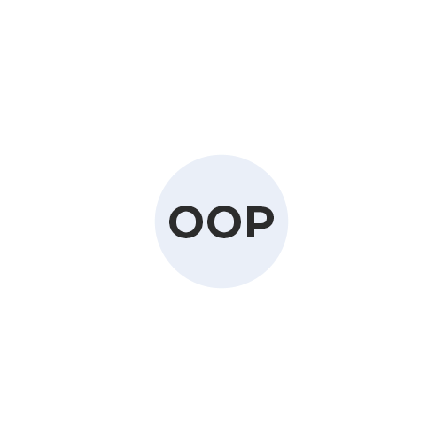
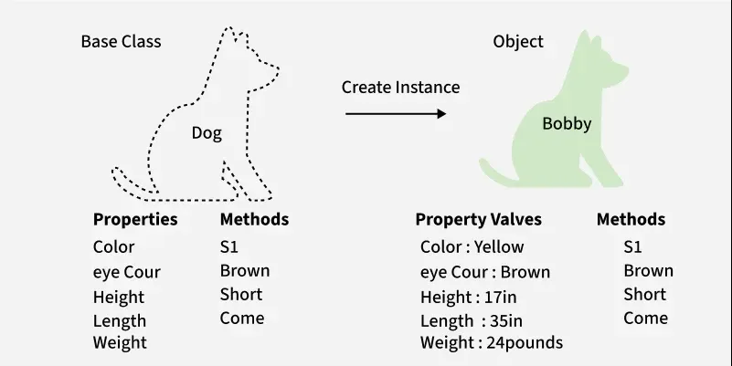
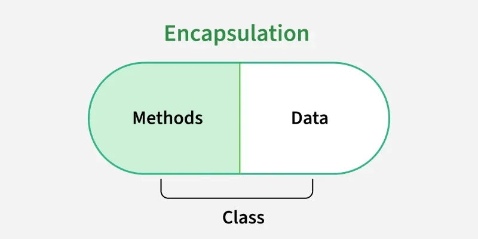
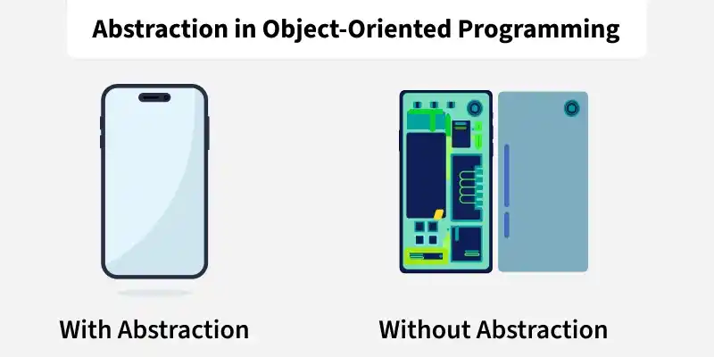
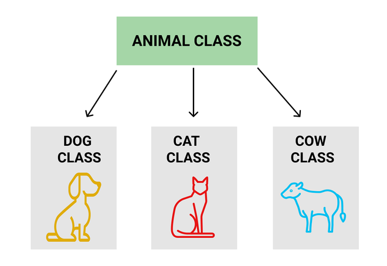
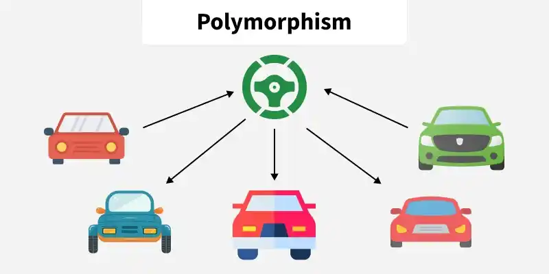
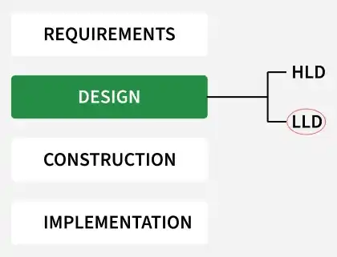
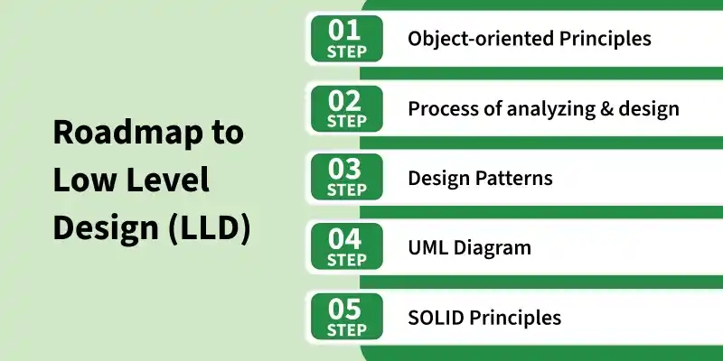
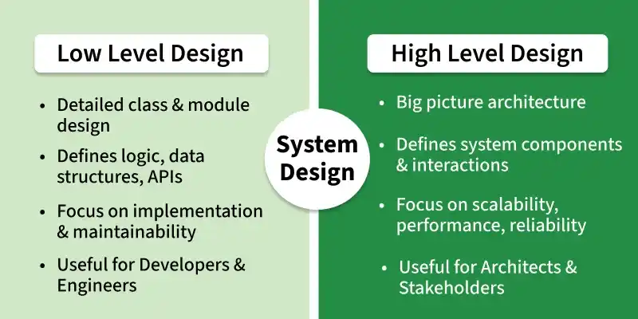

# 核心概念

## [面向对象编程 (OOP) 系统设计概念](https://www.geeksforgeeks.org/system-design/object-oriented-programingoop-concepts-for-designing-sytems/)

面向对象编程 (OOP) 是一种将代码组织成对象和类的编程方法。它有助于使代码更模块化、更易重用且更易于管理。简而言之，OOP 专注于创建包含数据和行为的对象。

- **模块化：** 代码被划分为易于管理的小部分（对象）。
- **可重用性：** 类可以重复使用，避免重复编写代码。
- **可扩展性：** 使构建和维护大型应用程序更加容易。

**示例：** 在汽车系统中，Car 类可以拥有颜色和速度等属性，以及 start() 和 stop() 等方法。可以从同一个类创建不同的汽车对象（例如 BMW、Audi）。



### 实际应用案例

面向对象编程 (OOP) 被广泛用于对现实世界系统进行建模，它将真实实体表示为具有类和关系的对象。

- **银行系统：** 账户、客户和交易等类用于以结构化的方式管理存款、取款和转账。
- **电子商务系统：** 产品、购物车和订单等类高效地处理产品列表、购买和订单处理。
- **图书馆管理系统：** 图书、会员和图书管理员等类管理图书的借阅、归还和跟踪。

### OOP 的必要性

随着软件系统规模的扩大和多个开发人员参与同一项目，如果没有适当的结构，代码管理将变得困难。OOP 通过将代码组织成模块化和可重用的组件来帮助解决这些问题。

- **更好的可维护性：** 系统中一部分的更改不会影响或破坏整个应用程序，从而使更新更加容易。
- **降低复杂性：** 通过将代码组织成结构化对象，避免在函数中传递过多参数。
- **团队协作：** 代码库可以划分为模块，使多个开发人员能够高效地并行工作。
- **代码重用性：** 类和组件可以在应用程序的不同部分重复使用，从而减少代码重复。
- **可扩展性：** 模块化设计使系统更容易扩展，并能应对不断增长的需求或用户。

### 面向对象编程中的类和对象

类和对象是面向对象编程 (OOP) 的基本概念。OOP 是一种系统设计方法，用于模拟现实世界中的事物及其交互。

#### 1. 类

类是用于创建对象的模板或蓝图。它指定了该类对象将具有的特征（属性）和操作（方法）。

**属性：** 对象包含的数据（例如，汽车类中的制造商、型号、年份）。
**方法：** 对象可以执行的操作（例如，startEngine()、accelerate()）。



#### 2. 对象

对象是类的实例。它根据类定义的蓝图创建。

- **属性：** 这些值代表对象的状态。例如，"Car"类的对象可能具有诸如"make"="Toyota"、"model"="Camry"和"year"=2022 之类的属性。
- **方法：** 为了执行某些任务或流程，对象可以调用其类定义的方法。这些方法可以改变对象的状态并操作其数据（属性）。例如，"start_engine"、"accelerate"和"turn_off_engine"方法可用于管理"Car"类对象的行为。

**示例：**

```js
class Student {
  constructor() {
    this.roll = null;
    this.name = null;
  }

  takeLeave() {
    console.log("on leave");
  }

  bunkClass() {
    console.log("Go out and play: ");
  }
}

const sid = new Student();
sid.bunkClass();
sid.name = "Siddhartha Hazra";
console.log(sid.name);
```

### 面向对象编程的四大支柱

这些是定义面向对象编程的核心概念，有助于构建结构化且高效的代码。它们使系统更安全、更易重用且更易于维护。

#### 1. 封装

封装是将数据和处理数据的方法组合成一个称为类的单元的过程。它使得通过公共接口与类交互的外部用户能够访问到类的实现细节。



- **类作为封装单元：** 类包含与特定实体或概念关联的信息（属性）和操作（方法）。类的公共方法允许用户与其交互，而无需了解这些方法的内部工作原理。
- **访问修饰符：** 访问修饰符（例如 public、private 和 protected）用于控制类成员（属性和方法）的可见性，从而实现封装。私有成员只能从类内部访问，而公共成员可以从类外部访问。

**示例：**

```js
class Employee {
  constructor() {
    this.id = null;
    this.name = null;
  }

  setId(id) {
    this.id = id;
  }

  setName(name) {
    this.name = name;
  }

  getId() {
    return this.id;
  }

  getName() {
    return this.name;
  }
}

const emp = new Employee();

// Using setters
emp.setId(101);
emp.setName("Geek");

// Using getters
console.log("Employee ID: " + emp.getId());
console.log("Employee Name: " + emp.getName());
```

#### 2. 抽象

抽象是指专注于对象或系统的关键特性，而忽略不重要元素的过程。它使程序员能够创建简洁易懂的模型，清晰地传达现实世界对象和概念的核心。我们可以通过两种方式实现抽象：

- **抽象类：** 抽象类提供了一种创建对象蓝图的方法，而无需提供完整的实现。它们作为其他类的模板，定义了子类可以扩展和自定义的通用行为和属性。
- **使用接口：** 接口作为类的蓝图，定义了一组方法签名，而无需指定其实现。与类不同，接口不能包含实例字段，但可以包含常量。它们提供了一种实现抽象的方法。



示例：

```js
// Abstract class
class Vehicle {
  constructor() {
    if (this.constructor === Vehicle) {
      throw new Error("Abstract classes can't be instantiated.");
    }
  }

  // Abstract methods
  accelerate() {
    throw new Error("Method 'accelerate()' must be implemented.");
  }

  brake() {
    throw new Error("Method 'brake()' must be implemented.");
  }

  // Concrete method
  startEngine() {
    console.log("Engine started!");
  }
}

// Concrete class
class Car extends Vehicle {
  accelerate() {
    console.log("Car: Pressing gas pedal...");
    // Hidden complex logic: fuel injection, gear shifting, etc.
  }

  brake() {
    console.log("Car: Applying brakes...");
    // Hidden logic: hydraulic pressure, brake pads, etc.
  }
}

// Main execution
const myCar = new Car();
myCar.startEngine();
myCar.accelerate();
myCar.brake();
```

#### 3. 继承

一个类（子类或派生类）可以通过继承从另一个类（父类或基类）继承属性和方法。子类在保留自身共同特征的同时，还可以添加或修改父类的功能。



语法：

```js
// Superclass
class Superclass {
  // Superclass members
}

// Subclass
class Subclass extends Superclass {
  // Subclass members
}
```

**示例：**

```js
// Superclass (Parent)
class Animal {
  eat() {
    console.log("Animal is eating...");
  }

  sleep() {
    console.log("Animal is sleeping...");
  }
}

// Subclass (Child) - Inherits from Animal
class Dog extends Animal {
  bark() {
    console.log("Dog is barking!");
  }
}

// Main
const myDog = new Dog();

// Inherited methods (from Animal)
myDog.eat();
myDog.sleep();

// Child class method
myDog.bark();
```

#### 4. 多态性

多态性通过将不同类的对象视为属于同一个超类，实现了代码重用、扩展和灵活性。通过标准接口，它能够统一处理各种类型的对象，使同一段代码可以处理多种类型的对象。

- **方法重写：** 方法重写是实现多态性的常用方法，子类可以实现其超类中定义的方法。运行时环境会根据对象的实际类型，在调用方法时选择调用哪个实现。
- **基于接口的多态性：** 实现多态性的另一种方法是使用接口或抽象类，在这种情况下，多个类可以继承同一个抽象类或实现同一个接口。
- **方法重载：** 方法重载允许一个类拥有多个同名但参数不同的方法。这使得开发人员能够创建执行类似任务但处理不同类型输入或不同数量参数的方法。



**示例：**

```js
class Calculator {
  // Method for adding two integers
  add(a, b) {
    return a + b;
  }

  // Overloaded method for adding three integers
  add(a, b, c) {
    if (arguments.length === 3) {
      return a + b + c;
    }
    return this.add(a, b);
  }

  // Overloaded method for adding two doubles
  add(a, b) {
    if (typeof a === "number" && typeof b === "number") {
      return a + b;
    }
    return this.add(a, b);
  }
}

const myCalculator = new Calculator();

// Example usage of the overloaded methods
const sum1 = myCalculator.add(5, 3);
const sum2 = myCalculator.add(4, 6, 2);
const sum3 = myCalculator.add(3.5, 2.7);

// Output the results
console.log("Sum of 5 and 3:", sum1);
console.log("Sum of 4, 6, and 2:", sum2);
console.log("Sum of 3.5 and 2.7:", sum3);
```

**注意：** Python 不像 Java 或 C++ 等语言那样直接支持方法重载。在这里，只有最后一个定义才能被访问和调用，因为它会"覆盖"任何先前定义的同名方法。

## [系统设计中的模块化和接口](https://www.geeksforgeeks.org/system-design/inroduction-to-modularity-and-interfaces-in-system-design/)

模块化和接口有助于设计可扩展、可维护且易于管理的系统。模块化将系统划分为独立的组件，而接口则定义了组件之间的通信。

- 模块化将系统分解为更小的独立模块
- 接口确保组件之间清晰且结构化的交互

### 模块化

模块化是一种系统设计原则，它将大型系统划分为独立的、自包含的组件（例如服务、子系统或软件包），这些组件可以单独进行开发、测试和部署。它提高了系统的可扩展性、可维护性和组织性。

- 每个模块都旨在执行特定的任务或功能，这些模块协同工作以实现系统的整体功能。
- 许多领域，例如软件工程、机械工程和建筑学，都使用这种方法来简化开发和维护流程、降低成本并增强系统的灵活性和可靠性。

**例如：** 在现代系统设计中，模块可以是微服务，例如电子商务系统中的支付服务或用户服务。每个服务都负责特定的职责，并通过 API 与其他服务通信。

```java
// Module 1: Addition module
public class AdditionModule {
    public static int add(int a, int b) { return a + b; }
}

// Module 2: Subtraction module
public class SubtractionModule {
    public static int subtract(int a, int b)
    {
        return a - b;
    }
}

// Module 3: Multiplication module
public class MultiplicationModule {
    public static int multiply(int a, int b)
    {
        return a * b;
    }
}

// Module 4: Division module
public class DivisionModule {
    public static double divide(int a, int b)
    {
        if (b != 0) {
            return (double)a / b;
        }
        else {
            System.out.println("Cannot divide by zero");
            return Double.NaN; // Not a Number
        }
    }
}

// Main program
public class Main {
    public static void main(String[] args)
    {
        int num1 = 10;
        int num2 = 5;

        // Using addition module
        int resultAdd = AdditionModule.add(num1, num2);
        System.out.println("Addition result: " + resultAdd);

        // Using subtraction module
        int resultSubtract
            = SubtractionModule.subtract(num1, num2);
        System.out.println("Subtraction result: "
                           + resultSubtract);

        // Using multiplication module
        int resultMultiply
            = MultiplicationModule.multiply(num1, num2);
        System.out.println("Multiplication result: "
                           + resultMultiply);

        // Using division module
        double resultDivide
            = DivisionModule.divide(num1, num2);
        System.out.println("Division result: "
                           + resultDivide);
    }
}
```

#### 实际应用案例

模块化在许多现实世界的系统中都有体现，这些系统中的各个组件虽然独立设计，但却能协同工作，构成一个完整的系统。

- **模块化建筑：** 这类建筑采用预制件，在异地建造，然后使用标准化部件在现场组装。
- **模块化汽车：** 这类汽车由于其部件（例如发动机和变速箱）可互换，因此易于改装或更换。
- **模块化电子产品：** 可更换的摄像头模块和带有可拆卸电池的手机就是由可更换模块组成的电子产品的例子。
- **模块化软件：** 这类软件被划分为独立的模块，每个模块都可以单独开发和测试，然后再集成到整个系统中。

#### 特性

模块化的特性包括：

- **灵活性：** 便于定制和适应不断变化的需求。
- **抽象性：** 模块提供清晰的高级接口，抽象出复杂的功能。
- **协作性：** 允许团队独立地开发不同的模块，从而促进并行开发。
- **测试性：** 模块化系统更容易测试，因为每个模块都可以单独测试，从而提高了系统的健壮性。
- **文档：** 鼓励采用更完善的文档实践，因为模块接口需要定义清晰并有文档记录。
- **互换性：** 模块可以互换或升级，而不会影响系统的整体功能，从而促进互操作性。

#### 组件

模块化设计的组件：

- **模块：** 这些是构成整个系统的较小、独立的组件。每个模块都是独立的，与其他模块具有清晰定义的接口，并且用于执行特定任务。
- **接口：** 这些是模块之间相互通信的接口。接口可以是软件、机械或电气连接，用于指定模块之间的通信方式。
- **子系统：** 这些是协同工作以在整个系统中执行特定功能的模块组。
- **集成：** 这包括将各个模块集成到一个整体单元中，并对整个系统进行测试，以确保一切运行正常。
- **维护：** 为了确保系统持续正常运行，这包括持续监控系统并根据需要进行更新。在某些情况下，这可能涉及更换某些模块。
- **文档：** 包括有关系统的所有技术和操作信息，包括原理图、手册和使用说明。

### 接口

接口定义了一组规则，用于指定系统中不同组件之间的通信方式。它概述了输入、输出和预期行为，以确保无缝集成。

- 定义组件之间的通信标准
- 使独立系统能够顺畅地协同工作

**示例：** 以下代码定义了一个名为"Shape"的接口，其中包含用于计算面积和周长的方法，该接口由"Circle"类实现，后者根据圆的半径计算圆的面积和周长。Main 类通过"Shape"接口创建一个"Circle"对象并调用其方法来演示多态性。

```java
// Interface: Shape
interface Shape {
    double calculateArea();
    double calculatePerimeter();
}

// Class: Circle implementing Shape interface
class Circle implements Shape {
    private double radius;

    public Circle(double radius) {
        this.radius = radius;
    }

    @Override
    public double calculateArea() {
        return Math.PI * radius * radius;
    }

    @Override
    public double calculatePerimeter() {
        return 2 * Math.PI * radius;
    }
}

// Main program
public class Main {
    public static void main(String[] args) {
        Shape circle = new Circle(5);
        System.out.println("Circle Area: " + circle.calculateArea());
        System.out.println("Circle Perimeter: " + circle.calculatePerimeter());
    }
}
```

#### 实际案例

USB（通用串行总线）标准是模块化和接口的一个很好的例子，它允许不同的设备轻松连接和通信。

USB接口定义了一套所有设备与计算机或智能手机交互时必须遵循的通用规则。键盘、鼠标、打印机、摄像头和存储驱动器等设备都遵循此标准，从而确保了兼容性。

由于有了这个接口，主机系统可以与任何USB设备通信，而无需了解其内部细节。这使得系统灵活易用，并支持即插即用功能。

#### 特性

接口定义了有助于构建灵活、可维护且松耦合系统的关键属性。

- **抽象：** 接口提供了一种定义功能契约的方法，而无需指定实现细节。它们定义了哪些操作可用，而无需指定这些操作是如何执行的。
- **封装：** 接口封装了实体的基本行为。它们隐藏了类或模块如何实现其功能的内部细节，从而实现了清晰的关注点分离，并促进了模块化设计。
- **多态性：** 如果不同类的对象实现了同一个接口，它们就可以互换使用，而接口正是实现这一点的关键。这增强了代码的灵活性和可重用性。
- **契约：** 实现类和系统的其他部分通过接口达成契约。为了保持一致性和可预测性，任何实现了某个接口的类都必须为该接口中指定的每个方法提供实现。
- **灵活性：** 接口允许类基于它们实现的接口而非实际类型进行通信，从而有助于促进组件之间的松耦合。这有利于软件系统的演进、测试和维护。

#### 组件

接口主要由定义两个系统如何交互的规则组成。

- **方法签名：** 定义可以通过接口调用的操作，并指定可用的操作。
- **输入和输出：** 描述方法所需的数据以及执行后返回的数据。
- **协议/规则：** 定义组件之间交互的通信规则，例如格式、顺序和约束。

#### 模块化与接口的关系

模块化将系统划分为更小的组件，而接口则定义了这些组件之间的交互方式。二者结合，提高了系统的灵活性、可扩展性和可维护性。

- **封装性：** 接口定义了模块应该做什么，隐藏了其内部细节。模块化确保每个部分独立运行，从而提高了清晰度和可维护性。
- **松耦合性：** 接口通过定义清晰的通信规则来降低模块之间的依赖性。模块化确保一个模块的更改不会影响其他模块。
- **灵活性和可重用性：** 接口允许不同的实现可以互换使用。模块化有助于重用和更新组件，而不会影响整个系统。
- **标准化和文档化：** 接口充当契约，清晰地定义了模块之间的交互方式。模块化组织这些组件，使系统更易于理解。
- **可扩展性：** 模块化允许通过引入新模块来添加新功能。接口确保这些新模块与现有模块无缝集成。

## [低层设计 (LLD)](https://www.geeksforgeeks.org/system-design/what-is-low-level-design-or-lld-learn-system-design/)

低层设计 (LLD) 在软件开发中扮演着至关重要的角色，它将高层抽象概念转化为开发人员可以用来构建系统的详细、可操作的组件。

- LLD 就像一张蓝图，指导开发人员如何实现系统的特定组件，例如类、方法、算法和数据结构。
- 无论我们是在开发微服务架构、Web 应用程序还是移动应用程序，理解 LLD 对于构建可扩展、可维护且高效的系统都至关重要。



### 高层设计 (HLD) 和低层设计 (LLD) 的区别

HLD 和 LLD 在系统设计中都非常重要，但它们侧重于不同的细节层次。HLD 提供系统的全局视图，而 LLD 则侧重于详细的实现。

1. **高层设计 (HLD)：** 侧重于整体系统架构，包括框架、数据库、组件集成以及系统在更宏观层面的运行方式。
2. **低层设计 (LLD)：** 侧重于组件和模块的详细设计，包括交互、UML 图、行为以及所使用的算法和数据结构。

**例如：** 在电子商务系统中，HLD 决定用户服务、支付服务和数据库等组件，而 LLD 则定义"订单"类的运行方式、它包含哪些方法以及它如何与其他类交互。

### 从给定的 HLD 创建 LLD 所需的概念

对于 HLD 到 LLD 的转换，我们通常使用[统一建模语言 (UML) ](https://www.geeksforgeeks.org/system-design/unified-modeling-language-uml-introduction/)图。除了这些图之外，我们在设计过程中还会使用面向对象编程 (OOP) 原则、[SOLID 原则](https://www.geeksforgeeks.org/system-design/solid-principle-in-programming-understand-with-real-life-examples/)和设计模式。



#### 步骤 1：理解面向对象原则

用户需求通过面向对象编程 (OOP) 的概念转化为设计，这些概念构成了低层设计 (LLD) 的基础。对 OOP 原则的深入理解有助于构建可维护、可扩展且结构良好的组件。

- **封装：** 将数据和操作这些数据的方法捆绑在一个单元中。
- **继承：** 新类可以继承现有类的属性和方法的机制。
- **多态：** 不同类能够以不同的方式响应同一个方法。
- **抽象：** 隐藏复杂的实现细节，只显示对象的基本特征。

#### 步骤 2：分析和设计组件

LLD 要求您分析现实世界的问题，并使用 OOP 概念将其分解为面向对象的问题。这是将现实世界的实体建模为对象和类的关键步骤。

我们应该关注：

- 根据系统需求识别类和对象。
- 确定不同实体之间的关系（例如关联、继承等）。
- 运用 SOLID 原则确保您的设计简洁、易于维护且可扩展。

#### 步骤 3：实现设计模式

面向对象设计的实现依赖于设计模式，这些模式为常见问题提供可重用的解决方案。它们遵循已被验证的最佳实践，帮助构建可扩展、易于维护且高效的系统。

- **创建型模式（例如，单例模式、工厂模式）：** 这些模式处理对象创建机制，力求以适合具体情况的方式创建对象。
- **行为型模式（例如，观察者模式、策略模式）：** 关注对象之间的通信以及它们如何相互交互。
- **结构型模式（例如，适配器模式、组合模式）：** 这些模式致力于简化系统及其组件的结构。

#### 步骤 4：在 LLD 中使用 UML 图

统一建模语言 (UML) 用于以可视化的方式建模和设计系统，有助于从 HLD 过渡到 LLD。它清晰地展现了组件及其关系，使开发人员更容易理解系统。

- **类图：** 用类及其相互关系来表示系统的结构。
- **序列图：** 展示对象如何随时间交互，并显示方法调用的顺序。
- **活动图：** 展示系统组件的工作流程或活动。
- **状态图：** 表示组件或对象的不同状态以及这些状态之间的转换。
- **用例图：** 通过展示不同的用户交互来定义系统的功能需求。

这些图在低层设计（LLD）中发挥着重要作用，它们以清晰的可视化方式展现了组件及其交互。

#### 5. 实施 SOLID 原则

SOLID 原则（规则）包含 5 条，必须严格按照系统需求或优化设计的要求来执行。为了编写可扩展、灵活、易于维护和可重用的代码：

1. 单一职责原则 (SRP)
2. 开闭原则 (OCP)
3. 里氏替换原则 (LSP)
4. 接口隔离原则 (ISP)
5. 依赖倒置原则 (DIP)

需要注意的是，SOLID 原则只是指导原则，并非必须严格遵守的规则。关键在于如何在遵循这些原则的同时，兼顾业务需求的具体要求和限制。

### 优势

低层设计 (LLD) 为构建软件系统提供了一种详细且结构化的方法，带来诸多优势：

- **清晰的组件功能：** LLD 为软件的每个部分提供了详细的工作计划，从而简化了开发和调试过程。
- **可扩展性和灵活性：** 它提供了一个结构良好的设计，使得在不影响整个软件的情况下更新或修复系统的部分内容变得更加容易。
- **改进的沟通：** LLD 有助于团队成员更有效地沟通，因为每个人都清楚地了解组件的工作原理。
- **更简洁的代码：** 遵循 LLD 的设计原则可以编写出更简洁、更结构化的代码，从而降低出错的可能性。
- **更快的编码速度：** 合理的 LLD 可以加快编码过程，因为开发人员可以遵循之前制定的详细计划。

### 低层设计 (LLD) 的最佳实践

一些构建良好低层设计的最佳实践包括：

- **模块化设计：** 始终尝试将系统分解为包含特定功能的小型独立组件。
- **清晰的接口：** 清晰定义每个组件的接口，包括方法、输入和输出。这有助于维护组件之间的有效通信。
- **使用设计模式：** 融入面向对象编程 (OOP) 原则，以提高代码的重用性、灵活性和可维护性。
- **遵循 SOLID 原则：** 遵循 SOLID 原则，可以实现更健壮、更易于维护的设计。
- **错误处理：** 通过在设计中加入验证检查，提前规划错误处理和系统验证。

### 学习低级设计 (LLD) 的路线图

要掌握低级设计，请遵循以下结构化的学习路径：

1. 面向对象和设计原则

- [Object-Oriented Programming (OOPS) Concepts](https://www.geeksforgeeks.org/system-design/object-oriented-programingoop-concepts-for-designing-sytems/)
- [Object-Oriented Analysis and Design](https://www.geeksforgeeks.org/software-engineering/object-oriented-analysis-and-design/)
- [SOLID Principles](https://www.geeksforgeeks.org/system-design/solid-principle-in-programming-understand-with-real-life-examples/)

2. 设计模式

- [Creational Design Patterns](https://www.geeksforgeeks.org/system-design/creational-design-pattern/)
- [Behavioral Design Patterns](https://www.geeksforgeeks.org/system-design/behavioral-design-patterns/)
- [Structural Design Patterns](https://www.geeksforgeeks.org/system-design/structural-design-patterns/)
- [When to choose which design pattern?](https://www.geeksforgeeks.org/system-design/design-patterns-cheat-sheet-when-to-use-which-design-pattern/)

3. 低层设计的UML和模型

- [Class Diagrams](https://www.geeksforgeeks.org/system-design/unified-modeling-language-uml-class-diagrams/)
- [Sequence Diagrams](https://www.geeksforgeeks.org/system-design/unified-modeling-language-uml-sequence-diagrams/)
- [Activity Diagrams](https://www.geeksforgeeks.org/system-design/unified-modeling-language-uml-activity-diagrams/)
- [State Diagrams](https://www.geeksforgeeks.org/system-design/unified-modeling-language-uml-state-diagrams/)
- [Use Case Diagrams](https://www.geeksforgeeks.org/system-design/use-case-diagram/)
- [Object Diagrams](https://www.geeksforgeeks.org/system-design/unified-modeling-language-uml-object-diagrams/)

4. 低层设计最佳实践

- [Data Structures and Algorithms for System Design](https://www.geeksforgeeks.org/system-design/data-structures-and-algorithms-for-system-design/)
- [Essential Security Measures in System Design](https://www.geeksforgeeks.org/system-design/essential-security-measures-in-system-design/)
- [Introduction to Modularity and Interfaces](https://www.geeksforgeeks.org/system-design/inroduction-to-modularity-and-interfaces-in-system-design/)
- [Difference between LLD and HLD](https://www.geeksforgeeks.org/system-design/difference-between-high-level-design-and-low-level-design/)
- [Performance vs Scalability](https://www.geeksforgeeks.org/system-design/performance-vs-scalability-in-system-design/)
- [Speed vs. Quality](https://www.geeksforgeeks.org/system-design/speed-vs-quality-in-system-design/)
- [Coding Standards Best Practices](https://www.geeksforgeeks.org/system-design/coding-standards-and-best-practices-for-system-design/)

5. 低层设计案例学习

- [Elevator System Low-Level Design](https://www.geeksforgeeks.org/system-design/elevator-system-low-level-design-lld/)
- [Tic-Tac-Toe Low-Level Design](https://www.geeksforgeeks.org/system-design/low-level-design-of-tic-tac-toe-system-design/)
- [Amazon Low Level Design](https://www.geeksforgeeks.org/system-design/amazon-low-level-designlld/)
- [Vending Machine Low Level Design](https://www.geeksforgeeks.org/system-design/vending-machine-low-level-design/)

6. 面试准备

- [How to Prepare for Low-Level Design Interviews?](https://www.geeksforgeeks.org/system-design/how-to-prepare-for-low-level-design-interviews/)
- [Top Low-Level Design(LLD) Interview Questions 2024](https://www.geeksforgeeks.org/system-design/top-low-level-system-designlld-interview-questions-2024/)
- [Best Books for Learning Low-Level Design(LLD) [2024]](https://www.geeksforgeeks.org/system-design/best-books-for-learning-low-level-designlld-2024/)

## [高层设计 (HLD) 和低层设计 (LLD) 的区别](https://www.geeksforgeeks.org/system-design/difference-between-high-level-design-and-low-level-design/)

[系统设计](https://www.geeksforgeeks.org/system-design/system-design-tutorial/)包括创建高层设计 (HLD) 和低层设计 (LLD)。高层设计类似于路线图，展示了整体规划；而低层设计则是为程序员提供的详细指南，指导他们如何构建每个部分。

- 它确保项目组织良好且运行流畅。
- 高层设计和低层设计是系统设计的两个主要方面。



### 高级设计 (HLD)

[高级设计 (HLD) ](https://www.geeksforgeeks.org/system-design/what-is-high-level-design-learn-system-design/)描述系统的整体架构，并展示不同组件之间的交互方式。它概述了主要模块、系统结构以及服务之间的关系。

HLD 包括：

- 系统架构，展示主要组件及其交互。
- 数据库设计以及模块之间的高级数据流。
- 系统、服务、平台及其关系的概述。
- 硬件、软件接口和用户界面的描述。
- 用户工作流程和关键性能考量。

### 低级设计 (LLD)

[低级设计 (LLD)](https://www.geeksforgeeks.org/system-design/what-is-low-level-design-or-lld-learn-system-design/)是软件开发过程中的一个阶段，用于详细指定系统组件及其交互。

- 它详细描述了每个模块，这意味着它包含每个系统组件的实际逻辑，并深入到每个模块的规范中。
- 它也被称为微观/详细设计。
- 它由设计人员和开发人员创建。
- 它涉及将高级设计转换为更详细的蓝图，涉及具体的算法、数据结构和接口。
- 低级设计 (LLD) 在编码过程中为开发人员提供指导，确保系统功能的准确高效实现。

### 高层设计与低级设计

高层设计 (HLD) 定义了整体系统架构，而低级设计 (LLD) 则详细阐述了内部逻辑和组件级实现。

| 高层设计                                                  | 低级设计                                                  |
| --------------------------------------------------------- | --------------------------------------------------------- |
| 高层设计是通用系统设计，指的是整体系统设计。              | 低级设计是对 HLD 的细化，指的是组件级设计过程。           |
| 高层设计简称 HLD。                                        | 低级设计简称 LLD。                                        |
| 它也被称为宏观/系统设计。                                 | 它也被称为微观/详细设计。                                 |
| 此外，它描述了应用程序的整体架构。                        | 它详细描述了每个模块。                                    |
| 高层设计表达了每个模块的简要功能。                        | 低级设计表达了模块功能逻辑的细节。                        |
| 它由解决方案架构师创建。                                  | 它由设计师和开发人员创建。                                |
| 高层设计 (HLD) 的参与者包括设计团队、评审团队和客户团队。 | 低层设计 (LLD) 的参与者包括设计团队、运维团队和实施团队。 |
| HLD 的创建时间早于低层设计 (LLD)。                        | 而 LLD 的创建时间晚于高层设计 (HLD)。                     |
| HLD 的输入标准是软件需求规格说明书 (SRS)。                | LLD 的输入标准是经过评审的高层设计 (HLD)。                |
| HLD 的输出标准是数据库设计、功能设计和评审记录。          | LLD 的输出标准是程序规格说明书和单元测试计划。            |
