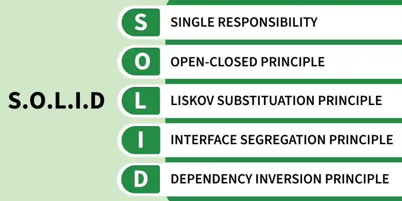
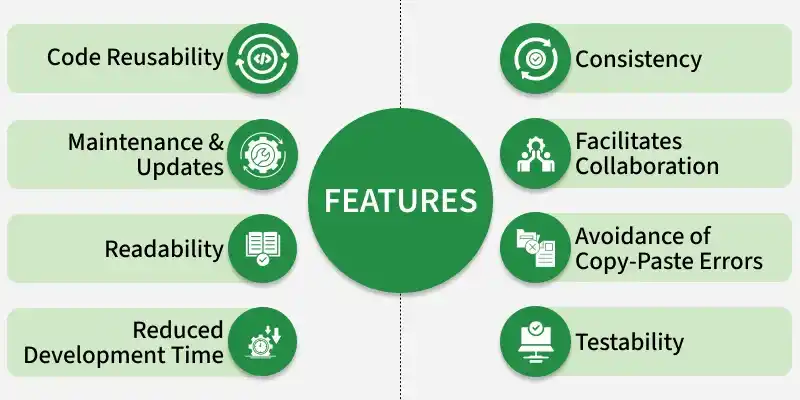
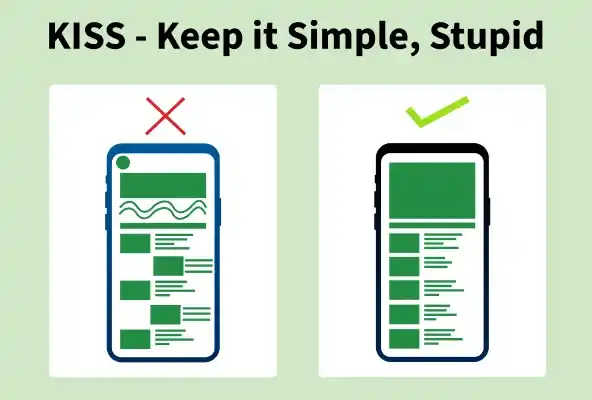
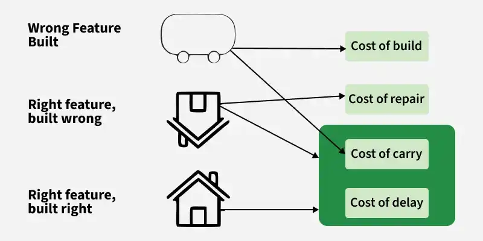
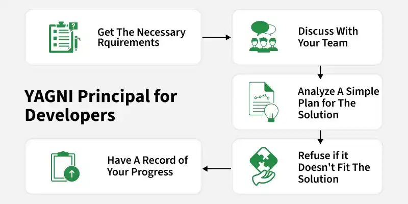

# 设计原则

## [SOLID 原则及其实际应用案例](https://www.geeksforgeeks.org/system-design/solid-principle-in-programming-understand-with-real-life-examples/)

SOLID 原则是五项基本准则，能够提升软件设计，使代码更易于维护和扩展。

- SOLID 原则有助于提高松耦合性。松耦合是指一组类彼此之间的依赖性较低。
- 松耦合有助于提高代码的可重用性、可维护性、灵活性和稳定性。
- 当某些代码需要修改时，松耦合的类可以最大限度地减少代码的修改量。



### 1. 单一职责原则（SRP）

该原则指出`一个类应该只有一个变更理由`，这意味着每个类都应该只有一个职责、一个任务或一个目标。换句话说，一个类在软件系统中应该只有一个任务或目标。

**例如：**想象一位面包师负责烘焙面包。面包师的职责是专注于烘焙面包，确保面包质量上乘、烘焙得当，并符合面包店的标准。

- 如果面包师除了烘焙面包之外，还要负责库存管理、订货、客户服务和清洁工作，这就违反了单一职责原则，因为多项职责被合并在一起。
- 每项任务都是一项独立的职责，将它们合并会降低面包师在烘焙方面的专注度和效率。
- 为了遵循`SRP`，职责应该分配给不同的个人或团队，每个个人或团队独立负责一项特定的任务。

**示例代码**

```js
// Class for baking bread
class BreadBaker {
  bakeBread() {
    console.log("Baking high-quality bread...");
  }
}

// Class for managing inventory
class InventoryManager {
  manageInventory() {
    console.log("Managing inventory...");
  }
}

// Class for ordering supplies
class SupplyOrder {
  orderSupplies() {
    console.log("Ordering supplies...");
  }
}

// Class for serving customers
class CustomerService {
  serveCustomer() {
    console.log("Serving customers...");
  }
}

// Class for cleaning the bakery
class BakeryCleaner {
  cleanBakery() {
    console.log("Cleaning the bakery...");
  }
}

function main() {
  const baker = new BreadBaker();
  const inventoryManager = new InventoryManager();
  const supplyOrder = new SupplyOrder();
  const customerService = new CustomerService();
  const cleaner = new BakeryCleaner();

  // Each class focuses on its specific responsibility
  baker.bakeBread();
  inventoryManager.manageInventory();
  supplyOrder.orderSupplies();
  customerService.serveCustomer();
  cleaner.cleanBakery();
}

main();
```

**输出**

```txt
Baking high-quality bread...
Managing inventory...
Ordering supplies...
Serving customers...
Cleaning the bakery...
```

- **面包师类：** 专门负责烘焙面包。该类专注于确保面包的质量和标准，不受其他任务的干扰。
- **库存管理类：** 负责库存管理，确保面包房拥有合适的原料和物料。
- **物料订购类：** 负责物料订购，确保面包房备有必需品。
- **客服类：** 负责服务顾客，以专注的态度对待每一位顾客。
- **面包房清洁工类：** 负责清洁面包房，确保环境卫生。

### 2. 开闭原则（OCP）

该原则指出`软件实体（类、模块、函数等）应开放扩展，封闭修改`，这意味着您应该能够在不修改类本身的情况下扩展其行为。

**例如：**假设你有一个名为 `PaymentProcessor` 的类，用于处理在线商店的付款。最初，PaymentProcessor 类仅支持使用信用卡处理付款。但是，你希望扩展其功能，使其也支持使用 PayPal 处理付款。

与其修改现有的 PaymentProcessor 类，不如创建一个新的 PayPalPaymentProcessor 类来添加 PayPal 支持。

这样既保持了原类不变，又通过新类扩展了其功能。

它遵循了开闭原则，即保持类的封闭性，使其难以修改，但允许扩展。

```js
// Base class for payment processing
class PaymentProcessor {
  processPayment(amount) {
    // Pure virtual function
    throw new Error("processPayment must be implemented");
  }
}

// Credit card payment processor
class CreditCardPaymentProcessor extends PaymentProcessor {
  processPayment(amount) {
    console.log(`Processing credit card payment of $${amount}`);
  }
}
```

#### 扩展功能

现在，要添加对 PayPal 付款的支持，您可以创建一个继承自 PaymentProcessor 的新类 PayPalPaymentProcessor。

```js
// PayPal payment processor
class PayPalPaymentProcessor extends PaymentProcessor {
  processPayment(amount) {
    console.log(`Processing PayPal payment of $${amount}`);
  }
}
```

#### 使用方法

在您的应用程序中，您可以直接使用 PaymentProcessor 或 CreditCardPaymentProcessor 这两种支付处理器，无需修改现有的代码。

```js
// Function to process payment
function processPayment(processor, amount) {
  processor.processPayment(amount);
}

function main() {
  const creditCardProcessor = new CreditCardPaymentProcessor();
  const payPalProcessor = new PayPalPaymentProcessor();

  processPayment(creditCardProcessor, 100.0); // Processing credit card payment
  processPayment(payPalProcessor, 150.0); // Processing PayPal payment
}

main();
```

**以上代码的解释：**

- **基类 (PaymentProcessor)：** 一个抽象类，定义了所有支付处理器通用的接口 (processPayment)。
- **CreditCardPaymentProcessor：** 专门实现信用卡交易的支付处理。
- **PayPalPaymentProcessor：** 扩展了支付处理器的功能，使其能够处理 PayPal 支付。
- **主函数：** 使用 PaymentProcessor 接口调用 processPayment() 函数，从而在不修改现有代码的情况下实现灵活性。

### 3. 里氏替换原则（LSP）

该原则由 Barbara Liskov 于 1987 年提出。根据该原则，`派生类或子类必须能够替换其基类或父类`。这确保了任何子类都可以替换其父类，而不会导致程序出现意外行为。

**示例：** 该原则的一个经典示例是四边形。矩形的高度和宽度都可以是任意值。正方形是宽度和高度相等的矩形。因此，我们可以说可以将矩形类的属性扩展到正方形类。

- 将矩形替换为正方形会强制执行约束（边长相等），从而改变父类的预期行为。
- 这违反了 LSP 原则，因为派生类不应改变或破坏基类的预期行为。

**示例代码**

```js
// Base class for shapes
class Rectangle {
  constructor(w, h) {
    this.width = w;
    this.height = h;
  }

  area() {
    return this.width * this.height;
  }

  getWidth() {
    return this.width;
  }

  getHeight() {
    return this.height;
  }

  setWidth(w) {
    this.width = w;
  }

  setHeight(h) {
    this.height = h;
  }
}

// Derived class for squares
class Square extends Rectangle {
  constructor(size) {
    super(size, size);
  }

  setWidth(w) {
    this.width = this.height = w; // Ensure both width and height remain the same
  }
}
```

**输出**

```txt
Area: 100
```

- **矩形类：** 这是基类，具有宽度和高度属性。它包含用于计算面积以及设置宽度和高度的方法。
- **正方形类：** 此类继承自矩形类，但重写了 `setWidth` 和 `setHeight` 方法，以确保更改一个维度会影响另一个维度，从而保持所有边长相等。

#### LSP 违规示例

- 要了解 LSP 的潜在违规情况，请考虑在预期使用矩形类的上下文中使用正方形类会发生什么：
- 如果将正方形类替换为矩形类，仅更改宽度或高度会导致意外结果，因为它会同时更改两个维度。

### 4. 接口隔离原则（ISP）

此原则适用于接口，类似于单一职责原则，强调保持接口的明确性和定义清晰。它指出，不应强制客户端依赖与其无关的方法，从而避免不必要的依赖。目标是通过使用多个小型、针对特定客户端的接口来避免臃肿的接口，每个接口都具有清晰明确的职责。

**例如：**假设您走进一家餐厅，您是纯素食主义者。餐厅服务员给了您一份菜单，其中包含素食、荤菜、饮料和甜点。

- 顾客应该收到一份与其需求相关的菜单（例如，仅限素食），而不是一份包含不必要菜品的通用菜单。
- 将通用菜单拆分成更小、更具体的菜单可以减少不必要的依赖关系，并最大限度地减少未来的变更。

```js
// Interface simulation is done by convention in JavaScript

// Class for vegetarian menu
class VegetarianMenu {
  getVegetarianItems() {
    return ["Vegetable Curry", "Paneer Tikka", "Salad"];
  }
}

// Class for non-vegetarian menu
class NonVegetarianMenu {
  getNonVegetarianItems() {
    return ["Chicken Curry", "Fish Fry", "Mutton Biryani"];
  }
}

// Class for drinks menu
class DrinkMenu {
  getDrinkItems() {
    return ["Water", "Soda", "Juice"];
  }
}

// Function to display menu items for a vegetarian customer
function displayVegetarianMenu(menu) {
  console.log("Vegetarian Menu:");
  for (const item of menu.getVegetarianItems()) {
    console.log("- " + item);
  }
}

// Function to display menu items for a non-vegetarian customer
function displayNonVegetarianMenu(menu) {
  console.log("Non-Vegetarian Menu:");
  for (const item of menu.getNonVegetarianItems()) {
    console.log("- " + item);
  }
}

function main() {
  const vegMenu = new VegetarianMenu();
  const nonVegMenu = new NonVegetarianMenu();
  const drinkMenu = new DrinkMenu();

  displayVegetarianMenu(vegMenu);
  displayNonVegetarianMenu(nonVegMenu);
}

main();
```

- **IVegetarianMenu 接口：** 此接口定义了一个获取素食菜品的方法。它确保只有实现了素食菜单接口的类才需要提供此功能。
- **INonVegetarianMenu 接口：** 与素食菜单接口类似，此接口定义了一个获取非素食菜品的方法。
- **IDrinkMenu 接口：** 此接口定义了一个获取饮品的方法，并将其与食物分开。
- **VegetarianMenu 类：** 实现了 IVegetarianMenu 接口，并提供素食菜品列表。
- **NonVegetarianMenu 类：** 实现了 INonVegetarianMenu 接口，并提供非素食菜品列表。
- **DrinkMenu 类：** 实现了 IDrinkMenu 接口，并提供饮品列表。

### 5. 依赖倒置原则（DIP）

依赖倒置原则 (DIP) 是面向对象设计中的一个原则，它指出`高层模块不应该依赖于底层模块。两者都应该依赖于抽象层`。这意味着`程序的大部分不应直接依赖于细小的、具体的部分。相反，两者都应依赖于通用概念（接口）`。此外，抽象不应依赖于细节。细节应依赖于抽象（细节应遵循这些规则）。

- 简而言之，依赖注入原则 (DIP) 建议类应依赖于抽象（例如，接口或抽象类），而不是具体的实现。
- 这使得代码更加灵活和解耦，从而更容易在不影响代码库其他部分的情况下更改实现。

**例如：**在软件开发团队中，开发人员依赖于抽象的版本控制系统（例如 Git）来管理和跟踪代码库的更改。他们不依赖于 Git 内部的具体工作原理。

以上示例的代码

```js
// Interface for version control system simulated via convention
class IVersionControl {
  commit(message) {
    throw new Error("commit() must be implemented");
  }
  push() {
    throw new Error("push() must be implemented");
  }
  pull() {
    throw new Error("pull() must be implemented");
  }
}

// Git version control implementation
class GitVersionControl extends IVersionControl {
  commit(message) {
    console.log("Committing changes to Git with message: " + message);
  }

  push() {
    console.log("Pushing changes to remote Git repository.");
  }

  pull() {
    console.log("Pulling changes from remote Git repository.");
  }
}

// Team class that relies on version control
class DevelopmentTeam {
  constructor(vc) {
    this.versionControl = vc;
  }

  makeCommit(message) {
    this.versionControl.commit(message);
  }

  performPush() {
    this.versionControl.push();
  }

  performPull() {
    this.versionControl.pull();
  }
}

function main() {
  const git = new GitVersionControl();
  const team = new DevelopmentTeam(git);

  team.makeCommit("Initial commit");
  team.performPush();
  team.performPull();
}

main();
```

**输出**

```txt
Committing changes to Git with message: Initial commit
Pushing changes to remote Git repository.
Pulling changes from remote Git repository.
```

- **IVersionControl 接口：** 定义了任何版本控制系统都应支持的操作，例如提交、推送和拉取。它作为一种抽象，将高级代码与底层实现解耦。
- **GitVersionControl 类：** 此类实现了 IVersionControl 接口，提供了使用 Git 管理版本控制的特定功能。
- **DevelopmentTeam 类：** 此类依赖于 IVersionControl 接口，这意味着它可以与任何遵循该接口的版本控制实现一起使用。它不需要了解 Git 内部的工作原理。

### 面向对象设计中 SOLID 原则的必要性

SOLID 原则在面向对象设计中至关重要的主要原因：

- SOLID 原则使代码更易于维护。当每个类都有明确的职责时，更容易找到需要更改的地方，而不会影响代码中不相关的部分。
- 这些原则有助于软件的成长。例如，开闭原则允许开发人员在不修改现有代码的情况下添加新功能，从而更容易适应新的需求。
- SOLID 原则鼓励灵活性。通过依赖抽象而非具体实现（如依赖倒置原则），开发人员可以在不影响整个系统的情况下更改组件。

## [软件开发中的 DRY 原则](https://www.geeksforgeeks.org/software-engineering/dont-repeat-yourselfdry-in-software-development/)

DRY（Don't Repeat Yourself，不要重复自己）是一项[软件开发原则](https://www.geeksforgeeks.org/software-engineering/modern-principles-of-software-development/)，它通过提倡可重用的组件和代码来避免逻辑重复。它确保所有更改都集中在一个地方进行，从而提高可维护性和一致性。DRY 与模块化设计和单一职责原则 (SRP) 相结合，可以构建可扩展且高效的系统。

- 通过减少重复并确保代码库的一致性来促进代码重用。
- 集中逻辑以最大限度地减少错误、简化更新并支持 SRP，从而实现更好的系统设计。

**示例：**如果没有 DRY，电子邮件验证逻辑会在多个函数中重复出现，因此任何更改都必须在多个地方进行。而有了 DRY，验证逻辑只需在一个函数中编写一次，即可在任何地方重用，从而简化维护。

### 实际应用

在实际应用中，DRY 应用于系统中重复使用相同逻辑或规则的区域。

- 实用程序和辅助类集中处理常用函数，例如字符串处理、日期格式化或计算。
- 验证逻辑和业务规则在多个模块中复用，以确保行为一致。
- 日志记录、异常处理和配置管理共享，避免重复设置和处理不一致。

### DRY 原则解决重复问题的方法

这些方法通过促进代码复用和更好的代码组织，帮助识别和消除重复逻辑。

- **创建函数或方法：** 识别重复逻辑并将其封装在可从多个位置调用的函数或方法中。
- **使用类和继承：** 对于更复杂的场景，使用类和继承创建可复用的组件，这些组件共享通用功能。
- **提取常量或配置：** 如果某些常量或配置重复出现，请将其集中到一个单独的源中，以避免冗余。
- **模块化：** 将代码分解为模块化组件，每个组件负责一项特定任务。这有助于提高代码的复用性和模块化程度。

### 特性

DRY 原则在软件开发中的特性包括：



- **代码重用性：** 鼓励创建可重用组件，减少代码库中的冗余，提高跨模块的开发效率。
- **更易于维护：** 集中化逻辑可最大限度地减少错误，并提高更新效率，因为只需在一个地方进行更改，而不是在多个地方。
- **更高的可读性：** 消除重复，使开发人员更容易理解、浏览和维护系统代码。
- **更快的开发速度：** 重用代码可节省时间，尤其是在大型项目中，因为它避免了重复实现相同的逻辑。
- **一致性：** 通过将功能封装在一个地方，确保行为一致，减少系统不同部分之间的不一致性。
- **更好的协作：** 由于共享逻辑定义清晰且可重用，因此允许多个开发人员独立工作而不会发生冲突。
- **避免复制粘贴错误：** 减少由重复代码引起的错误，确保错误不会在多个部分重复出现。
- **增强可测试性：** 通过将逻辑隔离到可重用和可测试的组件中，简化单元测试并减少意外副作用。

### 实现示例

假设您的代码中多个部分都需要相同的电子邮件地址验证逻辑：

```js
"use strict";

// Without DRY (duplicated logic)
function validateEmailFormat1(email) {
  return email.includes("@") && email.includes(".");
}

function validateEmailFormat2(email) {
  return email.includes("@") && email.includes(".");
}

// With DRY (single reusable function)
function validateEmailFormat(email) {
  return email.includes("@") && email.includes(".");
}

(function () {
  const email1 = "user@example.com";
  const email2 = "invalidemail";

  // Without DRY usage
  console.log("Without DRY validation 1:", validateEmailFormat1(email1));
  console.log("Without DRY validation 2:", validateEmailFormat2(email2));

  // With DRY usage
  console.log("With DRY validation:", validateEmailFormat(email1));
})();
```

**输出**

```txt
Without DRY validation 1: 1
Without DRY validation 2: 0
With DRY validation: 1
```

在非 DRY 示例中，相同的验证逻辑在多个函数中重复出现。而遵循 DRY 原则后，验证逻辑被封装在一个函数中，从而促进代码重用并减少冗余。

### DRY 原则的违反

当相同的逻辑或知识在多个地方重复出现，而不是集中管理时，就会发生 DRY 原则的违反。这些问题通常会增加维护工作量，并带来行为不一致的风险。

- 将相同的逻辑复制粘贴到多个方法或类中，会导致需求变更时出现多个变更点。
- 在控制器、服务和 DAO 等不同层级重复相同的业务规则会导致不一致和紧耦合。
- 在不同的文件中硬编码相同的值或配置会使更新容易出错且难以跟踪。

### DRY 原则与 SOLID 原则

DRY 原则与单一职责原则 (SRP) 紧密结合，以提高代码的可维护性并减少变更的影响。这两个原则都着重于组织代码，使变更可预测且局部化。

- 单一职责原则 (SRP) 确保一个类或模块只有一个变更理由。
- DRY 原则确保这个变更理由在代码库中仅存在于一个位置。
- 它们共同作用，减少了需求变更带来的连锁反应，使重构更加安全。

### 局限性

尽管 DRY 原则很重要，但盲目应用它会导致过度设计和复杂的架构。

- 例如：当代码重复是偶然发生，且未来代码很可能以不同的方式变化时；
- 当创建抽象带来的复杂性超过重复代码本身时；
- 在代码量非常小或实验性代码中，简洁性比代码重用更重要。

## [软件开发中的 KISS 原则](https://www.geeksforgeeks.org/software-engineering/kiss-principle-in-software-development/)

KISS 原则，即`保持简单，笨蛋`（Keep It Simple, Stupid，也有一些变体，如`保持简短简洁`或`保持超级简单`），是一种设计原则，它强调在设计、开发以及其他领域（例如工程、[软件开发](https://www.geeksforgeeks.org/software-engineering/what-is-software-development/)和用户界面设计）中，简洁性应是关键目标。

- 其核心思想是在实现所需功能或结果的前提下，尽可能地简化事物。
- 该原则表明，更简单的解决方案通常更容易理解、实现、维护和使用。

**例如：**与其创建一个包含多层结构的复杂验证系统，不如创建一个执行所需检查的简单函数，这样通常更容易维护，也更不容易出错。



### 应用KISS原则的步骤

应用KISS原则是指有意识地简化解决方案、设计、流程和决策，以提高效率、清晰度和效果。以下是应用KISS原则的一些实用步骤：

#### 1. 明确核心目标

在设计解决方案之前，首先要了解你真正想要实现的目标。

- 清晰地定义你要解决的问题或目标。
- 确定关键目标和需求。

#### 2. 聚焦核心要素

目标明确后，只关注真正必要的部分。

- 优先考虑实现目标所必需的关键特性或组件。
- 避免不必要的修饰或功能。

#### 3. 简化设计和工作流程

复杂的设计往往会造成混乱和错误，因此简化至关重要。

- 精简流程和工作流程，最大限度地降低复杂性。
- 消除冗余步骤或不必要的复杂情况。

#### 4. 优先考虑清晰度和易懂性

一个简单的解决方案应该易于所有人理解和使用。

- 确保解决方案清晰易懂，所有利益相关者都能理解。
- 在文档和沟通中使用简洁明了的语言。

#### 5. 迭代和改进

通过持续的审查和改进，简洁性会随着时间的推移而不断提升。

- 持续审查和改进解决方案，以进一步简化。
- 寻求反馈并根据获得的见解进行迭代。

#### 6. 使用简单的工具和技术

您选择的工具应该有助于简化，而不是增加复杂性。

- 选择符合 KISS 原则的简单工具和方法。
- 避免在工具和技术选择上造成不必要的复杂性。

#### 7. 测试简洁性

始终评估您的解决方案是否尽可能简洁。

- 根据 KISS 原则评估解决方案，以确保其简洁性。
- 评估每个组件或功能是否真正必要。

#### 8. 保持务实

简洁性应与实际需求和限制条件相平衡。

- 在简洁性与其他因素（例如功能性和可扩展性）之间取得平衡。
- 决策时要务实，尽可能优先考虑简洁性。

#### 9. 教育和倡导

当每个人都理解简洁的价值时，它才能发挥最佳效果。

- 向团队成员和利益相关者普及简洁的益处。
- 在您的组织或团队中倡导采用 KISS 原则（Keep It Simple, Stupid）。

#### 10. 以身作则

当人们看到简洁的实际应用时，他们会更快地接受它。

- 通过您的行动和决策来展现简洁解决方案的有效性。
- 以身作则，激励他人拥抱简洁。

### 示例或案例研究

以下是一些示例和案例研究，展示了KISS原则在不同领域的应用：

#### 谷歌搜索引擎

- 谷歌搜索引擎的界面简洁明了。其主页仅包含一个搜索栏和极简的文字，使用户易于理解和使用。
- 尽管搜索算法本身十分复杂，但谷歌对简洁性的坚持使其成为全球使用最广泛的搜索引擎。

#### 苹果iPhone

- 苹果iPhone以其直观易用的设计而闻名，遵循KISS原则。其界面导航简洁明了，图标极简，手势操作直观。
- 苹果在硬件和软件设计中优先考虑简洁性，从而为全球数百万用户带来流畅愉悦的用户体验。

#### 推特的字符限制

- 推特最初每条推文140个字符的限制，旨在促进简洁的沟通。用户被鼓励简洁明了地表达信息。
- 字符限制激发了创造力，迫使用户专注于信息的本质，从而造就了推特独特的沟通风格。

#### 特斯拉 Model S 仪表盘

- 特斯拉 Model S 电动汽车采用极简主义的仪表盘设计，配备大尺寸触摸屏。该界面提供必要的控制和信息，同时避免不必要的杂乱。
- 仪表盘的简洁性提升了易用性，减少了驾驶员的注意力分散，从而带来更安全、更愉悦的驾驶体验。

### KISS 原则在软件开发中的应用

KISS 原则在[软件开发工程 (SDE) ](https://www.geeksforgeeks.org/work-experiences/senior-software-engineer-job-description/)中至关重要，贯穿软件开发生命周期的各个阶段。以下是 KISS 原则在 SDE 中至关重要的几个关键原因：

- **可维护性：** 简洁的代码更易于理解、修改和维护，尤其是在拥有多名开发人员的大型项目中。
- **调试：** 更少的复杂性使得问题更容易快速识别和修复，从而提高系统稳定性。
- **可扩展性：** 简洁的设计使得随着需求的变化，可以更轻松地添加新功能。
- **性能：** 简洁的代码避免了不必要的开销，通常性能更佳。
- **更快的开发和协作：** 简洁的代码可以加快开发速度，减少技术债务，并使协作和代码审查更加容易。

### KISS 原则与过度工程

过度工程是指系统变得比实际需要更复杂，通常是由于过早添加功能或抽象层造成的。

| KISS（保持简单）原则                                          | 过度工程                                                 |
| ------------------------------------------------------------- | -------------------------------------------------------- |
| KISS 原则侧重于构建满足当前需求的简洁清晰的解决方案。         | 过度工程则通过过早引入功能或抽象层来增加不必要的复杂性。 |
| KISS 原则避免过早优化，仅在必要时进行性能调优。               | 过早优化会增加复杂性，却无法带来实际收益。               |
| KISS 原则倾向于使用简单的架构，而不是不必要地拆分系统。       | 不必要的微服务会增加部署、通信和维护的开销。             |
| KISS 原则使用最小且清晰的抽象层以提高代码的可读性和可维护性。 | 过多的抽象层会造成混乱，并使调试更加困难。               |

### 应用 KISS 原则的常见错误

虽然 KISS 原则提倡简洁，但应用不当会导致糟糕的设计决策。

- 过度简化关键逻辑并忽略未来需求。
- 为了减少代码量而移除必要的抽象层。
- 将简洁与缺乏结构混淆。

## [软件开发中的 YAGNI 原则](https://www.geeksforgeeks.org/software-engineering/what-is-yagni-principle-you-arent-gonna-need-it/)

`YAGNI`代表`You Aren't Gonna Need It（你不需要它）`。这是一项软件开发原则，建议开发人员只实现当前需求所需的功能，避免添加不必要的未来功能。它通过专注于当前需求，有助于降低复杂性、缩短开发时间并减少潜在的 bug。

- 通过专注于当前需求，防止不必要的功能开发，帮助团队始终与实际需求保持一致。
- 它与[KISS（Keep It Simple, Stupid，保持简单）](https://www.geeksforgeeks.org/software-engineering/kiss-principle-in-software-development/)原则密切相关，后者提倡设计的简洁性。这两个原则都鼓励专注于当前需求，而不是预测未来需求。

### 遵循 YAGNI 原则的重要性

开发人员应该遵循 YAGNI 原则的原因如下：



- **构建成本：** 构建成本是指创建一项功能或解决方案所花费的时间、精力和资源。它涵盖从规划、编码到测试的所有环节。
- **延迟成本：** 延迟成本是指未能及时交付功能或解决方案所错失的机会或造成的经济损失。
- **维护成本：** 当一项功能增加复杂性时，它会使软件其他部分的开发更加困难，从而导致额外的时间和精力投入。
- **修复成本：** 修复成本，也称为技术债务，是指修复在功能开发过程中出现的错误、漏洞或不良决策所产生的持续成本。

### 遵循 YAGNI 原则的步骤

对于开发人员来说，运用 YAGNI 原则就像拥有一个实用的指南，可以帮助你保持工作专注和高效。



- **明确必要需求：** 列出项目所需的所有事项，并将其分为`必备`和`可有可无`两类。
- **与团队讨论：** 接下来，是时候与团队沟通了。与他们分享你的计划和目标。这能确保每个人都步调一致，明白需要完成的工作。
- **分析简单的解决方案：** 现在，在规划实际工作时，务必保持简洁。将你的大目标分解成更小的任务。这有助于避免压力过大，并确保你专注于真正重要的事情。
- **拒绝不符合解决方案的想法：** 拒绝不符合解决方案的想法，以避免范围蔓延并保持专注。优先考虑核心需求，以确保及时高效地交付。
- **记录进度：** 记录你已完成的工作。这就像在游戏中记分一样。这能帮助你了解自己取得了多大的进展，以及是否朝着正确的方向前进。

### YAGNI 与过度工程

过度工程是指开发人员构建并非立即需要的功能或抽象。YAGNI 通过强调只关注当前需求来防止这种情况的发生。

| YAGNI                                    | 过度工程                                     |
| ---------------------------------------- | -------------------------------------------- |
| 只关注当前需求，避免不必要的未来功能。   | 基于对未来需求的假设来构建功能。             |
| 保持系统简洁，提高清晰度。               | 引入不必要的复杂性，使系统更难管理。         |
| 通过减少额外工作来加快开发速度。         | 由于添加了功能和抽象，反而减慢了开发速度。   |
| 通过只构建所需功能来高效利用时间和资源。 | 在可能永远不会使用的功能上浪费时间和精力。   |
| 更易于维护、调试和扩展。                 | 由于复杂且未使用的代码，维护和调试难度更大。 |
| 由于代码更少、更简洁，错误风险更低。     | 由于复杂性增加，错误风险更高。               |

### 应用 YAGNI 时的误区

YAGNI 提倡简洁，但必须谨慎应用。

- 将 YAGNI 与忽略可扩展性或设计质量混淆，会导致糟糕的系统设计和未来的局限性。
- 拒绝所有未来规划，而不是避免过早实现，可能会导致系统难以扩展。
- 移除支持当前需求的必要抽象层会降低代码的灵活性，增加维护难度。

YAGNI 的重点在于延迟实现，而不是放弃良好的设计。

### 优势

应用这种方法有助于构建更简单、更高效、更易于维护的系统，因为它只关注真正需要的功能。

- **缩短开发时间：** 通过避免开发未使用的功能，团队可以专注于当前需求，加快功能性软件的交付速度。
- **提高可维护性：** 更简洁、更专注的代码库更容易理解和维护。
- **更高的灵活性：** 能够将决策推迟到以后进行，可以提供更清晰的思路，并随着需求的逐渐明确，做出更明智的设计选择。
- **更少的缺陷：** 代码复杂度更低，推测性功能更少，因此更不容易出现缺陷，从而带来更高质量的产品。
