# UML

## [统一建模语言（UML）图](https://www.geeksforgeeks.org/system-design/unified-modeling-language-uml-introduction/)

统一建模语言 (UML) 是一种通用建模语言。UML 的主要目标是定义一种标准化的系统设计可视化方法。它与工程领域其他中使用的蓝图非常相似。UML 不是一种编程语言，而是一种可视化语言。

- UML 是一种标准化的建模语言（经 ISO 认证），它为团队提供了一种通用的系统设计可视化和沟通方式。
- 我们使用 UML 图来展示系统的行为和结构。
- UML 可以帮助软件工程师、业务人员和系统架构师进行建模、设计和分析。
- 国际标准化组织 (ISO) 于 2005 年发布了 UML 作为一项认可的标准。UML 经过多年的修订，并定期进行审查。

**例如：** 在电子商务系统中，UML 图可以展示用户、产品和订单等组件，以及它们在下单等流程中的交互方式。

### UML 的必要性

UML 对于清晰地可视化和沟通项目中不同利益相关者之间的系统设计至关重要。

- 复杂的应用程序需要多个团队的协作和规划，因此需要一种清晰简洁的沟通方式。
- 业务利益相关者可能不理解代码，而 UML 可以帮助他们以简单的可视化方式解释系统需求、功能和流程。
- 它允许团队在实际开发之前可视化工作流程、用户交互和系统结构，从而节省时间。

### UML 图的类型

UML 与面向对象的设计和分析密切相关。UML 使用元素并在它们之间建立关联来创建图表。UML 中的图表可以大致分为以下几类：

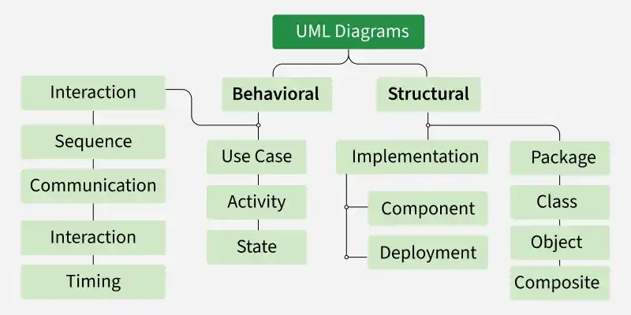

#### 1. 结构型 UML 图

[结构型 UML 图](https://www.geeksforgeeks.org/system-design/structural-diagrams-unified-modeling-languageuml/)是一种可视化表示，用于描绘系统的静态方面，包括其类、对象、组件及其关系，从而清晰地展现系统架构。结构型 UML 图包括以下几种类型：

##### 1. 类图

类图是应用最广泛的 UML 图。它是所有面向对象软件系统的基础。我们使用类图来描绘系统的静态结构，展示系统的类、方法和属性。类图还有助于我们识别不同类或对象之间的关系。

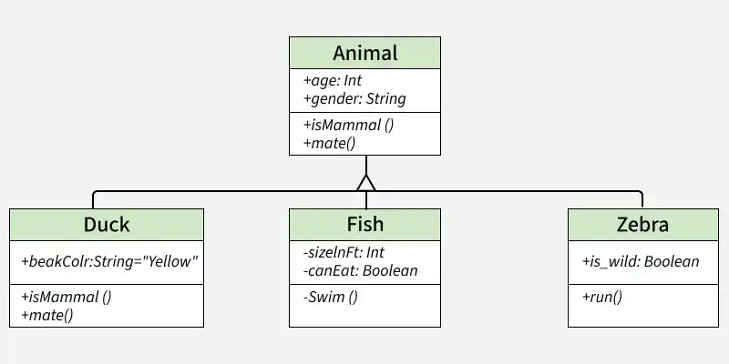

**复合结构图**

我们使用复合结构图来表示类的内部结构及其与系统其他部分的交互点。

- 复合结构图表示各部分之间的关​​系及其配置，这些关系决定了分类器（类、组件或部署节点）的行为方式。
- 它们使用部件、端口和连接器来表示结构化分类器的内部结构。
- 它们与类图类似，区别在于它们更详细地表示各个部分，而不是整个类。

##### 2. 对象图

[对象图](https://www.geeksforgeeks.org/system-design/unified-modeling-language-uml-object-diagrams/)可以看作是系统中实例及其之间关系的截图。由于对象图描绘的是对象实例化后的行为，因此我们可以研究系统在特定时刻的行为。

- 对象图与类图类似，区别在于它显示的是系统中类的实例。
- 我们使用类图来描述实际的分类器及其关系。
- 另一方面，对象图表示特定时刻类的具体实例及其之间的关系。

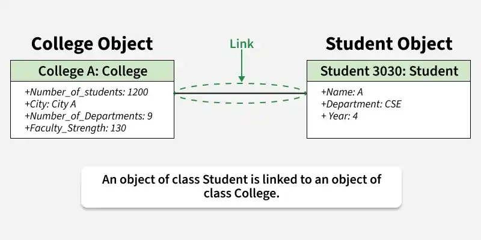

##### 3. 组件图

[组件图](https://www.geeksforgeeks.org/software-engineering/component-based-diagram/)用于表示系统中物理组件的组织方式。我们用它们来建模实现细节。

- 组件图描绘了软件系统元素之间的结构关系，并帮助我们了解计划的开发是否满足了功能需求。
- 在设计和构建复杂系统时，组件图至关重要。
- 系统组件之间通过接口进行通信。
- 在现代系统中，组件图广泛应用于微服务架构，用于表示服务边界、API 以及不同服务之间的通信。

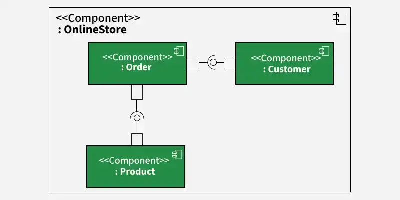

##### 4. 部署图

[部署图](https://www.geeksforgeeks.org/system-design/deployment-diagram-unified-modeling-languageuml/)用于表示系统硬件及其软件。它展示了系统有哪些硬件组件，以及哪些软件组件运行在这些组件之上。

- 我们将系统架构描述为软件工件在分布式目标上的分布。
- 工件是指系统软件生成的信息。
- 部署图主要用于软件在具有不同配置的多台机器上使用、分发或部署的情况。

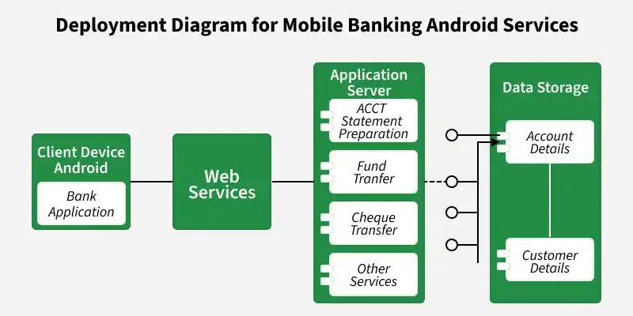

##### 5. 包图

我们使用[包图](https://www.geeksforgeeks.org/system-design/package-diagram-introduction-elements-use-cases-and-benefits/)来描述包及其元素的组织方式。包图简洁地展示了不同包之间的依赖关系以及包的内部组成。

- 包有助于我们将 UML 图组织成有意义的组，并使图表更易于理解。
- 它们主要用于组织类图和用例图。

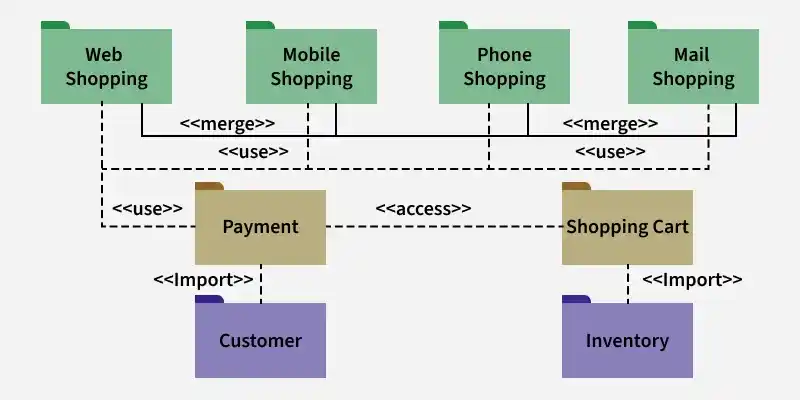

#### 2. 行为型 UML 图

[行为型 UML 图](https://www.geeksforgeeks.org/system-design/behavior-diagrams-unified-modeling-languageuml/)是一种可视化表示，用于描绘系统的动态特性，展示对象如何随时间推移响应事件而进行交互和行为。

##### 1. 状态机图

[状态图](https://www.geeksforgeeks.org/system-design/unified-modeling-language-uml-state-diagrams/)用于表示系统或系统某一部分在特定时间点的状态。它是一种行为图，使用有限的状态转换来表示行为。

- 状态图也称为状态机或状态图。
- 这些术语经常互换使用。简而言之，状态图用于对类随时间和外部刺激变化而产生的动态行为进行建模。

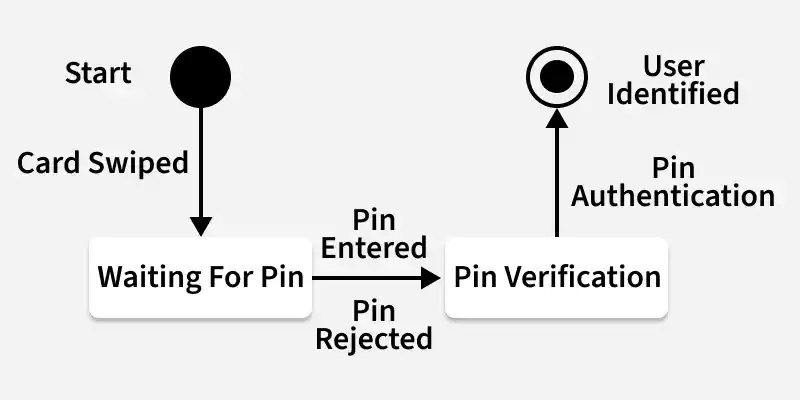

##### 2. 活动图

我们使用[活动图](https://www.geeksforgeeks.org/system-design/unified-modeling-language-uml-activity-diagrams/)来展示系统中的控制流程。活动图也可以用来描述用例执行过程中涉及的步骤。

- 我们使用活动图来建模顺序活动和并发活动。因此，我们基本上使用活动图来直观地描绘工作流程。
- 活动图关注流程的状态及其发生的顺序。
- 我们使用活动图来描述或描绘特定事件的起因。

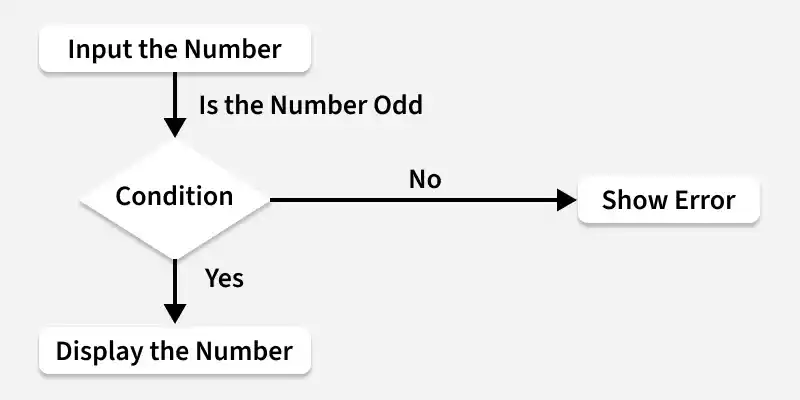

##### 3. 用例图

[用例图](https://www.geeksforgeeks.org/system-design/use-case-diagram/)用于描述系统或系统某个部分的功能。它们广泛用于阐明系统的功能需求及其与外部主体（参与者）的交互。

- 用例本质上是一个图表，表示系统可以应用的不同场景。
- 用例图让我们能够从宏观层面了解系统或系统某个部分的功能，而无需深入到实现细节。

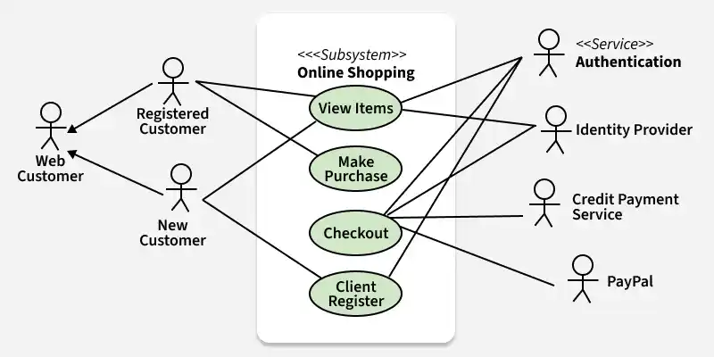

##### 4. 序列图

[序列图](https://www.geeksforgeeks.org/system-design/unified-modeling-language-uml-sequence-diagrams/)简单地描述了对象之间按顺序进行的交互，即这些交互发生的先后顺序。

- 我们也可以使用事件图或事件场景来指代序列图。
- 序列图描述了系统中对象如何以及按什么顺序运行。
- 这些图表被商务人士和软件开发人员广泛用于记录和理解新系统和现有系统的需求。

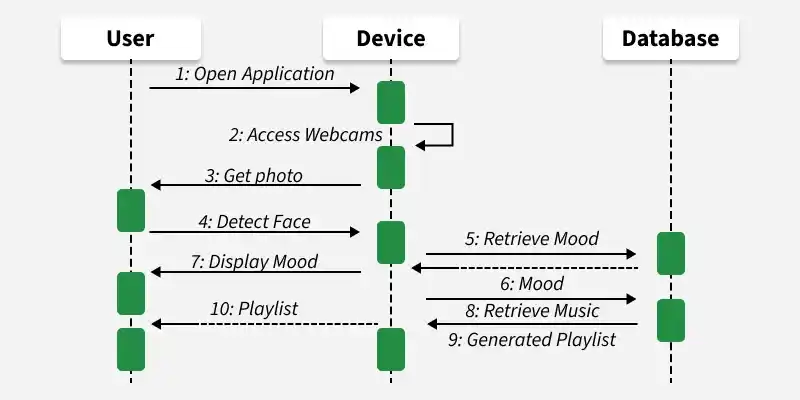

##### 5. 通信图

[通信图](https://www.geeksforgeeks.org/system-design/communication-diagram-unified-modeling-languageuml/)（在 UML 1.x 中称为协作图）用于展示对象之间按顺序交换的消息。

- 通信图主要关注对象及其关系。
- 虽然序列图也能表示类似的信息，但通信图以更自由的形式表示对象和链接。

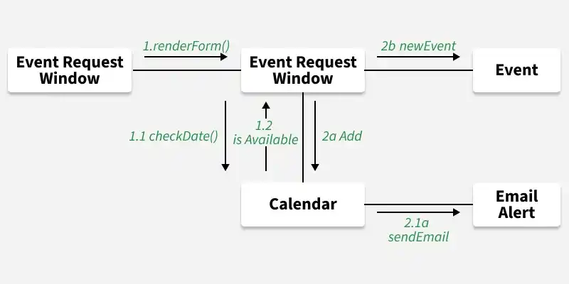

##### 6. 交互概览图

[交互概览图 (IOD)](https://www.geeksforgeeks.org/system-design/interaction-overview-diagrams-unified-modeling-language-uml/) 是一种 UML（统一建模语言）图，用于展示系统或流程中各个元素之间的交互流程。它提供了交互发生的高级概览，包括不同组件或对象之间的操作顺序、决策和交互。

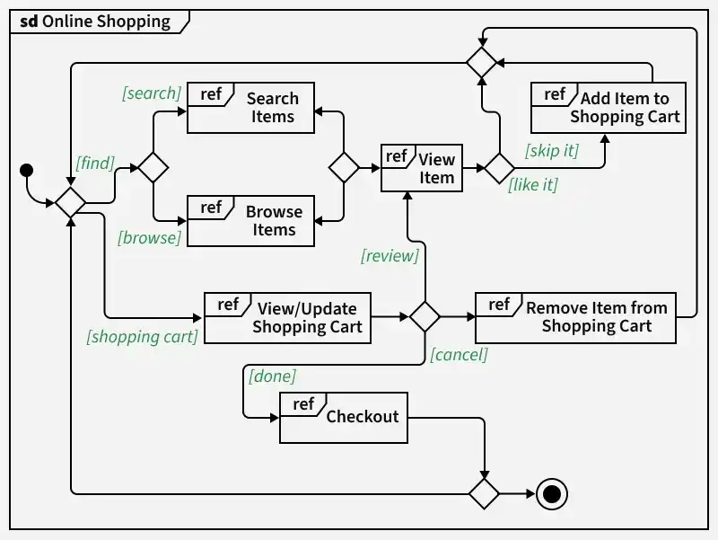

##### UML 2.0 的新增内容

- 软件开发方法论（例如敏捷开发）已被纳入 UML 规范，并且原始 UML 规范的范围也得到了扩展。
- 最初，UML 规范了 9 种图表。UML 2.x 将图表数量从 9 种增加到 13 种。新增的四种图表是：时序图、通信图、交互概览图和复合结构图。UML 2.x 将状态图更名为状态机图。
- UML 2.x 增加了将软件系统分解为组件和子组件的功能。

#### 创建 UML 图的工具

有多种工具可用于创建统一建模语言 (UML) 图，UML 图通常用于软件开发中，以可视化的方式表示系统架构、设计和实现。以下是一些常用的 UML 图创建工具：

- **Lucidchart：** Lucidchart 是一款基于 Web 的图表绘制工具，支持 UML 图。它用户友好且支持协作，允许多个用户实时协作处理图表。
- **Draw.io：** Draw.io 是一款免费的基于 Web 的图表绘制工具，支持多种图表类型，包括 UML 图表。它可与多种云存储服务集成，并支持离线使用。
- **Visual Paradigm：** Visual Paradigm 提供了一套全面的软件开发工具，包括 UML 图表绘制功能。它提供在线版和桌面版，并支持多种 UML 图表。
- **StarUML：** StarUML 是一款开源的 UML 建模工具，拥有用户友好的界面。它支持标准的 UML 2.x 图表，并允许用户通过插件自定义和扩展其功能。
